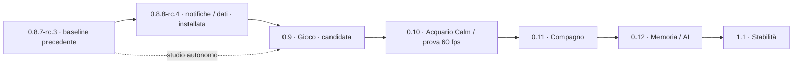

# DeskPulse / SmartPC — MasterPlan dei rilasci

**Revisione 2.79 · 15 ottobre 2026 · Europe/Rome**

**Baseline verificata: core 0.9.0-rc.16 installata · manifest 598 file · Theme API 2.11 · 68 superfici · Apple Calm 1.6.2 disponibile; Base attivo conservato.**

**Consegna rc.10, 13 ottobre:** rc.10 ottimizza sensori/cache, preview, buffer numerici e raggi nel scene graph; separa scene a 25 Hz e fisica a 60 Hz. Sul campione worker privato: scene Impara/Gara circa 25 Hz e raccolta iniziale oltre 2× rispetto alla rc.9. 64 controlli PC, sei gate numerici ARM, tre temi EGLFS e gare native di tre giri 2/4. Tutte le tabelle del gioco, sei piloti, 1.218 artefatti e preferenze conservati; Base attivo, NRestarts=0, nessun nuovo reboot OS. [Report/manifest/ricevuta rc.10](v09-optimization-report.md). Collector sperimentali e NPU non selezionati: le prove correnti favoriscono il percorso singolo CPU. Competenze individuali e FPS ottici restano da qualificare.

**Consegna storica rc.11:** ripristinati tutti i tentativi Evo/NEAT, generazione corrente, selezione completa, sensori/rivali del tentativo osservato e indicatori compatti. Quattro walkthrough EGLFS 960×640, controlli PC/ARM e ripresa privata del checkpoint reale Evo: 109.295 passi, generazione corrente 12. Tutti i campi dei sei piloti e 1.261 artefatti conservati, sessione in pausa chiusa senza perdita di pesi; 575 hash conformi, Base/preferenze conservati, servizio/GUI pronti e NRestarts=0. [Report/manifest/ricevuta rc.11](v09-population-report.md).

**Consegna storica rc.12:** memoria personale con riuso automatico dopo Start, checkpoint locale prioritario, genoma NEAT conservato, familiarizzazione/ripasso/consolidamento, Rientro e credito valido, prerequisito Partenza corretto, parametri effettivi e reset distinti. Gara mantiene tutte le vetture visibili anche in Sensori e inquadra il gruppo; record di giro pulito/V max per pista e configurazione, attribuiti al pilota. 79 regressioni PC, 3 controlli record, 31 contratto API, 25 test ARM, copia privata dei sei piloti reali e dieci walkthrough EGLFS inclusi gare 2/4 complete. Tutti i campi dei piloti, 1.265 artefatti e preferenze conservati; nuove tabelle vuote fino allo Start. Manifest 582 hash, Base attivo, NRestarts=0; nessun nuovo reboot OS. [Report e ricevuta](v09-driving-memory-report.md). Studio iniziale su cinque semi completato; competenza estesa, retention quantitativa e taratura su passo/traffico restano gate scientifici aperti.

**Consegna storica rc.13:** scene separate dal contesto statico, delegate conservati, clock monotono 30 Hz e buffer di posizioni reali (200 ms Popolazione/120 ms Gara-preview), camera e sensori coordinati. Worker a 30 Hz, fisica 1/60 s conservata; vertici/contatti calcolati quando necessari, parità esatta su 16 combinazioni. 94 controlli PC (una esclusione), 19 fisica/circuiti/record, 41 ARM, sette walkthrough finali e supplemento Movimento ridotto. Evo inizialmente 32 attivi: 35 s, 30,00 callback/s, p95 frame 43,73 ms, p99 46,59 ms, massimo 91,26 ms; pose p95 massimo 44,17 ms, zero pause >100 ms. Tre temi e gare 2/4 con tutte le auto contenute, nessun warning QML. Sei piloti, tutte le tabelle, 1.325 artefatti e preferenze conservati; 584 hash, Base, NRestarts=0, nessun nuovo reboot OS. [Report/ricevuta rc.13](v09-pacing-optimization-report.md). Gate iniziale del carico provato superato; FPS ottici, uso prolungato e carichi maturi restano aperti.

**Consegna storica rc.14:** cinque modalità, Qualifica congelata con un giro pulito minimo, snapshot/griglia veloce-lento, infiniti/bot, risultati per esercizio e revisione esplicita dei reset NEAT. Vista Pilota indipendente, Tentativi reali, sensori raccolti per budget. 99 controlli PC (una esclusione), dieci nuovi ARM, sette casi EGLFS e supplementi di navigazione/finestre. Checkpoint NEAT maturo: 20 s, 1,0016×, clock 30 Hz; p95 45,13 ms, p99 60,07 ms, massimo 83,27 ms. Sei piloti, 1.808 artefatti e preferenze conservati; sola chiusura della sessione sospesa al riavvio, nessun reset. 588 hash, API 2.11, Base, NRestarts=0, nessun reboot OS. [Report/ricevuta rc.14](v09-session-modes-report.md). Gate del campione software superato; competenza reale, ottica/input, uso lungo e confronto dei metodi restano aperti.

**Consegna storica rc.15, 14 ottobre:** [guida bilanciata e motore CPU](v09-balanced-runtime-report.md). RewardSpec normalizzata, giri continui puliti, feedback del sottosterzo dannoso, Ingresso curva e pressione graduale sul passo; Evo/NEAT esplorano nei pesi, PPO λ0,99, Clone replay numerico con frenate. Sensori/NEAT nativi e fisica float64 raggruppata; quattro gruppi persistenti scelti per il traffico misurato. Sei piloti e tutti gli artefatti/preferenze conservati; migrazione solo al prossimo Start. 86 regressioni PC, 12 gate ARM, temi/circuiti/Qualifica-Gara e prove EGLFS. 595 hash, API 2.11, Base, NRestarts=0, nessun reboot OS. I tempi del campione e la variabilità sono nel report; competenza, efficacia a cinque seed/budget uguali, 32 tentativi sempre a 1× e FPS ottici restano aperti.

**Consegna corrente rc.16, 14 ottobre:** [Evo progressivo](v09-evo-progressive-report.md): esercizi graduali, banche confrontabili, elite rivalutata, ripasso nella stessa selezione, mutazioni normalizzate e contatori per epoca/esercizio. Migrazione solo al prossimo Start, pesi/RNG/base/storico conservati; nessun reset dei piloti originali. 96 controlli PC complessivi, dieci nuovi ARM, sei walkthrough EGLFS sui tre temi incluse impostazioni/dossier e Qualifica→Gara. Sei piloti, 2.030 artefatti e preferenze conservati; 598 hash conformi, Base, GUI pronta, NRestarts=0, nessun reboot OS. Screening tre inizializzazioni × tre seed × 250 mila passi; seguito sui pesi attuali a cinque seed × tre milioni: quattro reti completano 4/4 giri finali, una resta in difficoltà. Generalizzazione e ripasso degli archi a velocità diverse restano aperti.

**Studi del 14 ottobre:** [incentivi](game-reward-balance-study.md) e [GPU/NPU](game-gpu-npu-parallel-study.md) conservano l'analisi iniziale. B0–B4 e A0/A1/A4 hanno ora un'implementazione; i gate scientifici ed estesi restano distinti. GPU impiegata nel rendering, compute/NPU non selezionati per questi carichi. La divisione del traffico aumenta la raccolta di circa 21–38% nei campioni confermati, mentre dividere i mondi solitari rallenta il batch.

**Riscontro Evo del 14 ottobre:** [studio iniziale](game-evo-learning-stall-analysis.md): 800 curve senza arrivo nella rc.15, fitness storiche poco confrontabili e ripasso che azzera la stagnazione. La [rc.16](v09-evo-progressive-report.md) attua le correzioni ed esegue i confronti. Conservare la memoria attuale, far ripartire gli esercizi al prossimo Start. Il seguito a cinque seed migliora l’apprendimento del giro ma non certifica tutti i piloti né tutti gli ingressi in movimento; non azzerare gli altri paradigmi sulla sola evidenza Evo.

**Studio del 15 ottobre — nuove priorità P0, non implementate:** [contratto di guida, giri, infinito e preset](game-methods-lap-integrity-analysis.md). Snapshot rc.16 in sola lettura con Evo in corso. Un ingresso cambia fra Passo/Controllo/Qualifica: nella copia, lo stesso Evo passa dal ritiro a quattro giri puliti rendendo coerente quel solo valore. Riprodotti settore saltato che blocca i giri successivi e reset di finestra Evo/NEAT diverso da PPO/Clone. Conservare Evo; prima contratto/migrazione → integrità e riarmo del giro → continuità/provenienza Infinito, poi curriculum comune e tarature separate. Calibrazione privata di 50 mila passi: PPO impara 20 m, Clone accelera, Smooth resta critico; non è una qualifica di circuito. **Solo analisi/prove PC**, nessuna modifica runtime, reset o riavvio.

**Reset nella fase di test:** l’utente autorizza la cancellazione della memoria dei piloti quando necessaria alle correzioni e ai confronti di apprendimento. Nessuna nuova conferma richiesta per un reset motivato; dichiarare piloti/percorsi coinvolti e distinguere reset effettuato da proposta. Il consenso non impone di azzerare subito tutta la rosa.

**Ordine ufficiale confermato:** Gioco v0.9.x → Acquario Calm v0.10 → Compagno v0.11 → Memoria/scene AI v0.12 → Stabilità v1.1. Il seguito scientifico del Gioco non rinumera le release successive.

## 1. Stato attuale e lettura delle evidenze

| Elemento | Stato corrente | Evidenza e limite |
| --- | --- | --- |
| Core | **0.9.0-rc.16 installata**, 598 file | [Report/ricevuta rc.16](v09-evo-progressive-report.md): hash conformi, GUI pronta, NRestarts=0, sei piloti e tutti gli artefatti/dati conservati; nessun nuovo reboot. |
| Tema attivo corrente | **Base**; Apple Calm 1.6.2 disponibile | Preferenze conservate anche nella consegna rc.16. Base, Functional e Apple Calm verificati in EGLFS; le attivazioni Apple delle consegne precedenti sono storiche. |
| Contratto dei temi | **SmartPC.ThemeApi 2.11**, 68 superfici | Estensione additiva impostazioni/geometria, corpus e kit nel [report rc.7](v09-settings-circuits-report.md); API 2.9 è la tappa storica del dossier. |
| Reboot | Ultimo reboot OS qualificato **0.9.0-rc.3** | [Ricevuta rc.3](evidence/v09-game-settings-pace-2026-10-11/board-install/final-receipt.json). La rc.16 ha riavviato il servizio, senza nuovo reboot OS: [ricevuta corrente](evidence/v09-evo-progressive-2026-10-14/final-receipt.json). |
| Sport in corso | Priorità e apertura del dato pertinente corrette in rc.3 | Serie A dalla cache recente e F1 dalle qualifiche concluse osservate. Sessione F1 attiva, latenza e reconnect durante l'evento restano da qualificare. |
| Notifiche v0.8.8 | **Implementate/installate; qualifica live parziale** | [Report](v088-notifications-implementation-report.md): banner nelle consultazioni, coda/storico, feed BSD Serie A autenticato, Fantacalcio su richiesta e scheduling a eventi/scadenze. 0 €/mese; gol/VAR e latenze reali ancora da qualificare. |
| Gioco v0.9 | **Rc.15 implementata e installata** | [Bilanciamento e motore CPU consegnati](v09-balanced-runtime-report.md), con modalità/Qualifica rc.14 e scene/clock rc.13 conservati. Ritmo del tempo simulato, competenza e carichi prolungati restano distinti dagli FPS. |

**Vocabolario:** “implementato” indica codice presente; “installato” richiede ricevuta/manifest; “verificato sulla board” ha un perimetro esplicito; “qualificato live” richiede un evento reale; “pianificato” e “in analisi” non dichiarano software attivo. Un tag, una versione nel README o un servizio active non sostituiscono manifest, heartbeat e prove funzionali.

Le differenze storiche v0.6.5/v0.6.1 e tag stabili rispetto alle candidate installate sono già registrate nei report delle singole consegne. N0 Rete ed E0 metriche hanno riconciliato le baseline pertinenti: oggi non sono una nuova attività “installare v0.7” o “iniziare discovery v0.8”. Prima di ogni prossima distribuzione si confrontano comunque runtime, manifest, checkout e modifiche presenti.

## 2. Regole di prodotto da conservare

- **Hardware/UI:** Orange Pi / piattaforma Allwinner A733 (sun60iw2), Debian/Qt 6.8.2, EGLFS/KMS PowerVR, display nativo 960×640 a 60 Hz. Animazioni a 60 fps restano un obiettivo da misurare, distinto dalla frequenza del pannello. **Gioco: priorità aggiornata a 30 fps regolari**, con tutte le vetture e cadenza del movimento verificata; gate iniziale Evo/32 superato nella rc.13, nessuna garanzia di 60.
- **Grafica:** conservare colori, font, icone e stile approvati; migliorare geometrie, gerarchie, scorrimento e risposta. Profilo attuale: barra 56 px, margini laterali 24 px, fondo 16 px. La verifica fisica a 50–60 cm rimane necessaria.
- **Home dinamica:** ora e meteo; evento solo se presente e pertinente. Niente spazi vuoti o dati inventati per completare una griglia. Oggi mantiene Ora, Orologio e Giornata.
- **Input:** 4/6 cambia argomento, 2/8 dashboard dello stesso argomento; nei pannelli agiscono sul loro contenuto. 5 approfondisce/conferma, 7 torna, 1 Home, 3 Avvisi, 9 Menu. Gioco attivo acquisisce le frecce per auto/visualizzazione e 5 richiede pausa prima dello sblocco della navigazione. Ritorno con vista, selezione e scorrimento coerenti. Legende permanenti eliminate dalle viste ordinarie; Comandi resta accessibile.
- **Dati:** distinguere corrente, precedente, assente, errore e fonte da qualificare. Zero reale, false e dato mancante hanno significati diversi. Ricezione cloud, raggiungibilità router e osservazione fisica non sono equivalenti.
- **Architettura:** Python per acquisizione/stato/persistenza, QML per presentazione; I/O e lavoro costoso fuori dalla GUI. Non cambiare linguaggio o distribuire lavoro su più core senza una misura che ne dimostri il beneficio.
- **Temi:** provider comune, contratto pubblico tipizzato, renderer sostituibili e compatibilità additiva. Nuove superfici includono Base/Functional, Apple Calm o fallback verificato, fixture e kit AI aggiornati.
- **Rete:** acquisizione sulla board/router, nessun agent sugli altri computer. Il sincronizzatore PC dell'Account già esistente resta un'integrazione distinta.
- **Risorse:** dispositivo dedicato; RAM/CPU sono misure diagnostiche, non i vecchi limiti del prototipo. Risposta, stabilità, crescita delle cache e recupero restano criteri. Misure software, tempo GPU e latenza ottica sono separati.
- **Verifica:** prove mirate ai rischi della modifica; conservare risultati falliti e residui. Nessuna ripetizione indefinita degli stress storici già superati.

## 3. Esperienza già disponibile

| Famiglia | Dashboard correnti | Approfondimenti e comportamento |
| --- | --- | --- |
| **Oggi** | Ora / Orologio / Giornata | Evento condizionale, ora dominante nella vista Orologio, meteo compatto e Giornata riferita alla data corrente. |
| **Meteo** | Adesso / Previsioni | Condizione dominante, vento/umidità/raffiche/precipitazioni, date locali e stato della fonte. |
| **Account ChatGPT** | Utilizzo | Finestre con durata/percentuale/reset, piano e crediti quando esposti; 5 apre le informazioni disponibili. Cache sincronizzata dal PC, dati precedenti riconoscibili. |
| **Sport** | Serie A / La mia squadra / F1 / MotoGP | Serie A è il campionato completo, separato dalla preferita. 5 apre tutte le partite della giornata, il club personale o il GP/sessione pertinente. Calendari e classifiche restano nel Menu contestuale. |
| **Casa** | Preferiti / Ambiente condizionale / Dispositivi | Consultazione Tuya, inventario e dettaglio; disponibilità cloud e valori riportati distinti. Nessun comando ai dispositivi. |
| **Rete** | Traffico / iliadbox / Dispositivi | WAN, sensori box, Wi-Fi/porte/storico, inventario e dettaglio; copertura e tempi espliciti. Nessuna telemetria CPU/GPU/RAM dei client. |
| **Gioco** | Pista / Classifica / Progressi / Pilota | Accademia progressiva, partenza/stallo, guida e traffico; Gara 2–4 con qualifiche distinte e modelli congelati, Prova/Campione, dossier e salvataggi. Calcolo dopo Start; 5 pausa confermata. Competenza estesa dei piloti da qualificare. |

Le sette macroaree sono filtrate dalle preferenze senza creare pagine vuote. Per i moduli informativi nascondere una famiglia non equivale a sospendere il suo provider; l'interesse di una vista e quello di un avviso sono concetti distinti. Il calcolo del Gioco è invece esplicito e si sospende all'uscita.

**Impostazioni attuali:** Schermo, Aspetto, Moduli e Home, Avvisi, Servizi collegati, Dati e aggiornamenti. Gestione temi raccoglie import/export/revisioni; Sport e Home raccoglie discipline e riepiloghi. Informazioni è autonoma e in sola lettura. Le modifiche di aspetto hanno anteprima/salvataggio/annullamento dove previsto; refresh e completamento persistente sono distinti. [Guida UX](v083-ux-operations.md), [dashboard correnti](v086-dashboard-implementation-report.md), [correzione Serie A](v086-serie-a-fix-report.md).

## 4. Registro delle versioni consegnate

Questa sezione è lo storico acquisito. I suoi numeri e contratti descrivono la singola consegna, non una seconda baseline corrente.

| Versione | Risultato acquisito | Stato / riferimento |
| --- | --- | --- |
| **v0.1** | Kiosk, ora/data, tastierino, systemd e diagnostica passiva. | Base rilasciata; [README dashboard](../README.md). |
| **v0.2** | Meteo Open-Meteo, Angri, previsioni/cache e avvio offline. | Rilasciata; prove storiche nel README. |
| **v0.3** | Home dinamica, navigazione a due assi, componenti e preferenze. | Rilasciata; conservata nel prodotto attuale. |
| **v0.4** | Account/piano ChatGPT, utilizzo/crediti quando disponibili e reset. | Rilasciata; sincronizzazione normalizzata dal PC, segreti fuori dalla board/QML. |
| **v0.5** | Engine eventi persistente, priorità/TTL/dedup, badge, banner, urgenti e bollettino. | Rilasciata; esistenza del motore non prova copertura di tutte le fonti Sport. |
| **v0.6 e revisioni** | Serie A, squadra/coppe/rosa, Fantacalcio, F1/MotoGP, impostazioni/Info. | Consegne acquisite; [Serie A](v06-sport-release.md), [Motorsport](v06-motorsport-release.md). Gate live distinti. |
| **v0.6.6** | Theme Engine T0–T5/A1–A6, bundle QML/JS, API pubblica, motion/scene, recovery e kit AI. | Implementato/installato; [migrazione](v066-migration-report.md), [A1–A6](theme-engine-a1-a6-implementation-report.md), [Avvisi personalizzabili](theme-engine-notification-migration-report.md). |
| **v0.7 rc.1–rc.3** | Casa/Tuya, preferiti/inventario/dettagli, manutenzione e primo Apple Calm completo. | Installazioni/reboot documentati; [Casa](v07-implementation-report.md), [manutenzione](v07-maintenance-report.md), [Apple iniziale](../../theme-projects/apple-calm/CONSEGNA.md). Quota/collaudi fisici separati. |
| **v0.8.0-rc.1** | Inventario iliadbox dalla board, preferiti/cache, quattro superfici, Theme API 2.3. | Installata, EGLFS e reboot; [report](v08-implementation-report.md). N0/N1/N2/N3 e distribuzione consegnati nel perimetro documentato; N4 e copertura fisica residui. |
| **v0.8.1-rc.1** | WAN/fibra, radio/stazioni, porte, RRD 1 h/24 h, Theme API 2.4. | E0–E4 consegnate, installazione/reboot; [report](v081-implementation-report.md). |
| **v0.8.2-rc.1** | Affidabilità cache/refresh, writer, lifecycle, feedback e costi. | Installata; [report](v082-implementation-report.md). Apple Calm 1.2.1. |
| **v0.8.3 rc.1/rc.2** | Sport unico, impostazioni per compito, icone, layout/liste conservando lo stile. | Candidate consegnate; [UX](v083-implementation-report.md), [spazi](v083-space-optimization-report.md). API 2.5, Apple 1.3.0/1.3.1. |
| **v0.8.4-rc.1** | Dashboard più ampie, margini/focus e quattro preferiti completi. | D1/D2 consegnati; [report](v084-dashboard-optimization-report.md). API 2.6, Apple 1.4.0. |
| **v0.8.5-rc.1** | Impostazioni/Info, chooser, cambio tema/readiness e correzioni di recovery. | Installata e reboot; [report](v085-settings-implementation-report.md). Apple 1.5.0; incidenti precedenti conservati nelle evidenze. |
| **v0.8.6 rc.1/rc.2** | Dashboard principali dirette, griglia orizzontale, Serie A e squadra separate. | Installazioni/reboot; [dashboard](v086-dashboard-implementation-report.md), [fix Serie A](v086-serie-a-fix-report.md). API 2.7, Apple 1.6.0. |
| **v0.8.7-rc.1** | Normalizzazione/stile/contesti e pubblicazioni più leggere. | Installata e reboot; [performance](v087-performance-implementation-report.md). Apple 1.6.1. |
| **v0.8.7-rc.2** | Cache riaperture, contesti costruiti una volta, dati team mirati e motion 100 ms. | Installata e reboot; [aperture](v087-opening-implementation-report.md). Apple 1.6.2. |
| **v0.8.7-rc.3** | Priorità alle partite attive e timing/sessioni Sport, offset F1 e apertura con 5. | Candidata consegnata; [fix Sport](v087-sport-live-fix-report.md). Riavvio servizio, non nuovo reboot OS. |
| **v0.8.8-rc.4** | Notifiche nelle consultazioni, scheduling/fonti e aggiornamenti. | Installata e reboot; [report](v088-notifications-implementation-report.md), gate live distinti. |
| **v0.9.0-rc.2** | Gioco/Piloti, tre algoritmi, Gara/Prova, F1 e persistenza, API 2.8. | Candidata installata; prove native, reboot e checkpoint, CPU scelta dopo confronto NPU. Qualifica traffico/fisica ancora aperta; [report](v09-game-implementation-report.md). |
| **v0.9.0-rc.3** | Impostazioni descritte, Controllo/Passo, campione distinto, valutazioni abbinate/riprendibili e Progressi dei tempi. | Candidata installata e reboot verificato; cinque seed, prove native e piloti preservati. Coefficienti sperimentali; [report](v09-game-settings-pace-report.md). |
| **v0.9.0-rc.4** | Prestazioni sensori/fisica, consegna scene senza attese del thread di invio, km/h e stato aggiornamento rete. | Installata, manifest 545 file, piloti/artefatti/preferenze conservati; native EGLFS e equivalenza esatta. Riavvio servizio, senza nuovo reboot OS; [report](v09-game-performance-report.md). |
| **v0.9.0-rc.5** | Gara con modelli congelati, una vettura per pilota, 3/5/10 giri; menu dedicato e guida PPO continua. | Installata, gara nativa di tre giri e griglia 2/4, PPO 60 s, manifest 546 file e archivi preservati; [report](v09-race-ppo-report.md). Riavvio servizio, senza nuovo reboot OS. |
| **v0.9.0-rc.6** | Quarta vista Pilota e dossier per identità, sessioni/profili/risultati, reset confermato con storico preservato. | Installata; otto gate PC e tre temi EGLFS 960×640, API 2.9/68 superfici, manifest 551 file, archivi conservati; [report](v09-pilot-dossier-report.md). Senza nuovo reboot OS. |
| **v0.9.0-rc.7** | Impostazioni per sezioni, percorsi per circuito, geometria condivisa e circuito tecnico. | Consegna A/B/C PC/EGLFS, API 2.10/68 superfici; [report](v09-settings-circuits-report.md). |
| **v0.9.0-rc.8** | Sei paradigmi fissi, protocolli corretti, Varano/Mallory metrici, camere e minimappa. | Installata 12 ottobre, 567 file e 765 artefatti allora conservati; [report storico](v09-paradigms-real-circuits-report.md). |
| **v0.9.0-rc.9** | Accademia, Partenza/stallo, f2-1, 68 sensori, maestro nel traffico e qualifiche per 2/4. | Installata 13 ottobre, 572 file, sei piloti e 1.218 artefatti conservati dopo recupero del journal; Base/Funzionale/Apple e Gare 2/4 native. Nessun nuovo reboot OS; [report](v09-academy-report.md). |
| **v0.9.0-rc.10** | Sensori/cache, preview e scene, buffer numerici, geometria dei raggi e confronto risorse. | Installata 13 ottobre, 575 hash conformi, 64 controlli PC/sei ARM/tre temi EGLFS/Gare 2/4; archivio e preferenze identici. CPU scelta dopo nuova prova NPU, collector sperimentali non selezionati; [report](v09-optimization-report.md). |
| **v0.9.0-rc.11** | Popolazione Evo/NEAT, generazione/tentativi e osservazione selezionata. | Installata 13 ottobre, 575 hash conformi, quattro walkthrough EGLFS, controlli PC/ARM, checkpoint reale ripreso su copia; dati dei piloti/artefatti/preferenze conservati. [Report](v09-population-report.md). |
| **v0.9.0-rc.12** | Memoria personale, Rientro, impostazioni effettive, tutte le vetture in Gara e record per pista/configurazione. | Installata 13 ottobre, 582 hash conformi, dieci walkthrough EGLFS, 25 test ARM, copia privata dei piloti reali, gare 2/4 concluse; dati/artefatti/preferenze conservati. Studio iniziale cinque semi, qualità estesa da qualificare. [Report](v09-driving-memory-report.md). |
| **v0.9.0-rc.13** | Scene separate dal contesto statico, delegate conservati, clock monotono 30 Hz e buffer auto/camera/sensori; contatti preparati quando necessari. | Installata 13 ottobre, 584 hash, dati/preferenze conservati, gate iniziale Evo/32 e gare 2/4 nei tre temi; supplemento movimento ridotto. [Report](v09-pacing-optimization-report.md). FPS ottici, ritmo effettivo della simulazione e carichi maturi/prolungati non sono certificati dal solo frame timing. |
| **v0.9.0-rc.14** | Cinque modalità, Qualifica/griglia, infiniti/bot, risultati per esercizio e reset NEAT. | Installata 13 ottobre, 588 hash, 1.808 artefatti allora conservati e gate del campione maturo; [report storico](v09-session-modes-report.md). |
| **v0.9.0-rc.15** | Reward normalizzata, ingresso curva, passo graduale, aggiornamenti specifici dei metodi; CPU nativa/batch e quattro gruppi nel traffico misurato. | Installata 14 ottobre, 595 hash, 86 regressioni PC/12 gate ARM, sei piloti/1.989 artefatti/preferenze conservati. [Report e ricevuta](v09-balanced-runtime-report.md). Efficacia estesa e 32 sempre a 1× aperti. |
| **v0.9.0-rc.16** | Evo progressivo, suite/ripasso, elite corrente, mutazioni normalizzate, epoche e ripartenza con pesi conservati. | Installata 14 ottobre, 598 hash; 96 controlli PC/dieci nuovi ARM, sei walkthrough EGLFS. Sei piloti/2.030 artefatti/preferenze conservati. Cinque seed × tre milioni: 4/5 reti con 4/4 giri finali; retention degli archi e generalizzazione aperte. [Report/ricevuta](v09-evo-progressive-report.md). |

Le promozioni/tag storici 0.7.0/0.8.0/0.8.1 e i manifest delle candidate rimangono nei resoconti. Non cambiano retroattivamente gli esiti dei test né attestano qualifiche mancanti. “Consegna acquisita” non significa che tutti i collaudi fisici/prolungati siano conclusi.

## 5. Theme Engine e direzione grafica attuali

**Il motore è consegnato.** Non ripartire da T0–T5, dalla facade o dalla migrazione dei vecchi hardcode. Presentazioni, icone, motion, regioni, contesti, domini, readiness, revisioni immutabili, import/export, journal/rollback e supervisore sono infrastruttura riutilizzabile.

Il riferimento attuale è **API 2.11 / 68 superfici / Apple Calm 1.6.2**, insieme a Base e Functional. Apple Calm 1.2.0 e il kit v0.6.6 sono tappe storiche: i loro conteggi e le misure di quel momento non descrivono la build corrente. Il kit per nuove superfici va rigenerato dal contratto corrente; non applicare una patch rc.3 a un vecchio SDK assumendone la compatibilità.

Ogni nuova release con UI deve includere:

1. Contratti sorgente e generatori, contesti/azioni/DTO e dominio pubblico pertinente.
2. Presentazioni Base/Functional, compatibilità Apple Calm e fallback dei bundle precedenti; pacchetti importati immutabili.
3. Fixture di assenza/cache/errore e scale testo, giorno/notte, Normal/Reduced/Off, focus e ritorni.
4. Kit AI/reference/qmltypes/registry allineati alla release effettiva, senza assegnare una nuova minor soltanto nel piano.
5. Recovery e cambio tema durante il lavoro, con preferenze conservate e priorità agli urgenti.

Il cambio completo di stile è occasionale e può mostrare caricamento; la navigazione comune richiede feedback e prontezza. Hardware/Cyberdeck restano profili senza release obbligatoria assegnata. Cozy segue il Compagno **v0.11**; non crea il cane tramite il solo tema.

Riferimenti tecnici: [spec AI](theme-engine-ai-authoring-spec.md), [piano engine acquisito](theme-engine-ai-execution-plan.md), [guida](theme-engine-implementation-guide.md), [graphic study attuato](v086-landscape-graphic-study.md).

## 6. Rete locale: capacità consegnate e confini

**Rete base ed estesa sono già installate.** La fonte primaria è iliadbox Wi-Fi 7, gateway 192.168.1.254, una LAN; API/token/TLS, inventario e metriche sono stati provati dalla Orange Pi nelle consegne 0.8.0/0.8.1. Il token esistente è sufficiente alle letture qualificate con settings=false.

| Dati | Comportamento acquisito | Limite da conservare |
| --- | --- | --- |
| Inventario, nomi, IP/MAC, preferiti e riscontri | Identità/provenienza/tempi, persistenza e cache. | Snapshot storico 39 record contro contatore box 54; guest indisponibile. Non è “54 dispositivi accesi”. |
| Associazioni Wi-Fi/porta | Join con host/stazione/MAC qualificati. | MAC privati, roaming e switch a valle richiedono prudenza; IP/nome non bastano per fondere identità. |
| WAN/fibra e router | Rate normalizzati, capacità separata dal traffico, potenza ottica, sensori/ventola/uptime. | Non è speed test, temperatura della board o telemetria dei PC. |
| Radio/stazioni e porte | Link/velocità/segnale riportato, contatori e dettagli. | Traffico Wi-Fi per stazione; Ethernet condiviso per porta; WAN totale. Non sommare i livelli o attribuire una porta intera a ciascun host. |
| RRD e cache metriche | Storico 1 h/24 h, serie/unità/direzioni e reset qualificati nel perimetro. | Null resta buco; cache resta precedente; niente consumo mensile universale per dispositivo. |
| Acquisizione | Inventario circa ogni 300 s; metriche estese solo con interesse visibile, default qualificato 30 s. | Non ripristinare come comportamento corrente i 5–10 s ipotizzati nello studio. |

Residui: transizioni fisiche acceso/sonno/scollegato e perdita/ripresa LAN, segmenti isolati/IPv6, riduzione dei permessi superflui, survey fresco e MLO operativo. WebSocket/notifiche Rete sono capacità da qualificare, non N4 già consegnato. Discovery/helper si valutano soltanto per lacune misurate; nessuna scansione indiscriminata, agent client o enumerazione IPv6 /64.

[Uso Rete](v08-network-operations.md), [uso metriche](v081-network-operations.md), [fonti/capacità](v08-router-capabilities-and-views.md). Non avviare nuovi endpoint soltanto perché compaiono nel catalogo: storage, telefonia, VPN, media e comandi router sono possibilità separate senza versione assegnata.

## 7. Performance e Sport: risultato attuale e residui

Le ottimizzazioni 0.8.7 conservano la grafica approvata. Cache dei renderer limitata, sospensione dei nascosti, proiezioni mirate e pubblicazione dei campi cambiati riducono lavoro inutile; readiness e lifecycle restano controllati.

| Confronto rc.2 sulla board | Mediana software prima → dopo | Interpretazione |
| --- | --- | --- |
| Apertura Serie A | 466 → 138 ms | Stesso protocollo con motion disattivato; non latenza USB/ottica. |
| Apertura Casa | 153 → 71 ms | Non qualifica latenza cloud o cambi fisici del dispositivo. |
| Apertura Rete | 249 → 111 ms | Non qualifica durata acquisizione o copertura LAN. |

Primi ingressi, Impostazioni, selettore squadra e alcuni cambi argomento restano da migliorare; il report conserva casi senza beneficio e regressioni. Otto core disponibili e PowerVR attiva sono accertati; distribuzione ottimale del lavoro e saturazione GPU non sono dimostrate. Non serve una riscrittura generale per applicare le correzioni già identificate.

**Sport rc.3:** Serie A dà precedenza a stato attivo/intervallo con freschezza e plausibilità, anche quando il badge Live resta da qualificare. F1 normalizza l'offset, associa il timing al GP/sessione e conserva qualifiche concluse/ultimi tempi in attesa dei risultati pubblicati. 5 apre ciò che la dashboard mostra. Una corrispondenza ambigua o cache scaduta non attiva la diretta.

Le qualifiche di Singapore con 22 piloti sono state lette dal feed reale; le prove EGLFS del timing attivo usano stato/orario simulati. **La rc.3 non abilita notifiche gol né certifica una sessione F1 attiva.** Vedere “in corso secondo la fonte” e ricevere un evento confermato sono qualifiche distinte. [Fix e perimetro](v087-sport-live-fix-report.md).

## 8. Sequenza del lavoro futuro

| Versione | Risultato per l'utente | Stato / dipendenza |
| --- | --- | --- |
| **v0.8.8 — Notifiche e aggiornamento dati** | Avvisi visibili/coerenti e acquisizione autonoma, meno lavoro ripetuto. | 0.8.8-rc.4 implementata/installata; capacità live e uso fisico residui nel report. |
| **v0.9 — Gioco / Piloti che imparano** | Piloti persistenti, Impara individuale/Gara simultanea, Pista/Classifica/Progressi/Pilota, impostazioni per sezioni, circuiti storico/tecnico/Mallory/Varano e camere. | Rc.15 installata: modalità, memoria, bilanciamento e backend CPU implementati/verificati nel perimetro dei report. Seguito v0.9.x per competenza dei metodi, taratura/ablation, carichi e gate fisici; P3 ibrido/SAC sperimentale. |
| **v0.10 — Acquario Calm** | Nuovo argomento: acquario 2D a tutto schermo, pesci animati locali nello stile Calm del futuro compagno. | Pianificazione/analisi; prova degli asset generati in chat e della board a 60 fps, da misurare in EGLFS. |
| **v0.11 — Compagno animato** | Cane locale con presenza nella dashboard, schermata di gioco/cura, bisogni, progressione e reazioni agli avvisi; profilo Cozy. | Dopo Acquario nella numerazione; SceneHost già disponibile, asset/comportamenti da implementare. |
| **v0.12 — Memoria e scene AI** | Preferenze/storia del compagno e planner di scene validato. | Compagno deterministico funzionante; budget/fallback e gestione dei dati espliciti. |
| **v1.1 — Stabilità integrata** | Configurazione, aggiornamento e recupero riproducibili, moduli selezionati qualificati. | Qualifica integrata delle release effettivamente incluse. |

v0.8.8 è manutenzione della piattaforma. Gioco è nella famiglia v0.9: rc.8 è la consegna precedente, rc.9 integra l'Accademia con gate residui espliciti. Gli eventi live delle notifiche continuano ad avere una qualifica separata.

## 9. v0.8.8 — Notifiche coerenti e aggiornamento dati

**Stato:** 0.8.8-rc.4 implementata e installata, con 79 casi PC e prove native dei tre temi sulla board. [Report e residui](v088-notifications-implementation-report.md). Piano originale: [dossier del 10 ottobre, revisione 3](notification-data-update-analysis-2026-10-10.md) e [studio delle fonti](notification-source-feasibility-study-2026-10-10.md). Perimetro confermato: **tutte le partite di Serie A**, **Fantacalcio solo quando si apre la schermata**, **Casa esclusa da questo nuovo lavoro per ora**, **0 €/mese**. La copertura calcio è il campionato, indipendentemente dalla squadra preferita e dalla pagina aperta.

### Obiettivo e grafica

Un evento affidabile deve diventare un avviso utile anche mentre si consulta un altro modulo. Riutilizzare banner piccoli/grandi e superfici urgenti esistenti, stile/focus/icone attuali. Banner non modali sopra le consultazioni; rinvio durante editing/conferme delicate; coda con un evento alla volta, storico/letto separati dalla consegna e motivi di soppressione comprensibili. Fascia silenzio e categoria restano esplicite; urgenza non inventata dal solo stato del punteggio.

La nuova policy è attiva: banner sopra le consultazioni, differimento durante editing, storico e consegna separati dalla lettura. Il feed Serie A è indipendente dalla pagina e dalla preferita. Qualifica dei gol confermati e latenza reale restano distinte dagli aggiornamenti risultato della fonte.

### Fonti e trasporti

- **Serie A:** acquisizione delle partite indipendente dalla vista aperta; polling adattivo e dettagli mirati a punteggio/stato/conferma. Gol, inizio/intervallo/finale e correzioni sono candidati per capacità, da qualificare. Una variazione di score non prova da sola il singolo gol o la conferma VAR.
- **F1:** stream SignalR già presente, consolidamento dei messaggi e generazione degli eventi selezionati; accesso senza autenticazione potenzialmente parziale secondo upstream. Qualificare capacità effettive, identità/sessione e reconnect reali.
- **MotoGP:** mantenere il percorso verificato e polling pertinente fino a un canale eventi qualificato; non promettere push perché un altro sport lo supporta.
- **Account:** watcher del file e soglie significative; helper persistente `--watch` implementato per `account/rateLimits/updated`, con merge parziale e riconciliazione. Non attivato: push da altro processo idle ancora da provare, timer PC conservato; non crea billing API.
- **Meteo/bollettino:** acquisizione e riconciliazione mirate, nuove revisioni e scadenze; nessun push universale dimostrato.
- **Rete:** WebSocket implementato e registrazione TLS verificata PC/board; invalidazioni con snapshot di recupero e riconciliazione cinque minuti. Transizioni fisiche/reconnect ancora da qualificare, nessun evento di assenza inferito dal socket chiuso.
- **Fantacalcio:** cache immediata, una lettura all'apertura se necessaria e refresh manuale; nessun timer ricorrente, retry alla chiusura o notifica voti.
- **Casa:** conserva il provider già disponibile; nuovi eventi/push Tuya e relativi studi quota sono rinviati.

Il “risveglio” riguarda il lavoro di acquisizione/elaborazione: la Orange Pi resta operativa. Usare cambiamenti e scadenze dove utile, polling dove necessario, baseline silenziosa al recupero. Timer, HTTP, pubblicazioni UI e transazioni si misurano separatamente; nessuna percentuale di risparmio garantita nel piano.

### Piano iniziale e criteri di qualifica

Le fasi rc.1–rc.3 sono integrate nella candidata installata rc.4; i criteri relativi a eventi reali, energia/CPU e accettazione fisica rimangono aperti secondo il report. La numerazione della candidata non dichiara superati tutti i gate della tabella.

| Fase proposta | Lavoro | Criterio di uscita |
| --- | --- | --- |
| **rc.1 · Policy/presentazione** | Coda/storico, banner nelle consultazioni, soppressione/differimento e preferenze chiare. | Tre temi, nessun furto del focus o doppia presentazione al cambio tema/reboot; avviso ricevuto mostrato secondo policy. |
| **rc.2 · Tutta Serie A** | Fonte/accesso qualificati, acquisizione autonoma di tutte le partite, adapter gol/correzioni e transizioni finali; Fantacalcio su apertura senza ricorrenza. | Replay con partite simultanee più incontro reale; identità e semantica valide, latenze annotate, reconnect senza raffica, zero polling ricorrente Fantacalcio. Attivazione per capacità provata. |
| **rc.3 · Altre fonti e risorse** | Delta/adapter F1, MotoGP mirata, Meteo/Account a cambi significativi, iliadbox con riconciliazione; scadenze mirate e richieste condivise. | Meno lavoro inutile su carico equivalente senza perdere freschezza/avvisi/stabilità; fonti e transizioni reali qualificate. Notifiche LAN dopo identità/copertura affidabili; Casa esclusa. |
| **rc.4 · Consegna** | Manifest/backup, preferenze e stato eventi, EGLFS, reboot e qualifica fisica pertinente. | Servizio/GUI pronti, tre temi senza warning inattesi, recupero e residui dichiarati. |

**Fonte calcio:** BSD REST v2 gratuito autenticato con token privato. Calendario completo (380 partite), classifica (20 squadre) e identità Serie A/stagione verificati PC e board; polling adattivo con quota persistente e baseline silenziosa al recupero. Nessun push calcio gratuito completo provato. Gol/VAR, latenza e riconnessione durante un incontro reale restano da qualificare; gli avvisi descrivono ciò che la fonte segnala.

Non aggirare il gate dei gol cambiando una variabile d'ambiente. Se una fonte non conferma l'evento, può mostrare un aggiornamento risultato qualificato senza inventare un gol confermato.

## 10. v0.9 — Gioco / Piloti che imparano

**Stato:** **rc.15 implementata e installata**; manifest 595 file e [ricevuta/verifiche](v09-balanced-runtime-report.md). [Modalità rc.14](v09-session-modes-report.md). [Memoria/rientro/record rc.12](v09-driving-memory-report.md). [Popolazione rc.11](v09-population-report.md), [ottimizzazione rc.10](v09-optimization-report.md). Il [report Accademia](v09-academy-report.md) registra le nuove funzioni, prove e limiti; i report [rc.7](v09-settings-circuits-report.md) e [rc.8](v09-paradigms-real-circuits-report.md) conservano le consegne precedenti. **S0–S5 non sono globalmente chiusi:** traffico, competenza estesa dei metodi, carichi ampliati, frame pacing e lettura/input fisici restano da qualificare. Nessuna certificazione dei nuovi circuiti dedotta dai cinque seed storici.

**Risultato:** gioco locale con piloti persistenti e profili/cervelli propri; primo ovale 2D asfaltato asciutto interamente visibile, vettura/gomme standard, camera fissa, poche auto rappresentative e progresso reale. La rosa attuale conserva i sei piloti manuali e il loro paradigma; i tentativi interni restano distinti dall’identità del pilota. Aprire Gioco non avvia il calcolo. **Start** avvia la sessione, **Pausa** la sospende; uscita/Home e urgente sospendono il lavoro; al ritorno serve un nuovo Start. **Impara allena il solo pilota selezionato**, con parametri/profilo scelti da fermo e salvataggio persistente. **Gara schiera più piloti già addestrati, contemporaneamente, ciascuno con la propria rete congelata**; Prova standard e Campione sono modalità distinte; replay registrato rinviato dopo l’MVP. Generazione, avanzamento, giri e andamento provengono dalla simulazione.

**GUI/UX aggiornata, revisione 4 su layout/tavole r2:** famiglia Gioco dopo Rete e **Pista/Classifica/Progressi**. Display **3,5″ orizzontale 960×640, 3:2**; rimosso il titolo locale "Auto che impara" e il pannello laterale. Arena **912×496** con fascia **912×48**; meno scritte e dati, stesso linguaggio del tema. Pista/auto condividono unità fisiche e scala uniforme; modello candidato veicolo 4,4×1,8 m, strada 10 m. Concept anche con più curve, senza anticipare il generatore.

**Impostazioni rc.3:** legenda permanente 2/8–4/6–5–7 eliminata dal menu Gioco, comandi e feedback conservati. Titolo evidente, descrizione più piccola in `textSecondary` e valore distinto; testi specifici per Evoluzione/PPO/NEAT, mutazione descritta come intensità. Verificate tutte le righe a 960×640, scala 1/1,1, paginazione e temi/fallback; kit aggiornato. [Studio e stato attuale](game-settings-speed-study.md), [report](v09-game-settings-pace-report.md).

**Gara e visualizzazione PPO rc.5:** menu Gara con soli piloti schierati, metodo del modello salvato e scelta 3/5/10 giri; selezione iniziale automatica dei modelli disponibili, Start resta nel menu se mancano due piloti. Una rete congelata e una vettura per ciascun concorrente, progressione iniziale allineata al traguardo comune. PPO mostra una guida dimostrativa in tempo reale; copie e valutazioni restano accelerate e private. La dimostrazione non prova la qualifica del campione. [Prove e limiti](v09-race-ppo-report.md).

**Scheda Pilota rc.6:** quarta vista principale **Pilota**, poi 5 apre il dossier. 4/6 sceglie Sintesi/Metodo/Storico/Risultati/Reset, 2/8 scorre e pagina, 5 cambia pilota sulla riga Pilota o apre i parametri della sessione. Durata attiva e passi dall'ultimo reset separati dal totale storico; sessioni vecchie senza statistiche indicate esplicitamente. Reset soltanto da fermo/salvato, scelta Annulla iniziale, conferma nominativa e archivio precedente conservato. Nessun pilota utente resettato durante la consegna. [Report](v09-pilot-dossier-report.md).

**Controlli concordati:** in Simulazione **4/6 selezionano l'auto**, **2/8 cambiano visualizzazione** (Segui / Duello / Circuito / Sensori), con navigazione tra viste/famiglie bloccata anche per le azioni broker. **5 Pausa** restituisce il controllo Navigazione solo dopo conferma dell'arresto; allora 2/8 cambiano vista e 4/6 modulo. Avvio/Pausa in corso trattengono le frecce, nessun evento ripetuto attraversa lo sblocco. Home/Indietro, Inbox/Menu, cambio tema e urgenti mantengono le uscite con pausa; ritorno senza ripresa implicita. “Pausa” e “Salvato” richiedono esiti reali. Le quattordici tavole r2 e la preview restano concept evolutivi a dati demo, senza Gara e la nuova Classifica: Le prove runtime di proporzioni, input capture e QML/Theme sono nei report di consegna; lettura/input fisici restano aperti.

**Costruzione:** fisica a passo fisso, sensori virtuali e reti proprie dei piloti; selezione/mutazioni come primo backend. S1 confronta F0 cinematica e F1 dinamica 2D con trazione/frenata, velocità laterale e limiti combinati di aderenza; la prima v0.9 simulativa qualifica F1 standard sull'asciutto. Un solo pilota selezionato in apprendimento alla volta, senza rotazione automatica della rosa; tentativi indipendenti tra copie di allenamento, avversari fissi nel curriculum di traffico, processo dedicato e snapshot limitati verso QML. La rc.9 usa **race-68-v3** e reti con dimensione propria del pilota, inclusi tre rivali osservabili, margini, accelerazioni e timer. I percorsi **32/42 ingressi** restano archiviati e compatibili; numeric7/numeric9 sono candidati storici. Accademia e qualifiche distinte sono implementate; le competenze individuali richiedono ancora prove. Salvare checkpoint/campione atomicamente e recuperarlo senza avvio automatico al reboot. Sfondo/statici preparati una volta; rendering, fisica e training hanno ritmi distinti.

**Algoritmi, approfondimento S0:** [ricerca Evoluzione/PPO/NEAT](game-learning-algorithms-study.md) basata su lavori originali, documentazione e sorgenti. Ambiente numerico comune, tentativi indipendenti, evoluzione fissa iniziale, poi PPO e NEAT come estensioni con gate propri. S1b propone confronto PC su cinque seed, valutazione separata e budget per passi/tempo; S2 verifica dipendenze PyTorch/ARM, memoria, thread e pause. GUI con metodo da fermo, generazioni per Evoluzione/NEAT e passi/aggiornamenti per PPO; checkpoint separati. Tutti e tre i backend sono implementati; Evoluzione ha una prima prova di apprendimento su cinque seed, PPO/NEAT restano sperimentali con gate di competenza aperti. La richiesta piloti/Gara/Classifica/F1 amplia invece esplicitamente il perimetro minimo v0.9, con il lavoro aggiuntivo descritto nello studio simulativo.

**Miglioramento del passo rc.3:** Controllo → Passo dopo due finestre diverse da almeno 9/10 giri validi; pressione sul tempo graduale in otto aggiornamenti. Traffico scelto esplicitamente nel profilo, competenza non automaticamente acquisita. Dieci scenari uguali per candidato/campione: promozione con arrivi almeno pari al precedente e mediana migliore di oltre 0,05 s, oppure recupero se il precedente scende sotto soglia. Campione/prova/checkpoint atomici, RNG e valutazione interrotta recuperabili; criterio/reward versionati, élite rivalutati e transizione PPO tra aggiornamenti. Cinque seed e prove finali indipendenti: 49/50 arrivi, guadagni di 5,94–16,53 s sul primo campione; un seed perde un arrivo. Confronto a budget simile con reward Controllo: nuovo criterio migliore in 3/5, peggiore in 2/5. **Coefficienti sperimentali, nessuna superiorità universale o progresso monotono dichiarati.** Progressi mostra tempi e validità; [dati/report](v09-game-settings-pace-report.md).

**Piloti e classifica:** identità/storia persistenti, profilo versionato e checkpoint/campioni propri; individui evolutivi e copie ambiente PPO sono tentativi del pilota, non nuovi personaggi. Classifica consultabile senza avvio del calcolo: Gare concluse con ordine di arrivo e categoria distinta Prova standard (configurazione uguale, cinque scenari candidati, modelli congelati). Giri/checkpoint/tempi validi e regolamento determinano gli ordini; fitness private non confrontate, dati assenti/incompleti/precedenti espliciti e snapshot immutabili. Riaddestrare un pilota preserva gli esiti delle sue versioni precedenti.

**Gara simultanea:** due o quattro piloti, mondo condiviso f2-1 nel nuovo percorso e f1-2 per i modelli precedenti. Azioni raccolte dallo stesso snapshot prima dell’integrazione. Griglia, giri, finestra finale/timeout e regole congelati a Start. Nel nuovo percorso contatti graduati, ritiro per urto grave, fuori pista recuperabile e limiti sportivi; la regola di ritiro immediato resta nel kernel precedente. Nessuna attribuzione di colpa o modello di danno promesso. Allenamento al traffico contro bot/piloti congelati: solo il selezionato impara. 5/urgente sospende tutto il mondo; 4/6 osserva un concorrente, 2/8 cambia solo il disegno. Gara interrotta non pubblica un vincitore. Dettagli, sensori e gate nello [studio piloti/Gara](game-drivers-simulation-study.md).

**Cataloghi e sviluppi:** TrackSpec, VehicleSpec, TireProfile, SurfaceProfile e ConditionProfile separati da pilota/renderer. Prima contenuti standard soltanto; predisposizione a circuiti curati, vetture con massa/potenza/sterzo diversi, gomme, asfalto/sterrato e asciutto/bagnato con effetti reali nel modello. Estensioni della famiglia v0.9.x dopo gate, senza date/versioni di dettaglio inventate; generatore, campionati, scia/urti con danni, usura/aquaplaning/terreno avanzato hanno nuova fattibilità. Acquario v0.10 precede Compagno v0.11 e Memoria/AI v0.12.

### Approfondimento impostazioni e circuito tecnico — analisi 11 ottobre

[Studio e fonti primarie](game-settings-circuits-ux-study.md): menu attuale Impara da 11/10/14 righe per Evoluzione/NEAT/PPO; alcune frecce modificano già profilo e invalidano la ripresa. Proposta: **Sessione / Allenamento / Gestione**, tre righe descrittive visibili, avanzate per metodo, selettori espliciti, draft applicato una volta e focus per ID. Correggere anche il contratto Comandi del dossier. Conferma reset nominativa e cattura della simulazione restano requisiti. [Tavole native di progetto](evidence/v09-settings-circuits-study-2026-10-11/README.md), non nuove prove EGLFS.

**Circuiti, rc.7 → rc.8:** `technical-1` resta il circuito compatto di esercizio da 272,052 m e carreggiata 10 m. La rc.8 aggiunge `varano-short-1` da 1.640 m e `mallory-oval-1` da 1.609,344 m, entrambi con carreggiata simulata 12 m e auto 4,4×1,8 m. Pianta ufficiale ricalcata/raccordata per Varano e ovale semplificato per Mallory: approssimazioni documentate, senza rilievo topografico o banking. Geometria comune a bordi, sensori, contatti e rendering; [fonti e prove](v09-paradigms-real-circuits-report.md).

| Blocco proposto v0.9.x | Risultato e gate aggiunti | Stato |
| --- | --- | --- |
| **A · Impostazioni** | Coerenza Apple Calm/Base/Funzionale e giorno/notte/scala 1–1,1; sezioni/avanzate, draft/annulla e focus per ID. | Implementato rc.7, walkthrough PC/EGLFS nel report; keypad/lettura fisici residui. Preset fissi nel backend e creazione per metodo corretti/verificati nella rc.8. |
| **B · Geometria e ambiti** | TrackRuntime condiviso, indice spaziale, cancelli ordinati; percorsi/modelli per circuito, reset mirato e storico. | Implementato rc.7; equivalenza raggi, checkpoint e conservazione verificate nel perimetro del report. Fallback dei nuovi preset corretto nella rc.8; reti storiche conservate. |
| **C · Circuito tecnico** | Pista tecnica, confronto cinque seed, Gara 2/4 multigiro, qualifica per circuito e carico prolungato. | Implementato rc.7 con evidenze separate; trasferimento non migliora tutti i seed, traffico/competenza generale e 60 FPS costanti non acquisiti. Protocolli multigiro aggiornati nella rc.8; confronto esteso dei nuovi metodi/circuiti residuo. |

Fisica/geometria CPU e pista statica preparata prima di Start. RAM effettivamente disponibile utilizzabile; NPU da rivalutare solo con carichi che dimostrino beneficio. Nessun cambio automatico ai pesi dei piloti attuali e nessuna qualifica della pista nuova dedotta dai giri sull'ovale. A/B/C hanno evidenze separate; il seguito è nel nuovo studio.

### Piloti per paradigma e circuiti in scala reale — consegna rc.8

[Audit e fonti primarie](game-paradigms-real-scale-study.md), seguito nel [report rc.8](v09-paradigms-real-circuits-report.md): preset vincolati nel backend e mantenuti al primo cambio circuito; Pure Pursuit senza falso apprendimento, Clone con aggregazione di esempi del maestro, PPO-Smooth senza rumore OU incoerente, mutazione adattiva limitata per Evoluzione. Reti storiche a 32 ingressi conservate; nuovi percorsi a 42 ingressi. Compiti, budget, checkpoint, valutazione e dossier registrano provenienza coerente. Tre giri del riferimento su entrambi i nuovi circuiti e qualifica neurale 9/10 arrivi su tre giri; nessuna competenza generale o di sorpasso dedotta da questi gate.

**Stato P0→P3:** P0 corretto e verificato; P1 camere Segui/Duello/Circuito/Sensori, minimappa e riduzione delle copie statiche implementate; P2 Varano Corto/Mallory Ovale, limiti/sensori metrici e protocollo multigiro implementati. Ingresso graduato nel traffico e qualifica dei sorpassi sono implementati nella rc.9. Restano competenza dimostrata dei piloti, confronto di almeno cinque seed per metodo a budget uguali, reti NEAT crescenti e gate fisici/uso prolungato. P3 Imitazione→PPO e primo esperimento SAC restano analisi/esperimenti successivi; TD3 e policy ricorrenti candidati posteriori.

**Scala/UI:** auto 4,4×1,8 m, geometria metrica comune e display 960×640. Sui nuovi circuiti camera ravvicinata e minimappa; panoramica con proporzioni fisiche. Durante Start, 4/6 seleziona auto, 2/8 cambia camera e 5 conferma pausa prima della navigazione. Circuiti e reti storiche preservati; nuove geometrie, sensori e protocolli hanno ambiti/versioni propri. UI Base/Funzionale/Apple e quattro camere provate su EGLFS; lettura/keypad fisici e FPS ottici non certificati.

### Spazio gara, fisica e sensori — analisi del 12 ottobre, seguito v0.9

[Studio e prove numeriche isolate](game-racing-space-physics-sensors-study.md). **Implementata nella rc.9; qualifica estesa aperta.** La carreggiata di 12 m è adeguata come base per sorpassi a due; tre affiancati dipendono da orientamento e curva. Quattro partecipanti non implicano quattro file in curva. Riserva candidata 0,75 m tra carrozzerie e per ciascun bordo: 2 auto richiedono 5,85 m parallele, 8,00 m a 15°; sono stime geometriche, non qualifica dinamica.

La diagnosi del 12 ottobre rilevava `traffic=False`, sensori dei rivali vuoti nel training, riferimento senza sorpassi e contatti sempre terminali. La rc.9 aggiunge un curriculum separato dai parametri fissi: esercizi di inseguimento, sorpasso, affiancamento, difesa e Gare 2/4; riferimento con pianificazione nel traffico e contatti graduati. Conservare metodi fissi e originali: curriculum/compito dell'ambiente separato, un learner alla volta, rivali congelati e una sola auto per pilota in Gara multigiro.

| Lotto implementato rc.9 | Intervento presente | Qualifica e residui |
| --- | --- | --- |
| **F0 · Scala e lettura** | DTO dimensioni vettura, dettagli proporzionali, alone meno ingombrante in panoramica, griglia per circuito. Carreggiata metrica conservata; eventuale larghezza variabile come nuova revisione. | Coincidenza corpo/collisore, corridoi orientati e partenze 2/4; tre temi/display reale. |
| **F1 · Fisica gara** | Taratura freno/drag/gomme, carico per asse, contatti graduati, fondo locale e fuori pista recuperabile, ritiro coerente. | Accelerazione/frenata/curva, contatti continui, stabilità numerica e bilanci fisici; versione e kernel legacy preservati. |
| **F2 · Sensori** | race-68-v3: margini, raggi laterali/posteriori, slip/accelerazioni, curvatura, tre gap/TTC e timer; portata frontale 150 m. Schema 32/42 archiviato e compatibile. | Normalizzazione/masks/versioni, replay; ablation su almeno cinque seed a budget uguali. Nessuna migrazione implicita dei checkpoint. |
| **F3 · Imparare il traffico** | Seguire → passare sul rettilineo → affiancarsi in curva → partenze/Gara 4; maestro di imitazione con traiettoria nel traffico e provenienza esplicita. | Sorpassi validi contro rivali diversi, spazio reciproco, capacità solitaria conservata; niente assistenza nascosta alle reti. |
| **F4 · Qualifica e dossier** | Solitario / Gara 2 / Gara 4 con campioni e ambiti distinti; La rc.9 richiedeva ≥18/20 scenari validi su tre giri. Dalla rc.14 sono verifiche tecniche: il requisito operativo è un giro valido di Qualifica sullo snapshot schierato. | Held-out, validità/urti/tagli/tempi, checkpoint, carico board e frame pacing. La qualifica solitaria attuale non certifica sorpassi. |

ABS/TCS richiedono stati di ruota prima dell'introduzione; cambio/power curve e trasferimento laterale seguono la taratura. Usura/temperatura/scia/banking e multibody restano livelli successivi. CPU per fisica/sensori/training; NPU solo se un confronto completo dimostra parità e beneficio. Le prove di implementazione sono nel report rc.9; ablation, taratura quantitativa e FPS ottici restano aperti. F0–F4 sono presenti nel codice; Acquario v0.10 precede Compagno v0.11 e Memoria/AI v0.12.

### Evo progressivo — consegna rc.16 e gate scientifici

[Implementazione e prove](v09-evo-progressive-report.md): Partenza 1/3/8/20 m → rettilineo → archi lenti → ingresso → curva completa/veloce → giro, poi Passo. Due casi principali più ripasso Partenza ed eventuale contesto precedente; stessi scenari per i 32 candidati. Promozione su banca distinta; generazioni dell’esercizio, scenari e statistiche per epoca nel dossier. Pesi attuali conservati, nessun allenamento automatico e nessun reset generale.

Lo screening non favorisce nettamente il cold reset. Il seguito a cinque seed conserva un fallimento e regressioni in alcuni esercizi brevi dopo il giro: studiare ripasso cumulativo senza confrontare fitness di banche diverse. Qualifica/Gara restano gate separati. Suite più lunghe costano più transizioni; nessuna promessa di 32 tentativi sempre a 1× o FPS ottici.

### Coerenza fra modalità e metodi — studio del 15 ottobre

[Analisi ed evidenze](game-methods-lap-integrity-analysis.md): il canale di fase 67 vale 2/9 in Passo, 1/9 in Controllo e 1 nel World di Qualifica/Gara. La prova privata con contesto corretto completa quattro giri puliti (migliore lanciato 20,10 s) senza cambiare pesi o azioni esternamente. Contratto degli ingressi, provenienza e migrazione compatibile sono ora **P0.1**. I precedenti walkthrough con riferimenti geometrici non certificavano questa parità per le reti neurali.

**P0.2:** un settore attraversato fuori pista rimane bloccato anche nella tornata successiva; separare attraversamento, validità e riarmo senza accettare tagli. **P0.3:** Infinito riprende un ramo precedente e usa un contesto diverso; la finestra di 60 s conserva World per PPO/Clone ma ricrea i mondi Evo/NEAT. Studiare continuità delle policy non mutate e confini espliciti di riproduzione, con verifiche di endurance. Nessuna correzione è stata applicata da questo studio.

**P1:** curriculum graduale condiviso, NEAT con inizializzazione/mutazioni e stagnazione proprie, PPO con GAE/rollout e valutazione deterministica, Smooth confrontato anche da zero, Clone con dataset stratificato. Le prove brevi di apprendimento su copie smentiscono una conclusione generale di impossibilità; cinque seed e giri/traffico restano da qualificare. Non resettare i tredici milioni di passi di Evo per il difetto di contesto.

### Fluidità Evo e obiettivo 30 fps — seguito rc.13

[Diagnosi e prototipi iniziali](game-frame-pacing-study.md), [implementazione/consegna](v09-pacing-optimization-report.md). F0 acquisito; F1/F2 consegnati con un input privato delle scene, contesto statico conservato, clock monotono e buffer di campioni reali. Pubblicazione/presentazione 30 Hz, fisica a 1/60 s; nessuna riduzione della popolazione. Migliorata anche la preparazione dei contatti, con parità verificata.

**Gate iniziale superato sul pacchetto finale:** Evo 32 tentativi inizialmente attivi, 35 s, 30,00 callback/s, p95 frame 43,73 ms/p99 46,59 ms/massimo 91,26 ms; pose p95 massimo 44,17 ms/massimo 87,43 ms, zero pause >100 ms. Gare 2/4 nei tre temi con tutte le auto contenute e sensori attivi. Non sono misure ottiche né una garanzia universale di 30 fissi.

**Seguito:** F3 completo (batch numerici di mondi compatibili) richiede ancora prototipo/parità di episodi, RNG e checkpoint; collector/NPU restano non selezionati. F4 esteso: optimizer/topologie maturi, transizioni generazione/ripasso/salvataggi/notifiche concorrenti, uso prolungato e accettazione fisica. 60 fps sono un’eventuale estensione da misurare.

### Fuori pista, memoria personale automatica, impostazioni e record — rc.12

[Studio](game-offroad-parameters-transfer-study.md) e [attuazione/consegna](v09-driving-memory-report.md). Fisica esterna f2-1 conservata: μ 0,45 contro 0,95 e rotolamento 0,045 contro 0,015. Aggiunti esercizio Rientro, credito valido anti-ciclo/taglio, reward fallimento/successo una sola volta e prerequisiti di curriculum corretti. Il menu mostra compiti/limiti effettivi, diagnostica e parametri pertinenti; origine e abilità nel dossier, reset locale/intero distinti.

**Memoria personale installata:** base versionata dello stesso pilota, bootstrap compatibile dopo Start, priorità al checkpoint locale. Evo conserva pesi ed esplorazione; NEAT genoma/topologia/innovazioni; PPO actor e nuovi rollout correnti nel ripasso; Clone esempi etichettati. Familiarizzazione evita gli stadi già verificati. Promozione atomica su prove accoppiate: almeno 18/20 per ogni contesto, validità conservata e margine tempi 5% quando confrontabile. La sola Partenza lascia la base **In formazione**. Qualifiche Gara e memoria separate; nessun training al boot/consultazione.

**Gara e statistiche installate:** tutte le vetture visibili in Sensori, camera del gruppo senza minimappa sovrapposta, scala metrica e margine fuori pista. Record persistenti per pista/geometria/configurazione e Gara/Prova/Campione: giro più rapido pulito misurato sui cancelli, V max fisica e attribuzione pilota/policy/sessione. Primo giro da fermo distinto, tempi storici privi di telemetria non stimati. Record delle sessioni concluse in Classifica e dossier; training/interruzioni separati.

| Lotto | Implementazione rc.12 | Gate scientifici o futuri |
| --- | --- | --- |
| **A · Memoria e valori** | Riuso automatico personale, locale prioritario, NEAT/dense verificati su copie reali; menu/dossier e tre temi 960×640. | Competenza dei singoli piloti, nuovi ingressi fisici per nuove auto/fondi. |
| **B · Rientro e reward** | Esercizio recupero su quattro piste, credito valido, penalità e provenienza; regressioni anti-ciclo. | Confronti estesi del recupero/guida/passo su cinque semi, senza confondere training e qualifica. |
| **C · Diagnostica e taratura** | Scenari evolutivi accoppiati, KL/clipping/critic PPO, screening 55 casi su cinque semi; preset manuali conservati. | Ottimo non dimostrato: λ/rollout/mutazione su passo e traffico, budget confrontabili, qualità/costo CPU/GUI. |
| **D · Consolidamento** | Ripasso per metodo, prove riservate e versioni atomiche; codice di contesto vettura/gomme/fondo/condizione e cache locale. | Retention quantitativa ovale → Varano → ovale su cinque semi, ablation 100/0–80/20–60/40; auto/fondi giocabili e generalizzazione fisica future. |

Le prove private sui piloti esistenti verificano ereditarietà e ripresa; non certificano la loro competenza. Lo screening iniziale cinque semi mostra vantaggi di trasferimento su Partenza, con stop CPU registrati; non chiude i gate su passo/traffico o ripasso a lungo termine. Spegnimento durante commit, carichi maturi, input/lettura fisici e FPS ottici restano distinti.

### Cinque modalità, giro ufficiale e risultati — rc.14 installata

[Studio della richiesta e audit in sola lettura](game-session-modes-results-study.md), 13 ottobre. [Implementazione/consegna rc.14](v09-session-modes-report.md): lo studio originario è superato dal report di consegna. Modalità richieste: **Impara** (un pilota, obiettivo un giro), **Qualifica** (un pilota, miglior giro), **Gara** (2–4 piloti), **Impara giro infinito**, **Impara sorpasso** (un pilota e bot congelati). Metodo/rete/parametri fissi del pilota conservati; copie Evo/NEAT non sono altri piloti.

**Dato identificato:** Evo, valutazione Rientro 21: 20/20 esercizi da 40 m, tempo mediano 4,908333 s. Non è un giro. Nella stessa verifica, Controllo 0/3 eseguiti, 17 non eseguiti: il risultato complessivo non prova guida sul circuito. I km/h appartengono al tempo simulato; mondi aggiornati a turno e tentativi conclusi con ultima velocità conservata richiedono semantica distinta dai 30 fps del renderer.

**Decisioni di prodotto:** almeno un giro valido di Qualifica per la versione/context effettivamente schierati; griglia «Più veloce davanti»/«Più lento davanti» dal miglior tempo, non da V max/ordine dei clic. Qualifica implementata sul candidato salvato congelato, un giro di lancio e tre cronometrati; un solo giro valido basta al requisito. Ultima versione qualificata conservata mentre il nuovo candidato impara. Nessuna eccezione senza tempo per il riferimento; competenze di traffico e prove dell’Accademia restano indicatori separati.

**Esperienza consegnata:** Vista Pilota a 1×, dichiarata quando è una dimostrazione del modello; Vista Tentativi mantiene tutte le copie reali e indica il rapporto del tempo. Qualifica/Gara prioritarie a 1×, senza training; verificare scheduler e capacità, non moltiplicare distanze/velocità per nascondere la lentezza. Tre schede risultati Allenamento/Qualifica/Gare, esercizi con metri e tempo tipico, giri con cronometro, eseguiti/falliti/non eseguiti distinti.

| Lotto | Lavoro | Stato/gate |
| --- | --- | --- |
| **M0 · Risultati e ritmo** | Obiettivo/distanza, prove eseguite, verdetto completo, ultima velocità dei conclusi e tempo simulato/reale per auto. | Installato/verificato: caso 4,91 s spiegato; nessuna falsa qualifica o velocità live su un tentativo fermo. |
| **M1 · Qualifica e griglia** | Cinque modalità coerenti, Qualifica sul candidato salvato, certificato per giro/policy/context, rosa/snapshot e due ordini. | Installato/verificato: un giro pulito abilita, tempo assente/incompatibile blocca; stesso modello per tempo e gara, nessuna variazione dei pesi nella misura. |
| **M2 · Allenamenti continui** | Traguardo non terminale, finestre per generazioni/PPO, checkpoint per obiettivo, bot e premi per manovra ripetibile. | Installato/verificato: continuo oltre quattro giri, budget/scenari equi, bootstrap e pause corretti, niente premi duplicati o respawn insicuri. |
| **M3 · Osservazione e capacità** | Pilota 1×, Tentativi con cadenza dichiarata, budget optimizer/scheduler, batch dopo parità. | Installato: campione NEAT maturo a 1,0016× e clock 30 Hz; gate del movimento superato. Tre temi, 2/4 auto e 32 tentativi; uso lungo, carichi ampliati e ottica/input aperti. |

Gli ingressi a 68 canali e il codice di compito richiedono una semantica stabile fra training e deployment; non rinormalizzare le vecchie fasi aggiungendo modalità. Le reti precedenti e la base personale restano, ma i tempi non si trasferiscono su un altro circuito/auto/fondo né da un vecchio protocollo. Prova/Campione conservano significato nello storico senza diventare automaticamente Qualifica.

### Incentivi, sottosterzo e passo — rc.15 installata; efficacia estesa aperta

[Studio del 14 ottobre](game-reward-balance-study.md), [30 tentativi congelati e hash sorgenti](evidence/v09-reward-balance-study-2026-10-14/current-rewards.json). Audit di tutti i termini, unità/metodi, fonti primarie, proposta numerica sperimentale e confronto R1/R2. La prova non riaddestra i piloti e non certifica i coefficienti proposti: cinque scenari di un candidato non sono cinque seed di apprendimento.

**Decisioni implementate nella prima versione:** progresso valido e giri puliti, tempo dopo affidabilità, rilascio/frenata scelti dalla rete; niente premi diretti a pedale/V max/centro pista. In continuo pagare una volta ogni giro pulito e permettere nuovi giri validi dopo il recupero. Conservare credito anti-taglio/ciclo, Qualifica congelata e requisito di almeno un giro ufficiale. Profili manuali e memoria personale preservati; Clone apprende dal maestro, Pursuit non dal reward. Pesi normalizzati e costi di aderenza sono installati dopo controlli di reward e risolvibilità; coefficienti ottimi ed efficacia prolungata richiedono esperimenti distinti.

| Lotto | Lavoro preparato | Stato/gate |
| --- | --- | --- |
| **B0 · Reward e misure** | RewardSpec versionata; termini riconciliabili, causa del ritiro, pedale/aderenza; eventi di giro continuo e anti-duplicazione. | RewardSpec e termini implementati, giro continuo/pedali/deriva riconciliati; gate numerici PC/ARM. Ulteriore ablation scientifica aperta. |
| **B1 · Curva e bilanciamento** | R1 scala attuale vs R2 giro/tempo; detector prima diagnostico, ingressi risolvibili a velocità diverse, successo prima del passo. | R2 implementata con detector moderato e Ingresso curva; 20/20 riferimenti su quattro piste. Efficacia dei learner a cinque seed/budget uguali ancora aperta. |
| **B2 · Passo e credito** | Pressione temporale graduale, campione selezionato per affidabilità/tempi, esplorazione dei pedali; λ/rollout PPO separati. | Pressione temporale graduata, esplorazione nei pesi e λ0,99 implementati. Miglioramento dei tempi puliti/critic e dispersione per seed ancora da misurare. |
| **B3 · Rientro, traffico e memoria** | Bonus locali senza incentivo a uscire/ripetere sorpassi artificiali, bot congelati, prove Ovale → Varano → Ovale. | Antifarming del sorpasso/rientro, ripasso e memoria conservati. Traffico con bot verificato funzionalmente; competenza sportiva e retention quantitativa aperte. |
| **B4 · Migrazione e board** | Percorso reward/curriculum versionato, originali immutabili; fitness/critic/rollout rivalutati, identità/pesi/topologia e qualifiche conservati. | Migrazione Start-only e ripresa batch implementate; rc.15 installata con originali immutati, 595 hash e prove EGLFS. Gate ottici/uso lungo e variabilità estesa aperti. |

Il premio di allenamento resta distinto dal verdetto di competenza e dal cronometro di Qualifica. La rc.15 implementa la prima versione del bilanciamento; coefficienti ottimi e efficacia prolungata restano da dimostrare. Roadmap futura conservata.

### CPU/GPU/NPU e 32 tentativi — CPU selezionata; capacità estesa aperta

[Studio e fonti primarie](game-gpu-npu-parallel-study.md), [inventario board](evidence/v09-gpu-npu-parallel-study-2026-10-14/board-capabilities.json) e [microbenchmark finale CPU7/GPU](evidence/v09-gpu-npu-parallel-study-2026-10-14/rays-opencl-cpu7.json). OpenCL 3.0/C 1.2, Vulkan hardware 1.3.277, driver PVR 24.2, FP32 senza FP64 OpenCL; NPU VIP9000 già provata per inferenza. RAM condivisa non elimina copie/coerenza/attese.

**Evidenza limitata:** 4/32/128 auto equivalenti e 128/512 segmenti, 64 campioni per caso, tre esecuzioni. Con CPU7 la CPU nativa supera la GPU completa in tutti i sei casi; vantaggi apparenti su CPU non fissata non certificano accelerazione del gioco. Geometria sintetica FP32, nessun loop di apprendimento o rendering Pista attivo qualificato. La precedente NPU 68→16→2 resta più lenta della CPU nel batch a rete unica; multi-policy/aggiornamento dei pesi e training non dimostrati.

| Lotto | Lavoro | Stato/gate |
| --- | --- | --- |
| **A0 · Baseline contemporanea** | Profiler e rate per auto sulla rc.14 matura, solitario/traffico, update/ripasso/salvataggi separati. | Benchmark del trainer su copie mature: 30 casi batch, 35 traffico e quattro baseline corrette. Headless distinto dalla GUI; per-auto/uso lungo ancora da qualificare. |
| **A1 · CPU raggruppata** | Batch/cache/native e 1/2/4 gruppi di mondi persistenti, buffer piccoli invece di snapshot per passo. | Batch float64, sensori/NEAT nativi e 2/4 gruppi persistenti implementati e confrontati. Solo: un batch; traffico misurato: quattro gruppi. Parità e pause verificate. |
| **A2 · GPU sensori** | Algoritmo reale su OpenCL con geometria residente, confronto con CPU ottimizzata e rendering contemporaneo. | Kernel sintetico riuscito; porting/parità/beneficio aperti. Nessuna riscrittura della fisica float64 senza nuova qualifica numerica. |
| **A3 · NPU condizionale** | Inferenza rete condivisa e pesi distinti/aggiornabili, reload/commit/precisione e costo ammortizzato. | Aperto solo se il carico giustifica il confronto. SDK di inferenza non implica backward/Adam NPU, NEAT non equivale a batch denso. |
| **A4 · Motore e prodotto** | Backend scelto su copie mature, pause/ripresa, 32 tentativi e bot, tre temi e finestre reali. | Backend scelto e rc.15 installata; sei casi nativi, dati/preferenze conservati. Clock 30 Hz e preview circa 1× nei campioni; 32 sempre a 1× e gate fisici aperti. |

La priorità proposta è A0/A1; GPU opzionale da misurare, NPU senza attivazione simbolica. Questo seguito si integra con B0–B4 ma i confronti di reward e backend rimangono separati per attribuire correttamente i risultati. Baseline aggiornata alla rc.15; roadmap futura conservata.

### Partenza e piloti immobili — implementazione L0–L3 e confronto residuo

[Analisi del 12 ottobre](game-idle-learning-study.md) e [implementazione rc.9](v09-academy-report.md). Il nuovo percorso introduce Partenza graduata, detector di stallo, termini reward e metriche nel dossier. PPO usa gamma in secondi con orizzonte 40 s; il precedente 0,995 resta archiviato. Prove preliminari isolate mostrano il beneficio su Partenza, incluso PPO-Smooth dopo la normalizzazione; budget e semi limitati non dimostrano competenza estesa. Il confronto λ/rollout/esplorazione su cinque semi rimane un gate sperimentale.

| Lotto rc.9 | Implementazione / confronto | Accettazione e residui |
| --- | --- | --- |
| **L0 · Diagnosi** | Termini reward, comandi/progresso/tempo simulato, attività del worker, motivo di fine episodio e metriche per metodo. | Distinguere politica ferma, auto inattiva e aggiornamento rete; tracce correnti su copie, nessuna falsa diagnosi di stallo. |
| **L1 · Tentativi utili** | TaskSpec/detector versionato, compito breve Partenza, checkpoint dei timer; reset del solo episodio in Impara. | Grazie/finestre tarate, freni/traffico esclusi quando appropriato, terminated/truncated corretti; nessun respawn in Gara. |
| **L2 · Obiettivo/esplorazione** | Baseline vs Partenza/stallo, poi reward e gamma PPO in secondi; confronto separato di λ/rollout/esplorazione se necessario. | Cinque seed per metodo che apprende, budget passi/CPU/episodi, partenze/validità/urti. Target candidato ≥18/20 partenze e riduzione stalli, da fissare prima delle prove. |
| **L3 · Dossier e integrazione** | Fase/motivo compatti, metriche partenza e percorsi precedenti preservati; collegamento alla qualifica Solitario/Gara. | Compatibilità, ripresa deterministica, tre temi e carico board; confluisce in F4. |

**Stato rc.9:** L0/L1/L3 e F0–F4 hanno implementazione e regressioni mirate nel [report](v09-academy-report.md). L2 introduce microesercizi a risultato e gamma in secondi; il confronto esteso resta aperto. Niente acceleratore minimo o premio per premere gas. Metodo/identità/pesi/storico conservati in un percorso dichiarato. Qualifica individuale, taratura quantitativa, ablation e prestazioni estese restano gate distinti dal codice presente.

**RAM, indicazione aggiornata dell'utente:** Gioco può usare tutta la RAM effettivamente disponibile dopo Start; rimosso il tetto candidato di 256 MiB. Dimensionare modello/buffer/popolazione secondo disponibilità rilevata e necessità, rivalutare durante la sessione e rilasciare alla chiusura. PPO non viene escluso per la sola memoria del runtime. I profili iniziali possono crescere dopo misure di CPU, pause e GUI: nessun numero del vecchio inventario è una prenotazione fissa. Lo studio propone confronti fino a popolazioni 128/256, copie PPO 16/32, rollout 1.024/2.048 e reti dense più ampie; sono candidati, non capacità della board già accertate o massimi imposti.

**NPU:** una politica Evoluzione appresa 32→16→2 è convertita per il CID A733 ed eseguita sulla board. Parità su 512 vettori: errore massimo 0,0000983. Inferenza residente completa NPU mediana 63,1 µs, CPU NumPy 42,3 µs; **CPU selezionata per questa candidata**. Non si dichiara training NPU né guida NPU a ciclo chiuso/Gara con più pesi propri. Nuove reti/carichi potranno essere adottati sulla NPU solo dopo correttezza e beneficio completi; il benchmark di un solo modello non qualifica l'intera rosa. [Misure e scelta](v09-game-implementation-report.md).

| Fase | Lavoro | Evidenza richiesta |
| --- | --- | --- |
| **S0 · Fattibilità e GUI/UX** | Hardware, algoritmo, scena/controlli, lifecycle, contratti e piano sperimentale. | Studio GUI/UX r4 con layout/tavole r2, input capture Simulazione/Navigazione, proporzioni e gate G1–G13; prove NPU di esempio già acquisite. Ricerca algoritmi, piloti, Gara condivisa, Classifica e F1/cataloghi aggiunti; le prove runtime e i residui attuali sono nel report di implementazione. |
| **S1 · Prototipo PC** | S1a: F0/F1, ovale/vettura standard, collisioni/checkpoint, piloti/Evoluzione e salvataggi. S1b: Gara headless 2/4, sensori/curriculum traffico, contatti/arrivi e Prova standard; PPO/NEAT come confronto aggiuntivo. Rc.3: baseline dei tempi, Controllo/Passo e promozione del campione implementati. | Dinamica stabile e sensibile ai parametri, identità/pesi propri, cinque semi, giri/contatti/arrivi validi e classifiche riproducibili; Gara nel minimo, PPO/NEAT estensioni. Rc.3: cinque seed, 49/50 giri finali; tempi migliori del primo campione e reward ancora sperimentale. Migrazione/ripresa verificate; robustezza ulteriore aperta. |
| **S2 · Carico board** | F1/sottopassi, un learner e cambio pilota esplicito, Impara/Gara 2/4/Prova/Campione; profili ampliati, dipendenze ARM e GUI concorrente. | Passi/s, apprendimento, CPU/RAM/temperature e stop; carico sostenibile scelto con misure. |
| **S3 · CPU/NPU** | Politiche congelate proprie dei piloti, profili osservativi qualificati per solitario/traffico e confronto CPU/NPU completo anche in Gara. | Guida equivalente e scelta motivata del runtime; niente ricompilazione continua dei pesi implicita. |
| **S4 · Vista/Theme** | Pista/Classifica/Progressi/Pilota 960×640, Impara/Gara, piloti/profili/partecipanti, Start/Pausa, dati reali, contesti/azioni additive, fallback e kit. Rc.3: menu senza legenda, descrizioni/valori distinti e Progressi di tempi/validità implementati. | Tre temi e geometria arena, cattura/rilascio delle frecce con ack, focus, urgenti/fault worker, checkpoint e frame pacing sotto training e Gara. Nuove righe leggibili a scala 1/1,1, focus sempre visibile, compatibilità delle presentazioni. |
| **S5 · Qualifica** | Manifest/backup, installazione, input reale, reboot e sessione almeno 30 minuti. | Preferenze, piloti/checkpoint e risultati Gara/Prova conservati; sessioni interrotte corrette, GUI/lettura fisica e limiti pubblicati. |

**Avanzamento al 11 ottobre, rc.3:** S0 acquisito; S1a Evoluzione e nuovo percorso Controllo/Passo verificati su cinque seed, S1b protocolli Gara/Prova verificati ma competenza traffico aperta; S2 standard e soak 30 minuti rc.2 storici, nuove sessioni native 120 s rc.3 e ripresa valutazioni verificate, profili ampliati/uso finale aperti; S3 confronto NPU acquisito nella rc.2 e CPU selezionata; S4 menu/Progressi/input/lifecycle nativi verificati, lettura fisica aperta; S5 installazione/manifest 545 file/backup, reboot, preferenze/piloti e checkpoint/risultati in store isolato verificati, accettazione fisica aperta.

**Prossimi passi:** mantenere la consegna rc.10 e le prove [A/B/C rc.7](v09-settings-circuits-report.md), [preset/circuiti rc.8](v09-paradigms-real-circuits-report.md). Accademia, f2-1, 68 ingressi e qualifiche Solitario/Gara 2/Gara 4 sono il nuovo perimetro implementato. Restano confronto a budget uguali su cinque semi, conservazione delle abilità nelle reti reali, taratura quantitativa, ablation dei sensori, carico ampliato e uso/input fisici. Ibrido/SAC e fisica delle ruote seguono queste prove.

**Uscita:** piloti persistenti con apprendimento riproducibile, F1 standard contenuta e Gara simultanea qualificate, Classifica corretta, sessione esplicita/recuperabile e obiettivo **30 fps regolari** sotto training e Gara sul carico scelto, con tutte le auto, contatori e movimento coerenti. 60 fps sono un’estensione da provare successivamente. Se non raggiunto, adattare simulazione/carico e riportare il limite prima della promozione. CarRacing-v3 è un riferimento, non una dipendenza della prima pista. Circuiti/vetture/fondi aggiuntivi, generatore e guida da immagini arrivano dopo l'ovale standard; un giro sull'ovale non prova guida generale.

## 11. v0.10 — Acquario Calm

**Pianificata, in analisi; nessuna implementazione o prova della scena sulla board.** Nuovo argomento Acquario con una sola scena a tutto schermo **960×640**, semplice e rilassante, nello stesso stile **Calm / illustrazione 2D** scelto per il futuro compagno. Obiettivi distinti: qualità e coerenza dei modelli/asset animati generati tramite ChatGPT nella chat, e sostenibilità del rendering a **60 fps** sulla Orange Pi. Modelli qui indica personaggi/rig/clip grafici; il 3D e l'addestramento di reti non sono requisiti acquisiti.

Percorso: [analisi preliminare](v010-aquarium-analysis.md) → [studio completo di integrazione](v010-aquarium-integration-study.md), con [18 schede di ricerca e ispirazioni](v010-aquarium-online-research.md) → concept e pesce master → confronto rig 2D/sprite → prova EGLFS a carico crescente → integrazione e qualifica. Lo studio verifica i punti di inserimento nei sorgenti locali rc.13: famiglia/superficie autonoma, shell immersiva, controller leggero, clock visivo distinto dai 30 Hz del Gioco, asset locali e lifecycle. È progettazione documentata, non un nuovo runtime. Proposta iniziale: fondo statico, pochi pesci, nuoto/coda/pinne, virate e profondità a livelli; bolle/piante/luce solo dopo misure. Nessuna cura, progressione, planner AI o cloud durante l'esecuzione nella prima versione.

Il tutto schermo richiede una policy esplicita per la shell: scena sull'intero pannello senza barra ordinaria permanente; Home/Indietro/Menu/Avvisi e urgenti restano raggiungibili e prioritari. Uscita/overlay sospendono il lavoro animato; i provider informativi mantengono la loro policy. Nuova superficie tematica proposta `aquarium.main`, contratto additivo e fallback da progettare; non assegnare una nuova Theme API prima dell'implementazione.

**Uscita proposta:** carico nominale fissato prima delle prove, rendering vicino a 60 fps con frame pacing documentato (budget 16,67 ms), percentili/stalli/frame mancati e verifica fisica del pannello. Registrare caricamento, 30 minuti di scena, refresh/avvisi concorrenti, pause/riprese, cambio tema e reboot. Misure software non certificano da sole FPS ottici; qualità dei loop AI e prestazioni hanno gate separati. Se il target manca, ridurre carico/effetti e riprovare, dichiarando il limite senza promuovere 30 fps come raggiungimento dei 60.

## 12. v0.11 — Compagno animato

**Pianificata, non implementata.** Conserva integralmente presenza nella dashboard, schermata propria per giocare/interagire, accudimento con bisogni e progressione persistenti e reazioni agli avvisi. Cane con riposo/attenzione/gioco e reazioni preparate agli eventi. [Analisi e specifica acquisite](v010-companion-analysis.md), riallineate a v0.11; i nomi dei file storici sono conservati. Le prove dell’Acquario informano asset/rendering, senza certificare il carico o i comportamenti del cane. Riutilizzare SceneHost persistente già consegnato, con regioni dichiarate dalle presentazioni e priorità ai dati/focus/urgenti. Nessuna riprogettazione dell'engine per introdurre il cane.

Percorso: stile/dimensioni e set piccolo di asset; macchina a stati deterministica; comandi e reazioni ai moduli qualificati; profilo Cozy; carico/frame pacing e lifecycle. Palette notte, silenzio Avvisi, movimento ridotto e riposo del cane rimangono controlli distinti.

**Uscita:** funzionamento locale senza AI/cloud, scene giorno/notte, asset precaricati durante la sequenza, stop/ripresa, urgenze e dati mancanti; compatibilità dei temi supportati. Nessuna reazione da una presenza LAN ambigua.

## 13. v0.12 — Memoria e scene AI

**Pianificata.** Preferenze/storia del compagno e planner AI opzionale, tramite JSON validato e catalogo di azioni/asset consentiti. Cache/eventi già persistenti e checkpoint del Gioco non vengono presentati come nuova memoria AI del compagno.

Percorso: dati/retention/cancellazione, schema SQLite versionato, contesto minimo, validazione scene, quota/costo/timeout e alternative locali. Fonte esecutiva e budget AI sono espliciti, non dedotti dal piano ChatGPT monitorato nella v0.4. Nessun codice generato viene eseguito.

**Uscita:** scene invalide respinte, preferenze recuperate al reboot, AI assente senza effetto sulla dashboard, consumo tracciabile e cancellazione verificata. Richiede Compagno deterministico già utile.

## 14. v1.1 — Stabilità integrata

Consegna dei moduli effettivamente selezionati con configurazione iniziale, versione/manifest identificabili, aggiornamento e recupero riproducibili. Verificare backup/ripristino, preferenze, cache corrotte/non scrivibili, offline, credential management, fonti live qualificate e matrice dei temi.

Una build fissa resta in uso normale almeno 24 ore con osservazione passiva di processo, RAM/CPU/temperature, fonti e log; uptime board, processo e versione sono distinti. Non bloccare la chat nell'attesa né inventare un soak dal breve controllo post-reboot. Animazioni e input sono misure separate.

Timeout microSD/SDIO, rumore audio/Bluetooth e aggiornamenti vendor restano approfondimenti se nuove evidenze li rendono pertinenti. I vecchi binding corretti, scollegamenti tastierino manuali e incidenti storici di recovery sono spiegati nei report: non riportarli come guasti nuovi senza riscontro. [Audit OS](../../os/board-audit-2026-09-29.md), [osservazione storica](../../os/diagnostics/2026-10-01-24h/report.md).

## 15. Gate aperti e priorità

| Area | Verifica/lavoro ancora aperto | Trattamento attuale |
| --- | --- | --- |
| Guida/allenamento Gioco | Coerenza ingressi fra modalità, settori invalidi e riarmo, continuità Infinito; poi preset degli altri metodi. | [Studio 15 ottobre](game-methods-lap-integrity-analysis.md): difetti comuni riprodotti su copie, P0.1→P0.2→P0.3 prima del bilanciamento. Runtime ancora rc.16; nessuna nuova installazione o cancellazione. |
| Notifiche/dati | Gol/VAR e latenza durante partita, reconnect reale, accettazione dei comandi/banner. | 0.8.8-rc.4 implementata e installata; tutta Serie A, Fantacalcio su consultazione, Casa esclusa. |
| Sport live | Incontro Serie A, sessione F1/MotoGP attiva e reconnect: capacità per fonte da qualificare. | BSD autenticato e calendario/classifica verificati; avvisi etichettati secondo la fonte, nessuna conferma VAR inventata, flag globale live non attivato. |
| Acquario v0.10 | Concept, pesce master/rig/clip, integrazione tutto schermo, carico nominale, frame pacing e FPS fisici. | [Studio completo/fonti](v010-aquarium-integration-study.md): rig/sprite, contratto/fullscreen, Q0–Q4 e A0–A5; 60 fps obiettivo, nessun asset di produzione o benchmark acquisito. |
| Reattività | Primi ingressi, carichi maturi, distribuzione dei frame e feedback del tastierino. | [Rc.10](v09-optimization-report.md): scene circa 25 Hz nel campione privato e walkthrough Apple migliorato; niente garanzia globale di 60 FPS. Collector/clock solo dopo beneficio misurato sul carico pertinente. |
| Input/lettura | Tastierino reale, risposta ottica e pannello a 50–60 cm. | Distinti dalle simulazioni; richiesti dove cambiano comandi o composizione. |
| Rete | Presenza/sonno/isolamento, transizioni LAN, token/coverage, survey/MLO non qualificati e N4. | Consultazione utile già consegnata; eventi/nuove capacità richiedono prove pertinenti. |
| Casa | Quota/consumo/scadenza e polling controllato; app/dispositivi/hub/rete reali. | **Rinviata come nuovo lavoro**; conservare candidata/consultazione e non dichiarare superati i residui. Non blocca Gioco o Notifiche. |
| Theme/stabilità | Power-cut, uso prolungato, qualifica di nuovi bundle e persistenza. | Conservare recovery e prove acquisite; ulteriori test solo per nuovo rischio. |
| Gioco | Competenza dei piloti nel traffico, confronto dei metodi e taratura. | **Rc.15 installata**: [reward, curva, migrazione e backend CPU](v09-balanced-runtime-report.md); variabilità e gate scientifici espliciti. [M0–M3 consegnati](v09-session-modes-report.md): risultati comprensibili, giro di Qualifica, griglia, infiniti/bot e ritmo 1×. Restano confronto/retention, carichi maturi/prolungati e verifica ottica/input; 30 fps non attestano 1×. |
| Identità distribuzione | Runtime rc.15, API 2.11 e tema 1.6.2. | 595 hash conformi, preferenze/campi dei sei piloti e tutti gli artefatti conservati; nessun allenamento implicito. Base attivo, NRestarts=0, backup e rollback disponibili. Nessun nuovo reboot OS. |

## 16. Ordine operativo e scheda di ogni release

1. **Baseline:** 0.9.0-rc.15 installata / API 2.11 / 68 superfici / Apple Calm 1.6.2 disponibile; Base attivo conservato. Manifest, ricevuta, archivio e preferenze verificati. Conservare le modifiche manuali e confrontare nuovamente runtime/stato prima di ogni consegna.
2. **Manutenzione v0.8.8:** conservare la gestione consegnata e chiudere i gate live durante occasioni pertinenti; misurare il beneficio delle scadenze con carico confrontabile. Nessuna nuova integrazione Casa.
3. **Gioco v0.9:** priorità allo [studio del 15 ottobre](game-methods-lap-integrity-analysis.md): contratto degli ingressi, integrità/riarmo dei giri e Infinito prima di ulteriori coefficienti; nessuna implementazione implicita dallo studio. Conservare Evo e confrontare gli altri metodi su copie. R0–R2 e geometria dei raggi R4 sono consegnati nella [rc.10](v09-optimization-report.md); R3/R5 provati e non selezionati per i carichi correnti. Seguito su carichi maturi e misure GPU/energia/ottiche. La rc.9 consegna L0/L1/L3, prima scelta L2 e F0–F4. Conservare i percorsi originali e la [ricevuta attuale rc.16](v09-evo-progressive-report.md). F1/F2 per presentazione a 30 Hz consegnati nel carico verificato. [M0–M3 consegnati](v09-session-modes-report.md): risultati distinti, Qualifica/griglia, infiniti/bot e Vista Pilota 1×. La rc.16 consegna Evo progressivo e un primo seguito a cinque seed; rimangono generalizzazione, ripasso degli archi a velocità diverse e carichi prolungati. Scheduler/F3 completo richiedono parità e beneficio prima della selezione; F4 esteso rimane aperto. Protocolli/piloti conservati. A/B e infrastruttura C/D del [nuovo studio](game-offroad-parameters-transfer-study.md) sono implementati e installati; ora qualificare efficacia del ripasso/retention e taratura su passo/traffico. Allenare esplicitamente i singoli piloti, verificare Partenza e conservazione delle abilità, quindi un giro di Qualifica per lo snapshot da gara; confronto dei metodi su cinque semi a budget uguali, taratura/ablation, carico ampliato e gate fisici S5. Poi esperimenti ibrido/SAC. Timing Qt distinti da FPS ottici.
4. **Occasioni reali:** chiudere singoli gate Sport/notifiche durante partita/sessione pertinente; non mettere in attesa tutto il progetto per un evento futuro.
5. **Poi:** Acquario v0.10: [studio completo](v010-aquarium-integration-study.md) e fonti acquisiti; prima concept/pesce master, confronto rig/sprite e verticale fullscreen/lifecycle, poi carico nominale e qualifica 60 fps. Nessuna implementazione autorizzata dal solo studio. Seguono Compagno v0.11, Memoria/scene AI v0.12 e qualifica integrata v1.1. Seguito Gioco nella famiglia v0.9.x secondo P0→P3, senza nuova versione/data obbligatoria. Hardware/Cyberdeck, Media/Spotify, camera/audio, altri giochi e generatore restano senza release obbligatoria assegnata.

Per ogni chat/release usare la scheda: **baseline → risultato utente/schermate → sorgenti/capacità → implementazione → verifica PC/board/live → distribuzione/rollback → residui/decisione**. Le nuove feature entrano quando hanno contenuti utili; offline resta consultabile dopo il primo uso. Ogni azione ha esito reale, cancellazione/errori e focus coerenti.

**Regola di aggiornamento del MasterPlan:** aggiornare tutte le sezioni coinvolte — baseline, esperienza, registro, sequenza, versione futura, gate e ordine operativo. Sostituire le frasi superate; spostare il dettaglio storico nel report. Nessuna nuova consegna va aggiunta soltanto come prefazione lasciando il resto del piano a una baseline precedente.
