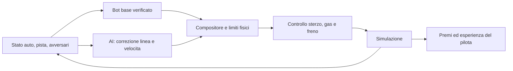

# Gioco: maestro capace e piloti che imparano a correre

**16 ottobre 2026 · analisi attuata nel verticale rc.20, installato con nuova rosa e migrazione. R2 esteso e R5 generale restano parziali. [Consegna, prove e limiti](v09-residual-implementation-report.md).**

Sostituisce, come direzione proposta per il prodotto, la partenza da reti casuali. Le implementazioni e prove precedenti rimangono storiche. Segue lo [studio sulle accelerazioni](game-learning-acceleration-research.md); la baseline dello studio era la **rc.19**, non la rc.18. Le sezioni seguenti conservano decisioni e criteri originali; lo stato corrente è nel report rc.20.

## 1. Obiettivo e decisione proposta

Un nuovo pilota deve partire da una guida già funzionante sul contesto supportato. L'allenamento deve affinare traiettorie, frenata, accelerazione e comportamento con avversari. La prima sessione non deve tornare agli esercizi «avanza di un metro».

**Scelta raccomandata:** architettura ibrida permanente, con bot base verificato e rete che apprende correzioni. Il pilota comprende entrambi. La capacità iniziale appartiene al bot; il contributo appreso va misurato separatamente. Una futura rete autonoma ottenuta per distillazione è un progetto successivo.

La prima consegna deve includere una base verificata e un pilota che mostri un beneficio misurato. La disponibilità di nuovi nomi nel menu non costituisce successo.

## 2. Riscontro attuale e limiti della diagnosi

[Snapshot in sola lettura della scheda](evidence/v09-base-driver-redesign-2026-10-16/board-readonly-snapshot.json), ore 12:15 circa Europe/Rome. SQLite aperto con `mode=ro`, `query_only` e transazione di lettura, senza costruire GameStore. Nessun cambiamento a sessioni, servizio o modelli. Gli otto sorgenti del gioco verificati coincidono con il workspace. Servizio osservato attivo, `NRestarts=0`, runtime rc.19.

| Pilota originale | Passi nel record principale | Ore nel contatore memorizzato | Nota |
| --- | ---: | ---: | --- |
| Evo | 14.471.530 | 7,005 | Presente checkpoint |
| NEAT | 10.935.344 | 4,850 | Presente checkpoint |
| PPO | 0 | 0 | Profilo precedente, nessun checkpoint |
| Pursuit | 77.536 | 0,003 | Controller, non apprendimento |
| Clone | 8.221 | 0,008 | Training iniziale |
| PPO-Smooth | 0 | 0,007 | Checkpoint presente, contatore passi nullo |

I contatori principali non vanno sommati ai percorsi per pista: ambiti, ricette e migrazioni storiche sono differenti. Lo snapshot conferma ore accumulate su Evo/NEAT, ma non dimostra che ogni algoritmo abbia avuto lo stesso training o che nessuno abbia appreso. Nessun replay comportamentale o benchmark prestazionale è stato eseguito in questa analisi. Zero qualifiche cronometrate nella tabella corrente non equivale a zero capacità di guida.

### Problemi strutturali verificati nel codice

1. `game_hybrid.py`: Clone→PPO inizializza un allievo imitativo casuale. La presenza del maestro non significa che il comando iniziale sia quello del maestro. Non soddisfa il nuovo requisito di guida pronta.
2. `game_control.py`: esiste già una base Pure Pursuit con anticipazione delle curve, frenata e gestione dei corridoi nel traffico. È il punto di partenza riutilizzabile, ma va verificata nel nuovo contratto su ogni circuito.
3. Il maestro usa margini conservativi di velocità e torna alla linea preferita. Non è una traiettoria ottimale certificata né un maestro di difesa completo.
4. `game_rewards.py`: esistono avanzamento valido, tempo, contatti, limiti, stallo, sottosterzo e sorpasso. Modificare soltanto questi pesi lascia irrisolto il requisito iniziale della base capace.
5. `game_academy.py`: esistono scenari di sorpasso/difesa, ma il successo finale «resta davanti» non descrive da solo una difesa corretta. Servono rilevatori di affiancamento, spazio e cambi di linea.
6. `game_simulation.py`: tre rivali sono selezionati per distanza euclidea. In una situazione affollata questo può omettere l'avversario posteriore importante; la selezione per ruolo è un'ipotesi concreta di miglioramento, da confrontare.

Non è accertata una causa unica delle ore senza il risultato atteso. La nuova direzione cambia il problema che chiediamo all'apprendimento di risolvere.

## 3. Maestro base: cosa deve saper fare

Nuovo controller versionato, candidato `race-base-1`, ricavato dall'attuale percorso moderno e sottoposto a gate prima dell'uso.

- Seguire una linea percorribile, con ingombro completo della vettura e margine dal bordo.
- Stimare velocità di percorrenza e frenata dalla curvatura e dalle capacità dell'auto; mantenere limiti fisici anche dopo uno spostamento laterale.
- Partire da fermo, completare giri consecutivi, rallentare dietro una vettura e mantenere distanza.
- Scegliere passaggi semplici a destra/sinistra quando lo spazio è libero; rinunciare quando è occupato.
- Gestire ostacoli e rientri secondo regole dichiarate; nessun teletrasporto o cancellazione del contatto.
- Fornire alla rete linea, velocità e comandi base, con uno stato persistente e riproducibile.

La geometria deriva dalla pista corrente. Le tarature vengono salvate per vettura, gomme, fondo e fisica. La prima qualifica riguarda ovale e auto standard; gli altri circuiti diventano supportati soltanto quando il maestro li supera. L'esistenza di una pista nel catalogo non ne certifica automaticamente la nuova base.

La linea iniziale può essere conservativa. Il maestro deve già guidare; non deve essere dichiarato ottimo, altrimenti il compito di miglioramento non sarebbe misurabile.

### Ovale base più largo: decisione del 16 ottobre

L’utente richiede **2 metri aggiuntivi di larghezza complessiva** per l’ovale base `oval-1`: **10 → 12 m**, allargando di un metro per lato. Le dimensioni fisiche dell’auto standard restano 4,4 × 1,8 m. Si conserva la linea centrale dell’ovale (raggio 31 m, semirettilineo 36 m): la larghezza cresce del 20%, con più spazio laterale per traiettorie e affiancamenti. Non si modifica Mallory, Varano o il circuito tecnico.

Nuova revisione proposta `oval-1` **rev.2**, coerente fra `TrackSpec`, catalogo e configurazione. Non basta allargare il disegno: strada fisica, sensori Python/nativi, limiti, fuori pista, cancelli, griglia, bot e corridoi devono usare gli stessi 12 m. Nelle curve i bordi asfaltati passano da raggi 26/36 m a 25/37 m; la lunghezza della linea centrale non cambia. I limiti ammissibili delle traiettorie devono considerare ingombro, margine e curvatura, senza assumere che più larghezza garantisca ogni sorpasso.

**Vincolo verificato nel codice:** `TrackRuntime.bounds` dell’ovale è attualmente fissato a `[-72,-36]…[72,36]`. Derivarlo dai parametri: il nuovo rettangolo dell’asfalto è `[-73,-37]…[73,37]`, cui aggiungere l’eventuale margine di presentazione coerente con il fuori pista. Rigenerare geometria visuale/camera e conservare la scala uniforme pista/auto sul display 960×640, senza ritagliare i bordi o ridimensionare artificialmente solo le vetture.

L’hash del contesto cambia: vecchie qualifiche e record non certificano l’ovale allargato. Coordinare la revisione con il reset della vecchia rosa già previsto. R0 e i confronti dei nuovi piloti devono usare tutti la medesima pista da 12 m; nessun confronto dei tempi fra vecchia e nuova larghezza come se il circuito fosse identico.

Verifiche richieste: due auto affiancate con margini geometrici validi, sensori/bordi Python e nativi coerenti, uscita/rientro sui nuovi bordi, cancelli e giri validi, camera completa e parità del residuo neutro. **Stato: requisito pianificato, larghezza runtime ancora 10 m.**

### Una buona linea di partenza può essere calcolata

Prima del rinforzo, valutare una linea a curvatura ridotta con profilo di accelerazione/frenata, calcolata alla preparazione del circuito e salvata. Il progetto ufficiale [TUMFTM](https://github.com/TUMFTM/global_racetrajectory_optimization) distingue percorso corto, minima curvatura e minimo tempo: non sono lo stesso obiettivo. Possiamo studiarne i principi con la nostra fisica, senza aggiungere subito il solver completo al loop.

Confrontare linea centrale, linea preparata e residuo appreso. Non chiamare «apprendimento della rete» il guadagno ottenuto soltanto da un planner o da una velocità base ritarata. Una base ragionevolmente tarata evita di dimostrare un miglioramento artificiale contro un bot reso appositamente troppo lento. Nessun costo di preparazione o ottimo globale sulla nostra geometria è ancora misurato.

## 4. Controllo appreso: traiettoria e velocità

Prima variante: due uscite continue, **correzione laterale della linea** in metri e **correzione della velocità obiettivo**. Il controllo a valle produce sterzo, gas e freno. L'AI decide quindi dove passare e come affrontare la curva; il controller realizza una richiesta fisicamente percorribile.

Per una futura variante con controllo diretto si possono studiare residui su sterzo e pedale. Non aggiungerei subito anche quel problema: aumenta la ricerca e rende meno leggibile il beneficio del nuovo schema.

### Inizializzazione che conserva davvero la capacità

- Uscita deterministica della rete esattamente zero: a zero correzione la pipeline deve riprodurre quella del maestro, incluse le decisioni nel traffico. Non basta impostare pesi piccoli.
- Prima verifica con esplorazione disattivata. Nel training l'esplorazione è piccola e limitata; uno scostamento casuale può comunque fallire e non è una garanzia di sicurezza.
- Riferimenti modificati con continuità e limiti di variazione. Intervalli iniziali candidati: ±0,25–0,50 m e circa ±5% della velocità base, da validare sulle curve più strette; per sorpassare servirà successivamente l'intera larghezza legalmente disponibile.
- Espansione delle possibilità solo dopo prove di controllo. Intervalli troppo stretti possono impedire di migliorare o superare: non devono diventare un tetto permanente.
- Una richiesta fuori limite non viene premiata come se fosse stata eseguita. Salvare azione della policy, target realizzato, motivi di limitazione e azione fisica finale; il learner deve modellare correttamente il proprio spazio di azione.
- Per PPO conservare azione campionata e relativa probabilità: non sostituirle con il comando modificato dal limitatore. In SAC il compositore è parte della dinamica dell'ambiente; definire coerentemente l'azione del critic, la trasformazione e l'entropia. Verifiche numeriche delle trasformazioni prima del training.
- Il controllore geometrico deve seguire la traiettoria modificata, ricalcolandone la velocità ammissibile. Non sommare un offset discontinuo a una linea che considera ancora solo la curvatura centrale.

**Candidato** ed **effettivo campione** sono distinti. La gara usa il migliore verificato; aggiornamenti rumorosi non sostituiscono il campione. Il riferimento geometrico è congelato durante un esperimento: cambiarlo cambia l'identità della policy composta.

## 5. Osservazioni, memoria e trasferimento

Nuovo contratto versionato, senza reinterpretare `race-68-v3`:

| Gruppo | Informazione necessaria |
| --- | --- |
| Auto | Velocità longitudinale/laterale, imbardata, sterzo, accelerazioni e azione precedente |
| Pista | Linea e bordi davanti, curvatura con segno, larghezza, spazio per l'intero corpo |
| Base | Target e comando del bot, linea attuale, limiti applicabili e loro stato |
| Avversari | Distanze lungo pista e laterali, velocità relativa, ingombro, affiancamento, maschera di presenza |
| Contesto | Proprietà fisiche dichiarate di vettura/fondo/gomme, non un indice arbitrario di pista |
| Manovra | Stato del precedente cambio linea, sovrapposizione e breve storia osservabile |

Garantire slot per rivale davanti, dietro e affiancato; una vettura assente non equivale a una vettura ferma. Gestire wrap del traguardo, curve vicine ma separate e doppiaggi. Convenzione unica del segno laterale, distinta da quella attuale dove necessario.

Iniziare con stato esplicito e una breve storia, non con una rete ricorrente obbligatoria. Se la manovra dipende da uno stato del compositore non visibile, esporlo: altrimenti stessi ingressi possono richiedere azioni differenti.

Il bot adatta la guida alla nuova geometria; la rete conserva pesi generali e affina il contesto. Rete di base del pilota più adattamenti per contesto, con verifica prima della promozione; evitare il reset della base a ogni pista. Compatibilità degli ingressi necessaria, qualifica della pista nuova separata. Fondi e auto futuri richiedono osservabilità e prove, non soltanto riuso dei pesi.

## 6. Modi di imparare da confrontare

| Metodo | Ruolo proposto | Valutazione |
| --- | --- | --- |
| Residuo PPO | Primo verticale su codice già disponibile | Integrazione più corta; raccoglie esperienza recente. Non riusa arbitrariamente vecchi rollout |
| Residuo SAC | Secondo confronto prioritario | Riutilizzo di transizioni, due critic e target; maggior costo degli aggiornamenti, da misurare |
| Residuo TD3 | Terzo algoritmo, nuovo pilota Linea | Actor deterministico, replay, due critic, aggiornamenti ritardati e smoothing del target; confronto diretto con SAC |
| Dimostrazioni + SAC | Estensione successiva | Dataset completo di transizioni del maestro e del pilota; non bastano coppie osservazione/azione |
| Imitazione/DAgger | Per distillare o coprire manovre specifiche | Utile, ma da sola non garantisce il superamento del maestro né guida pronta da pesi casuali |
| Evoluzione/NEAT da zero | Laboratorio storico | Non più percorso principale per creare piloti pronti secondo il nuovo requisito |
| Evoluzione di residui | Eventuale confronto successivo | Possibile, con inizializzazione neutra e identità distinta; non prima del verticale efficace |

La letteratura supporta la direzione residuale: [RLPP, ICRA 2025](https://arxiv.org/abs/2501.17311), con SAC su Pure Pursuit. Il paper riporta fino al 6,37% sul tempo sul giro dei riferimenti; il training descritto impiega quasi quattro ore su workstation i7-13700K/RTX 3090. È evidenza di fattibilità, non di apprendimento istantaneo sulla nostra scheda. La nostra architettura di target laterale/velocità è un adattamento da verificare, non una replica esatta del lavoro.

[SAC](https://arxiv.org/abs/1812.05905) e [RLPD](https://arxiv.org/abs/2302.02948) motivano il confronto sul riuso dei dati. Non dimostrano che il nuovo SAC sarà più rapido del nostro PPO: confronto sullo stesso controllo, dati, seed e contesto. [DAgger](https://proceedings.mlr.press/v15/ross11a.html) informa il lavoro sulle dimostrazioni.

Per il prototipo di riferimento valutare un'implementazione mantenuta, ad esempio [Stable Baselines3 SAC](https://stable-baselines3.readthedocs.io/en/master/modules/sac.html), con dipendenze congelate. Compatibilità PyTorch/ARM/Python e costo degli aggiornamenti sulla scheda sono un gate preliminare, non una disponibilità già verificata. Un eventuale port leggero richiede confronto numerico con il riferimento; non aggiungere un SAC artigianale senza quel controllo. Anche il warmup casuale e l'entropia vanno configurati nel piccolo spazio residuale, evitando di ereditare esplorazione indiscriminata dalle impostazioni generiche.

Il maestro corrente non può insegnare correzioni migliori di se stesso limitandosi a etichettare sempre «residuo zero». La base serve a partire; il miglioramento deriva da esiti reali, dimostrazioni migliori dichiarate o traiettorie ottimizzate, con provenienza distinta.

### Aggiunta richiesta: Linea, basato su TD3

**TD3 (Twin Delayed DDPG)** aggiunge un metodo differente da PPO e SAC. Usa replay e due critic, aggiorna la policy meno spesso dei critic e regolarizza il target con rumore limitato. La policy è deterministica; l’esplorazione del comportamento si aggiunge esplicitamente durante il training. [Fujimoto et al., ICML 2018](https://proceedings.mlr.press/v80/fujimoto18a.html), [implementazione di riferimento](https://stable-baselines3.readthedocs.io/en/master/modules/td3.html).

**Linea** usa lo stesso Maestro e gli stessi residui di linea/velocità. Uscita iniziale nulla, rumore di esplorazione contenuto nell’inviluppo verificato, nessun rumore in Qualifica/Gara. Il rumore sulle azioni target di TD3 è distinto dal rumore esplorativo eseguito dall’auto; entrambi vanno salvati/configurati correttamente con RNG e stato del learner. Anche SAC e PPO vengono valutati senza esplorazione: la differenza dell’actor deterministico riguarda l’algoritmo, non un’esclusiva di Linea in gara.

Il nome non promette automaticamente traiettorie più precise, guida più regolare o tempi migliori. Due critic e aggiornamenti ritardati non garantiscono un training più rapido sulla scheda. Misurare costo totale, passo e affidabilità con medesimi dati/compito e seed abbinati. Riutilizzare l’infrastruttura replay/target sviluppata per SAC dove compatibile, mantenendo aggiornamenti e checkpoint distinti. Prima validazione numerica, dipendenze ARM e pausa/ripresa; poi disponibilità nella rosa solo dopo i medesimi gate degli altri piloti AI.

La sequenza conserva prima il verticale Crono efficace, poi confronta SAC e TD3: l’aggiunta non autorizza a mostrare un quinto pilota non ancora utilizzabile.

## 7. Rosa proposta dopo il reset

| Pilota | Base iniziale | Differenza verificabile | Disponibilità proposta |
| --- | --- | --- | --- |
| **Maestro** | Bot verificato | Riferimento fisso, nessun apprendimento | Prima di tutti |
| **Crono** | Stesso bot + residuo neutro | PPO, ottimizza giri e settori puliti | Primo pilota AI |
| **Memoria** | Stesso bot + residuo neutro | SAC, riusa transizioni | Dopo correttezza numerica e budget ARM |
| **Linea** | Stesso bot + residuo neutro | TD3: actor deterministico con esplorazione separata, replay e aggiornamenti ritardati | Dopo confronto con SAC, parità e gate di utilizzabilità |
| **Tattico** | Stesso bot + residuo neutro | Metodo selezionato sui confronti, maggiore copertura di duelli | Dopo la fase solo/traffico; ricetta finale registrata prima di crearlo |

Tutti i piloti AI devono ricevere addestramento solo, sorpasso e difesa; i nomi indicano enfasi, non incapacità degli altri. Per confrontare gli algoritmi usare anche repliche con lo stesso obiettivo e seed abbinati: Crono contro Tattico con reward differenti non isola PPO contro SAC.

I nuovi piloti iniziano capaci **quanto la base verificata**, non con abilità neurali già apprese. La loro maggiore velocità e qualità tattica devono essere dimostrate.

**Decisione dell’utente del 16 ottobre:** eliminare i vecchi piloti dalla situazione attiva e mantenere soltanto piloti utilizzabili. La rosa finale prevista è Maestro, Crono, Memoria, Linea e Tattico, ciascuno disponibile solo dopo i gate pertinenti. Nessun archivio/laboratorio dei vecchi piloti nella Dashboard e nessuna voce sperimentale non utilizzabile nella creazione. Se un nuovo metodo non supera i gate, il relativo pilota non viene mostrato come disponibile. Evo, NEAT, PPO, Pursuit, Clone, PPO-Smooth e le vecchie varianti cessano di essere scelte ordinarie.

La copia di ripristino resta esterna al database attivo e all’interfaccia. La rimozione definitiva dei componenti di codice inutilizzati richiede una verifica delle dipendenze: il controller geometrico e altri componenti ancora necessari al Maestro o ai nuovi learner rimangono, senza mantenere le vecchie identità.

## 8. Ricompense: obiettivi e protezioni contro scorciatoie

Proposta di struttura, **pesi da tarare prima della consegna**, con componenti pubblicate separatamente:

`r = w_progress * delta_avanzamento_valido/L - w_time * dt/T_ref + eventi_puliti - costi_contatti_uscite - costo_controllo`

L e T_ref appartengono al contesto e sono congelati nella ricetta. Il reward del singolo intervallo decisionale somma i passi fisici realmente eseguiti; non dipende dal frame grafico.

| Componente | Comportamento desiderato | Vincoli di progetto |
| --- | --- | --- |
| Avanzamento | Procedere lungo il giro | Credito validato da settori/checkpoint, niente doppio credito avanti/indietro o tagli |
| Tempo | Stesso giro in meno secondi | Costo a tempo; confronto terminale con tempi del maestro congelato, non record mobile |
| Giro/settore | Successo pulito e ripetibile | Bonus una sola volta; settori confrontabili con ingresso/uscita controllati |
| Contatto/uscita | Evitare collisioni e tagli | Eventi e gravità, nessuna colpa inventata; incidenti gravi escludono la promozione |
| Controllo | Manovre fisicamente realizzabili | Costo moderato sulle variazioni; non punire ogni sterzata/frenata necessaria |
| Sorpasso | Guadagnare posizione correttamente | Incontro armato, affiancamento, superamento completo e mantenuto, pulizia e unicità |
| Difesa | Restare davanti con passo utile | Solo contro minaccia reale, episodio finito, regole di spazio e progresso minimo |
| Stallo | Non fermarsi o provocare reset rapidi | Timeout e ritorno di fallimento peggiore del completamento; niente premi per mera sopravvivenza |

**Nessun premio autonomo a gas premuto o velocità istantanea.** Frenare prima della curva deve poter aumentare il risultato sul settore/giro. Non costringere alla linea centrale: si applicano costi di bordo, fattibilità e regole, lasciando libera la scelta della traiettoria.

Il terminale deve evitare che un ritiro rapido risparmi più costo-tempo di quanto perda: confrontare un orizzonte fisso o addebitare il tempo residuo e la mancata conclusione. La validità resta un gate di promozione separato dalla somma numerica. Non assegnare un premio alla richiesta del target se non produce avanzamento fisico.

Eventuale shaping verso sottobiettivi: confrontare la forma `gamma * Phi(s_next) - Phi(s)` con terminali coerenti. Le proprietà di invarianza richiedono le ipotesi del modello del paper; non garantiscono automaticamente assenza di exploit nel nostro gioco. [Ng, Harada e Russell, ICML 1999](https://ai.stanford.edu/~ang/papers/shaping-icml99.pdf).

### Taratura prima del training lungo

Una banca di comportamenti programmati deve controllare almeno: maestro pulito, stesso giro più veloce, fermo, taglio, crash immediato, zig-zag, frenata corretta, frenata arbitraria davanti al rivale, sorpasso ripetuto artificialmente e difesa pulita. L'ordine desiderato deve risultare dai termini e dai gate, non soltanto dal premio totale. Confrontare i coefficienti uno alla volta; nessun numero dichiarato «ottimale» sulla base dell'intuizione.

## 9. Sorpasso e difesa: esercizi espliciti

Sequenza: solo → inseguimento → passaggio in rettilineo da entrambi i lati → affiancamento in curva → difesa → duelli → piccola gara. Campionamento misto con ripasso del solo, non cancellazione delle abilità precedenti.

- Avversari con velocità e linee diverse, congelati durante ogni blocco di training e verifica.
- Difesa con rivale inizialmente dietro e più veloce, minaccia misurata; non premiare il semplice trascorrere del tempo davanti a un bot irraggiungibile.
- Regole **semplificate del nostro gioco**: spazio quando affiancati, niente contatto intenzionale, niente taglio, niente cambi ripetuti di linea o frenata punitiva. Non si dichiara conformità a un regolamento sportivo reale.
- Penalità e invalidità rilevate da geometria, azioni e storia dell'incontro. Se una responsabilità non è determinabile, registrarla come tale.
- Perdere posizione contro un rivale più veloce non implica fallimento del controllo: misurare passo, spazio e manovra. Il premio difesa non deve rendere conveniente fermare entrambi.
- Dopo i bot, usare un piccolo archivio di piloti congelati e stili diversi. Si allena sempre un pilota alla volta; gli avversari non cambiano pesi contemporaneamente. Nessuna necessità iniziale di una grande lega di self-play.

[GT Sophy, Nature 2022](https://www.nature.com/articles/s41586-021-04357-7) sostiene l'utilità di scenari misti e premi per correttezza nelle corse. Il lavoro non è una ricetta pronta per hardware ridotto.

Uno studio specifico sulla [difesa, IROS 2026](https://arxiv.org/abs/2607.20973) separa scelta strategica e controllo con vincoli. È una motivazione per rappresentare lo spazio da difendere; non copiamo il suo MPC non lineare: il costo del solver riportato non è un budget dimostrato per noi e l'obiettivo di ostacolo richiede le nostre regole contro comportamenti scorretti.

## 10. Frequenze e uso delle risorse

- Conservare fisica/controllo base a 60 Hz e presentazione candidata a 30 Hz.
- Sperimentare AI sui target a 10 Hz contro 20 Hz; fra decisioni il controller segue il riferimento con continuità. Non abbassare insieme la fisica.
- Ricalcolare sconto e GAE in secondi: con scala gamma di 40 s, a 10 Hz `gamma=exp(-0,1/40)≈0,99750`; il vecchio valore a 60 Hz non è intercambiabile. Reward integrati nel blocco, durata e bootstrap dei troncamenti espliciti.
- Una rete iniziale piccola, candidata MLP 64×64, da confrontare con una più piccola. Sono dimensioni proposte, non un benchmark. Nessun bisogno iniziale di visione da pixel o modello linguistico.
- Un learner attivo; confrontare 1/2/4 mondi prima di aumentare. RAM disponibile per replay/telemetria, senza un limite artificiale; costo CPU e frame pacing restano da misurare.
- GPU Qt Quick; NPU soltanto dopo parità e vantaggio completo sull'inferenza del nuovo carico. Nessuna promessa di training NPU.
- Gli aggiornamenti devono lasciare spazio alla GUI, e il salvataggio deve essere atomico. Esportare raccolta/s, aggiornamenti/s, tempo in fisica/rete/optimizer/qualifiche e tempo simulato/reale.

## 11. Training, promozione e UX

**Impara** diventa allenamento del pilota già capace su passo e controllo, con finestre di raccolta che non rappresentano crash visivi. Gli esercizi brevi possono ripartire prima della curva difficile, ma mantengono prove complete. **Infinito** verifica e allena continuità; **Sorpasso** include progressivamente anche difesa, indicandolo nel menu. Nessun nuovo comando che interferisca con Pausa/Salvato o con i tasti già approvati.

**Qualifica** e **Gara** usano policy composte congelate, senza esplorazione. Una vettura per pilota, tutti i concorrenti visibili e certificato relativo a hash del pilota completo, pista, auto e fisica. Cambi del bot base/compositore/rete invalidano l'attualità della qualifica. Il maestro può fare da riferimento in gara dopo la propria Qualifica, non riceve un tempo finto.

Nella UI 960×640 Apple Calm conservare la pista grande. Informazioni brevi: `Base pronta`, `Allena: frenata`, `Migliore −1,2% sul maestro`, `4/5 giri puliti`, `Sorpassi puliti 3/4`. Le percentuali sono mostrate solo dopo vere prove confrontabili; gli esempi qui sono di testo, non risultati acquisiti.

Il dossier distingue origine della base, metodo, tempo attivo, esperienza nuova, contributo della rete, interventi del compositore, campione/candidato e prove per abilità. **Azzera miglioramenti** ripristina residuo neutro mantenendo la base verificata; **ricrea base** è un'operazione diversa e non diventa il reset ordinario.

## 12. Reset e migrazione della rosa — specifica originale, attuata nella rc.20

La richiesta include lo studio di reset e creazione. **Nella sola analisi non era stata eseguita alcuna cancellazione.** La migrazione successivamente autorizzata è registrata nella ricevuta rc.20. Specifica adottata:

1. Preparare e verificare maestro, nuovi contratti e ricette in archivio di prova.
2. Dopo salvataggio/pausa, acquisire backup coerente SQLite con i suoi journal e tutti i modelli referenziati, più manifest/hash e preferenze; non copiare soltanto il file DB aperto ignorando un eventuale WAL.
3. Conservare il vecchio esperimento soltanto nel backup esterno, identificando revisioni e ambiti. Rimuovere dalla situazione attiva vecchie identità, modelli non referenziati dalla nuova rosa, sessioni, memorie, qualifiche e relativi record. Creare le nuove identità con un ID di esperimento comune; non rinominare Evo in SAC mantenendo dati non compatibili.
4. Nuovo namespace di policy/checkpoint/qualifiche/record per il contratto nuovo. Vecchi tempi e primati restano soltanto nel backup esterno: niente righe di piloti eliminati in Classifica, dossier, selettori, Gara o ripresa automatica.
5. Nuove reti residuali neutre; nuovi critic/optimizer/rollout/replay. Base geometrica verificata conservata. Niente riuso automatico di memorie storiche dal contratto differente.
6. Verificare riferimenti di tutte le tabelle, comprese `objective_paths`, `objective_archives`, `timed_qualifications`, `driver_memory`, `driving_contexts`, `driving_archives`, `profile_paths`, record e sessioni. Installare atomicamente e provare il ripristino su copia.

**Accettazione della pulizia:** database e artefatti attivi senza riferimenti orfani ai vecchi piloti; elenco, creazione, Classifica, dossier, Gara e valori predefiniti mostrano soltanto la nuova rosa verificata. La verifica deve includere riapertura, riavvio e assenza di ripopolamento automatico dei vecchi preset. Rimozione nella stessa migrazione che installa la nuova rosa utilizzabile, preservando il funzionamento fino a quel momento.

**Rischio verificato:** l'attuale `reset_roster()` non pulisce le tabelle nuove di obiettivi e qualifiche. Non usarlo da solo per questa migrazione. Anche il reset individuale esistente non crea il nuovo contratto o il maestro; richiede una migrazione dedicata.

Questo reset serve a cambiare architettura e rendere gli esperimenti confrontabili. Non è una correzione scientificamente dimostrata per ogni vecchio pilota.

## 13. Gate di accettazione e ordine del lavoro

Tutte le soglie seguenti sono proposte da fissare prima dei confronti. Nessun gate nuovo è già superato da questo documento.

| Fase | Risultato richiesto | Condizione per proseguire |
| --- | --- | --- |
| R0 · Maestro | Guida pronta, fisica e controlli coerenti | Sul primo contesto: 20/20 partenze, 20/20 giri, 5/5 serie da cinque giri puliti; scenari di frenata e traffico semplice separati |
| R1 · Residuo neutro | La nuova AI parte davvero dalla base | Azioni e traiettorie equivalenti al maestro a correzione zero, con pause/riprese e contesto; niente rumore in Gara |
| R2 · Premi | Obiettivo e rilevatori comprensibili | Banca anti-exploit, resoconto per termine e terminali verificati; target irrealizzati non premiati |
| R3 · Primo miglioramento | Crono più efficace della base | Mediana tempi migliora su banca indipendente, affidabilità non degradata; obiettivo iniziale candidato ≥1%, oltre l'incertezza misurata |
| R4 · Metodi | Confronto PPO/SAC/TD3 utile al prodotto | Stesso compito e contatore dati, seed abbinati, costo totale ARM e frame pacing; metodo scelto da esiti completi |
| R5 · Tattica | Passaggi e difesa corretti | Esempio di soglia: ≥16/20 sorpassi contro bot superabili e ≥16/20 difese negli scenari definiti difendibili, nessun contatto grave/violazione nel set; non estendere a gare arbitrarie |
| R6 · Migrazione e pannello | Nuova rosa pulita e utilizzabile | Backup esterno/ripristino, vecchi piloti eliminati da dati e UI attivi, nessun ripopolamento o dato orfano/certificato copiato; gare 2/4/5, una vettura/pilota e tutti visibili, controlli tre temi e pacing |

Non rendere il gate R0 infinito: se il bot fallisce, correggere il bot o dichiarare il contesto non supportato, senza tentare di far coprire il difetto all'AI per ore.

In R5 confrontare sempre anche il maestro da solo. Se i suoi automatismi superano già gli stessi bot, il semplice successo del pilota composto non dimostra apprendimento tattico: servono vantaggi di tempo, spazio o riuscita su incontri non risolti dalla base. Un campione di 20 prove è un gate di prodotto iniziale, non una stima precisa di affidabilità generale.

Screening proposto su copie: due seed, 100 mila e poi 300 mila transizioni decisionali per candidato, con verifiche su banca di sviluppo. Conferma: cinque seed e budget scelto prima della banca finale; includere run falliti. Le transizioni a 10 Hz non sono confrontabili direttamente con i vecchi contatori fisici a 60 Hz: registrare entrambi, più secondi reali e dimostrazioni.

Diagnosticare raccolta, premi e variazioni effettive dell'actor a checkpoint di tempo definiti. Se non c'è segnale utile al budget deciso, interrompere e analizzare; non lasciare training per ore senza un controllo. L'effetto «sa già guidare» arriva dalla base a training zero; il tempo per migliorare rimane un risultato sperimentale.

**Ordine raccomandato:** R0 → R1/R2 → verticale Crono/R3 → SAC e TD3/R4 → sorpasso/difesa/R5 → migrazione e consegna R6. Eseguire R6 soltanto dopo risultati su copie. Non creare tutte le nuove varianti nel menu prima di avere il primo caso convincente.

## 14. Mappa d'implementazione proposta

- `game_control.py`: estrarre stato/riferimenti del bot, controlli delle traiettorie modificate, versione della base.
- Nuovi moduli per compositore residuale, contratto sensori/azioni, SAC e TD3; prove numeriche e pausa/ripresa prima dell'integrazione.
- `game_academy.py` / trainer: frequenza decisionale, esperienza di azioni richieste/eseguite, esercizi tattici e avversari congelati.
- `game_rewards.py` / risultati: nuova ricetta e rilevatori eventi, diagnostica separata, confronti temporali validi.
- `game_learning.py`, policy/export/native: snapshot della policy composta e parità di esecuzione, senza riferimenti esterni mutevoli.
- `game_store.py` / memoria/trasferimento/record: namespace nuovo, migrazione completa e qualifiche per policy composta.
- Impostazioni/dossier/presentazione: nuova rosa e lettura di capacità/appreso, grafica Apple Calm e geometria conservate.

## 15. Chiusure operative della revisione finale

**16 ottobre: riesame prima dell’implementazione.** La direzione, la rosa e il reset sono definiti. Le seguenti chiusure rendono il piano eseguibile; non aggiungono altri algoritmi o nuovi circuiti.

### 15.1 Cinque piloti devono poter correre insieme

**Incompatibilità verificata nei sorgenti:** `game.py` limita a quattro selezione, configurazione e Start; `game_settings.py` limita lo schieramento a quattro; `game_worker.py` valida 2–4 concorrenti; `game_modes.py` descrive 2–4. Le prove native correnti coprono principalmente due/quattro auto.

Portare il limite condiviso a **2–5 concorrenti** per poter schierare Maestro, Crono, Memoria, Linea e Tattico insieme. Aggiornare selettori, testi, Worker, validazione delle richieste, griglia fisica, risultati e prove. Non eliminare implicitamente il quinto ID né usare una costante diversa fra UI e Worker. Il limite degli avversari nei soli esercizi di training è un parametro separato.

Verificare gare 2/4/5, tre e cinque giri, griglia veloce→lento e inversa; una vettura per pilota, ID distinti, tutte visibili e risultati completi anche per i ritirati. Misurare in particolare il carico a cinque policy composte con sensori e traiettorie: fisica 60 Hz e presentazione candidata 30 Hz rimangono obiettivi da verificare. Nessuna promessa di 30 fps fissi dedotta dalle vecchie prove a quattro.

### 15.2 Stati chiari: base, candidato e campione

Per ogni pilota distinguere:

- **Base pronta:** controller e contesto verificati, residuo deterministico neutro; il pilota sa guidare grazie alla base.
- **In allenamento:** candidato aggiornabile, esplorazione e metriche per finestra; non sostituisce il campione.
- **Miglioramento verificato:** confronto indipendente favorevole, stessa configurazione e hash completi; tempo e affidabilità pubblicati.
- **Qualificato:** tempo reale di Qualifica ottenuto proprio dalla versione che può essere schierata.
- **In pausa / salvataggio / errore:** stato esplicito; «Salvato» soltanto dopo persistenza riuscita.

Nessuna promozione basata solo sulla reward. L’eventuale uso del Maestro come base stabile deve essere dichiarato; un candidato non numerico, un modello mancante o un algoritmo indisponibile non vengono silenziosamente sostituiti dal bot facendoli apparire AI funzionanti. Il campione valido rimane utilizzabile mentre un candidato regressivo viene scartato.

### 15.3 Misura dei progressi e stallo del training

Scheda per intervallo: secondi attivi reali, secondi simulati, nuove transizioni decisionali/passaggi fisici, aggiornamenti effettivi, giri/settori validi, contatti/uscite, quota di richieste limitate, tempi del candidato e del campione. Distinguere il caso «sta raccogliendo replay» da «sta aggiornando» e «sta verificando»; quest’ultimo costo non è esperienza di training.

Registrare cambiamento delle azioni su una banca diagnostica, non solo cambiamento dei pesi. Se i target vengono sempre annullati dal compositore, se non arrivano aggiornamenti oppure se compaiono valori non finiti, segnalare la causa e mettere in pausa il candidato quando necessario. Per uno stallo statistico usare finestre e budget preregistrati: un intervallo senza record non dimostra un errore. All’esaurimento del budget senza segnale utile, conservare il campione e produrre il resoconto diagnostico anziché prolungare automaticamente il training.

### 15.4 Autorità dei comandi e significato delle azioni

Il bot produce la propria proposta e il compositore ne costruisce una sola versione finale con il residuo. Non deve esistere un secondo planner che, dopo l’AI, riporti silenziosamente l’auto al centro o sovrascriva sempre il tentativo di sorpasso. Stato del riferimento e vincoli effettivi sono osservabili e ripristinabili.

Congelare il significato di azione e normalizzazioni nella ricetta. Ampliare durante il curriculum l’intervallo delle correzioni modifica il problema: farlo su un confine di raccolta dichiarato, con scala/intervallo osservabili e persistenti; azzerare i rollout PPO incompatibili. Per SAC/TD3 non reinterpretare le vecchie azioni del replay con una scala nuova: mantenere una rappresentazione compatibile in unità fisiche e contesto oppure aprire un nuovo buffer/epoca. I confronti fra candidati usano la stessa autorità di controllo.

Un aggiornamento a base, planner, compositore o sensori crea una nuova versione della policy composta; riqualifica e gestione esplicita dei dati incompatibili. Nessuna modifica del Maestro a metà di un confronto.

### 15.5 Ricette, dipendenze e memoria persistente

Prima di creare ogni pilota congelare una scheda con algoritmo, rete, seed, frequenze, sconti in secondi, limiti residuali, esplorazione/warmup, coefficienti reward, curriculum, versione della base e dipendenze. I coefficienti vengono scelti con la banca anti-exploit e prove di sviluppo, poi bloccati prima della verifica finale: la loro taratura non è un motivo per rinviare indefinitamente il primo verticale.

La disponibilità effettiva di SAC/TD3 su ARM va chiusa prima di prometterne la consegna. Usare un riferimento mantenuto e confronti numerici; se una dipendenza non è disponibile o ha costo incompatibile, riportare il blocco tecnico senza lasciare nel menu un pilota che non parte. Non serve aggiungere un sesto algoritmo per coprire quel problema.

Checkpoint atomico: actor, critic, target, ottimizzatori, RNG, replay compatibile, stato del bot/compositore e punto della raccolta. Su ripresa verificare equivalenza deterministica e assenza di doppio credito per premi e aggiornamenti. Per un’interruzione durante una scrittura mantenere l’ultimo checkpoint completo; i dati successivi non confermati non possono essere dichiarati salvati.

La RAM disponibile non equivale a crescita illimitata dello storage: definire conservazione di campione, ultimo checkpoint riprendibile e punti diagnostici necessari. Ripulire soltanto artefatti dimostrati non referenziati, conservando il backup esterno della migrazione e i modelli congelati degli avversari effettivamente usati. Le vecchie identità eliminate non tornano in UI per effetto dei riferimenti tecnici.

### 15.6 Primo contesto e completamento

Il verticale iniziale usa **ovale da 12 m, auto standard e asfalto asciutto**. Niente nuovi fondi, danni, gomme degradabili o modelli del mondo in questa consegna. Gli altri circuiti esistenti rimangono invariati; per la nuova rosa diventano selezionabili nel contesto supportato quando il Maestro e le policy hanno superato le prove richieste, con stato comprensibile nel menu.

La nuova rosa si consegna come utilizzabile dopo R0–R6, includendo il caso a cinque vetture e la pulizia dei vecchi piloti. Nessun risultato già acquisito sulle reti precedenti chiude automaticamente questi gate. È possibile sviluppare e verificare i moduli per tappe su copie senza migrare prematuramente la produzione.

**Analisi sufficiente per iniziare l’implementazione:** restano misure da acquisire e parametri da tarare negli esperimenti previsti, non nuove decisioni di prodotto necessarie all’avvio. La velocità di apprendimento, il guadagno sul giro e il costo reale della scheda non sono risultati già dimostrati.

## 16. Decisione conclusiva

Adottare il **maestro verificato con apprendimento residuale** come nuova direzione principale. È coerente con il requisito di divertirsi e vedere piloti che già percorrono la pista. Il primo successo richiesto è un bot che gira subito e una rete che dimostra una correzione utile; seguono differenze fra metodi e tattica.

**Aggiornamento dopo l'autorizzazione:** beneficio del training e primi tempi ARM misurati, nuova rosa e migrazione installate nella rc.20 con backup completo. Correttezza tattica generale, sorpassi in curva e altri contesti rimangono da qualificare; R0–R6 non vengono dichiarati tutti chiusi. Consultare il [report di consegna](v09-residual-implementation-report.md) per dati e matrice corrente.

## Seguito dopo la consegna rc.20

L’[analisi N0–N5](game-next-improvements-oval-timing-analysis.md) prepara il cronometraggio nell’isola dell’ovale, la promozione per singola abilità, il completamento della banca R2 e la diagnosi dei sorpassi in curva. Include un concept a 960×640 e criteri di validità/persistenza dei settori. È documentazione di pianificazione: nessuna ulteriore modifica al runtime o ai piloti.
