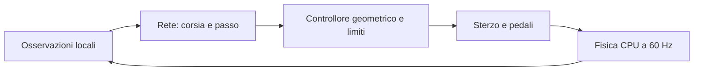

# Crono: guida, esplorazione, incentivi e viste durante il run

**20 ottobre 2026 · analisi e sonde private completate · runtime rc.23 invariato.**

Richiesta: una sola auto, tasti con pochi effetti visibili, circa 39 km/h e
traiettorie quasi uguali. Obiettivo: apprendere guida più veloce e scelte di
traiettoria osservabili, mantenendo un pilota persistente e gare affidabili.

## 1. Conclusione

L'osservazione dell'utente è coerente con il codice e le prove. Ci sono quattro
problemi distinti:

1. **Viste:** sull'ovale Segui/Duello/Circuito hanno la stessa camera; con una
   sola auto 4/6 non può selezionare un'altra esperienza. Non è un guasto del
   tastierino. Le opzioni attuali promettono differenze che qui non mostrano.
2. **Autorità:** Crono propone corsia e fattore di passo; non controlla
   direttamente sterzo e pedali. Il riferimento sui circuiti corti è 10 m/s,
   con variazione neurale massima ±25%. Il tetto richiesto è quindi 45 km/h,
   non il limite della vettura standard.
3. **Ricerca:** l'esplorazione laterale è minuscola e il candidato modifica
   quasi soltanto il passo. Un comando fisso già consentito dal contratto è
   più veloce e ottiene un premio maggiore: il problema non si risolve soltanto
   aumentando il premio alla velocità.
4. **Valutazione delle azioni:** attore e critic condividono ingressi locali che
   non distinguono due stati simmetrici con distanza al termine diversa.
   In un compito finito questo rende il valore futuro ambiguo. È un difetto
   strutturale riprodotto; il suo contributo quantitativo allo stallo resta da
   misurare in un confronto di apprendimento.

Raccomandazione: correggere osservabilità del critic, esplorazione e riferimento
di velocità, verificando ogni fattore separatamente; studiare poi lo shaping
del premio. La sola aggiunta di auto o un bonus per accelerare non affronta
questi limiti.

## 2. Stato corrente e perimetro delle prove

Lettura della scheda **20 ottobre, 14:57 UTC / 16:57 Europe/Rome**: rc.23;
hash di nove sorgenti installate identici a quelli usati nelle sonde PC.
[Snapshot selezionato](evidence/v09-crono-driving-study-2026-10-20/board-snapshot.json).

È lo **stato persistito**, non la RAM dell'allenamento in corso. Nessuno store
istanziato sugli originali, nessuna pausa, installazione, riavvio o modifica ai
piloti. Copia del checkpoint con permessi privati fuori dal repository; nelle
evidenze non ci sono pesi o replay.

Crono salvato: **64.361 decisioni, 502 aggiornamenti, 186 episodi, 31 verifiche**;
campione fermo a **33,317 s di mediana nelle verifiche finite**. Gli ultimi cinque
candidati danno 33,517–33,967 s e non vengono promossi. Il valore precedente
negativo della explained variance non è permanente: qui vale **+0,563**. Non è
corretto attribuire lo stallo al critic guardando un solo minibatch.

Le sonde eseguono **otto configurazioni congelate**, tre giri da griglia
deterministica ciascuna, più un episodio finito con seme 91001 per misurare i
premi. Nessun aggiornamento neurale e nessun confronto statistico fra metodi.
Sono prove PC con gli stessi sorgenti; non misurano fluidità o prestazioni ARM.
[Script](evidence/v09-crono-driving-study-2026-10-20/probe_controls.py) ·
[risultati](evidence/v09-crono-driving-study-2026-10-20/control-probes.json).

## 3. Perché si vede una sola auto e i comandi cambiano poco

### 3.1 Un pilota PPO non è una popolazione Evo

`ResidualTrainer` raccoglie un'esperienza alla volta e mostra una prova del
candidato congelata per giro. In Impara e Giro infinito il mondo visibile ha
una sola vettura; in Sorpasso aggiunge i bot. Le verifiche avvengono in altri
mondi. Non esistono 32 generazioni di Crono da selezionare.

Un futuro PPO con quattro ambienti avrà quattro esperienze della **stessa
policy**, con rumore e partenze differenti; non quattro piloti persistenti e
non quattro generazioni. Qualifica resta una vettura; Gara una per partecipante.

### 3.2 Mappa effettiva

| Tasto | Oggi | Effetto su ovale, Impara |
| --- | --- | --- |
| 2/8 | Scorre Segui, Duello, Circuito, Sensori | Le prime tre sono uguali: `following` è disabilitato per l'ovale. Sensori mostra i raggi e nasconde la plancia. |
| 4/6 | Seleziona fra le auto presenti | Modulo 1: torna alla stessa auto. Non cambia pannello o modello. |
| 5 | Pausa e salvataggio | Comportamento da conservare. |

`view='pilot'/'attempts'` è una preferenza storica passata al trainer ma non
seleziona mondi diversi nel percorso residuale. Va resa effettiva o rimossa da
quel menu. Nessuna conclusione su eventuali problemi HID: qui è dimostrato il
comportamento applicativo, non un nuovo test fisico del tastierino.

### 3.3 Proposta UX

Conservare Apple Calm, 960×640, scala metrica, arena ampia e comandi catturati
fino a 5. Durante il run, 2/8 deve scorrere viste realmente diverse:

- **Pista:** panoramica con giro, ultimo, migliore delle prove e tre settori.
- **Guida:** camera che segue anche sull'ovale, confronto velocità
  effettiva/richiesta e indicatori compatti acceleratore/freno.
- **Apprendimento:** attività corrente, episodi raccolti, aggiornamenti,
  verifiche, tempo simulato e reale separati; contributi del premio e ultime
  traiettorie reali sovrapposte con modello/provenienza.
- **Sensori:** raggi, margine, curva in arrivo e auto osservata.

4/6 seleziona un ambiente/bot quando ce ne sono diversi; nella vista
Apprendimento scorre Passo/Traiettoria/Premi. Dove c'è un solo oggetto la
selezione va dichiarata indisponibile, senza suggerire altre auto nascoste.
Il riferimento Maestro/campione può essere una **traccia registrata**, marcata
come confronto; non va disegnato come un'altra auto realmente in allenamento.

Mostrare separatamente **Raccolta / Aggiornamento / Verifica / Prova visibile**.
L'attuale prova deterministica non mostra il rumore stocastico della raccolta;
la nuova vista deve esplicitarlo. Se si vuole osservare la raccolta a 1×,
prevedere una registrazione limitata di pose/comandi per riproduzione fedele,
con ritardo indicato. Non chiamarla live e non rallentare il learner per
sincronizzarlo al display. In Gara mantenere tutte le auto visibili.

## 4. Quanto controllo ha Crono

La rete decide a 10 Hz. `line_fraction` sceglie un bersaglio entro il corridoio;
il riferimento laterale si sposta al massimo **0,9 m/s**. `pace_delta` modifica
il fattore di velocità entro **0,75–1,25**. Il follower determina anticipazione,
frenata e sterzo. Una rete non può compensare con più premio un comando non
disponibile nel suo spazio d'azione.

Nel follower `maximum=10` m/s se la pista è lunga al massimo 600 m, altrimenti
24 m/s; il cambio è legato alla lunghezza e non alla potenza del veicolo.
In curva il riferimento usa inizialmente il **30% di μg**, e il limite di
frenata anticipata è 2 m/s². Sono margini del controllore, non una misura della
massima prestazione fisica. Raggi e pneumatici restano fisici.

### 4.1 Risultati congelati

| Configurazione | Giro lanciato rappresentativo | V max | Limiti pista nei tre giri |
| --- | ---: | ---: | ---: |
| Base neutra | 35,701 s | 35,70 km/h | 0 |
| Campione Crono salvato | 32,041 s | 39,72 km/h | 0 |
| Candidato Crono salvato | 32,738 s | 38,87 km/h | 0 |
| Passo massimo consentito, corsia centrale fissa | 28,768 s | 44,67 km/h | 0 |
| Passo massimo, frazione corsia +0,5 | 28,150 s | 44,67 km/h | 0 |
| Passo massimo, frazione corsia −0,5 | 29,371 s | 44,67 km/h | 0 |
| Sonda privata fattore 1,5, fuori dal contratto attuale | 24,320 s | 53,58 km/h | 0 |
| Sonda privata fattore 1,8, fuori dal contratto attuale | 21,143 s | 64,20 km/h | 0 |

Questi giri lanciati non sono le mediane da fermo delle verifiche: **32,041 e
33,317 s non sono una regressione o un nuovo record ufficiale**. Le ultime due
righe aumentano l'autorità del riferimento senza apprendimento: mostrano spazio
fisico nel caso provato, non un nuovo preset sicuro per tutti i casi.
Con fattore 1,8 lo scarto laterale arriva a circa **3,40 m** e cresce la penalità
di sottosterzo: non è una proposta di default.

Il candidato corrente usa un residuo di passo mediano circa **0,375**, cioè un
fattore circa **1,094**. Quasi tutta la variazione rispetto al Maestro è questa
piccola richiesta di velocità. Il residuo laterale mediano è **0,011** e i
percentili 5–95 sono 0,0098–0,0118. Non sta provando linee molto diverse.
Frenate superiori alla soglia diagnostica compaiono in circa **1,9%** dei campioni
in moto: frena, ma le frenate sono brevi e decise dal follower.

## 5. Esplorazione e attribuzione del merito

Nel checkpoint la deviazione standard gaussiana grezza è circa
**[0,00976; 0,14861]**. Vicino a uscita neutra e corsia base centrale:

- il rumore laterale corrisponde a **0,041 m** di bersaglio, prima del filtro di
  corsia e della risposta fisica; non è la deviazione misurata dell'auto;
- il rumore di passo vale circa **3,72%** del fattore di riferimento prima di
  `tanh`; lontano dallo zero l'effetto può essere minore;
- il rumore viene ricampionato ogni 0,1 s. Il follower limita i cambi laterali
  e richieste alternate possono annullarsi senza produrre una manovra;
- entropia PPO configurata a zero: manca quel termine esplicito di incentivo
  all'esplorazione. Non significa che la policy sia deterministica o che la
  deviazione standard non possa essere appresa.

Il rollout è **12,8 s**, γ ha scala temporale **40 s**, λ di GAE **1,6 s**;
insieme la traccia γλ decade con scala **1,54 s**. Dopo 5 s resta circa **3,9%**
del peso diretto della traccia. Questo non significa che l'agente non possa
imparare dipendenze più lunghe: il critic deve però stimarle bene. Ingresso,
punto di corda e uscita possono richiedere una scelta coerente più lunga.

Prove da confrontare: rumore espresso in metri e percentuale di passo,
esplorazione coerente nel tempo, durata della scelta di traiettoria e GAE più
lungo. Ad esempio σ laterale grezza 0,05/0,10 sono **candidati di studio**, non
valori già ottimizzati. Non applicare rumore esterno al comando mantenendo la
vecchia probabilità PPO: transizione e log-probabilità devono descrivere
l'azione davvero campionata. Cambi di frequenza richiedono aggiornare γ/λ in
unità temporali e versionare i dati.

La gSDE studia esplorazione dipendente dallo stato e ricampionamento periodico,
con un compromesso fra prestazione e regolarità del moto. È una direzione utile,
non una promessa di accelerazione sul nostro sistema. [Raffin et al., 2022](https://proceedings.mlr.press/v164/raffin22a.html).

## 6. Critic: un'ambiguità riprodotta

Due stati solo, in centro pista a 10 m/s, ruotati di mezzo giro, hanno distanze
residue di **328,779 e 159,389 m**. I loro 90 ingressi differiscono al massimo
di **3,33×10⁻¹⁶**: per attore e critic sono indistinguibili.
[Sonda ripetibile](evidence/v09-crono-driving-study-2026-10-20/probe_alias.py) ·
[risultato](evidence/v09-crono-driving-study-2026-10-20/finite-horizon-alias.json).

In Impara finito, il traguardo è terminale e il futuro dipende da quanto manca.
Le osservazioni descrivono strada, dinamica, avversari e corsia, ma gli ingressi
temporali 64–67 vengono azzerati/rimpiazzati e non viene aggiunta la distanza
residua. Sull'ovale simmetrico il critic non può distinguere questi casi.
La dimostrazione riguarda la rappresentazione; non quantifica da sola quanto
migliorerà PPO correggendola.

Primo candidato: **attore con osservazioni locali, critic con contesto completo
del compito** — frazione residua, confine finito/continuo, tempo residuo quando
previsto dal compito. Evitare un ID arbitrario della pista come scorciatoia.
È coerente con l'idea di ingressi asimmetrici fra policy e critic, studiata in
simulazione; il beneficio locale va misurato. [Pinto et al., 2017](https://arxiv.org/abs/1710.06542).

Conservare il significato dei confini: successo di un vero compito finito è
terminale; limite esterno di raccolta in un processo continuo è troncamento e
richiede bootstrap. Il backend attuale usa già `terminated` per il bootstrap:
non va sostituito alla cieca. La ricetta a confini diversi respinta nella rc.22
resta esclusa. [Documentazione Gymnasium](https://gymnasium.farama.org/tutorials/gymnasium_basics/handling_time_limits/).

## 7. Il premio incentiva già il tempo, ma va studiata la sua efficacia

Nel solo pulito l'attuale premio per passo è sostanzialmente:

`progresso valido / lunghezza pista − dt / tempo di riferimento − penalità`

Il riferimento è **37,642 s**. A parità di progresso, risparmiare 1 s dà circa
**+0,02657**, un decimo **+0,002657**, prima dello sconto. Nelle sonde finite:

| Configurazione | Tempo episodio | Ritorno non scontato | Penalità sottosterzo |
| --- | ---: | ---: | ---: |
| Base | 36,867 s | 0,02082 | 0 |
| Campione | 33,333 s | 0,11457 | 0 |
| Candidato | 34,000 s | 0,09676 | 0 |
| Massimo passo, centro | 30,200 s | 0,19781 | 0 |
| Fattore privato 1,5 | 26,033 s | 0,30739 | −0,00121 |
| Fattore privato 1,8 | 23,150 s | 0,29364 | −0,09179 |

Quindi una guida più rapida **riceve già più premio entro il contratto attuale**.
Ai circa 39 km/h non stiamo osservando un agente bloccato da forti penalità di
sottosterzo o regolarità: nella sonda sono entrambe zero. Ai ritmi privati più
alti invece la penalità può cambiare l'ordine delle preferenze. Va verificato
se identifica instabilità utile da evitare, senza cancellarla perché un giro
breve non è uscito.

La penalità uscita −0,5 equivale a circa **18,82 s** del solo termine tempo;
ritiro −3 a **112,93 s**. Sono equivalenze non scontate, non probabilità di
fallimento ottimali. Non dimostrano che questi pesi siano sbagliati; spiegano
perché l'esplorazione di linee nuove deve poter trovare benefici senza essere
quasi sempre un salto rischioso.

### 7.1 Premio candidato

- Conservare progresso valido, protezione dai tagli, contatti e guida inversa.
- Rendere leggibili guadagno/perdita in **secondi a parità di avanzamento**,
  rispetto a un riferimento congelato per ricetta e contesto fisico.
- Confrontare uno shaping potenziale `F = gamma * Phi(s_next) - Phi(s)`, con
  una stima congelata del tempo residuo e trattamento esplicito dei terminali.
  Il principio di conservazione della policy ottima ha ipotesi precise; non
  basta chiamare “potenziale” qualsiasi bonus. [Ng, Harada e Russell, 1999](https://people.eecs.berkeley.edu/~russell/papers/icml99-shaping.pdf).
- Non premiare direttamente acceleratore premuto, velocità assoluta anche fuori
  pista, zig-zag o vicinanza obbligatoria alla mezzeria. Una traiettoria legale
  diversa deve poter vincere sul tempo reale.
- Usare settori e PB per spiegare il risultato. Un PB che cambia continuamente
  non deve diventare un riferimento mobile occulto del premio. Un eventuale
  bonus terminale per miglioramento va provato separatamente, non sommato a
  tutti gli altri cambiamenti.
- Una linea di riferimento di curvatura contenuta con profilo velocità può
  guidare l'apprendimento, ma non va trasformata nell'unica linea ammessa,
  specialmente nel traffico. Uno studio F1TENTH confronta riferimenti e premi
  su posizione/velocità e osserva vantaggi usando la linea di minima curvatura;
  non è una garanzia nel nostro simulatore. [Evans et al., 2021](https://arxiv.org/html/2103.10098v2).

Moltiplicare tutti i premi per una costante non assicura un miglior gradiente
PPO: gli advantage qui vengono normalizzati; cambia anche la scala del critic.
Misurare separatamente pesi relativi, esplorazione e capacità di prevedere il
ritorno. Un singolo episodio con reward maggiore non certifica la migliore
policy allenata.

## 8. Profilo di velocità e traiettorie più capaci

Conservare una base che sa guidare, rimuovendo il limite arbitrario legato alla
sola lunghezza della pista. Progettare un riferimento per punti della linea:

- velocità in curva da curvatura, aderenza e margine fisico esplicito;
- passata all'indietro per distanza di frenata, in avanti per accelerazione,
  potenza, resistenza e aderenza disponibile;
- riduzione per traffico, margine strada e condizioni; niente bypass dei limiti
  con un moltiplicatore arbitrario;
- punti/offset davanti all'auto, non solo un bersaglio laterale istantaneo,
  per ingresso esterno, corda e uscita con un comando temporalmente coerente;
- residuo appreso sul passo e sulla linea, eventualmente seguito in un secondo
  esperimento da piccoli residui di sterzo/pedali. Non mescolare subito tutte
  le autorità e non tornare a imparare da fermo senza base.

La letteratura residuale combina una base con una linea pianificata e un profilo
di velocità, poi apprende correzioni. Supporta questa architettura; i guadagni
pubblicati non sono trasferibili numericamente al nostro hardware o alla nostra
fisica. [Trumpp et al., 2023](https://arxiv.org/html/2302.07035v2).

## 9. Più esperienze e costi reali

Per rendere visibili più tentativi ha senso confrontare **1/2/4 ambienti** dello
stesso pilota. Non fissare subito 32: prima misurare decisioni utili e nuove
competenze per secondo reale, con display a 30 Hz e fisica a 60 Hz conservati.
Usare batch CPU per inferenza e dati, evitando processi in contesa sulla stessa
scheda. Non assumere accelerazione proporzionale al numero di ambienti.

Nel checkpoint sono registrati circa **1.365,6 s** di lavoro dentro `check.tick`
su 5.523,7 s totali accumulati. È circa un quarto del totale come rapporto
diagnostico, **non una misura completa del costo di verifica**: non comprende
tutte le preparazioni, serializzazioni, presentazione e attese. Le verifiche
fermano la raccolta nel trainer. Tenere confronto congelato completo per le
promozioni; studiare screening più economici soltanto come prefiltri, senza
indebolire il requisito finale o scegliere sulla banca di test finale.

## 10. Piano d'intervento prima di una nuova candidata

| Passo | Cambiamento da preparare | Prova richiesta |
| --- | --- | --- |
| C0 · Diagnostica | Separare contatori raccolta/gradiente/verifica/prova; registrare comandi richiesti/eseguiti, saturazioni, sigma fisica e premio per termine. | Attribuzione a modello, compito, dt e contesto; nessun campione grafico contato come esperienza. |
| C1 · Valore futuro | Risolvere alias finito con contesto del compito per il critic; attore locale preservato. | Stati simmetrici distinti dal critic, terminali/troncamenti corretti, gradienti e ripresa esatta. Confronto separato da reward e velocità. |
| C2 · Esplorazione | Ampiezza in unità fisiche, scelte coerenti, durata/GAE; gSDE come candidato ulteriore. | Varietà misurata delle linee, log-probabilità corrette, stabilità e apprendimento a budget uguale. |
| C3 · Base e autorità | Profilo velocità fisico e riferimenti di traiettoria; limite indipendente dalla lunghezza totale. | Sweep congelato su più partenze, giri lanciati e traffico; margine/aderenza e nessuna scorciatoia. |
| C4 · Incentivi | Tempo a pari progresso e potenziale congelato, preservando sicurezza. | Contabilità esatta e anti-exploit; ablation contro premio attuale, senza reintrodurre in blocco il candidato rc.22 respinto. |
| C5 · Viste | Pista/Guida/Apprendimento/Sensori distinte, tasti contestuali e confronto di tracce. | Tre temi, 960×640, 5/Pausa-Salvato, auto sempre visibili in Gara, nessun pannello sovrapposto alle vetture. |
| C6 · Ambienti | Confronto 1/2/4 copie con un unico pilota persistente. | Costo reale inclusa verifica, fluidità e qualità a parità di transizioni; selezione effettiva con 4/6. |

### 10.1 Protocollo e criteri di promozione

1. Baseline rc.23 congelata e ricette distinte; sviluppo e nuova banca finale
   separate, congelate prima del tuning. Le banche finali già usate sono note.
2. Almeno **cinque semi completi** per ogni candidato confrontato, stesso numero
   di transizioni e costo totale separato. Screening a 8.192 decisioni come
   primo budget, poi estensione dei candidati stabili. Se cambia il dt delle
   decisioni, eguagliare anche tempo fisico/esposizione: il solo numero di
   decisioni non è più equivalente.
3. Sperimentare prima C1 e C2 con controllo/premio invariati; C3 congelato
   misura l'autorità, non l'apprendimento. Per C4 confrontare sia premio attuale
   sia candidato sotto lo stesso controllore. Evitare un'unica modifica che
   cambi simultaneamente osservazioni, premio, rumore e velocità.
4. Obiettivo candidato di ricerca: almeno **5% di miglioramento mediano** dei
   giri lanciati sul proprio campione iniziale in almeno 4/5 semi, senza
   regressioni di pulizia/sicurezza sulla banca finale. Soglia desiderata,
   non risultato già ottenuto. Riportare distribuzioni, tempi, fallimenti e
   costo delle verifiche, non solo il giro migliore.
5. Confrontare anche i comandi fissi diagnostici: se una rete lunga da allenare
   non batte un controllo semplice sicuro nello stesso spazio d'azione, non
   basta dire che ha accumulato molti aggiornamenti.
6. Partire dall'ovale asciutto e auto standard; poi tenuta di competenza,
   traffico e trasferimento a un altro circuito. Nessuna certificazione globale
   da tre giri sul solo ovale.
7. Conservare attore e campione reali. Nuovi ingressi del critic richiedono
   schema/versione espliciti e gestione del suo ottimizzatore/rollout. Replay
   senza nuovi campi non può essere reinterpretato ricostruendo un progresso
   che i vecchi ingressi non contenevano. Archiviare l'epoca, non cancellare
   tutti i piloti. Gara e qualifica conservano i modelli verificati finché le
   nuove versioni non superano i gate.

**Stato finale dello studio:** cause dell'esperienza poco varia accertate,
limite del controllo e margine entro l'azione attuale misurati, alias del
critic riprodotto, piano C0–C6 documentato. Nessuna nuova ricetta ottimizzata o
installata; le campagne di apprendimento e la UX restano lavoro successivo.
