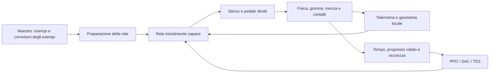

# Guida neurale diretta — Maestro come insegnante iniziale

**20 ottobre 2026 · piano D0–D6 implementato nella rc.25 installata; qualifica scientifica estesa distinta.**

Richiesta approvata: è la rete a guidare. Il Maestro dà una base per imparare,
poi il pilota deve poter cercare traiettorie, frenate, accelerazione, sorpassi
e difesa tramite le conseguenze della fisica. Il precedente contratto
corsia/passo della rc.24 non soddisfa questo requisito.

Il [report rc.25](v09-direct-driving-report.md) descrive l'implementazione,
le due basi neurali preparate A/B, i quattro confronti completi e i limiti.
Questo documento conserva anche le prime sonde come storico: i loro default
respinti non sono quelli selezionati per la consegna.

## 1. Contratto deciso

- **Sterzo** normalizzato [-1,1], sull'intera corsa fisica della vettura.
- **Pedale firmato** [-1,1]: positivo acceleratore, negativo freno, zero rilascio.
  È il contratto fisico già supportato dal simulatore: pieno gas e pieno freno
  disponibili, esclusi i due pedali contemporanei. Un'eventuale futura guida
  con frenata e accelerazione simultanee richiederà un contratto a tre uscite.
- Nessuna traduzione in corsia o velocità desiderata, nessun tetto di 36/45 km/h,
  nessuna limitazione laterale a 0,9 m/s e nessun bot che corregge le azioni.
- I limiti di corsa/velocità meccanica dello sterzo, potenza, gomme, attrito,
  trasferimento di carico e collisioni restano nella **fisica**. Non sono un
  intervento del Maestro.
- Decisione iniziale 10 Hz, fisica 60 Hz; comando mantenuto fra decisioni.
  Confrontare 10/20 Hz se una prova riproduce un limite concreto di controllo.
  Non promettere più fluidità del display aumentando gli update della rete.
- Maestro resta bot esplicito in rosa, eventuale avversario e produttore di
  esempi; la rete in Qualifica/Gara e nel perfezionamento guida da sola.

## 2. Preparazione: apprendere una guida che regge senza insegnante

Prima imitazione supervisionata di esempi di sterzo/pedale; poi esecuzione
**della rete**, raccolta degli stati che visita, etichettatura separata del
Maestro e aggiornamento del dataset. Nessuna miscela nascosta durante la prova
che certifica la capacità autonoma.

Questa aggregazione affronta il cambiamento di distribuzione causato dagli
errori del pilota, descritto da [DAgger — Ross et al., PMLR 2011](https://proceedings.mlr.press/v15/ross11a.html).
Il prototipo implementa davvero etichette sugli stati visitati dalla rete;
non chiama DAgger un semplice buffer di traiettorie del bot.

La base va verificata su partenze, recuperi, curve, frenate e più giri. Per
Tattico servono anche dimostrazioni di traffico; una base addestrata solo con
sensori rivali sempre a zero non certifica sorpasso o difesa.

Durante il perfezionamento i premi e la fisica devono poter favorire una
soluzione diversa e più veloce del Maestro. Niente penalità permanente per
lo scostamento dalla sua traiettoria o dal suo pedale. Gli eventuali esempi
conservati nel replay non diventano un filtro delle azioni a runtime.

## 3. Sensori e parametri

Nuovo contratto `direct-physical-90-v1`, distinto anche a parità di dimensione
dal vecchio `race-residual-90-v1`. Nessun comando del Maestro fra gli ingressi.

| Gruppo | Dato disponibile nel prototipo | Significato / limite |
| --- | --- | --- |
| Moto | Velocità longitudinale/laterale, yaw rate, sterzo effettivo e accelerazioni | Feedback dello stato fisico, non una velocità obiettivo. |
| Pneumatici | Angoli di deriva anteriori/posteriori, margini del corpo vettura | Permettono di correlare comando, scivolamento e perdita di traiettoria. |
| Strada | Raggi anteriori/laterali/posteriori, orientamento/offset, geometria locale a 4/8/15/40/80/150 m e curvature | Mappa locale osservabile; non una traiettoria ottima già calcolata. |
| Vettura | Massa, potenza, forze motrice/frenante, passo, baricentro, inerzia, rigidezza laterale, corsa/velocità sterzo e ripartizioni | Metadati noti del simulatore. Esporli non significa che una rete allenata su un solo valore sappia generalizzare. |
| Fondo | μ configurato composto e resistenza al rotolamento | μ vero noto è informazione esplicita del simulatore, **non una stima appresa**. Studiare poi incertezza/variazioni locali e stima tramite risposta delle gomme. |
| Rivali | Fino a tre vetture vicine, posizione/velocità relativa, orientamento, distanze dei corpi e rischio di collisione | Nessuna loro azione futura o intenzione privilegiata. |
| Memoria breve | Due comandi precedenti; dinamica attuale nella telemetria | Non è ancora una rete ricorrente o un modello appreso della fisica. |

La rete non riceve posizione assoluta/ID pista, linea ideale, comando bot,
bersaglio di passo o etichette della fase di addestramento. Il critic mantiene
il contesto del compito finito/continuo; il futuro non entra nell'attore.

Prima di dichiarare adattamento a gomme, auto o fondi differenti: variare quei
parametri in raccolta, mantenere valori/scenari separati per la verifica e
misurare sicurezza e tempi. I 90 ingressi da soli non costituiscono tale prova.

## 4. Premi e perfezionamento

- Progresso valido, costo del tempo, tagli/limiti pista, incidenti, stallo e
  sottosterzo dannoso restano osservabili e contabilizzati separatamente.
- Shaping potenziale alla decisione con gamma coerente e terminali/troncamenti
  distinti; non premiare il pedale, la velocità fuori pista o il giro invalido.
- Più gas conviene solo se produce progresso/tempo migliore senza perdere la
  capacità di completare la prova. Frenare prima della curva deve poter essere
  vantaggioso per un giro complessivamente più rapido.
- Sorpasso confermato con spazio e permanenza, nessun doppio premio dallo stesso
  affiancamento; difesa con regole osservate e contatti attribuiti separatamente.
- In guida diretta le inversioni difensive si osservano dalla **traiettoria
  effettiva**: non esiste più una corsia richiesta da cui ricavare le intenzioni.
- Candidato e campione congelato restano distinti; salvataggio/ripresa includono
  comando mantenuto, memoria dei comandi, RNG, replay/rollout e verifiche.

PPO ottimizza dati della propria policy: non inserire dimostrazioni del Maestro
nel rollout fingendo che siano azioni campionate dalla policy corrente.
[Riferimento PPO — Schulman et al.](https://arxiv.org/abs/1707.06347).
Per SAC/TD3 la preparazione dei critic e la transizione dall'imitazione vanno
progettate esplicitamente: la prima prova dimostra che riusare la vecchia
configurazione residuale può distruggere rapidamente una buona guida iniziale.

## 5. Compatibilità, reset e rosa

**Aggiornamento autorizzato ed eseguito, 20 ottobre:** l'utente conferma che
l'intero archivio è di prova e può essere azzerato. Eseguito il reset completo
del Gioco su tutti i circuiti/obiettivi: cinque piloti nuovi a zero passi/secondi,
nessun checkpoint, nessuna sessione/storia/qualifica/PB/record o memoria personale
nell'archivio attivo. Copia di ripristino esterna completa, 88 file verificati;
preferenze e tema conservati. Nessun modello delle sonde importato.
[Ricevuta reset](evidence/v09-game-reset-2026-10-20/board/receipt.json).

Il primo reset usava le inizializzazioni rc.24. La nuova consegna rc.25
ricrea nuovamente l'archivio, secondo la stessa autorizzazione, con reti A per
Crono/PPO, Memoria/SAC e Linea/TD3, B con traffico per Tattico/TD3 e Maestro
geometrico esplicito. Ogni rete guida sterzo e pedale; il bot serve nella
preparazione offline e come avversario/riferimento.

**Non reinterpretare i pesi residuali.** Il nuovo protocollo rifiuta i vecchi
checkpoint. Basi e provenienza sono asset di prodotto versionati, preparati in
questo lavoro; nessun campione RL della ricerca viene importato come progresso
personale. Reset di pesi personali, replay, qualifiche, sessioni e PB, con
backup esterno e rollback; preferenze e tema conservati e verificati nella
[ricevuta rc.25](evidence/v09-direct-implementation-2026-10-20/board/final-receipt.json). Il caricamento degli asset non esegue training; Start resta
l'unico ingresso nell'attività del Gioco.

## 6. Prime sonde storiche, precedenti alla selezione rc.25

[Evidenze](evidence/v09-direct-driving-2026-10-20/).

Implementati `game_direct.py` e `game_direct_trainer.py`: policy con attuatori
diretti, sensori senza insegnante, adapter della policy, salvataggio/ripresa,
PPO/SAC/TD3 sul nuovo spazio di azione. Percorso privato, non selezionato dai
profili dello store o installato sulla scheda.

- Dataset iniziale: 6.144 stati fisici campionati sull'ovale nominale; quattro
  round da quattro rollout della rete con nuove etichette del Maestro. MLP 90
  ingressi, 64 neuroni nascosti, due uscite. Nessuna chiamata del Maestro nella
  prova finale di guida.
- Cinque semi di inizializzazione/ottimizzazione 31–35; cinque prove finite
  ciascuno: **25/25 completate**, senza limiti pista o contatti. Tempi circa
  36,72–36,95 s: capacità iniziale imitata, non vantaggio appreso sul Maestro.
- Test di autorità: pieno gas resta tale oltre 45 km/h; sterzo e freno possono
  raggiungere tutta la corsa. Test che rendono impossibili le chiamate al bot
  durante osservazione/guida e test di ripresa a metà di un comando mantenuto.
- Prima sonda a 49.152 passi per ciascun metodo, seme 31: PPO 36,95→35,13 s;
  SAC e TD3 producono candidati che non completano la prova, mentre il campione
  iniziale resta conservato. **Non promuovere quei default off-policy.** La sonda
  precede il completamento del collegamento delle regole tattiche al nuovo
  prefisso del premio: non è una qualifica del traffico.

Confronto PPO completo su cinque semi, sorgenti congelati e **49.152 passi
fisici raccolti per seme**: tutti e cinque migliorano la propria base. Mediana
fra semi **36,850→35,683 s**, riduzione **3.17%**; 25/25 prove finali
valide senza contatti/limiti pista. Banca finale 720001–720005, distinta dai casi
di raccolta, aggregazione e promozione. Sono prove finite con partenza da fermo,
non PB ufficiali. Cinque semi non equivalgono a cinque piste o fondi diversi.

Serie separate di tre giri: cinque basi e cinque campioni, **10/10 serie con
3/3 giri puliti**, nessun ritiro/limite pista. Non è un confronto di gara nel
traffico. [Risultati PPO](evidence/v09-direct-driving-2026-10-20/ppo-summary.json).

**42 test passati**, inclusi i percorsi residuali precedenti, gradienti/ripresa
e nuovo contratto; tre oggetti Qt non raccoglibili segnalati al teardown, senza
fallimenti. Il primo test aveva riprodotto una cache di comandi diretti non
svuotata al reset completo: corretto e verificato. Un controllo aggiuntivo
impedisce a un avversario diretto di cambiare il marcatore delle regole dell'ego;
è l'unica modifica di codice dopo il congelamento della campagna solo.
[Ricevuta e hash](evidence/v09-direct-driving-2026-10-20/receipt.json).

La prima taratura SAC/TD3 resta respinta. Questo confronto non autorizza a
rendere disponibili tre piloti incapaci di conservare la base: la preparazione
dei critic e una transizione stabile restano lavoro esplicito prima della
consegna del nuovo percorso.
Nessun benchmark ARM, qualifica GUI, attestazione di adattamento ad altri fondi
o apprendimento tattico generale acquisiti da queste prove PC.

## 7. Piano ufficiale e gate

| Fase | Lavoro | Condizione di chiusura |
| --- | --- | --- |
| D0 — Autorità | Contratto diretto e isolamento docente | Implementato: piena corsa, bot assente dagli attuatori e ripresa esatta; test PC e ARM positivi. |
| D1 — Base neurale | Asset versionati con provenienza, imitazione + aggregazione | A/B selezionate e congelate, prove di guida e gare miste; una preparazione selezionata per ruolo, non cinque preparazioni indipendenti. Robustezza estesa aperta. |
| D2 — Fisica osservabile | Sensori di dinamica e metadati, parametri variabili in raccolta | Implementato; prove limitate con massa/potenza/grip variabili. Auto, piste e fondi molto diversi ancora da qualificare. |
| D3 — Perfezionamento | PPO/SAC/TD3 diretti con avvio critic e transizione graduale | Cinque semi completi per metodo, banca finale separata, quattro repliche esatte. Mediane PPO −1,24%, SAC −15,09%, TD3 −4,48%; uniformità del vantaggio aperta. Tattico a budget doppio, nessun guadagno ulteriore misurato. |
| D4 — Traffico | Base B da dimostrazioni, verifiche abilità e griglie | Implementato; Tattico 45/45→45/45 senza contatti/uscite/violazioni nella banca finale. Capacità insegnata conservata, nessun incremento tattico attribuito al RL. Gare miste concluse anche con contatti: competenza generale aperta. |
| D5 — Ripartenza pulita | Reset completo autorizzato con nuova base diretta | Installazione con scambio atomico/backup e cinque piloti a zero verificata; 632 hash conformi, nessun dato di prova attivo. Nessun vecchio replay/certificato trasferito. |
| D6 — UX e scheda | Comandi reali, fasi di preparazione/guida, dossier e plancia | Implementato; 45 test PC e 16 ARM passati; Base/Functional/Apple EGLFS 960×640 e installazione passati, Qualifica GUI e Gara 5/5 su tre giri. FPS ottici e uso prolungato aperti. |

Il [report di attuazione](v09-direct-driving-report.md) e la ricevuta finale
sono il riferimento per stato installato e perimetro verificato. Il piano
architetturale è realizzato; i risultati scientifici non uniformi restano
espliciti e non si trasformano in gate dichiarati superati.
Una rete che controlla tutto può inizialmente sbagliare di più: gli errori vanno
appresi e misurati, non nascosti con interventi geometrici durante la guida.

## Seguito D7 — scuola guida, consegna rc.26 del 21 ottobre

Il [report rc.26](v09-driving-school-report.md) attua la diagnosi di velocità costante e fondamenti: docente fisico di preparazione, esperti neurali e selezione allenabile, lezioni, esplorazione coerente, probabilità PPO, conservazione del campione e verifiche di gara, salvataggi e nuova epoca con storico preservato. Cinque semi per metodo inclusi quelli prodotto, banca finale e repliche esatte, tre temi nativi e installazione sono documentati separatamente. I vecchi dati di prova non sono nuovamente eliminati: quattro nuovi attori preparati, critic/replay iniziali e precedenti checkpoint archiviati. Generalizzazione, uso di ore, competenza tattica superiore e FPS ottici restano aperti.
