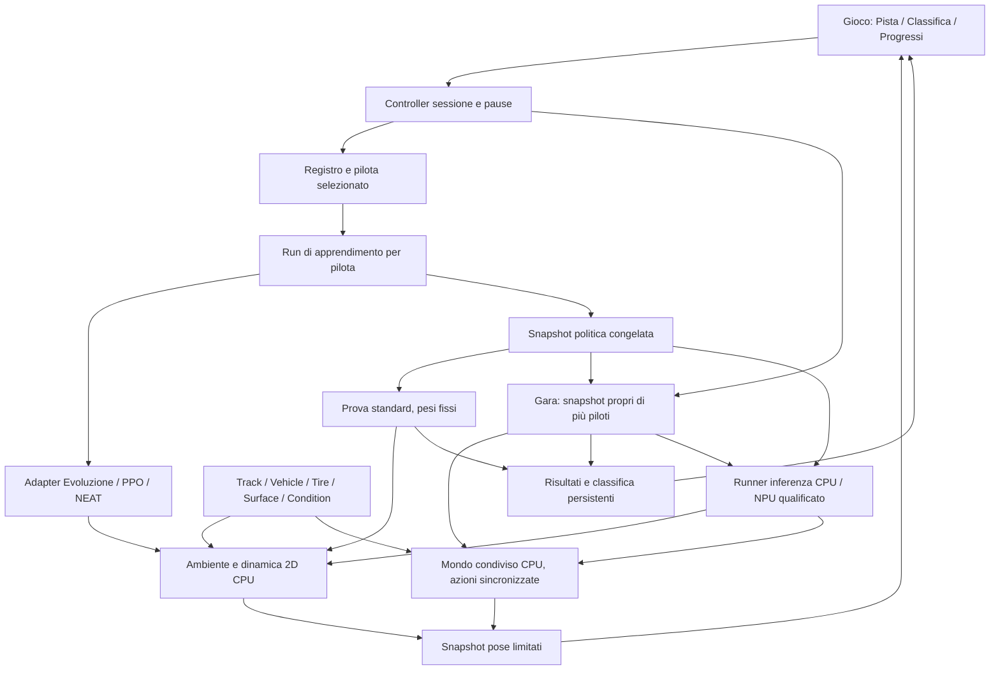

# v0.9 · Gioco — piloti persistenti, classifica e simulazione estendibile

**Aggiornamento 13 ottobre, requisito aggiunto:** ogni pilota conserva una memoria personale di guida, riutilizzata automaticamente su nuovi circuiti e future vetture; esperienza locale e qualifiche restano specifiche del contesto. Il nuovo [studio, sezioni 5.1–5.8](game-offroad-parameters-transfer-study.md#51-requisito-memoria-personale-e-riuso-automatico) definisce base/versioni, inizializzazione dopo Start, paradigmi, ripasso e conservazione delle abilità. Requisito pianificato nel MasterPlan 2.66; non ancora implementato nella rc.11.

**Approfondimento 11 ottobre, analisi:** [impostazioni e circuiti](game-settings-circuits-ux-study.md). Geometria condivisa tra sensori/fisica/render, campioni/checkpoint per circuito, migrazione e classifiche per ambito; concept tecnico offline, non nuova competenza o contenuto installato.

**Aggiornamento rc.6:** [vista Pilota e dossier](v09-pilot-dossier-report.md), durata/sessioni/profili/risultati e reset confermato con storico conservato; API 2.9, 68 superfici.

**Aggiornamento rc.5:** [Gara e guida PPO](v09-race-ppo-report.md): una vettura per pilota, reti salvate congelate, 3/5/10 giri e dimostrazione PPO distinta dai tentativi di apprendimento.

## Stato implementazione · 11 ottobre 2026

La candidata corrente è **0.9.0-rc.6**, con [ottimizzazioni del motore e delle scene](v09-game-performance-report.md): menu spiegato, Controllo/Passo, campione verificato e Progressi dei tempi implementati/installati. [Nuovo report e limiti](v09-game-settings-pace-report.md); la [consegna rc.2](v09-game-implementation-report.md) conserva il confronto CPU/NPU e le prove precedenti. Il testo seguente conserva lo studio precedente; i candidati numeric9/30 sono sostituiti in questa build da race-32-v1, rete 32→16→2 e fisica f1-2. NPU verificata nella rc.2 con una politica appresa, CPU scelta dopo misure; PPO/NEAT e guida nel traffico restano da qualificare.

10 ottobre 2026 · revisione 2 · approfondimento S0 · SmartPC / DeskPulse.

**Stato: analisi, ricerca e specifiche candidate.** Questo documento non implementa il gioco e non qualifica prestazioni sulla Orange Pi. Integra il [MasterPlan](release-masterplan.md), lo [studio algoritmi](game-learning-algorithms-study.md), lo [studio GUI/UX](v09-game-gui-ux-study.md) e il [dossier NPU](npu-ai-games-study.md). La richiesta attuale autorizza l'analisi e l'inserimento nel piano ufficiale; non avvia installazioni o sessioni sulla scheda.

**Direzione di prodotto aggiornata:** un gioco locale nel quale si creano **piloti con identità, apprendimento e storia persistenti**. **si seleziona e allena un pilota alla volta**, con parametri definiti; si conserva il suo modello e in **Gara si sfidano contemporaneamente più piloti già addestrati**, ciascuno con la propria rete congelata. Prima un ovale asfaltato asciutto e una vettura standard; una vista Classifica nella stessa famiglia Gioco. Predisporre dati e contratti per circuiti, fondi, condizioni e vetture differenti. La RAM disponibile può essere utilizzata dopo Start, senza il precedente tetto di 256 MiB. Avvio e pausa restano espliciti.

## 1. Valutazione di fattibilità

**Giudizio progettuale: plausibile per una simulazione 2D contenuta, da qualificare con un prototipo.** La camera fissa e il modello numerico del veicolo consentono di separare fisica, apprendimento e disegno. La simulazione può includere massa, potenza, frenata e aderenza senza introdurre subito sospensioni 3D o un motore automobilistico completo. Il numero sostenibile di tentativi contemporanei e il passo interno della fisica non sono ancora misurati.

| Requisito | Proposta | Evidenza ancora necessaria |
| --- | --- | --- |
| Ogni pilota impara | Politica/checkpoint propri, seed e profilo di apprendimento persistenti. | Miglioramento riproducibile e ripresa corretta. |
| Gara | Due piloti inizialmente, quattro come obiettivo candidato; politiche proprie congelate in un mondo condiviso. | Avversari osservabili, contatti, griglia, giri e ordine di arrivo; carico board. |
| Classifica | Risultati Gara e categoria separata Prova standard, a condizioni comuni. | Ordinamenti distinti, giri validi e provenienza dei risultati. |
| Vettura standard | Modello 2D parametrico con limiti longitudinali e laterali. | Test della dinamica e carico sulla board. |
| Fondi diversi | Materiale, condizioni e gomme concorrono all'aderenza effettiva. | Taratura e stabilità; differenze verificabili nel comportamento. |
| Più vetture | Schede di dati indipendenti da pilota e renderer. | Compatibilità delle osservazioni e comparazioni corrette. |
| 60 FPS | Pista statica, pochi veicoli disegnati, snapshot limitati. | Qualifica della GUI con training e fisica attivi. |
| NPU | Inferenza delle politiche congelate, con modelli distinti per pilota. | Conversione, parità e utilità misurate; training CPU iniziale. |

Fonti primarie mostrano precedenti, non prove per SmartPC: F1TENTH è un ambiente di ricerca per guida autonoma con simulatori; la sua scala 1:10 e i suoi parametri non si trasferiscono automaticamente alla nostra vettura. [Lavoro F1TENTH, PMLR 2020](https://proceedings.mlr.press/v123/o-kelly20a.html).

## 2. Il pilota è un'entità del gioco

Un **pilota** non è il singolo individuo di una generazione né una copia ambiente PPO. Ha nome, numero, identità stabile e un percorso di apprendimento che continua tra sessioni. Il comportamento emerge dalla politica appresa; il nome o il colore non gli attribuiscono abilità fittizie.

| Entità | Contenuto proposto | Durata |
| --- | --- | --- |
| `Driver` | driverId, nome, numero, profilo attivo, storia, checkpoint/campione e stato. | Persistente. |
| `LearningProfile` | Metodo, rete, iperparametri, sensori, ricompense e curriculum versionati. | Versione immutabile durante una sessione. |
| `TrainingRun` | Una sessione del pilota: seed, scenari, tempo, passi, fasi, risultati. | Da Start al termine; metadati durevoli. |
| `Attempt` | Singolo individuo/genoma o ambiente/episodio che contribuisce al training. | Transitorio; identità locale al run. |
| `PolicySnapshot` | Pesi/grafo congelati e versioni delle trasformazioni ingresso/uscita. | Artefatto immutabile con hash. |
| `EvaluationBatch` | Prova dei piloti su una configurazione e scenari comuni. | Risultati durevoli e pubblicati a completamento. |
| `RaceSession` | Partecipanti/snapshot, griglia, regole, stato comune e risultato della gara. | Persistente; mondo attivo transitorio. |
| `Leaderboard` | Vista derivata dei risultati qualificati per Gara o Prova standard. | Ricostruibile dai risultati. |

Il vincitore di una generazione aggiorna il campione del **medesimo pilota**; non crea un nuovo personaggio. Nuovo pilota e discendente/clonazione di una politica sono operazioni esplicite: un discendente ha ID nuovo e parentPolicyId, senza ereditare risultati come se fossero propri. La clonazione non è necessaria alla prima versione.

La prima rosa candidata è **quattro piloti**, non un tetto permanente. Ogni pilota può avere molte varianti interne durante l'allenamento. La UI mostra il nome del pilota e, nei dettagli, il numero del tentativo. I colori distinguono identità; non indicano una potenza o un talento inventato.

## 3. Cosa può differenziare l'apprendimento

I profili sono preset riproducibili, non migliaia di slider nel Menu della dashboard. Variabili candidate:

| Famiglia | Variabili | Modalità di introduzione |
| --- | --- | --- |
| Metodo | Evoluzione fissa, PPO, NEAT. | Evoluzione iniziale; altri backend dopo i loro gate. |
| Rete | Numero di strati/neuroni, attivazioni, topologia fissa/evolutiva. | Architetture validate; precisione e mapping versionati. |
| Esplorazione | Seed, ampiezza delle mutazioni, dispersione delle azioni. | Diversità tra piloti, documentata nei profili. |
| Ottimizzazione | Popolazione/elite; learning rate, rollout, batch, epoche PPO; specie/stagnazione NEAT. | Parametri pertinenti al metodo, senza fingere equivalenze. |
| Obiettivo | Peso di progresso, tempo, uscita e regolarità dello sterzo. | Stili candidati da osservare, non attributi garantiti. |
| Curriculum | Scenari, partenze, ordine dei circuiti/fondi. | Primo ovale; ampliamento controllato successivo. |
| Informazioni | Sensori, stato della vettura, eventuale contesto fisico. | Profili osservativi dichiarati e compatibilità esplicita. |

Per la prima rosa tutti possono usare Evoluzione con seed/profili diversi. Proposta prudente: confrontare prima stessa rete e seed diversi, poi introdurre una differenza di profilo per volta. PPO e NEAT aggiungeranno realmente metodi diversi quando disponibili; non mostrare piloti “PPO” se il worker esegue Evoluzione.

Un pilota candidato “prudente” può penalizzare maggiormente le uscite, uno “veloce” il tempo. Sono etichette del profilo di training: la condotta va dimostrata dalle traiettorie. La classifica usa sempre regole comuni, indipendenti dal premio privato del pilota. Mostrare tempo e passi di allenamento evita di attribuire al metodo la differenza fra un pilota nuovo e uno allenato per ore.

**Cambio profilo:** versione nuova, evento nella storia e compatibilità esplicita. Cambio algoritmo/topologia incompatibile avvia un nuovo percorso del pilota e conserva il precedente snapshot; non si promette conversione automatica o continuità dei pesi. Cambio dei soli iperparametri può proseguire se il backend lo supporta e lo registra.

## 4. Ogni pilota ha un cervello distinto

Per PPO ogni pilota possiede **una propria politica, valutatore, ottimizzatore e seed**. Le copie ambiente del suo run raccolgono esperienze per quella politica. Condividere una singola rete tra tutta la rosa produrrebbe un unico cervello con nomi diversi: non soddisfa la richiesta di apprendimento individuale.

Per Evoluzione e NEAT ogni pilota possiede la propria popolazione/linea di evoluzione e campione. Gli individui interni non sono automaticamente piloti della classifica. Gli adapter dello studio precedente si applicano al run di un pilota.

### Un solo pilota in apprendimento, scelto dall'utente

Il flusso concordato è **scegli pilota → imposta profilo → Start → allena → Pausa/salva → scegli un altro pilota oppure Gara**. Un solo `TrainingRun` aggiorna pesi, popolazione o ottimizzatore alla volta. Nessuna rotazione automatica della rosa: gli altri piloti mantengono i propri checkpoint e non ricevono allenamento implicito. Parametri/metodo si cambiano da fermo, con la compatibilità descritta nel §3.

Il pilota persistente può continuare ad allenarsi in sessioni successive. Il checkpoint riprende il suo percorso; lo snapshot esportato rappresenta una precisa versione di guida utilizzabile in gara. Non aspettare un astratto “100% addestrato”: distinguere modello disponibile, competenza provata e compatibilità con la gara.

Un run PPO può avere più copie ambiente e un run evolutivo più individui: sono tentativi dello **stesso** pilota. Se il curriculum contiene avversari, questi sono bot o snapshot congelati: solo il pilota selezionato impara. Conservare altri stati utili in RAM non significa eseguirne gli ottimizzatori.

La pausa interrompe anche minibatch, selezione/riproduzione e passaggi di curriculum. Si può cambiare pilota solo dopo ack e checkpoint coerente; un errore di salvataggio conserva il precedente stato valido e viene dichiarato. Niente apprendimento all'avvio, a vista chiusa o durante Gara.

## 5. Allenamento, gara, prova e osservazione

| Modalità | Pesi | Cosa vede l'utente | Effetto sulla classifica |
| --- | --- | --- | --- |
| **Impara** | Cambiano solo per il pilota selezionato. | I suoi tentativi e il miglioramento; eventuali avversari fissi del curriculum. | Nessun risultato Gara ricavato dalla fitness. |
| **Gara** | Congelati e distinti per tutti i partecipanti. | Piloti già addestrati che corrono insieme nella stessa pista. | Ordine di arrivo e risultato della gara conclusa. |
| **Prova** | Congelati per ogni pilota partecipante. | Valutazioni individuali comparabili, senza traffico. | Categoria tecnica Prova standard separata dalle gare. |
| **Campione** | Congelati. | Un pilota salvato che guida. | Osservazione; nessuna gara/prova classificata implicita. |

Dopo una pausa si può cambiare modalità o pilota. Ogni lavoro pesante richiede Start; consultare Classifica non avvia calcoli. In Impara i tentativi indipendenti possono apparire sovrapposti come ghost; in Gara ogni auto è un partecipante nello stesso mondo. La gara simultanea entra nel primo perimetro v0.9; il cronometro rimane un utile strumento di valutazione.

### 5.1 Gara: ciclo e regole candidate

1. Da fermo scegliere almeno due piloti, una versione salvata per ciascuno e la configurazione comune. Prima vettura/gomme standard su ovale asciutto.
2. Verificare hash, osservazioni/azioni, fisica e idoneità alla gara; se manca un requisito mostrarne il motivo. Metodi diversi possono sfidarsi se qualificati nello stesso regolamento.
3. Fissare `RaceSession`, griglia, seed e regole prima di Start. Candidato: tre giri, partenza da fermo, postazioni non sovrapposte e ordine scelto visibile; per confronti ripetuti ruotare la griglia.
4. Start avvia countdown e poi tutte le auto sullo stesso tempo simulato. Ogni rete decide usando il proprio punto di vista dello stesso snapshot precedente; raccogliere tutte le azioni prima di integrare il mondo. Un ordine di chiamata diverso non deve dare a un pilota informazioni più recenti.
5. Controllare contatti, limiti, checkpoint e giri a ogni passo. Nessuna mutazione, aggiornamento PPO o compilazione dei pesi durante la gara.
6. Il primo arrivo valido avvia una finestra finale comune, candidata 30 secondi simulati; limite totale candidato cinque minuti simulati. Gli altri terminano il percorso o ricevono un esito esplicito. Tempi di countdown/pausa non contano; durate definitive da qualificare.
7. Dopo l'arrivo valido la vettura esce dalla fisica al tick successivo; eventuale segno finale non ostacola i concorrenti. Tutti arrivati/ritirati termina prima dei timeout. Congelare e salvare risultato e provenienza; una nuova gara richiede Start. Una sessione interrotta dall'utente o dal worker resta incompleta.

**Contatti, prima regola candidata:** riconoscere collisioni tra sagome orientate e con i bordi, comprese quelle fra sottopassi. Un contatto ritira i veicoli coinvolti, senza attribuire automaticamente una colpa. Dal tick successivo il ritirato esce dalla fisica; eventuale posa finale è un segno visivo distinto, senza ostacolo invisibile. Questa regola permette di studiare evitamento e sorpassi senza promettere subito urti con rimbalzo, danni o spinte realistici. Deve essere provata con due e quattro auto prima della promozione.

Una gara ghost può servire come controllo sperimentale del costo e della guida, con etichetta esplicita. La consegna della gara condivisa richiede avversari percepibili e regola di contatto qualificata. Scia, danni, penalità con attribuzione di responsabilità, pit stop e campionati restano estensioni.

### 5.2 Allenare un pilota anche al traffico

Saper completare l'ovale da soli non dimostra evitamento o sorpasso. Curriculum candidato: guida solitaria → avversario lento fisso → partenze affiancate/inseguimento → traffico con snapshot congelati. In ogni fase si allena **un solo pilota**; gli avversari non imparano. Più rollout possono eseguire copie di questi mondi, tutte riferite al medesimo pilota in apprendimento.

Premi candidati: progresso valido, completamento e tempo, penalità per uscite/contatti; bonus di sorpasso solo se evento verificato e non ripetibile oscillando attorno allo stesso avversario. Valutazioni su posizioni di griglia e avversari diversi dal training verificano la competenza; i numeri definitivi e la soglia d'idoneità restano gate S1. Salvare versioni di curriculum e politiche avversarie: un miglioramento non deve dipendere da un bot cambiato senza traccia.

Un modello solo-solista o con sensori incompatibili resta consultabile e utilizzabile in Campione/Prova. Per Gara proporre allenamento compatibile, preservando lo snapshot precedente; non adattare silenziosamente gli ingressi né applicare un controller esterno che decida i sorpassi al posto della rete.

## 6. Classifica: risultati del gioco verificabili

Nuova vista **Classifica** nella famiglia Gioco. Due categorie: **Gare** (ordine di arrivo delle sessioni concluse) e **Prova standard** (valutazione individuale). La classifica identifica prima la configurazione: circuito/versione, fondo/condizione, vettura/gomme, fisica, azioni/osservazioni ammesse e regolamento. Non mescolare tempi dell'asciutto e del bagnato o di vetture con potenza diversa.

### Posizioni e risultati Gara

Durante Gara: ordinare per giri validi completati e avanzamento lungo il giro, vincolato ai checkpoint ordinati. Non usare distanza euclidea dal traguardo, fitness o miglior tempo di training. Tagli, inversioni e doppiaggi non devono creare avanzamento fittizio. Mostrare posizione del pilota osservato e giro nella fascia; la tabella completa si consulta dopo pausa/fine.

A fine gara: arrivati ordinati per tempo simulato di completamento (incluse eventuali penalità previste dal regolamento); rilevare l'attraversamento entro il passo, senza privilegiare l'indice del pilota. Precisione/pareggi sono dichiarati. Poi non arrivati ordinati per avanzamento valido al termine o al ritiro, con stato **Non conclusa / Ritirato** e nessun tempo d'arrivo inventato. Un ritiro del veicolo è un esito sportivo; arresto del worker/utente interrompe la sessione e non pubblica un vincitore definitivo.

Ogni tabella identifica raceId, partecipanti, snapshot, regole/griglia e configurazione. Conservare le gare precedenti senza sommare punti arbitrari: punti/campionati hanno un futuro regolamento separato. Un pilota riaddestrato conserva i risultati ottenuti dalla sua vecchia versione.

### Prova standard candidata

- Ovale iniziale, vettura standard, gomme standard, asfalto asciutto.
- Cinque scenari di partenza comuni per tutti i piloti; numero definitivo da qualificare.
- Una politica congelata per pilota, con hash, profilo e data; stessa politica in tutto il batch.
- Guida deterministica per i campioni PPO e nessuna mutazione negli altri metodi.
- Giri validi solo con checkpoint ordinati, partenza/traguardo corretti e controllo delle uscite fra passi.
- Tutti i partecipanti completano lo stesso protocollo prima di pubblicare il nuovo batch come classifica corrente.

### Ordinamento candidato, leggibile nei dettagli

1. Numero di prove concluse con giro valido, decrescente.
2. Mediana dei tempi sui soli giri validi, crescente.
3. Miglior giro valido come ulteriore criterio.
4. Se nessuno ha completato giri, avanzamento valido mediano, decrescente.

Un pilota affidabile può precedere uno che realizza un giro rapido ma fallisce gli altri: la UI chiama la tabella “Prova standard” e rende visibile il criterio. Un futuro tabellone puro “Miglior giro” sarà una categoria separata. Pareggi reali conservano la stessa posizione; ordine stabile per ID non diventa prova di abilità superiore.

Tempo assente = “—”, mai zero. Pilota non ancora valutato = “Da provare”, fuori dalle posizioni qualificate. Uscite/fallimenti sono risultati; interruzione utente o errore worker sono prove incomplete, non sconfitte. La classifica precedente resta consultabile mentre il nuovo batch è in corso, con stato “precedente” e indicazione del lavoro da completare.

Se il pilota impara dopo la prova, la sua nuova policyVersion non aggiorna retroattivamente i tempi. La riga rimanda allo snapshot provato e può indicare “Modello aggiornato · da riprovare”. Copiare un campione non duplica record; i risultati appartengono a driverId e policyHash della prova.

### Estensioni future

- Classifiche per circuito, fondo, vettura/classe e configurazione gomme.
- Serie di prove su più circuiti, punti e regolamento espliciti.
- Categoria “vettura uguale” per confrontare piloti e categoria “pacchetto pilota+auto” se richiesta.
- Confronto scientifico separato con uguali passi/tempi di training: la classifica del gioco misura la guida, non prova da sola che un algoritmo sia superiore.

La valutazione separata e la variabilità delle politiche durante il training sono richiamate nelle [indicazioni SB3](https://stable-baselines3.readthedocs.io/en/master/guide/rl_tips.html); il regolamento sopra è una nostra proposta di prodotto.

## 7. Parte simulativa: quale livello serve

La vettura deve accelerare, frenare e curvare secondo parametri coerenti. Per fondi e gomme, cambiare solo il colore della pista non soddisfa il requisito. Serve una dinamica che colleghi forze e aderenza al movimento.

| Livello | Contenuto | Ruolo proposto |
| --- | --- | --- |
| **F0 · Cinematico** | Passo, velocità, sterzo, limiti e collisioni. | Baseline per verificare pista e apprendimento; non sufficiente a dichiarare fisica di slittamento. |
| **F1 · Dinamico 2D** | Stato longitudinale/laterale, imbardata, sterzo, trazione/frenata, forze pneumatici limitate. | Candidato per la prima vettura standard del prodotto. |
| **F2 · Dinamico ampliato** | Assali/materiali locali, curve gomme più ricche, trasferimenti approssimati e condizioni variabili. | Fondi/vetture multipli dopo qualifica F1. |
| **F3 · Alta fedeltà** | Sospensioni articolate, pneumatici avanzati, temperatura/usura, acqua e terreno deformabile. | Fuori dal primo perimetro; nuova fattibilità necessaria. |

La raccomandazione aggiorna la precedente baseline puramente cinematica: F0 resta strumento di studio, ma **S1 confronta F0 e F1**, e la prima v0.9 simulativa qualifica una F1 contenuta sull'asciutto. Non si dichiara consegnato il requisito fondi/gomme mediante una sola limitazione della velocità.

F1TENTH documenta un modello single-track dinamico con imbardata e angolo di deriva; questo rende plausibile un nucleo numerico piccolo. Il sorgente gestisce separatamente le velocità basse. [Dinamica documentata](https://f1tenth-gym.readthedocs.io/en/v1.0.0/api/dynamic_models.html), [implementazione di riferimento](https://raw.githubusercontent.com/f1tenth/f1tenth_gym/main/gym/f110_gym/envs/dynamic_models.py). Questi precedenti non verificano il nostro modello gomme né la Orange Pi.

## 8. F1 candidata: stato e forze

Proposta di stato: posizione `x,y`, orientamento, velocità longitudinali/laterali nel riferimento del corpo, velocità di imbardata e sterzo effettivo. Le due azioni mantengono il significato precedente: sterzo richiesto e acceleratore/freno firmato; un attuatore limita la velocità di variazione dello sterzo.

Per ogni passo:

1. Aggiornare lo sterzo nei limiti di angolo e velocità dell'attuatore.
2. Ricavare trazione e frenata dal comando e dai parametri della vettura.
3. Stimare slip degli assali e forze laterali da un modello pneumatici semplice.
4. Applicare limiti combinati alle forze disponibili, secondo materiale/condizione/gomma.
5. Integrare velocità, imbardata e posa; controllare attraversamenti/collisioni e checkpoint.
6. Pubblicare osservazione e risultato, separati dal renderer.

### Longitudinale

Potenza, massa e forza motrice devono avere effetti diversi. Candidato: forza di trazione limitata da una forza massima ai bassi regimi, dalla potenza disponibile a velocità superiore e dall'aderenza; forza frenante con proprio limite; resistenza al rotolamento e aerodinamica sottraggono forza. Un termine del tipo `P/max(v, v_epsilon)` richiede gestione esplicita del regime vicino a zero: non autorizza accelerazione infinita alla partenza.

La scheda standard usa parametri fittizi dichiarati in unità SI, da tarare nel pilot, non specifiche di un'auto reale inventate. All'inizio niente cambio marce manuale, curve motore complete o ripartizione della trazione avanzata. Un futuro drivetrainVersion potrà aggiungerli preservando la provenienza dei risultati.

### Laterale e aderenza combinata

Proposta semplificata per ogni assale: forza laterale iniziale da rigidezza e slip, poi saturazione rispetto al carico normale e all'aderenza. La trazione/frenata e la forza laterale condividono il limite disponibile: non concedere contemporaneamente frenata massima e curva massima indipendenti. Un vincolo circolare/ellittico è candidato al primo modello; la legge effettiva va testata e versionata.

Il codice CarRacing applica limiti alle forze longitudinali/laterali e una proprietà di attrito del tratto di strada per le ruote. È un precedente utile di guida dall'alto; il nostro modello standard non eredita le sue costanti o scala. [Sorgente CarRacing dynamics](https://raw.githubusercontent.com/Farama-Foundation/Gymnasium/main/gymnasium/envs/box2d/car_dynamics.py).

### Stabilità e passo

Partire da decisioni a 60 Hz; confrontare integrazione fisica con 1/2/4 sottopassi interni per decisione, mantenendo il tempo simulato. Più sottopassi non cambiano il ritmo grafico e non moltiplicano automaticamente le decisioni della rete. Confrontare un integratore semplice e uno di riferimento più accurato in S1, specialmente a bassa velocità, sterzo forte e cambio aderenza.

I riferimenti Box2D raccomandano passo fisso e descrivono il compromesso fra accuratezza e costo dei sottopassi. Non legare la fisica ai frame visuali. [Simulazione Box2D](https://box2d.org/documentation/md_simulation.html). Questo non obbliga a usare Box2D o il numero di sottopassi dei suoi esempi.

Per la F1 standard non simulare quattro corpi ruota con giunti soltanto per poter disegnare quattro ruote. Una carrozzeria orientata e forze per assale possono ridurre il numero di stati; il contatto con il fondo viene comunque definito nel modello. Le ruote decorative non sono un sostituto della fisica.

## 9. Fondi, condizioni e gomme come dati separati

**Asfalto/sterrato** descrivono il materiale; **asciutto/bagnato** descrivono una condizione. Sono assi distinti: anche lo sterrato può essere bagnato. Le gomme modificano la risposta su una superficie/condizione, non la sola velocità massima della vettura.

| Profilo | Dati candidati | Prima disponibilità |
| --- | --- | --- |
| `SurfaceProfile` | Materiale, resistenza al rotolamento e parametri di aderenza di base. | Asfalto iniziale; schema per altri fondi. |
| `ConditionProfile` | Umidità/aderenza equivalente e variazioni spaziali definite. | Asciutto iniziale; bagnato omogeneo successivo. |
| `TireProfile` | Compatibilità fondo, risposta/slip, moltiplicatori/curve e limiti. | Gomma standard iniziale. |
| `SurfaceMap` | Segmenti o zone della pista associati ai profili. | Fondo uniforme iniziale; zone miste dopo qualifica. |

Proposta prima estensione: bagnato omogeneo e sterrato omogeneo, con differenze verificabili in frenata e curva. Non scegliere coefficienti fisici universali dal solo nome “bagnato”: i valori sono parametri di gioco dichiarati finché non calibrati contro dati. Effetti più avanzati come aquaplaning, profondità dell'acqua, fango deformabile e usura sono futuri, non inclusi da una voce nel catalogo.

Se la vettura attraversa un confine materiale, specificare come campionare il fondo per assale e aggregare i contatti. All'inizio i due assali possono vedere lo stesso profilo uniforme; la combinazione fra grip longitudinale/laterale e carichi deve restare coerente. La geometria stradale non cambia automaticamente quando cambia il materiale.

La grafica può distinguere i fondi con texture statiche e icone nei dettagli. Particelle di terra/pioggia sono decorazioni opzionali e non necessarie per il requisito simulativo. Non inferire grip o meteo dal colore disegnato.

## 10. Vetture estendibili

Catalogo `VehicleSpec` indipendente dal pilota, con riferimenti a gomme e alla versione del modello fisico. Campi candidati:

- ID/versione/nome; lunghezza, larghezza e passo in metri.
- Massa, baricentro/assali e inerzia d'imbardata se necessari alla F1 scelta.
- Potenza, forza motrice/frenante, resistenze e limiti dello sterzo.
- TireProfile e parametri laterali; modello della trazione previsto.
- Forma di collisione e punti dei sensori; riferimento all'asset grafico.

Prima vettura: stessa sagoma candidata **4,4×1,8 m, passo 2,65 m** già disegnata. Potenza/massa/rigidezze/grip restano da definire e validare nel pilot; non sono già specifiche misurate.

Cambiare potenza deve incidere sull'accelerazione disponibile; cambiare gomme e aderenza su frenata/curva; cambiare passo e inerzia sulla dinamica. Il pilota può essere specializzato in una vettura; il passaggio ad altre può richiedere riaddestramento. Il sistema conserva il suo driverId, ma la competenza provata e i record sono per configurazione.

Il renderer mantiene scala uniforme e usa dimensioni reali del nuovo VehicleSpec: niente auto tutte disegnate grandi uguali quando le collisioni differiscono. Il limite di leggibilità e il fit dei futuri circuiti restano quelli della GUI r2, da qualificare sul pannello.

## 11. Circuiti come contenuti versionati

`TrackSpec` contiene geometria in metri, larghezza/bordi, traguardo, checkpoint ordinati, zone percorribili, punti/varianti di partenza, superficie e visuale statica. I parametri fisici non devono essere codificati nel nome del file PNG.

Primo contenuto: ovale **144×72 m**, strada **10 m**, raggio centrale candidato **31 m** e scala **6 px/m**. Sono quote progettuali esistenti, non una pista già simulata. Le quote di pista e veicolo alimentano insieme renderer, raggi e collisioni.

Per aggiungere un circuito futuro:

1. Validare continuità, bordi, larghezza, intersezioni, checkpoint e partenze.
2. Verificare raggi e percorribilità rispetto alle vetture abilitate; un controller di riferimento prova la pista senza fornire la traiettoria alla rete.
3. Validare mappa superfici/condizioni e unità.
4. Verificare fit uniforme e leggibilità a 960×640.
5. Assegnare versione/hash, poi abilitare training e prove.

Il generatore automatico è successivo al caricamento di piste curate. Cambi geometrici o di materiali producono una nuova configurazione per i record. Curve diverse dentro lo stesso viewport sono il primo ampliamento; circuiti enormi non vengono resi validi rimpicciolendo le auto fino a perderne la leggibilità.

## 12. Osservazioni della rete: aggiornamento necessario

Il profilo `numeric7` dello studio precedente resta candidato per la baseline cinematica F0. Con velocità laterale, sterzo effettivo e gomme, potrebbe nascondere stato necessario al controllo: non fissare definitivamente sette ingressi soltanto per conservare il conteggio 162.

Candidato F1 `numeric9`: cinque distanze, velocità longitudinale, velocità laterale, velocità di imbardata e sterzo effettivo. Normalizzazione e limiti in unità/versioni esplicite. La proposta dà alla rete lo stato dinamico locale senza fornire un percorso risolto. Deve essere verificata per osservabilità e apprendimento; orientamento rispetto alla pista/storia dei sensori restano alternative dichiarate.

Con nove ingressi, una rete `9→16→2` ha **194 parametri**; PPO con attore e valutatore separati `9→16→2` / `9→16→1` ha teoricamente **373 parametri** includendo due dispersioni. Cambia observationVersion; i pesi numeric7 non vengono caricati automaticamente come numeric9. S3 deve esportare l'osservazione/promessa effettivamente qualificata, non una rete storica diversa.

### Profilo gara candidato `race-v1`

`numeric9` solitario non qualifica da solo la percezione del traffico. Predisporre un profilo versionato che aggiunga avversari vicini: candidato tre slot con posizione/velocità relativa nel riferimento dell'auto, orientamento relativo (seno/coseno) e maschera di presenza. Raggio di osservazione, normalizzazione, ordinamento e slot vuoti sono definiti nello schema; nessun ID del pilota o azione futura dell'avversario diventa un ingresso. Con vetture diverse serviranno anche ingombri compatibili o una versione nuova.

Proposta iniziale: sensori locali simulati, con portata dichiarata e uguale per tutti; non spacciarli per una telecamera reale. Confrontare raggi che intercettano anche le carrozzerie e feature relative prima di fissare gli ingressi. Assenza di avversari deve essere uno stato valido fin dall'allenamento solitario; il curriculum di traffico usa la medesima interfaccia. L'architettura race-v1 e i suoi conteggi vanno qualificati separatamente dalla rete numeric9 da 194 parametri.

Un precedente implementativo usa un simulatore con più vetture, raggi sulle altre carrozzerie e controlli di collisione. Non dimostra urti realistici né capacità di sorpasso appresa: sono requisiti del nostro curriculum e della nostra fisica. [Sorgente primario F1TENTH multi-vettura](https://raw.githubusercontent.com/f1tenth/f1tenth_gym/main/gym/f110_gym/envs/base_classes.py).

Per fondi e vetture multipli decidere se il pilota riceve contesto fisico esplicito, una storia osservativa o impara ad adattarsi dal comportamento. Se si forniscono dati come grip nominale o potenza, dichiararli nel profilo: non dare ai soli piloti di un metodo un vantaggio nascosto. Un pilota che guida bene sull'asciutto non è già certificato sul bagnato.

## 13. Architettura proposta

Contratti candidati `DriverRegistry`, `LearningProfile`, `SimulationCatalog`, `EvaluationService`, `RaceSessionController`, `LeaderboardRepository`. Sono nomi di progetto, non classi già implementate. Cataloghi e controller non vivono nel tema; QML consuma dati normalizzati e pose bounded. Estensioni come un nuovo fondo devono aggiungere dati/modello compatibili, senza riscrivere la shell o il registro piloti.

## 14. GUI/UX aggiornata: tre viste nella famiglia Gioco

**Pista / Classifica / Progressi.** L'arena e la fascia di Pista restano quelle approvate: 912×496 e 912×48 nel display orizzontale 960×640, senza titolo locale aggiuntivo. Classifica e Progressi possono usare il normale layout di consultazione del tema; nessuna sidebar sopra la pista.

| Vista | Contenuti essenziali | Comandi |
| --- | --- | --- |
| Pista | Pilota attivo, circuito/vettura nei dettagli, fase e auto osservata. | 5 Start/Pausa, durante attività 4/6 auto e 2/8 visualizzazione. |
| Classifica | Gara/Prova standard; posizione, pilota, arrivo/tempo e stato, con configurazione nei dettagli. | Da fermo 2/8 cambia vista; 5 apre consultazione/selezione e dettaglio pilota secondo il pannello del sistema. |
| Progressi | Pilota selezionato, training e valutazioni, tempo/passaggi reali. | Da fermo; dati separati per pilota/profilo. |

La consultazione della Classifica può mostrare **quattro righe grandi per pagina**, con scorrimento nel pannello attivato da 5; in quel pannello 2/8 seleziona una riga, 5 apre dettagli e 7 torna. Fuori dal pannello 2/8 scorre le tre viste e 4/6 cambia famiglia. È una proposta da verificare con il pattern esistente del sistema, non una modifica dei comandi attivi concordati.

In Simulazione, le frecce non aprono Classifica: prima **5 e ack di pausa**, poi navigazione. Durante Gara e Prova vale la stessa cattura; il contatore descrive la prova reale, non una generazione. Nome pilota nella fascia, numero/alone esterni alla sagoma, sensori della sola auto selezionata. Se si osserva un candidato interno, dichiarare “tentativo” e il pilota proprietario; non mostrare quel candidato come personaggio appena creato.

Menu da fermo: Modalità Impara/Gara/Prova/Campione; pilota e profilo per Impara, partecipanti/snapshot e griglia/regole per Gara, cataloghi disponibili. Confermare i partecipanti prima di Start; nessuna gara con meno di due modelli compatibili. Nuova rosa o cambio profilo sono operazioni esplicite; l'interfaccia non modifica potenza/gomme durante una prova classificata. I cataloghi della prima release espongono un ovale asfaltato asciutto e una vettura; le opzioni future non sono finte scelte funzionanti.

Nuove capability proposte: driverId/driverName, learningProfileRevision, roster e selectedTrainingDriverId, raceId/raceState/participants/lap/position/raceRulesVersion, evaluationState, leaderboardScope/resultVersion, catalogCapabilities; superfici `game.leaderboard` e `game.driver.details`. Le azioni di creazione/selezione/prova richiedono schema, ticket ed esito come le altre azioni pubbliche. Nessuna API registrata da questo studio.

In Gara la fascia contiene modalità, giro/posizione e pilota osservato, senza generazione/loss. 4/6 seleziona il concorrente osservato; Tutte mostra inizialmente le due/quattro vetture, Solo/Sensori cambia soltanto il disegno. Tutti i concorrenti continuano nella stessa fisica anche se nascosti; 5/urgente sospende **tutto il mondo**, comprese reti, timer e avversari.

Le immagini della revisione GUI/UX 2 restano concept della sola baseline: non rappresentano ancora Gara, Classifica, roster o F1 verificata. Serviranno tavole aggiornate e QML nella fase S4; il nuovo documento specifica requisiti, non spaccia le vecchie immagini per preview delle nuove funzioni.

## 15. Persistenza e lifecycle

Proposta: registry e risultati di classifica in un archivio locale con transazioni; file separati per reti/checkpoint grandi, manifest/hash e promozione atomica. SQLite è un candidato coerente con la persistenza del progetto, non una scelta implementata in questa analisi. Un risultato fa riferimento a un artefatto esistente e validato prima di essere pubblicato.

Conservare ID pilota, cronologia profili, sessioni, passi/tempo, campioni e prove con versioni di pista/vettura/fondo/gomme/fisica. La classifica è derivata e può essere ricostruita; non salvare solo posizione e nome perdendo le prove. Pesi modificati non mutano uno snapshot già usato in un risultato.

Start carica il necessario; pausa mantiene lo stato utile in RAM; uscita sospende, checkpoint coerente e rilascio a fine sessione. Crash/reboot recuperano l'ultimo stato durevole valido senza training automatico. Un batch di prova interrotto resta incompleto; ripresa usa i medesimi snapshot/versioni o apre un batch nuovo dichiarato.

Per Gara salvare raceId, policyHash di ciascun partecipante, griglia, regole/versioni, eventi di giro/contatto/ritiro e ordine finale in una transazione. Un cambio del modello di un pilota non modifica la rete caricata nella gara. Ripresa esatta dopo reboot richiede stato dell'intero mondo, RNG, attuatori, timer e tutti gli snapshot: se non qualificata, mantenere la gara incompleta e proporre una nuova gara, senza fingere continuità o assegnare punti. Pausa nella stessa sessione può mantenere il mondo in RAM.

I/O, log e salvataggi non avvengono a ogni frame. Nessuna eliminazione automatica di piloti per liberare RAM; archiviazione/cancellazione sono scelte utente con gestione dei riferimenti ai risultati. La strategia di retention sarà definita nel prototipo, con archivio consultabile e dimensione misurata.

## 16. Costo atteso e piano di misura

Più circuiti nel catalogo non richiedono che tutti siano simulati contemporaneamente. Geometria e texture della pista attiva si possono preparare una volta; registry e classifica sono carichi a bassa frequenza. Il costo cresce soprattutto con tentativi attivi, sensori, query geometriche, sottopassi e aggiornamenti delle reti.

Conto di lavoro, **non benchmark**: `tentativi attivi × 60 × sottopassi` aggiornamenti fisici al secondo di tempo simulato. Con 32 tentativi e 2 sottopassi sono 3.840 aggiornamenti/s; con 128 tentativi e 4 sottopassi sono 30.720. Le cinque query sensore per decisione aggiungono rispettivamente 9.600 / 38.400 query/s, se eseguite una volta per decisione. Il costo di una query dipende dalla geometria e dalla struttura d'accelerazione.

In Veloce i passi per secondo reale possono crescere; misurare simtime/walltime e tenere la pubblicazione 20–30 Hz e la GUI verso 60 FPS indipendenti. Non dedurre il costo della F1 dal numero di stati o dal margine di RAM. Un campione NPU accelera la politica, non automaticamente sensori e gomme.

### Matrice S1/S2 proposta

1. F0/F1 sullo stesso ovale e vettura; 1/2/4 sottopassi, 1/16/32/64 tentativi. Confronto più grande 128/256 solo se utile e sostenibile.
2. Un pilota attivo; cambio esplicito fra quattro piloti salvati, con checkpoint e isolamento. Gara con 2/4 partecipanti; 8 soltanto confronto successivo se utile.
3. Impara / Gara / Prova / Campione; una politica fissa isolata distingue costo rete da costo ambiente.
4. Geometria ovale e circuito curato con più segmenti; materiale uniforme prima delle zone miste.
5. GUI 1/4/8 auto visibili, input/pause/urgenti e provider reali; sessione almeno 30 minuti sulla candidata.

La Gara evita aggiornamenti delle reti, ma aggiunge sensori e contatti in un mondo comune. Quattro auto producono al massimo sei coppie da controllare per sottopasso, otto ne producono 28 in un controllo esaustivo: è un conteggio, non una misura di FPS. MLP minuscole possono essere più convenienti su CPU. Modelli di piloti con pesi diversi non equivalgono a un batch di osservazioni della stessa rete: S3 deve misurare più runner/modelli NPU residenti, caricamenti e latenza complessiva entro il tick, con CPU come riferimento. Il benchmark di un solo campione non qualifica una gara.

Metriche: tempi per dinamica/sensori/collisioni/rete/aggiornamenti, transizioni/s, tempo al miglioramento, RSS/disponibilità, CPU/thread, temperature, frame pacing e ack di pausa. Uso della RAM disponibile autorizzato senza quota fissa; i limiti di adozione derivano da risposta e stabilità. Affinità, Numba o un nucleo nativo si valutano soltanto se il profiler identifica un costo da risolvere.

## 17. Verifiche della fisica e delle classifiche

Gate fisici candidati:

- Partenza/frenata a velocità quasi zero senza divisioni instabili, energia o accelerazioni spurie.
- Traiettoria in rettilineo e curva, sterzo invertito simmetrico, limiti effettivi dell'attuatore.
- Accelerazione coerente con massa/potenza; frenata e curva sensibili alla riduzione di grip.
- Richieste di forze combinate oltre il limite producono saturazione/slittamento coerenti, non aderenza illimitata.
- Risultati convergenti al diminuire del passo; freeze/reset non cambia istantaneamente traiettoria o superficie.
- Cambio materiale, contatti assali, footprint orientato e attraversamenti/checkpoint validi.

Non basta una traiettoria bella: testare curve ad alta velocità e frenata in curva, oltre al controller di riferimento. Le formule/grip restano parametri di gioco fino a calibrazione; niente etichetta “simulatore automobilistico certificato”.

Gate piloti/classifica candidati:

- DriverId stabile attraverso generazioni, aggiornamenti, reboot e archivio.
- Piloti distinti non condividono accidentalmente pesi/RNG/ottimizzatore; tentativi non duplicano il roster.
- Ordine corretto con tutti validi, alcuni falliti, nessun giro, pareggi, pilota non valutato e dato precedente.
- Batch interrotto/fallito non pubblica una nuova classifica completa; prova vecchia mantiene il proprio snapshot.
- Record separati per pista/fondo/condizione/vettura/gomme/fisica/regolamento.
- Stessa prova confrontabile su CPU/NPU solo dopo gate di parità; profili incompatibili non partecipano silenziosamente alla stessa categoria.

Gate Gara candidati:

- Un solo learner durante il curriculum; hash dei modelli avversari immutati. In Gara tutti gli hash restano fissi.
- Snapshot osservativo comune, azioni raccolte prima dell'integrazione; permutare l'ordine dei partecipanti non cambia l'esito oltre la tolleranza qualificata.
- Griglia senza sovrapposizioni, countdown, partenze affiancate, inseguimento, sorpasso, contatto laterale/frontale e doppio ritiro.
- Collisioni fra sottopassi, eliminazione fisica del ritirato e renderer coerente; nessun passaggio attraverso un'auto a velocità alta.
- Posizioni con doppiaggi/tagli/inversioni, arrivi nello stesso tick, pareggi, timeout, nessun arrivato e finestra finale.
- 5/urgente congela l'intero mondo; selezione/visibilità non cambia tempi, collisioni o decisioni. RaceId e input precedenti non attraversano reset.
- Risultati persistenti con provenienza completa; gara interrotta non crea vincitore; riaddestramento successivo conserva gli esiti storici.

## 18. Inserimento nel piano ufficiale

| Passo della famiglia v0.9 | Perimetro | Gate |
| --- | --- | --- |
| **Prima v0.9** | Ovale asfalto asciutto, vettura/gomme standard, F1 contenuta, piloti persistenti con profili Evoluzione, Pista/Classifica/Progressi, Impara/Gara/Prova/Campione; Gara condivisa con regola di contatto qualificata, prima due piloti e quattro come obiettivo candidato. | Dinamica, apprendimento, avversari, gara/classifica, lifecycle, UI e board qualificati. |
| **Estensione algoritmi** | PPO poi NEAT per i piloti, confronto dei metodi e campione NPU se utile. | Gate per backend, input/persistenza e conversione. |
| **Estensione contenuti** | Circuiti curati aggiuntivi, vetture/gomme e materiali/condizioni omogenei. | Validazione cataloghi, comportamento fisico e categorie classifica. |
| **Estensione simulativa** | Zone miste, gomme più ricche, curriculum su più contesti. | Stato osservabile, stabilità e generalizzazione. |
| **Esplorazioni successive** | Generatore piste, campionati, scia/urti con danni, usura/meteo dinamico o fisica avanzata. | Nuova fattibilità e scope prima di promettere consegna. |

Le estensioni possono appartenere alla famiglia v0.9.x; la numerazione precisa segue risultati e scelta di prodotto. Il primo perimetro **si amplia realmente** rispetto al solo ovale che impara: piloti, Gara simultanea, Classifica e F1 standard entrano nei requisiti, con più lavoro S1/S4/S5. Non presentarli come funzioni già ottenute da un controller cinematico. Compagno v0.10 e Memoria v0.11 mantengono la numerazione concordata; non si inventano date.

S1a: ambiente/versioni, confronto F0/F1, vettura standard, piloti e apprendimento. S1b: Gara headless, curriculum traffico, risultati/prove congelate e confronto algoritmi quando disponibile. S2: carico Impara e Gara 2/4, cambio pilota. S3: profilo osservativo effettivo e più politiche congelate CPU/NPU. S4: tre viste e contratti/fallback. S5: persistenza piloti/gare/classifica, test fisico, reboot e sessione lunga.

**Decisione proposta:** inserire questi requisiti nel MasterPlan come studio S0 e perimetro della prossima v0.9. La fattibilità architetturale è plausibile; prestazioni e qualità della simulazione restano gate. Il primo esperimento utile è una vettura F1 su ovale senza GUI, con controller di riferimento e un pilota che apprende, prima di moltiplicare contenuti e run.

## 19. Fonti primarie e limiti della ricerca

Consultate il 10 ottobre 2026. Nessun pacchetto installato o benchmark ripetuto. Fonti mobili da fissare alla revisione scelta per un eventuale riuso di codice.

| Fonte | Uso nello studio | Limite |
| --- | --- | --- |
| [F1TENTH, PMLR 2020](https://proceedings.mlr.press/v123/o-kelly20a.html) | Precedente di ricerca guida autonoma e valutazione. | Scala/benchmark diversi, nessuna prestazione Orange Pi. |
| [F1TENTH dynamic models](https://f1tenth-gym.readthedocs.io/en/v1.0.0/api/dynamic_models.html) | Stati cinematici/dinamici e parametri. | Non catalogo di vetture standard per SmartPC. |
| [Sorgente F1TENTH](https://raw.githubusercontent.com/f1tenth/f1tenth_gym/main/gym/f110_gym/envs/dynamic_models.py) | Bassa velocità, limiti di accelerazione/sterzo, implementazione numerica. | Numba e parametri da qualificare, non port già eseguito. |
| [F1TENTH multi-vettura](https://raw.githubusercontent.com/f1tenth/f1tenth_gym/main/gym/f110_gym/envs/base_classes.py) | Mondo condiviso, sensori sugli avversari e rilevazione contatti. | Non prova sorpassi appresi, risposta agli urti o prestazioni board. |
| [CarRacing](https://gymnasium.farama.org/environments/box2d/car_racing/) e [car dynamics](https://raw.githubusercontent.com/Farama-Foundation/Gymnasium/main/gymnasium/envs/box2d/car_dynamics.py) | Guida 2D e forze/attrito della superficie per ruota. | Ambiente/scala e stack grafico diversi. |
| [Box2D simulation](https://box2d.org/documentation/md_simulation.html) | Passo fisso e sottopassi; riferimenti di integrazione. | Motore non ancora scelto per il nucleo. |
| [SB3 RL tips](https://stable-baselines3.readthedocs.io/en/master/guide/rl_tips.html) | Separazione training/valutazione. | Regolamento del gioco e classifica sono nostre proposte. |

Per riuso di codice verificare le licenze del singolo file e della versione: la [licenza Gymnasium](https://raw.githubusercontent.com/Farama-Foundation/Gymnasium/main/LICENSE) è MIT, mentre il file dinamico F1TENTH consultato conserva avvisi BSD a tre clausole nonostante il repository abbia una licenza generale MIT. Non copiare implementazioni o parametri senza mantenere avvisi e definire il modello effettivamente usato.
