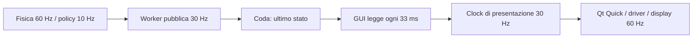

# Gioco — perfezionare sorpassi e fluidità

**16 ottobre 2026 · studio e piano di intervento · runtime rc.21 invariato.**

Segue la [consegna rc.21](v09-timing-improvements-report.md). Questa attività aggiunge analisi, sonde su copie PC ed evidenze; nessuna installazione, pausa, modifica ai piloti o riavvio della Dashboard. [Evidenze e script ripetibili](evidence/v09-overtaking-fluidity-study-2026-10-16/).

## 1. Decisione proposta

Procedere su due percorsi coordinati:

1. **Sorpassi:** rendere coerenti esercizio, evento di sorpasso e premi; misurare il limite del controllore prima di cambiare rete o aggiungere rumore.
2. **Fluidità:** trovare dove si accumula il ritardo, ottimizzare prima il lavoro ripetuto del controllore e della GUI, poi confrontare un disegno sincronizzato al display.

Obiettivo del gioco: fisica a 60 Hz, decisioni neurali a 10 Hz, movimento regolare a **30 aggiornamenti visivi al secondo**. I tre numeri descrivono lavori differenti. La modifica del disegno non deve accelerare/rallentare la fisica o concedere giri non validi. Tutte le vetture restano visibili in Gara.

Non serve un nuovo pilota per iniziare. Maestro rimane il riferimento; Tattico è il primo candidato per il traffico. Crono, Memoria e Linea beneficiano dell’infrastruttura comune, con verifiche proprie dei rispettivi metodi.

## 2. Stato accertato e limiti delle prove

| Riscontro | Evidenza | Cosa permette di concludere |
| --- | --- | --- |
| Scheda corrente rc.21, 621 hash conformi, servizio active/NRestarts=0 | [Lettura live](evidence/v09-overtaking-fluidity-study-2026-10-16/baseline-live.json) | Identità del software confermata senza intervenire. Non è un nuovo test visivo. |
| Tattico rc.21 e Maestro: 16/20 sorpassi in curva sulla banca finale precedente | [Screening a cinque semi](evidence/v09-timing-improvements-2026-10-16/heldout-summary.json) | La protezione conserva la capacità della base nei campioni osservati; non dimostra superiorità tattica. |
| Apple Calm: p95 dei segmenti 41,75–51,77 ms; massimo 124,79 ms | [Misure native precedenti](evidence/v09-timing-improvements-2026-10-16/board/apple-native/report.json) | Gli scatti sono compatibili con i dati; la media dei p95 non basta per dire “30 fissi”. |
| Nel precedente campione gara: circa 5,13 GiB disponibili, CPU al massimo 50,47 °C; GUI ~49% di un core, worker ~74–77% | [Risorse precedenti](evidence/v09-timing-improvements-2026-10-16/resource-summary.json) | Nessuna evidenza di RAM esaurita in quel campione. Non esclude picchi su un core, attese GPU/driver o salvataggi maturi. Non sono letture di carico aggiornate in questo studio. |
| Verifiche ~57% del tempo del precedente screening PC Tattico | [Costi](evidence/v09-timing-improvements-2026-10-16/study-costs.json) | Verificare il campione è un costo importante; diverso dalla velocità del movimento visibile. |

Il p95 è la durata entro cui ricade il 95% degli intervalli del campione; va affiancato a p99, massimo e numero di stalli.

La vecchia chiave `softwareMeanHz` di `frame-summary.json` è calcolata usando il **tempo simulato** al denominatore. Non va usata come misura esatta di frame/s reali. I p95 e massimi di `frameSwapped` provengono invece da intervalli monotoni reali. Mancano le serie temporali complete per collegare il singolo picco al suo evento.

## 3. Sorpassi: una causa riprodotta

### 3.1 L’esercizio si chiude troppo presto in alcuni casi

La prova di sviluppo ripete i dieci scenari già noti 95201–95210, due policy congelate, distanza 160 oppure 240 m, stesso limite di 50 s. Non viene effettuato alcun aggiornamento neurale. La traiettoria fisica fino al superamento dei 160 m è identica, verificata mediante digest degli stati.

| Policy congelata | Esercizio 160 m | Esercizio 240 m | Contatti / uscite / violazioni |
| --- | --- | --- | --- |
| Maestro | 7/10 | 10/10 | 0 in entrambe le condizioni |
| Tattico, seme 11 | 7/10 | 10/10 | 0 in entrambe le condizioni |

[Risultati completi](evidence/v09-overtaking-fluidity-study-2026-10-16/drill-results.json) · [sintesi](evidence/v09-overtaking-fluidity-study-2026-10-16/drill-summary.json).

Nei tre casi prima mancanti, il Maestro completa il passaggio tra **175,4 e 188,6 m**; il Tattico congelato tra **172,4 e 184,2 m**. Sono manovre completabili con la guida esistente. Il maggiore successo indica una correzione della misura del compito, **non apprendimento più rapido** e non una prova che 240 m sia il valore ottimo universale.

Attenzione alla compatibilità: cambiare la distanza modifica anche il premio per metro, perché oggi il denominatore contiene `spec.distance`. La prova su policy congelate isola la possibilità fisica; applicare 240 m al training richiede una ricetta versionata e un confronto dell’apprendimento.

### 3.2 Fine esercizio, errore e sorpasso sono attualmente mescolati

Nel codice `skill_failed` può significare “arrivato al limite senza completare il passaggio”, “violazione” o “giro non valido”. Non consente una diagnosi precisa.

Proposta:

- **Sicurezza violata:** contatto, uscita, spazio insufficiente, manovra vietata dal regolamento del gioco.
- **Manovra incompleta:** esercizio concluso prima del passaggio, con stato affiancato/ancora dietro.
- **Blocco reale:** nessun progresso, distinto dall’attesa dietro una vettura.
- **Limite di raccolta:** finestra conclusa; non è una sconfitta del pilota.
- **Completato:** superamento pulito e mantenuto, con tempo/distanza necessari.

Gli esiti restano controllabili nel dettaglio; nella schermata principale basta una frase breve, per esempio «Affiancato», «Sorpasso completato» o «Esercizio finito prima del sorpasso».

## 4. Coerenza del compito: priorità prima dei nuovi pesi

### 4.1 Consolidare il rilevatore già comune

Riscontro verificato in `Episode.step`: la condizione `impara_sorpasso oppure reward residual-racing-1` porta **già tutti i piloti residuali**, anche negli esercizi finiti, nel rilevatore con incontro armato, effettivo affiancamento, mantenimento per 0,5 s e credito per banda di giro. Il ramo semplice che accredita il solo cambio di gap appartiene ai percorsi storici non residuali. Non c’è evidenza di una divergenza 0,5 s fra le modalità della rosa attuale.

Conservare quindi queste invarianti e rendere esplicite le fasi **avvicinamento → affiancamento → superamento → conferma → rientro sicuro**, con cause di interruzione verificabili. Un solo credito per incontro valido; niente premi da lasciare passare il bot e ripassarlo subito, dal wrap del giro, da un bot ritirato o dalla conclusione di una finestra. Il rientro può avere una misura separata: non obbligare una vettura a tagliare davanti al rivale per ottenere il premio di sorpasso.

La geometria va misurata sulla progressione della pista e sull’ingombro delle auto, verificando anche la distanza fisica; su circuiti futuri non basta la vicinanza lungo un ramo diverso. Il regolamento è quello osservabile del nostro gioco, senza attribuzione delle intenzioni del pilota.

### 4.2 Regole uguali durante raccolta e verifica

Le regole `spatial-rules-2` della rc.21 sono attive nelle verifiche congelate; la raccolta usa le regole precedenti. Un candidato può quindi esercitarsi su azioni poi penalizzate dal verificatore.

Proposta: un `raceRulesVersion` condiviso e versionato per ambiente, eventi, premi e verifiche. Conservare la severità della valutazione, insegnando le stesse regole durante la raccolta. Verificare frenata necessaria prima della curva, frenata arbitraria con rivale dietro, spazio affiancati, rientro e cambi ripetuti di lato. Contatti e uscite restano distinti dal tempo perso.

### 4.3 Premi confrontabili fra esercizi e giri continui

[Prova privata del cambio modalità](evidence/v09-overtaking-fluidity-study-2026-10-16/mode-transfer.json): SAC conserva 80 esperienze (transizioni del replay) nel passaggio Impara→Impara sorpasso, con actor invariato. Il percorso residuale usa il checkpoint principale e può trasferire il replay; non eredita automaticamente l’isolamento dei vecchi percorsi non residuali.

Oggi, nell’esercizio curva:

- progresso breve: `2 / 160 = 0,0125` per metro;
- progresso continuo: `1 / 338,78 ≈ 0,002952` per metro;
- rapporto **4,235×**, oltre al bonus di successo breve +2 e alla penalità −1 per `skill_failed`;
- gli ingressi residuali neutralizzano i quattro canali di contesto del vecchio curriculum: non comunicano distanza residua/modalità allo stimatore del valore (critic).

Questo è un rischio concreto di obiettivi non coerenti nel replay e di credito terminale difficile da interpretare. La prova dimostra trasferimento e differenza di scala; **non misura ancora il danno alla convergenza**. Anche i compiti diversi all’interno dello stesso curriculum meritano il confronto.

Prima variante da studiare: progresso/tempo in unità comuni, evento di sorpasso comune, confini di raccolta senza premio o sconfitta artificiale. Separare il punteggio mostrato all’utente dalla ricompensa numerica. Se si vuole davvero un obiettivo finito entro una distanza, la sua informazione deve essere rappresentata nel problema oppure va trattato come un contesto distinto.

La distinzione tra terminale del compito e interruzione esterna deve essere esplicita: PPO/SAC/TD3 hanno già maschere separate nel backend; non occorre riscriverle alla cieca. [Gymnasium, gestione dei limiti](https://gymnasium.farama.org/tutorials/gymnasium_basics/handling_time_limits/) spiega perché il bootstrap dipende da questa distinzione. Non basta rinominare ogni insuccesso come `truncated` per renderlo corretto.

Possibile esperimento successivo: termine potenziale limitato `F = γ Φ(s_next) − Φ(s)` sul progresso dell’incontro, calcolato coerentemente con i confini di decisione a 10 Hz, i terminali e la ripresa. [Ng, Harada, Russell](https://ai.stanford.edu/~ang/papers/shaping-icml99.pdf) danno le condizioni teoriche di invarianza; non sono una garanzia di convergenza della nostra rete. Evitare bonus ripetuti per il solo affiancamento o il semplice gas.

## 5. Controllore e apprendimento delle manovre

### 5.1 La rete opera dentro un inviluppo della base

Gli allievi scelgono correzione laterale e passo; il controllore geometrico trasforma la richiesta in sterzo e pedale, con limiti di aderenza e traffico. [Residual RL](https://arxiv.org/abs/1812.03201) supporta questa architettura ibrida; i risultati del paper non quantificano il nostro gioco.

Riscontri locali:

- La base sceglie tra centro e lati circa ±3,6 m; la correzione può arrivare al corridoio disponibile, circa ±4,2 m nella configurazione corrente.
- La richiesta laterale cambia al massimo di 0,9 m/s. Un passaggio da 0 a 3,6 m richiede almeno 4 s nel riferimento, prima dell’inseguimento effettivo della vettura. Non è la velocità laterale istantanea dell’auto.
- Il passo è limitato dalla curvatura e dal margine verso la vettura davanti. La correzione di passo non può annullare quel limite di traffico, chiamato `cap` nel seguito.
- Nella nuova sonda, il pedale finale viene limitato rispetto alla proposta senza cap per circa **7,3–7,5 s medi** per esercizio. La misura identifica un intervento del cap, non dimostra che sia inutile.

Non eliminare il cap per far apparire più veloci le auto. Registrare richiesta, limite applicato e motivo: vettura ancora nello stesso corridoio, affiancamento possibile, rientro o limite di aderenza.

### 5.2 Varianti da confrontare una alla volta

1. **Spazio di completamento:** 160 m come prova difficile, finestra 240 m come candidato; poi un limite da geometria/gap/velocità relativa con tetto esplicito. Stesse condizioni per candidato e campione.
2. **Persistenza del lato:** mantenere la scelta del passaggio finché resta percorribile; cambiare solo con un motivo di sicurezza, evitando oscillazioni del bersaglio.
3. **Cap di traffico basato sugli ingombri:** distinguere “davanti nello stesso corridoio” da “affiancato con corsia libera”. Conservare frenata pericolosa, curve e vetture ruotate.
4. **Traiettoria laterale regolare:** confrontare il filtro corrente con un cambio di linea che rispetti accelerazione laterale e variazione del comando. Il budget di velocità deve includere anche il cambio di linea, oltre alla curvatura della pista.
5. **Esplorazione di manovre risolvibili:** solo dopo aver verificato l’inviluppo fisico.

Il rumore laterale iniziale σ≈0,01 esplora pochi centimetri intorno alla linea di base; quando la base è già su un lato il margine è asimmetrico. Non prova da solo che l’actor saprà scoprire l’altro lato del sorpasso. Aumentarlo indiscriminatamente può solo aggiungere incidenti.

Confrontare esplorazione persistente e graduale su un lato, un piccolo repertorio di manovre sicure e, se necessario, dimostrazioni espresse nelle **azioni residuali**, non nei comandi sterzo/gas del vecchio Clone. Registrare richieste e azioni applicate. Una policy gerarchica con scelta del lato resta una seconda fase, se i due comandi continui risultano insufficienti.

### 5.3 Progressione per Tattico

La base sa già guidare. Confrontare gli 8.192 passi decisionali iniziali solo con una progressione a capacità: ripasso solo, sorpasso facile, curva, difesa, traffico misto. Distribuire il budget per **decisioni fisiche raccolte in ciascuna abilità**, non solo per numero di episodi di durata diversa.

Nel continuo `next_window()` conserva mondo e fase: una finestra di 60 s non crea automaticamente una nuova esercitazione di difesa o curva. La progressione deve essere esplicita, rispettando la continuità e senza spostare improvvisamente auto/bot.

Usare avversari congelati con gap, velocità, lato e fase della curva variati. Ripassare il solo e difendere la capacità già acquisita. Nuove prove con candidato/campione sugli stessi scenari; banca finale separata. L’estensione dell’esercizio non deve essere usata per dichiarare un beneficio neurale inesistente.

## 6. Fluidità: dove può nascere il ritardo

### 6.1 Fatti e ipotesi da separare

| Punto | Riscontro nel codice | Ipotesi / verifica necessaria |
| --- | --- | --- |
| Tre cadenze indipendenti | Deadline worker 1/30, poll GUI 33 ms, `GamePresentationClock` 1/30 | Possono produrre attese di fase. Non provano la causa del picco 124,79 ms. |
| Clock preciso | Il presenter usa già `PreciseTimer` e deadline monotone | Sostituire soltanto il tipo di timer non risolve il problema. [Qt](https://doc.qt.io/qt-6.8/qtimer.html) ammette ritardi anche con timer precisi. |
| Conversioni GUI | `syncScene` materializza la scena con JSON stringify/parse; mappe e testi dipendono dai dati ricevuti | Misurare conversione/binding/GC; non attribuire automaticamente tutto al disegno GPU. |
| Storia ripetuta | `World.rows` include fino a 64 giri recenti per vettura, oltre al timing compatto | Nel lungo periodo il pacchetto cresce; inventariare consumer prima di separare pose e storico. |
| Diagnostica continua | `presentationTrace` crea un oggetto per tick e conserva 120 campioni | Confrontare tracing spento/acceso e buffer a capacità fissa; non assumere che sia il collo di bottiglia. |
| Sensori pubblicati | `send_frame` richiede un’osservazione completa per inviare cinque raggi anche fuori da Sensori | Confrontare proiezione dei soli raggi e lettura condizionata, conservando sensori della policy e semantica pubblica. |
| Interpolazione | Buffer 120 ms per Gara/preview, nessuna estrapolazione | Se mancano campioni freschi l’auto può fermarsi sull’ultimo. Più buffer aggiunge latenza e non genera dati mancanti. |
| Preview e apprendimento | Nello stesso worker girano preview, raccolta/update/verifica e salvataggio | Un lavoro lungo può fermare la preview. In Gara non c’è learner: questa ipotesi non spiega da sola gli scatti della gara. |

Non confondere movimento lento scelto dal controllore, ritardo del disegno e velocità simulata inferiore a 1×. Registrare le tre misure separatamente.

### 6.2 Primo profilo PC: geometria prima della NPU

[Sonda ripetibile](evidence/v09-overtaking-fluidity-study-2026-10-16/profile_race.py) e [profilo](evidence/v09-overtaking-fluidity-study-2026-10-16/profile-race.json): 1.000 tick, cinque policy iniziali congelate, fisica e campionamento righe/raggi/pickle. Nessuna GUI, scrittura o trasporto reale; profiler attivo, PC x86 e sensori nativi.

| Blocco | Tempo cumulativo strumentato |
| --- | --- |
| Esecuzione completa della sonda | 3,204 s |
| `frozen_actions` / controllori | 1,995 s |
| `World.step` | 0,911 s |
| `pursuit_actions` | 1,106 s |
| `poses`, 28.367 chiamate | 0,707 s |
| `observations` | 0,342 s |
| Forward delle reti, 668 chiamate | 0,014 s |

I blocchi sono annidati: **non sommare i tempi cumulativi**. Il profiler altera i costi e non misura il limite ARM o i frame del pannello. È però un’indicazione concreta per provare un calcolo raggruppato (batch) dei controllori: oggi le cinque policy racing richiamano separatamente geometria e follower anche nello stesso mondo.

Primo candidato: raccogliere le decisioni residuali individuali e applicare insieme il follower/controllore, mantenendo cache, stato per vettura, ordine logico, RNG e azioni a 60 Hz. La rete resta individuale; il batch è fra vetture dello stesso istante, non fra policy che stanno cambiando durante la verifica. Serve parità su azioni, eventi, giri, contatti e checkpoint prima di usarlo.

Il forward neurale è meno dell’1% del tempo strumentato di questa sonda: non sceglie una NPU per risolvere questo carico. Confermare i rapporti su ARM e policy mature prima di stimare il beneficio.

### 6.3 Disegno sincronizzato e dati più leggeri

[Qt FrameAnimation](https://doc.qt.io/qt-6.8/qml-qtquick-frameanimation.html) offre callback sincronizzate con l’animazione. Confrontarlo con il presenter attuale: aggiornamento visivo ogni due refresh **solo quando il display è effettivamente a 60 Hz**, fallback temporale per refresh diverso o callback saltati. Usare un clock monotono coerente con i timestamp dei pacchetti, non sommare ingenuamente secondi di un clock a millisecondi di un altro.

Non far dipendere la fisica dal numero dei frame. Non abilitare a forza VSync off o il render loop threaded: [Qt Scene Graph](https://doc.qt.io/qt-6.8/qtquick-visualcanvas-scenegraph.html) descrive scelte dipendenti da piattaforma/driver. Registrare il loop effettivo e le attese con [QSG_RENDER_TIMING](https://doc.qt.io/qt-6.8/qtquick-visualcanvas-scenegraph-renderer.html); prima una traccia breve, poi misure senza log sincroni per limitare l’effetto della sonda.

In ordine di rischio basso: diagnostica su richiesta, timing aggiornato per revisione/evento, sensori visuali solo quando necessari, cache della proiezione numerica, separazione fra pose frequenti e storia lenta. Le revisioni devono avanzare anche su invalidazione e cambio modello. Conservare il contratto dei temi e il significato dei dati mancanti.

Le [indicazioni Qt sulle prestazioni](https://doc.qt.io/qt-6.8/qtquick-performance.html) motivano profilazione, poco lavoro bloccante e attenzione alle conversioni; non dimostrano che una specifica ottimizzazione sia già riuscita sul nostro software.

### 6.4 Checkpoint maturi e costo delle verifiche

Il checkpoint SAC/TD3 può contenere 32.768 × 184 valori float64: **46 MiB di solo replay non compresso**. Compressione, base64/JSON, hash, scrittura e fsync avvengono nel percorso sincrono di `save_training`. Anche la preparazione dello snapshot e le verifiche completate vanno misurate. Il writer dei giri è asincrono, quello dei checkpoint di training non lo è.

Proposta progressiva:

1. misurare separatamente snapshot/copia, compressione, serializzazione, fsync e pulizia degli artefatti;
2. trasferire la serializzazione/scrittura di uno snapshot immutabile fuori dal percorso della preview, se è il costo dominante;
3. mantenere ACK «Salvato» solo dopo persistenza verificata, backpressure e un salvataggio pendente limitato; gli eventi obbligatori non si scartano come le scene;
4. se la preparazione stessa resta lunga, confrontare preview in un processo dedicato o checkpoint a blocchi versionati. Nuovi processi solo dopo confronto del loro costo IPC/CPU.

Le verifiche ripetono anche il campione immutato. Una cache dei suoi risultati, indicizzata da policy, base/compositore, fisica, regole, scenario, avversari e banca, può evitare lavoro duplicato. Riutilizzare soltanto prove completate e compatibili, dichiarandole come riuso; nessuna nuova transizione appresa o nuova qualifica fittizia. Confronto preliminare del candidato e stop anticipato solo se il rifiuto è già certo; prove non eseguite marcate «non testate».

RAM libera utile per snapshot immutabili, cache delle prove e ring di telemetria; non giustifica buffer illimitati. GPU per QML; eventuale CPU aggiuntiva per preview/writer se il profilo lo richiede. Nessun nuovo offload NPU proposto in questa fase. Le fonti Qt consultate sono del ramo 6.8; le varianti vanno provate sul runtime effettivo 6.8.2 della scheda, senza assumere identità con ogni patch successiva della documentazione.

## 7. Piano sperimentale e criteri prima dell’implementazione

### 7.1 Sorpassi e premi

| Fase | Esperimento | Criterio |
| --- | --- | --- |
| O0 | Congelare sorgente/configurazione, policy, scene e banche; riprodurre le cause | Nessun reset personale; causa specifica per ogni insuccesso. La prova 160/240 è già acquisita solo come diagnosi di sviluppo. |
| O1 | Consolidamento dell’evento comune, spazio di completamento adeguato, regole raccolta/verifica allineate | Nessun doppio credito, wrap, bot ritirato, contatto o spazio negato premiato; mantenimento uguale nei finiti/continui. |
| O2 | Premio comune e gestione coerente di terminali/finestre; confrontare controllore e azione applicata | Ordinamento delle ricompense favorevole a guida pulita/rapida, sorpasso pulito e difesa lecita; fermo, taglio, incidente e riciclaggio del credito non convenienti. Nessun coefficient tuning sul set finale. |
| O3 | Confrontare singolarmente cap/corridoio, persistenza del lato, esplorazione e progressione | Beneficio misurato rispetto alla stessa base, senza perdere passo, difesa o pulizia. La durata maggiore non vale come apprendimento. |
| O4 | Cinque semi completi, budget fisico uguale e banca nuova | Riportare tutti i semi, mediana/media/caso peggiore per abilità e costo. Nessuna promozione da un singolo campione o dal solo totale riuscito. |

Disegno candidato, da congelare prima delle campagne: semi di training 21–25; sviluppo 96101–96140; selezione 97101–97112 per famiglia; finale 98101–98160 per famiglia, **non eseguita in questo studio**. Parametri espliciti per avvicinamento, affiancamento iniziale, interno/esterno, gap, passo relativo e difesa; i seed da soli non creano famiglie nuove.

Primo screening Tattico a **196.608 passi fisici di raccolta per seme**, circa 32.768 decisioni se tutte durano sei tick. Verifica conteggiata fuori budget, con tempo/transizioni propri. Riportare anche risultati a decisioni uguali se gli episodi accorciano il blocco finale. Successivamente estendere a PPO/SAC/TD3 soltanto le modifiche risultate utili, con cinque semi per metodo per ogni nuovo default scelto. [Henderson et al.](https://arxiv.org/abs/1709.06560) motivano il controllo della variabilità e della riproducibilità; cinque semi sono lo screening minimo scelto per questo progetto, non una legge statistica.

Il beneficio richiesto è un confronto abbinato: nuovo allievo contro campione conservato e **nuovo Maestro** della stessa base. Se migliora il controllore, quel guadagno appartiene alla base finché non viene misurato un vantaggio aggiuntivo della rete. Soglie prestazionali da fissare sul nuovo generatore prima della banca finale; niente “10/10” ottenuti rendendo più facile il compito a posteriori.

### 7.2 Fluidità

**Traccia necessaria:** tempo monotono di passo, fine controllo, invio pacchetto, ricezione, conversione/QML, presentazione e swap; numero di sequenza/policy; fase raccolta/update/verifica/snapshot/fsync; dimensione pacchetto, coda, core/thread del callback, CPU/termiche. Correlare evento e ritardo senza scambiare correlazione per causa.

Campioni in RAM con capacità fissa ed esportazione dopo il segmento; misurare la sonda accesa/spenta. Raccogliere intervalli grezzi per percentili veri e conteggio degli stalli. Registrare anche pose ripetute quando la vettura dovrebbe muoversi. Distinguere età dell’ultimo pacchetto ricevuto ed età della posa effettivamente interpolata: il `publishedMs` corrente descrive la scena più recente, non necessariamente il campione usato dal buffer da 120 ms. Loggare timestamp degli estremi e interpolazione; soglia candidata per l’età della posa: p95 ≤200 ms e massimo ≤300 ms, da confermare sul clock comune prima della qualifica.

| Fase | Lavoro | Gate candidato |
| --- | --- | --- |
| F0 | Traccia su replay privato e controllo del costo della sonda | Clock/unità/thread coerenti; nessun benchmark con pumping manuale o screenshot nel segmento. |
| F1 | Confermare ARM: controllore, conversioni, code e render loop | Assegnare i picchi a uno o più tratti della pipeline; distinguere Gara e training maturo. |
| F2 | Una modifica per volta: batch controllo; poi dati/presenter; poi salvataggio/verifiche | Parità fisica e dei risultati; miglioramento ripetibile dei ritardi e nessuna regressione dei comandi. |
| F3 | A/B bilanciati su policy/scena/seed identici | Segmenti da almeno 120 s in movimento; ripetizioni indipendenti. p95/p99 e stalli per run, non solo media di percentili. Se il rumore copre il vantaggio, esito inconclusivo. |
| F4 | Qualifica del candidato su temi e carichi maturi | Almeno 10 min per carico pertinente, includendo update, verifica e salvataggio; Base/Functional/Apple e condizioni di stile supportate. Conferma fisica separata. |

Carichi: una Qualifica, Gara a cinque vetture, un allievo con bot; copie mature PPO e replay SAC/TD3 pieno. Regressioni funzionali anche su 2–4 vetture. In Gara i piloti devono restare in movimento durante le misure: fermarsi prima del traguardo o usare un replay/numero di giri diagnostico adeguato.

Target iniziale, da accettare prima delle prove native: cadenza visiva 30 Hz, p95 ≤50 ms, p99 ≤66,67 ms, nessuno stallo **>100 ms** in movimento continuo e nessun accumulo del ritardo fra campione e vettura. Riportare anche massimo e deadline mancate. Sono criteri di consegna proposti, **non** una certificazione attuale di 30 fissi; il campione rc.21 con massimo 124,79 ms non soddisfa il vincolo sugli stalli.

I frame software, le pose aggiornate e gli FPS ottici restano tre misure. Aumentare il conteggio di frame duplicati o rendere la scena a 60 Hz non prova che l’auto sia più fluida. Per dichiarare regolarità sul pannello occorre una verifica fisica pertinente.

## 8. Compatibilità, consegna e ordine operativo

| Modifica | Trattamento della memoria |
| --- | --- |
| Ottimizzazione GUI/pacchetti con semantica conservata | Pesi, replay, qualifiche e record intatti; audit dei consumer Theme API. |
| Batch del controllore numericamente equivalente | Parità su comandi, eventi, checkpoint e giri; se non equivalente, non trattarlo come trasparente. |
| Nuova base/compositore o protocollo delle manovre | Nuova versione esplicita; vecchia policy congelata archiviata, nuova qualifica prima della Gara. Record storici con provenienza. |
| Nuovi premi, terminali o osservazioni | Nuovo percorso/ricetta; conservare actor compatibile e base. Archivio del vecchio replay; critic/target/ottimizzatori da ricreare dove gli obiettivi non sono confrontabili. Mai reinterpretare vecchi ritorni silenziosamente. |

**Ordine consigliato:** O0/F0 → O1 e diagnosi F1 → O2 con confronto del controllore → F2 → O3/O4 → F3/F4 e consegna. La normalizzazione precede un lungo riaddestramento; la correttezza del batch precede il suo uso nei campioni scientifici. I dati preesistenti restano recuperabili.

Nel prodotto: messaggi comprensibili e una sola riga di stato della manovra, dettagli nel dossier. Conservare plancia dell’ovale, spazio pista, scala, tema Apple Calm e comandi 2/8, 4/6, 5. Nessun grafico tecnico permanente o nuova legenda ingombrante.

Lavoro successivo nella famiglia **v0.9.x**. Acquario v0.10 → Compagno v0.11 → Memoria/AI v0.12 → Stabilità v1.1 rimangono nell’ordine approvato. Questo documento prepara l’implementazione: **nessuna nuova release, modello, ricetta o misura nativa viene dichiarata consegnata da questa analisi.**
