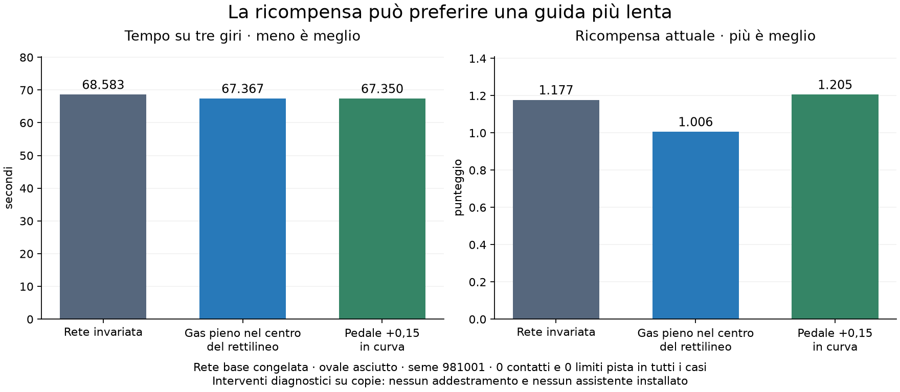
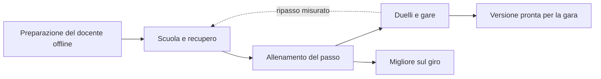

# Da guida prudente a pilota da corsa — studio delle ricompense

**21 ottobre 2026 · Europe/Rome · analisi originale.**

**Attuazione successiva:** [rc.27 implementata e installata](v09-racing-objective-report.md), con confronti, migrazione conservativa e limiti dichiarati. Questo documento conserva diagnosi e proposte precedenti; lo stato corrente R0–R7 è nel report e nel MasterPlan.

Baseline esaminata: **0.9.0-rc.26**, scuola guida neurale diretta, ovale da 12 m. Questo studio aggiorna la diagnosi dopo l’uso reale della [scuola guida](v09-driving-school-report.md). Sono state eseguite letture dei salvataggi e simulazioni isolate su copie: nessuna modifica al runtime installato, ai piloti o alle impostazioni, nessun reset o riavvio.

## 1. Risultato principale

**Una guida più veloce e valida può ricevere una ricompensa peggiore.** Non basta aggiungere un incentivo all’acceleratore: abbiamo trovato una contraddizione misurabile fra punteggio e tempo finale.

Nella prova sulla rete base congelata, tre giri sull’ovale richiedono **68,583 s**. Portando a fondo il pedale soltanto nella parte centrale dei rettilinei, richiedono **67,367 s**, senza contatti o limiti pista. Il punteggio però scende da **1,176590 a 1,005645**. Anche il ritorno scontato con lo shaping attuale peggiora: **0,766917 → 0,703768**.

La penalità di sottosterzo cresce più del beneficio del tempo risparmiato. È una causa concreta da correggere; non dimostra che sia l’unica causa dello stallo nell’allenamento. Altri problemi riguardano curriculum, conservazione delle competenze, esplorazione e costo delle verifiche.



**Direzione proposta:** obiettivo misurato sul tempo valido; penalità per conseguenze e infrazioni calibrate; scuola con un criterio di completamento; allenamento dedicato al passo e poi al traffico. Sterzo, acceleratore e freno restano interamente alla rete. Le prove con il pedale modificato servono a diagnosticare il punteggio e non diventano assistenti di guida.

## 2. Metodo, provenienza e limiti

Evidenze: [cartella dello studio](evidence/v09-race-objective-study-2026-10-21/).

| Materiale | Cosa dimostra |
| --- | --- |
| [Snapshot sorgenti](evidence/v09-race-objective-study-2026-10-21/source-snapshot.json) | Hash dei moduli rilevanti; sorgenti installati corrispondenti a quelli esaminati. |
| [Stato salvato](evidence/v09-race-objective-study-2026-10-21/saved-state-summary.json) | Contatori e verifiche persistite, acquisiti il **21 ottobre alle 10:27:05 italiane**. Non rappresentano eventuale lavoro successivo o ancora in RAM. |
| [27 prove congelate](evidence/v09-race-objective-study-2026-10-21/frozen-objective-probes.json) | Base e otto snapshot candidato/campione, tre varianti ciascuno, stesso scenario nominale e seme 981001; tracce e componenti delle ricompense. |
| [24 prove di ordinamento](evidence/v09-race-objective-study-2026-10-21/reward-ordering-audit.json) | Base, candidato Crono e candidato Memoria; seme iniziale 981017, grip nominale e fattore 0,85; quattro varianti e ricalcolo dei punteggi. |
| Script `probe_objectives.py`, `probe_rankings.py`, `plot_objectives.py` | Procedure delle sonde e figura. Usano il simulatore esistente e copie private degli attori. |

Gli snapshot personali completi rimangono nella copia privata di lavoro; nelle evidenze sono presenti hash, risultati e telemetria, senza pubblicare i pesi personali. Gli script richiedono quella copia per riprodurre esattamente i candidati. La base può essere ricostruita dalla preparazione presente nel progetto.

Le prove non addestrano nuove reti. Il secondo seme cambia le perturbazioni iniziali di posizione e orientamento dell’episodio: **non equivale a un secondo addestramento indipendente**. I comandi della rete mantengono la cadenza prevista dal suo controller; gli interventi diagnostici sul pedale sono applicati alle copie della simulazione. La ricompensa viene aggregata ogni sei passi fisici, includendo lo shaping e il terminale.

Questa banca dimostra fattibilità di traiettorie e incoerenze del punteggio su casi specifici. Non certifica un limite fisico globale, la convergenza di un metodo o una ricetta pronta da installare.

## 3. Cosa risulta dall’uso reale

I contatori storici includono epoche precedenti; qui contiamo i nuovi passi fisici raccolti dall’inizio della scuola rc.26.

| Pilota | Passi nuovi | Aggiornamenti | Episodi riusciti / conclusi | Verifiche completate | Ripartenze dal campione |
| --- | ---: | ---: | ---: | --- | ---: |
| Crono / PPO | 61.292 | 80 | 63/63 | 4, tutte senza guadagno | 2 |
| Memoria / SAC | 24.507 | 993 | 25/25 | 1 senza guadagno | 0 |
| Linea / TD3 | 29.914 | 1.218 | 29/30 | 2 senza guadagno | 1 |
| Tattico / TD3 traffico | 12.258 | 481 | 12/12 | Nessuna completata | 0 |

Aggiornamenti PPO e SAC/TD3 hanno dimensioni e significati diversi: la colonna non è una classifica dell’apprendimento. Gli episodi comprendono esercizi, non soltanto giri.

Per Crono i tempi dei candidati verificati sono **24,583 / 24,533 / 24,850 / 25,100 s**, contro **24,433 s** del campione sugli scenari di verifica. Le quattro competenze risultano dimostrate. In tutte queste verifiche il controllo finale della griglia non è stato avviato: **le gare di conservazione non spiegano questi rifiuti**, che avvengono già sul tempo.

I campioni salvati restano le basi preparate; i candidati correnti possono differire e non coincidono necessariamente con l’ultimo candidato già verificato. Una migliore prova privata di un candidato non costituisce una promozione ufficiale.

Le verifiche congelate hanno consumato circa **174,5 s per Crono**, **126,0 s per Memoria**, **52,0 s per Linea**, **2,7 s per Tattico**, nei contatori salvati. Vanno contate separatamente dalla raccolta utile. Non ricaviamo percentuali da tempi con semantica diversa senza strumentazione comune.

Nel journal letto durante lo studio compaiono inoltre errori `sem_unlink` alla chiusura di worker, con servizio attivo e `NRestarts=0`. Sono un seguito operativo distinto: non c’è evidenza sufficiente per attribuire loro questo stallo o una perdita di salvataggi completati.

## 4. Audit della ricompensa attuale

### 4.1 Formula e scala

Il percorso diretto usa `direct-driving-2`, principalmente:

```text
r = progresso valido / lunghezza pista
    − tempo trascorso / T0
    − penalità di uscita, permanenza fuori pista, contatto e ritiro
    − penalità di rischio sottosterzo
    + termini del compito, quando applicabili

shaping per decisione = gamma × Phi(stato successivo) − Phi(stato attuale)
```

Sull’ovale nominale **T0 = 37,642 s**. Il tempo è già penalizzato: non manca semplicemente l’istruzione “vai più veloce”. Un secondo guadagnato vale circa **0,02657** nel solo termine temporale non scontato. A titolo di confronto di scala, uscita 0,5 vale circa 18,8 s e ritiro 3 circa 112,9 s. Queste equivalenze non sono da sole una calibrazione del rischio: probabilità, sconto e conseguenze fisiche cambiano il problema.

### 4.2 Il conflitto misurato

Rete base, scenario 981001, primo giro da fermo e due lanciati:

| Variante diagnostica | Tempo totale 3 giri | Ritorno ambiente | Ritorno scontato con shaping | Contatti / limiti |
| --- | ---: | ---: | ---: | ---: |
| Rete invariata | 68,583 s | 1,176590 | 0,766917 | 0 / 0 |
| Gas pieno nel centro dei rettilinei | **67,367 s** | **1,005645** | **0,703768** | 0 / 0 |
| Pedale +0,15 in parte della curva | 67,350 s | 1,205293 | 0,786770 | 0 / 0 |

La seconda variante guadagna **1,217 s**, ma:

| Componente | Rete invariata | Gas sul rettilineo | Differenza |
| --- | ---: | ---: | ---: |
| Progresso | 3,000428 | 3,000309 | −0,000119 |
| Tempo | −1,821986 | −1,789664 | **+0,032322** |
| Sottosterzo | −0,001852 | −0,205000 | **−0,203148** |

Le altre componenti sono nulle in questo confronto. La differenza di progresso residua è quella del campionamento al traguardo. Il proxy di sottosterzo incorpora deriva anteriore stimata, richiesta laterale, margine che peggiora o errore di orientamento, sostenuti per almeno 0,25 s. Può attivarsi anche su un passaggio valido e complessivamente più rapido. Il punteggio finisce per preferire la condotta più lenta.

Non concludiamo che quella manovra sia fisicamente ideale o robusta. Concludiamo che **la sua penalizzazione è maggiore del guadagno che il prodotto chiede di cercare**, pur senza conseguenze sportive in quel caso.

### 4.3 Controlli aggiuntivi e ricalcolo del punteggio

Con il seme iniziale 981017 il conflitto si ripete:

| Rete congelata | Tempo invariato → gas rettilineo | Ritorno attuale invariato → gas | Ritorno ricalcolato senza proxy sottosterzo |
| --- | --- | --- | --- |
| Base | 68,583 → 67,433 s | 1,176196 → 1,003132 | 1,178050 → **1,209065** |
| Crono candidato | 68,417 → 67,750 s | 1,182664 → 0,994691 | 1,182664 → **1,200170** |
| Memoria candidato | 67,983 → 66,967 s | 1,187586 → 1,024672 | 1,194149 → **1,221125** |

È un ricalcolo delle stesse traiettorie, non un guadagno ottenuto riaddestrando. Il ritorno scontato ritrova lo stesso ordinamento favorevole al più veloce quando si rimuove quel termine.

Sono stati ricalcolati i pesi **0 / 0,05 / 0,1 / 0,25 / 1**. La soglia cambia fra casi e fra ritorno totale e scontato: ad esempio **0,1 non basta a correggere ogni confronto non scontato**. Non scegliamo un nuovo coefficiente da questa sola banca.

Nelle 24 prove aggiuntive, **15 terminano con successo e 9 falliscono**. Il gas sempre a fondo causa il ritiro in tutti i sei casi; il gas sul rettilineo fallisce anche nei tre casi a grip ridotto. Le reti invariate e la variazione moderata in curva completano entrambe tutti i sei casi. Anche togliendo soltanto il proxy, tutti i nove fallimenti rimangono penalizzati: il migliore ritorno totale fra loro è circa **−3,363**.

Questo controllo esclude l’idea di installare un comando “rettilineo = gas pieno”. Il pedale giusto dipende anche dalla curva successiva, dall’aderenza e dalla velocità di ingresso.

## 5. Perché può sembrare che guidi sui binari

### 5.1 Preparazione prudente e margine fisico

La preparazione della scuola sceglie fra alternative finite. Il docente calcola velocità di curva con un utilizzo prudente del grip: il parametro della base selezionata è circa **0,65**. Non è un ottimizzatore globale del tempo minimo. La rete può quindi iniziare vicina a un equilibrio stabile, centrale e conservativo.

Nella prova congelata della base, la velocità media nelle porzioni di curva misurate è **47,73 km/h** e `|accelerazione laterale|/(mu × g)` circa **0,625**. Con +0,15 al pedale in curva diventano circa **49,49 km/h** e **0,669**, con giri validi più rapidi. Esiste margine in quel confronto.

Questo indice globale non misura la saturazione di ogni asse, non include da solo il vincolo combinato longitudinale/laterale e non dimostra che il restante 37,5% sia interamente sfruttabile. Servono le forze effettive, i carichi e la traiettoria del nostro modello.

Una velocità abbastanza costante su un arco di raggio costante può essere corretta. Le prove devono valutare ingresso, punto di corda, uscita e rettilineo successivo. Variazioni vistose dello sterzo o accelerazione continua non sono criteri di intelligenza.

### 5.2 Scuola permanente e competenze deboli

Sull’ovale, **4 episodi ogni 6** restano lezioni anche dopo molte riuscite. Questo rapporto riguarda il numero di episodi, non necessariamente il tempo simulato. Mancano una vera conclusione della scuola e una fase dominante di ricerca del passo.

I gate attuali richiedono almeno 12 passi fisici di gas oltre 0,9, almeno 6 di frenata e una riduzione di velocità, oppure una variazione laterale oltre 0,4 m. L’esercizio aderenza verifica soprattutto la sicurezza. Dimostrano gesti minimi, **non la qualità della staccata, della traiettoria o della ricerca del limite**. La penalità per `skill_failed` passa già dal controllo delle competenze dell’episodio: non è stata individuata qui una sua omissione.

Inoltre l’attore non riceve l’etichetta della lezione, mentre il critic riceve contesto aggiuntivo. Compiti con vincoli diversi possono richiedere azioni differenti a telemetria simile. È un rischio di ambiguità da misurare; non una causa già dimostrata.

### 5.3 Esplorazione e dimostrazione visibile

Durante la raccolta il pedale usa anche impulsi latenti mantenuti per **1,2 s**. È una forma di esplorazione, non una decisione ragionata sul punto di frenata. Va confrontata con alternative temporalmente coerenti e con perturbazioni di sterzo/pedale legate agli effetti fisici.

**La preview visibile è però deterministica e usa una rete congelata.** Non applica direttamente questi impulsi casuali. Non attribuiamo quindi automaticamente il comportamento “artificiale” osservato dall’utente al rumore della raccolta. Vanno confrontate tracce di rete preparata, candidato e campione, con pedale richiesto, attuatori effettivi e velocità.

La verifica attuale riparte dall’attore campione dopo due controlli senza guadagno; nel caso ordinario sono circa **24.576 passi fisici** fra due controlli, con variazioni per episodi e verifiche. Può interrompere una ricerca utile, ma può anche proteggere da un peggioramento persistente. Serve un confronto a budget identico prima di allungare o eliminare la ripartenza.

### 5.4 Due esperti neurali non equivalgono a competenze isolate

La rete ha un esperto solo, uno traffico e un selettore allenabile. In solo il peso del traffico è inizialmente circa **0,00873**. Una sonda sul vero ottimizzatore Adam, con gradiente sintetico e stato iniziale azzerato, misura:

| Blocco | Norma del gradiente | Norma della modifica |
| --- | ---: | ---: |
| Solo | 3,1776 | 0,00054265 |
| Traffico | 0,03687 | 0,00054124 |

Un gradiente circa 86 volte più piccolo non produce necessariamente una modifica 86 volte minore: Adam normalizza i momenti per coordinata. È coerente con le proprietà descritte nel [lavoro originale di Adam](https://arxiv.org/abs/1412.6980). Il gate piccolo non garantisce la conservazione dell’esperto traffico.

La sonda dimostra il meccanismo, non misura i gradienti reali dei candidati e non attribuisce a questo il loro stallo. Prossime prove: instradamento effettivo degli aggiornamenti, gestione dei momenti, ripasso di esperienze competenti e distillazione ausiliaria su stati di traffico. Un’eventuale protezione riguarda l’allenamento dei pesi; nessun bot si sostituisce alla rete in pista.

## 6. Ricerca su fonti primarie

Fonti consultate il 21 ottobre 2026. Le traduzioni nel progetto sono proposte, non risultati già ottenuti qui.

| Fonte | Risultato pertinente e limite | Applicazione proposta |
| --- | --- | --- |
| [Wurman e altri, GT Sophy, Nature 2022 — PDF degli autori](https://www.cs.utexas.edu/users/pstone/Papers/bib2html-links/nature22.pdf) | Controllo continuo di sterzo/pedale a 10 Hz; progresso, infrazioni, scenari misti e vantaggio relativo sugli avversari. Pesi diversi per circuito, penalità di slip esclusa su uno. Aumentare indiscriminatamente i contatti penalizzati può produrre timidezza. Infrastruttura e quantità di dati molto maggiori delle nostre. | Separare passo e tattica nelle misure; provare segnale relativo simmetrico e scenari variati. Non copiare coefficienti, architettura o promesse di tempi di apprendimento. |
| [Fuchs e altri, Super-Human Performance in Gran Turismo Sport, 2021](https://arxiv.org/html/2008.07971) | Formalizza il tempo minimo tramite progresso e sconto; il solo progresso può rendere insufficientemente conveniente frenare, richiedendo conseguenze di collisione. Nell’appendice PPO e imitazione hanno limiti in quel setup. | Valutare il giro completo e il credito temporale fino all’uscita di curva; SAC resta un confronto pertinente, non un vincitore garantito sul nostro simulatore. |
| [Evans e altri, Reward Signal Design for Autonomous Racing, 2021](https://arxiv.org/html/2103.10098) | Confronta ricompense geometriche; il riferimento a curvatura minima funziona meglio nei casi studiati. Il veicolo usa comandi di velocità/sterzo e un modello cinematico. | Usare la geometria per preparazione e benchmark. Il contratto è diverso dal nostro pedale diretto: non importare una formula di velocità come soluzione universale. |
| [Ng, Harada, Russell, ICML 1999](https://people.eecs.berkeley.edu/~russell/papers/icml99-shaping.pdf) | Lo shaping basato su differenze di potenziale può preservare la politica ottima sotto le ipotesi del modello e la corretta gestione dei terminali. | Verificare telescopaggio, sconto e terminali. Un bonus generico a velocità, grip o personal best non gode automaticamente della stessa proprietà. |
| [TUM, global racetrajectory optimization](https://github.com/TUMFTM/global_racetrajectory_optimization) | Distingue percorso più corto, curvatura minima e tempo minimo, includendo limiti di accelerazione, modello veicolo e mappe di attrito. | Costruire offline riferimenti raggiungibili con la nostra fisica, utilizzabili come dati e metro di confronto. Il riferimento non pilota l’auto durante la gara neurale. |
| [Stable Baselines3, RL Tips and Tricks](https://stable-baselines3.readthedocs.io/en/master/guide/rl_tips.html) | Raccomanda normalizzazione, valutazione separata dall’esplorazione, più prove e controllo dell’ambiente. La ricompensa osservata in training non è sufficiente per stimare la prestazione. | Verifiche indipendenti, distribuzioni dei tempi e confronto dell’implementazione NumPy con un riferimento maturo. Cambiare algoritmo da solo non corregge una ricompensa incoerente. |
| [Gymnasium, Handling Time Limits](https://gymnasium.farama.org/tutorials/gymnasium_basics/handling_time_limits/) | Distingue termine del compito e interruzione artificiale, con bootstrap coerente. | Audit di giro singolo, finestre infinite, reset e ultimo intervallo parziale. Il nostro codice possiede già segnali distinti: non dichiariamo un bug generale senza riproduzione. |
| [AWS, Action space and reward function](https://docs.aws.amazon.com/solutions/latest/deepracer-on-aws/action-space-reward-function.html) | Gli esempi DeepRacer descrivono scelte di velocità/sterzo. | Le ricette online vanno tradotte al nostro comando acceleratore/freno; la stessa parola “throttle” non garantisce lo stesso contratto fisico. |

Lo shaping attuale e il prior del critic sono stati riletti: il valore usa **critic − Phi**. Non è emerso il presunto errore di segno che darebbe un doppio incentivo; il clipping del potenziale di velocità non è un limitatore del pedale. Le prove mostrano che lo shaping esistente **non risolve** la contraddizione della penalità di sottosterzo.

### Pareri e resoconti pratici online

Questi materiali sono esperienze o suggerimenti degli autori, non prove controllate sul nostro gioco:

1. [Ray Goh, vincitore DeepRacer F1 ProAm, resoconto su AWS, 2020](https://aws.amazon.com/blogs/machine-learning/using-log-analysis-to-drive-experiments-and-win-the-aws-deepracer-f1-proam-race/): propone di analizzare distribuzione dei tempi, completamenti, checkpoint ed entropia, ricavando gli esperimenti dai log. Il metodo di analisi è utile; le sue ipotesi statistiche e i risultati non diventano garanzie per noi.
2. [Discussione originale: How to optimize a Reward function](https://www.reddit.com/r/reinforcementlearning/comments/1fit226/how_to_optimize_a_reward_function/): descrive accelerazioni seguite da rallentamenti usando premi alla velocità. Un commento suggerisce una penalità temporale. **Noi la abbiamo già**: il consiglio non identifica da solo la correzione.
3. [Discussione originale: RL for Raceline Optimization](https://www.reddit.com/r/reinforcementlearning/comments/11mmtpu/rl_for_raceline_optimization/): propone partire da una traiettoria preparata e ridurre progressivamente la dipendenza dal riferimento. Il commentatore dichiara incerto il risultato. È un’ipotesi da confrontare, non una dimostrazione che l’imitazione decrescente risolva lo stallo.

## 7. Obiettivo di prodotto e ricompense da confrontare

### 7.1 Prima definire cosa significa “migliore”

**Solo:** minimizzare il tempo del giro valido e mantenere una probabilità di completamento accettabile. Confrontare separatamente partenza da fermo, giri lanciati e serie su più giri. I **24,433 s** delle verifiche attuali non sono direttamente confrontabili con i circa **22,08 s** lanciati delle sonde.

**Gara:** arrivare prima degli altri secondo il regolamento, conservando controllo e correttezza. Una staccata che peggiora il giro ma conclude un sorpasso può essere utile; un contatto che respinge l’avversario non deve diventare una scorciatoia premiata.

**Scuola:** acquisire capacità sufficienti per accedere alle altre fasi. Premiare un gesto obbligatorio per sempre può interferire con la strategia più veloce.

### 7.2 Formula candidata, non ancora scelta

Prima famiglia da confrontare:

```text
r_passo = a × incremento di progresso sportivamente valido / lunghezza
          − b × dt / T0
          − costo delle conseguenze sportive e dei fallimenti
          + gamma(dt) × Phi(successivo) − Phi(attuale)
```

Il confronto deve includere la formula attuale, la rimozione/riduzione del proxy di sottosterzo e una formulazione temporale più diretta. A parità di giro valido completato, il punteggio deve ordinare correttamente le traiettorie del banco di riferimento; in presenza di rischio va dichiarato il compromesso desiderato.

**Usare soltanto −tempo non basta:** terminare subito potrebbe costare meno che finire il giro. Fallimento, tempo limite e ripartenza devono avere un costo terminale coerente con il tempo perso e con la probabilità di arrivare. Viceversa, penalità enormi a ogni piccolo scostamento possono far preferire una guida troppo prudente. Le scale vanno provate anche su incidenti precoci e tardivi, recuperi e situazioni bloccate.

Da non aggiungere come obiettivi permanenti:

- premio a premere l’acceleratore o il freno;
- premio a sterzare poco o a stare sempre al centro;
- premio a consumare sempre il 100% del grip;
- bonus PB dipendente da un record che cambia mentre vecchie transizioni restano nel replay;
- premio a velocità istantanea che ignora staccata, uscita e tempo finale.

Questi segnali possono servire come diagnostica o nella preparazione esplicitamente separata. Per il pilota da corsa conta l’effetto della sequenza di azioni.

### 7.3 Correggere il sottosterzo senza insegnare gli incidenti

La prima ablation riguarda esclusivamente il proxy; contatti, uscite e ritiri restano misurati. Confrontare peso zero e pesi ridotti, oppure una penalità legata a una perdita di controllo verificabile invece che alla sola richiesta di deriva. Registrare durata, asse, velocità, margine e conseguenza dell’attivazione.

Il banco deve contenere curve valide veloci, curve valide lente, ingressi troppo rapidi, controsterzo di recupero, tagli, rientri e incidenti. Una regola che passa soltanto il confronto favorevole sul nostro ovale asciutto non è pronta.

### 7.4 Credito temporale e algoritmi

Valutare l’azione fino all’uscita e al tratto successivo. Dopo aver corretto l’ordinamento dei reward, confrontare per SAC/TD3 backup su più decisioni con quello corrente a un passo, controllando il bias fuori politica. Per PPO confrontare l’orizzonte GAE e l’esplorazione a budget uguale. Sono proposte sperimentali, non modifiche già applicate.

La scala delle ricompense influenza anche entropia SAC, errore dei critic, clipping e aggiornamenti dell’attore. Non moltiplicare il premio per cento mantenendo invariato ogni altro parametro. Verificare gradienti, target, trasformazione `tanh`, azione effettivamente memorizzata, resume RNG e comportamento vicino alla saturazione rispetto a una implementazione di riferimento.

## 8. Percorso di apprendimento proposto



1. **Scuola con completamento.** Dopo riuscite ripetute su casi diversi, ridurre le lezioni a un piccolo ripasso. Sostituire le soglie di gesto con prove di efficacia: staccata che consente l’uscita, traiettoria valutata sul settore concatenato, adattamento a grip e potenza. Non aggiungere etichette arbitrarie all’attore senza confrontare il bisogno reale di contesto.
2. **Passo prevalente.** Partenze distribuite sul circuito e anche giri lanciati, ricerca di frenata e corda, più giri consecutivi. Il docente offline deve offrire riferimenti meno conservativi ma realmente eseguibili, inclusi recuperi; la rete può superarli. Distinguere limite teorico, riferimento simulato raggiungibile e prestazione appresa.
3. **Conservazione delle competenze.** Ripasso stratificato e misura delle modifiche dei due esperti. Confrontare protezione degli aggiornamenti e distillazione prima di scegliere una soluzione. Non introdurre una nuova architettura senza evidenza che quella attuale limiti il risultato.
4. **Traffico.** Rivali congelati con velocità, stili, linee e posizioni diverse; situazioni di affiancamento, attacco, difesa e rientro. Confrontare vantaggio relativo locale simmetrico, con regole contro il guadagno da cicli di sorpasso/retrocessione, giri doppiati e tagli. L’attuale premio al passaggio ha già protezioni per incontro/banda: non va descritto come completamente privo di anti-abuso.
5. **Due risultati interni per ogni identità.** Conservare “migliore sul giro” e “pronto per la gara” come snapshot distinti quando serve. La ricerca del passo può avanzare mentre si riqualifica il traffico. La qualifica/griglia deve però usare **il tempo della stessa versione che correrà**, non il record di un altro snapshot. Nessun raddoppio dei personaggi nel menu.

Maestro resta il riferimento esplicito. Crono/PPO, Memoria/SAC, Linea/TD3 e Tattico/TD3 conservano differenze di apprendimento; una nuova personalità o un nuovo nome non risolverebbero l’incentivo comune incoerente. Tutti devono ricevere obiettivi di corsa verificabili; Tattico ha più copertura del traffico.

## 9. Sensori e telemetria necessari

La rete possiede già dati fisici, grip dichiarato, caratteristiche veicolo, avversari, raggi fino a 150 m, geometria anticipata a 15/40/80/150 m e punti locali a 4/8 m. Non parte completamente cieca sulla curva. Prima di aumentare gli ingressi verificare normalizzazione, informazione effettivamente utilizzata e coerenza fra dati e forze del modello.

Nel banco diagnostico raccogliere:

| Gruppo | Misure |
| --- | --- |
| Risultato | Tempo da fermo e lanciato, settori, dispersione, arrivi, giri puliti, DNF e relativa causa. |
| Azione | Sterzo e pedale neurali, comando effettivo, accelerazione, frenata, saturazioni e ritardi. |
| Fisica | Velocità longitudinale/laterale, deriva, yaw, carichi e utilizzo combinato dell’aderenza per asse, margine dell’intera carrozzeria. |
| Premio | Ogni componente, ritorno scontato, motivazione delle penalità e correlazione/ordinamento rispetto ai tempi validi. |
| Apprendimento | Passi fisici, decisioni, aggiornamenti, tempo raccolta/update/verifica, fase, esplorazione, versione reward e hash dei pesi. |
| Tattica | Opportunità e sorpassi riusciti, difese, posizioni guadagnate/perse, contatti e infrazioni; responsabilità solo dove il modello la definisce. |

Sul display **960×640** mantenere poche informazioni: candidato/campione, giro, delta, migliore verificato, fase e ultimo esito comprensibile. I dettagli appartengono a Telemetria/Pilota; andamento dei giri e cause di rifiuto devono rendere distinguibili “sta provando”, “migliora”, “più lento”, “respinto nel traffico”. L’aggiornamento degli strumenti diagnostici non deve aggiungere push Python→QML a ogni passo fisico.

## 10. Piano operativo proposto R0–R7

| Passo | Lavoro | Criterio per procedere |
| --- | --- | --- |
| **R0 — Contratto e banco del premio** | Congelare obiettivi/misure; trasformare il conflitto riprodotto in una banca di ordinamento con casi validi e fallimenti. | Le coppie controllate rispettano l’obiettivo dichiarato; nessun guadagno da taglio, stallo, ritiro precoce o ciclo di passaggi. |
| **R1 — Riferimenti fisici** | Misurare inviluppo veicolo, traiettorie e profili offline sullo stesso simulatore; distinguere min-curvatura e min-tempo. | Una base raggiungibile più rapida e pulita è eseguita realmente, non calcolata soltanto in un modello semplificato. |
| **R2 — Confronto delle ricompense** | Confrontare attuale, ablation del proxy e obiettivo temporale; stessa rete, curriculum, inizializzazione, esplorazione e budget. | Migliora il tempo valido sulla banca separata senza un aumento inaccettabile dei DNF. Nessuna scelta da una sola coppia o un solo seme. |
| **R3 — Curriculum e competenze** | Conclusione della scuola, ripasso e aggiornamenti degli esperti; poi confronto del criterio di ripartenza. | Migliora il rapporto esperienza utile/tempo e conserva fondamenti e traffico. Cambiare un fattore per confronto. |
| **R4 — Metodi e credito temporale** | Audit differenziale NumPy, scala/entropia, azioni, bootstrap; confronto multi-step e forme di esplorazione per metodo. | Correttezza numerica e ripresa esatta; eventuale vantaggio misurato in passi e tempo reale. |
| **R5 — Gara e visibilità** | Migliore sul giro distinto da versione gara; premi relativi e avversari variati; esiti/UI coerenti. | Tempi e certificati appartengono allo snapshot che corre; tutte le auto presenti, nessuna promozione fittizia. |
| **R6 — Qualifica della ricetta** | Almeno cinque semi di addestramento per metodo; misurare separatamente preparazioni indipendenti, copie dei checkpoint reali e casi mai usati per scegliere. Prima PC, poi prove mirate ARM. | Report di ogni seme, costo completo e regressioni; nessun default scelto da una campagna incompleta. |
| **R7 — Migrazione e consegna** | Versione nuova del reward/ricetta, archivio e ricevuta, eventuale nuova epoca dei critic/replay, aggiornamento del piano ufficiale. | Attori e identità conservati dove compatibili; qualifica dei pesi effettivamente consegnati; installazione esplicitamente autorizzata. |

R0 è **parzialmente acquisito**: 51 sonde, ricalcolo e conflitto dimostrato. La banca estesa, i nuovi allenamenti e R1–R7 rimangono da fare. Non attribuire una nuova rc allo studio.

### Criteri quantitativi candidati da fissare prima degli allenamenti

- Budget iniziale confrontabile con la campagna precedente: **98.304 passi fisici raccolti per metodo**, **131.072 per Tattico**; contare separatamente preparazione, decisioni, aggiornamenti e verifiche. Se insufficiente, estensione uguale e dichiarata per tutte le varianti pertinenti.
- Obiettivo prodotto provvisorio: almeno **3% di riduzione della mediana dei giri lanciati**, a budget fissato, in almeno **4/5 semi**, con risultati per singolo seme. È un criterio di selezione proposto, non una promessa di apprendimento.
- Almeno **95% di completamenti puliti** sulla banca finale variata, esplicitando numerosità e intervalli di incertezza; stessa soglia per ogni metodo. Il traffico ha una propria banca e il confronto col precedente, senza nascondere incidenti nella sola mediana dei tempi riusciti.
- Nessuna tolleranza a giri accorciati o certificati riferiti ad altri pesi; misurare precisione/quantizzazione del cronometro. Il gate attuale dello 0,1% a 24,4 s vale circa 24 ms, vicino a 1–2 passi fisici: guadagni di pochi millesimi richiedono particolare cautela.
- Riferimento fisico e misura del grip restano diagnostici: non obbligare la rete a una percentuale di aderenza o a un pedale prefissati.
- Valutare velocità di apprendimento in campioni **e** tempo reale, includendo verifiche e carico del rendering. CPU/GPU/NPU più veloci non correggono una preferenza del punteggio sbagliata; nessun nuovo percorso hardware è richiesto da questa diagnosi.

## 11. Memorie e migrazione

**Nessun reset è necessario per svolgere lo studio.** Per una futura ricetta mantenere attori attuali, identità, storico e snapshot qualificati come confronto e punto di partenza. I dati supervisionati del docente vanno rivalutati per qualità, non eliminati automaticamente.

Critic e replay dipendono invece dall’obiettivo. Ricalcolare le vecchie ricompense è lecito solo se ogni transizione contiene tutte le informazioni necessarie: eventi, limiti, contesto fisico e durata effettiva. L’attuale buffer numerico non conserva automaticamente tutta questa informazione. In mancanza dei campi occorre archiviarlo e avviare una nuova epoca di critic/replay, con provenienza esplicita. Un cambiamento dei pesi deve avere nuove verifiche; un certificato passato rimane valido soltanto per il suo snapshot e regolamento.

## 12. Decisione raccomandata

**Avviare l’implementazione da R0/R2: rendere coerente il premio con il tempo valido e verificarlo prima di addestrare per ore.** In parallelo preparare il riferimento fisico R1; dopo un confronto interpretabile, intervenire su scuola permanente e interferenza fra competenze. Quindi migliorare credito temporale e traffico.

La possibilità di ottenere piloti più veloci è sostenuta dalle traiettorie diagnostiche eseguibili e dalla letteratura. La capacità dei nostri learner di scoprirle stabilmente deve ancora essere dimostrata. Il prossimo successo da chiedere al sistema è un guadagno misurabile e ripetibile sul giro, con sicurezza e costo dichiarati, non il solo completamento degli esercizi.
