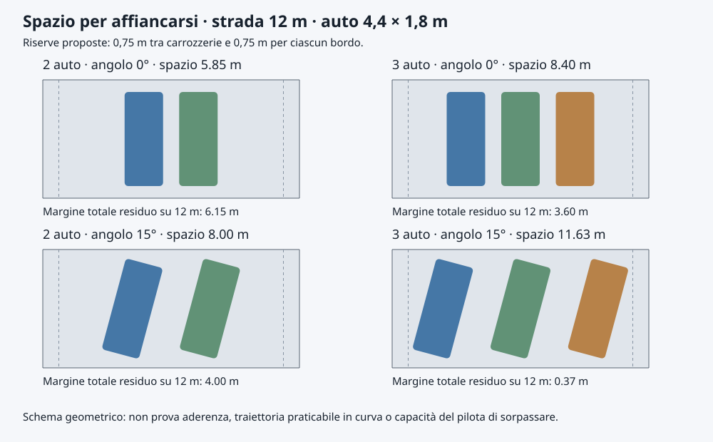

# Gioco · spazio gara, fisica e sensori

**Studio 1 · 12 ottobre 2026 · baseline sorgente 0.9.0-rc.8.**

**Seguito 13 ottobre:** implementazione nella [rc.9 Accademia](v09-academy-report.md), con prove e limiti aggiornati. Il testo seguente conserva lo studio preparatorio del 12 ottobre e le sue misure sulla rc.8.

Analisi richiesta dopo la consegna di Varano Corto e Mallory Ovale. Le proposte qui sotto non sono implementate o qualificate sulla board. Questo lavoro comprende lettura del codice, ricerca di fonti primarie, calcoli riproducibili e controllo statico delle griglie; non comprende allenamenti, modifiche ai piloti o installazioni. Stato della consegna precedente nel [report rc.8](v09-paradigms-real-circuits-report.md).

**Seguito sulla partenza:** lo [studio piloti fermi](game-idle-learning-study.md) aggiunge diagnosi, compito Partenza e detector dello stallo. L0–L2 precedono F1–F3 descritti qui; F0 può procedere indipendentemente e L3 confluisce in F4. Le proposte di schemi 48/64 restano da rivedere se il nuovo compito richiede ingressi temporali.

## 1. Risposta e decisioni proposte

**Le dimensioni fisiche sono plausibili e lo spazio per sorpassare c'è.** La vettura standard misura 4,4 × 1,8 m; Varano Corto e Mallory Ovale hanno una carreggiata simulata uniforme di 12 m. È una buona base per due auto affiancate e per una gara con quattro partecipanti. Tre auto affiancate richiedono condizioni favorevoli; quattro affiancate in curva non sono l'obiettivo.

Il limite attuale alla gara è soprattutto comportamentale: i preset dei sei piloti hanno `traffic=False`, la promozione Controllo → Passo non attiva il traffico, e il riferimento Pure Pursuit segue la mezzeria senza pianificare sorpassi. I sensori degli avversari esistono, ma restano vuoti durante l'allenamento standard. Inoltre ogni sovrapposizione tra carrozzerie ritira immediatamente entrambe le auto.

| Decisione candidata | Motivo | Priorità |
| --- | --- | --- |
| Conservare scala SI e carreggiata 12 m sui nuovi circuiti | Affiancamento a due già spazioso; non serve rimpicciolire le auto. | Acquisita come raccomandazione |
| Migliorare la leggibilità delle carrozzerie e dell'alone in panoramica | La selezione può apparire molto più grande del corpo fisico. | F0 |
| Calibrare freni/gomme e distinguere strada, fuori pista e barriera | Le attuali semplificazioni rendono ogni errore terminale. | F1 |
| Allenare inseguimento, sorpasso e spazio reciproco | Fare giri veloci da soli non dimostra competenza in gara. | F3, indispensabile |
| Provare sensori a 48/64 ingressi contro gli attuali 42 | Più contesto utile, con confronto sperimentale prima dell'adozione. | F2 |
| Qualifiche distinte Solitario / Gara 2 / Gara 4 | Il gate attuale non certifica traffico o sorpassi. | F4 |

La successione consigliata è F0 → F1 → F2 → F3 → F4. Preparazione di scenari e registrazione della qualifica possono iniziare insieme alla taratura fisica. Il vincolo di prodotto rimane: **un pilota in apprendimento alla volta; una sola auto per pilota nella gara, politiche congelate, più giri**.

## 2. Dimensioni: cosa rappresentano realmente

### Vettura

`game_catalog.VehicleSpec`: lunghezza 4,4 m, larghezza 1,8 m, passo 2,65 m, massa 1.200 kg, potenza 85 kW, forza motrice massima 6.500 N e frenante 10.000 N. È dimensionalmente una compatta sportiva/turismo. Come confronto, Toyota pubblicava per la GR86 preliminare del 2021 lunghezza 4,265 m, larghezza 1,775 m, passo 2,575 m e massa 1.270 kg. La nostra vettura non è una replica di quel modello; il confronto riguarda l'ingombro. [Toyota, dati preliminari GR86](https://media.toyota.co.uk/world-premiere-of-the-all-new-toyota-gr-86/).

Dimensioni plausibili non equivalgono a prestazioni calibrate: potenza, massa, gomme, equilibrio tra assi e resistenza devono essere verificati insieme con prove di accelerazione, frenata e curva.

### Circuiti

| Circuito attuale | Lunghezza misurata nel runtime | Larghezza simulata | Provenienza / limite |
| --- | ---: | ---: | --- |
| Ovale compatto | 338,779 m | 10 m | Circuito di esercizio, non replica reale. |
| Circuito Tecnico | 272,052 m | 10 m | Esercizio compatto con più curve. |
| Mallory Ovale | 1.609,344 m | 12 m | Lunghezza di un miglio; sagoma semplificata, raggio e larghezza scelti dal progetto. |
| Varano Corto | 1.640 m | 12 m | Pianta ricalcata e raccordata; larghezza uniforme, senza profilo altimetrico. |

La pianta ufficiale di Varano riporta larghezza **10–12 m**, rettilineo di partenza **467 m**, pendenza longitudinale massima **2,50%** e trasversale massima **9,50%**. Il nostro modello usa 12 m ovunque: è più generoso nei tratti che realmente sono larghi 10 m. La lunghezza totale uguale non prova che ogni rettilineo/raggio sia esatto. Banking e rettilineo di 467 m non sono prestazioni già riprodotte e certificate. [Varano, pianta tecnica 1.640 m](https://www.autodromovarano.it/wp-content/uploads/2024/04/pista_1640_19.pdf).

La mappa ufficiale Mallory identifica l'ovale da un miglio; non documenta i 12 m di carreggiata o il raggio di 80 m usati nella nostra approssimazione. [Mallory, mappa ufficiale](https://www.malloryparkcircuit.com/wp-content/uploads/2014/03/Mallory-Park-Map.pdf).

Per i nuovi circuiti permanenti, l'Appendice O FIA 2026 indica 12 m come larghezza di progetto, 15 m nella zona della griglia fino all'uscita della prima curva e transizioni graduali. Le indicazioni ammettono casi di circuiti esistenti più stretti e non costituiscono una certificazione del nostro gioco. Il documento indica inoltre almeno 6 m di lunghezza di griglia per vettura, 8 m in F1. [FIA, Appendice O 2026, §§7.3 e 7.7](https://www.fia.com/system/files/documents/appendix_o_2026_published_23122025.pdf).

**Conclusione:** 12 m è un riferimento realistico per il progetto. Eventuali zone da 15–16 m vanno introdotte come variante dichiarata del circuito o riproducendo una fonte locale verificata, con nuova revisione della geometria. Non si deve trasformare una replica senza registrarne le differenze.

## 3. Quanto spazio serve per affiancarsi

Per uno studio prudente adottiamo **0,75 m tra carrozzerie** e **0,75 m per ciascun bordo**. Sono riserve progettuali iniziali, non requisiti FIA, né soglie sufficienti per qualsiasi velocità.

L'ingombro trasversale di un rettangolo orientato di un angolo θ rispetto alla tangente locale è:

`b(θ) = larghezza × |cos θ| + lunghezza × |sin θ|`

Per N auto: `W = N × b(θ) + (N−1) × distanza + 2 × margine bordo`.

| Affiancamento | Auto parallele alla strada | Angolo 15° | Angolo 30° |
| --- | ---: | ---: | ---: |
| 2 auto | 5,85 m | 8,00 m | 9,77 m |
| 3 auto | 8,40 m | 11,63 m | 14,28 m |
| 4 auto | 10,95 m | 15,26 m | 18,79 m |

Su 12 m due auto hanno spazio anche con un orientamento obliquo moderato. Tre a 15° lasciano soltanto 0,37 m oltre le riserve già incluse. Questo non è un motivo per far cercare al pilota tre traiettorie contemporaneamente in una curva stretta.

La tabella è una sezione locale: non tiene conto dell'arco percorso dalla carrozzeria, della differenza di raggio tra linea interna/esterna, dell'aderenza o della futura traiettoria degli avversari. Il passaggio va verificato su **corpi orientati e corridoi futuri**, non sulla distanza tra centri o sul rapporto 12/1,8. Quattro partecipanti non richiedono quattro file affiancate.

### Griglia attuale

Il controllo statico delle quattro piste, con quattro vetture standard, rileva **zero sovrapposizioni e zero contatti iniziali con il bordo**. È una prova di posa, non una prova della partenza dinamica.

- Ovale compatto: due auto per fila, centri laterali distanti 3,6 m, quindi 1,8 m liberi tra corpi paralleli; file distanti 7 m.
- Circuiti a poligono: posizioni alternate a ±1,8 m dalla mezzeria e passo longitudinale di 4 m per partecipante. Stessa colonna ogni 8 m: circa 3,6 m di spazio longitudinale libero sul rettilineo.
- Proposta: ancoraggi della griglia per circuito, passo iniziale candidato di 6 m per partecipante e controllo dell'intera carrozzeria, poi prove di partenze con accelerazioni differenti. Registrare area disponibile e distanza dalla prima frenata. Il passo attuale è compatto ma non risulta sovrapposto.

## 4. Scala fisica e lettura sul display

Arena 912 × 496 nel display orizzontale 960 × 640. Il corpo QML misura `4.4 × scale` per `1.8 × scale`; strada e posizioni usano la medesima scala. Il collisore è un rettangolo orientato delle stesse dimensioni fisiche.

| Camera Circuito | Corpo della vettura, pixel calcolati | Contorno di selezione, estensione nominale |
| --- | ---: | ---: |
| Ovale compatto | 26,40 × 10,80 | 36,40 × 20,80 |
| Circuito Tecnico | 29,25 × 11,96 | 39,25 × 21,96 |
| Mallory | 5,33 × 2,18 | 15,33 × 12,18 |
| Varano | 5,77 × 2,36 | 15,77 × 12,36 |

Questi sono calcoli del layout, non misure ottiche. Il contorno aggiunge 5 px per lato, senza occupare spazio fisico: su Mallory la sua larghezza apparente vale circa 10 m, mentre la carrozzeria resta larga 1,8 m. Inoltre ruote da 7 × 2 px e altri dettagli fissi possono sporgere/disordinarsi quando il corpo è molto piccolo.

**F0 proposto:** dimensioni DTO provenienti da `VehicleSpec`, dettagli proporzionali o nascosti sotto una soglia di leggibilità, selezione meno ingombrante in panoramica, indicatori simbolici dichiarati nella minimappa. Nessun minimo in pixel deve ingrandire il corpo fisico. Per seguire la gara usare Segui/Duello; Segui offre normalmente 5–8 px/m, quindi un corpo lungo 22–35,2 px e una strada larga 60–96 px. Duello può ridurre la scala se le auto si allontanano. Mantenere tema, fascia compatta e input attuali.

## 5. Fisica già presente e limiti

Stato `[x, y, orientamento, velocità longitudinale, laterale, velocità di imbardata, sterzo]`, modello dinamico a bicicletta 2D con tre gradi di libertà del corpo e transizione cinematica a bassa velocità. Decisioni a 60 Hz, almeno due sottopassi, campionamento adattivo dei contatti. Sono presenti limite/rate dello sterzo, forza/potenza motrice, freno, rotolamento, resistenza quadratica, forze laterali limitate da un budget di aderenza combinata, corpi orientati e cancelli ordinati dei giri.

| Elemento | Stato attuale | Conseguenza per la gara |
| --- | --- | --- |
| Carico verticale | Metà del peso per asse, baricentro a metà passo. | Frenata e accelerazione non trasferiscono carico. |
| Gomme | Risposta laterale lineare tagliata al limite, μ globale. | Transizione verso perdita di aderenza semplificata; fondi locali assenti. |
| Forza longitudinale | Comando, rotolamento e drag sommati prima del limite di aderenza. | Da separare resistenze esterne e richiesta ai pneumatici, calibrare la ripartizione tra assi. |
| Freni | Forza totale massima 10 kN, nessuno stato di ruota. | Niente bloccaggio fisico, ABS o bias configurabile. |
| Contatto tra auto | Sovrapposizione → ritiro di entrambe. | Anche una sfiorata termina il duello; nessuna risposta d'urto. |
| Bordo strada | Contatto/uscita → ritiro. | Nessun recupero su erba, cordolo o via di fuga. |
| Auto ritirata | Non partecipa ai contatti successivi. | La sagoma visibile non è un ostacolo fisico: comportamento da dichiarare. |
| Motore/trasmissione | Forza limitata dalla potenza; niente giri/marce. | Prestazioni aggregate, senza comportamento di una trasmissione. |
| Pista | Piano, larghezza uniforme, aderenza uniforme. | Nessun banking, dosso, fondo misto o bagnato locale. |

L'impostazione 2D è estendibile. CommonRoad distingue modelli cinematici, dinamici a singola traccia e multibody, con controlli di fattibilità/aderenza: è un riferimento utile per strutturare livelli di complessità. Non occorre integrare subito un simulatore multibody per avere sorpassi credibili. [CommonRoad, modelli e fattibilità](https://commonroad.in.tum.de/docs/commonroad-drivability-checker/sphinx/api_feasibility.html).

## 6. Estensioni fisiche consigliate

### F1 · Primo livello utile per gare credibili

1. **Taratura della vettura:** esplicitare posizione/altezza del baricentro, distribuzione del peso, asse motrice e frenante, densità dell'aria e `CdA`. Conservare unità e valori di riferimento nel catalogo; misurare accelerazione, frenata e velocità in curva prima di fissare una nuova versione.
2. **Trasferimento longitudinale e gomme:** carichi per asse dipendenti dall'accelerazione, saturazione laterale continua e budget combinato coerente. Considerare il trasferimento laterale in una fase successiva con assi/ruote espliciti; non duplicare forze introducendo due correzioni incompatibili.
3. **Fuori pista recuperabile:** separare limite sportivo, superficie percorribile e barriera. Fondo locale con grip/rotolamento, penalità per escursioni e invalidazione dei tagli; un'uscita lieve non è automaticamente un incidente terminale. La geometria del corpo e i cancelli restano autorevoli.
4. **Contatti graduati:** normale/profondità, velocità relativa nel punto di contatto, impulso, separazione e dissipazione controllata. Ritiro solo per urto grave secondo soglie tarate. Eventuale danno leggero deterministico e documentato; non iniziare da deformazioni complesse.
5. **Ritiro esplicito:** scegliere ghost visibile/non collidente o ostacolo persistente con sensori e collisioni coerenti. Vietato rendere una sagoma apparentemente solida ma invisibile al controllo senza una chiara convenzione.

L'urto va verificato anche durante la rotazione: i sottopassi attuali vanno mantenuti/estesi, non sostituiti dal solo test della posa finale. Sono utili confronti con le verifiche continue di ostacoli dinamici documentate da [CommonRoad](https://commonroad.in.tum.de/docs/commonroad-drivability-checker/sphinx/05_collision_checks_dynamic_obstacles.html).

### Secondo livello

- Stato di rotazione delle ruote e slip longitudinale, poi ABS/TCS con benefici misurabili.
- Curva di coppia/potenza e cambio automatico, ripartizione frenante, trazione anteriore/posteriore/integrale.
- Trasferimento laterale e differenze tra pneumatici, necessari prima di promettere comportamento distinto di vetture molto diverse.
- Semplice profilo di pendenza/banking solo quando posizione e segno sono documentati; il massimo 9,5% di Varano non va applicato a tutta la pista.

**Più avanti:** temperatura/usura gomme, consumo carburante, scia/aerodinamica, sospensioni e fondi deformabili. Acquaplaning richiederebbe acqua, velocità e pneumatici: un moltiplicatore di grip non lo rappresenta.

Le due uscite correnti — sterzo e pedale firmato gas/freno — bastano per sterzare e frenare insieme, incluse prime prove di frenata in curva. Gas e freno indipendenti diventano una nuova versione delle azioni soltanto se l'esperimento ne dimostra l'utilità.

## 7. Sensori già disponibili

Sono osservazioni esatte del simulatore, senza rumore/occlusione: **non sono una camera o un LiDAR reale**.

| Ingressi | Contenuto corrente |
| --- | --- |
| 0–4 | Cinque raggi verso i bordi, ±1,2 / ±0,6 / 0 rad, portata 50 m. |
| 5–10 | Velocità longitudinale/laterale, imbardata, sterzo, scostamento dalla mezzeria, errore di orientamento. |
| 11–31 | Tre avversari attivi più vicini entro 40 m: posizione e velocità relative, orientamento sin/cos, maschera di presenza. |
| 32–33 | Velocità con scala estesa e larghezza strada. |
| 34–41 | Quattro punti futuri della mezzeria a 15 / 40 / 80 / 150 m, in coordinate dell'auto. |

I sensori degli avversari funzionano **anche dietro e ai lati**; sono i raggi di bordo a essere rivolti prevalentemente davanti. Tre slot bastano a rappresentare tutti gli altri partecipanti di Gara 4 se sono entro portata. Per otto partecipanti occorre rivedere numero/selezione degli slot. Il riordino per distanza può cambiare l'identità associata allo slot, da considerare nella progettazione.

Mancano informazioni esplicite su distanza tra carrozzerie, margine dei vertici dal bordo, rischio di collisione, accelerazioni/slip e curvatura. Alcune possono essere dedotte dai dati già presenti: prima di aggiungerle bisogna misurarne il beneficio.

### Portata rispetto alla frenata

Stima illustrativa su piano con aderenza costante: `d = v²/(2 μ g) + 0,3 v`. I 0,3 s sono una **riserva progettuale**, non una latenza misurata della rete. μ=0,95 viene dal catalogo corrente; μ=0,55 è soltanto uno scenario candidato per prove di grip ridotto, non un valore universale del bagnato.

| Velocità | μ 0,95, frenata + riserva | μ 0,55, frenata + riserva |
| --- | ---: | ---: |
| 90 km/h | 41,0 m | 65,4 m |
| 120 km/h | 69,6 m | 113,0 m |
| 160 km/h | 119,3 m | 196,4 m |

Sono calcoli analitici, non distanze misurate nel `World`; freno, drag, pendenza e sterzo cambiano il risultato. In curva la richiesta laterale riduce l'aderenza longitudinale disponibile. Il confronto mostra perché 50 m non bastano come unico orizzonte alle velocità più alte. I 150 m di preview della pista aiutano a leggere il tracciato, **non estendono i 40 m di rilevamento degli avversari**.

Proposta: range frontale legato a velocità/frenata, inizialmente 80–150 m con possibilità di 200–220 m negli scenari veloci a grip ridotto; posteriore candidato 60–80 m dipendente dalla chiusura. Range/masks e normalizzazione devono essere versionati. TTC significa stima temporale a moto relativo, non previsione certa delle intenzioni dell'avversario.

## 8. Candidati osservativi: 42 → 48 → 64

**Non adottare automaticamente la rete più grande.** Confrontare gli stessi scenari e budget; tenere 42 ingressi se le aggiunte non migliorano robustezza e sorpassi.

| Variante proposta | Aggiunte | Uso |
| --- | --- | --- |
| 48 | Quattro raggi laterali/posteriori diagonali a ±90° / ±150° e due margini sinistro/destro dell'intera carrozzeria. | Affiancamento, uscita di curva, spazio al bordo. |
| 64 | Ai 48 aggiungere ax/ay e slip dei due assi (4), curvatura firmata a 20/60/120 m (3), gap longitudinali/laterali delle carrozzerie e rischio TTC per ciascuno dei tre slot (9). | Frenata, sottosterzo/sovrasterzo e decisione di passaggio. |

È un conteggio candidato, non uno schema già approvato. Le distanze devono usare il corpo orientato, la progressione del circuito e il corretto ramo geometrico nelle curve ravvicinate. Evitare TTC infinito/NaN, distanza al centro presentata come distanza tra paraurti, salti al traguardo e maschere mancanti. Scegliere slot coerenti per rilevanza davanti/dietro/lato, verificando la differenza rispetto ai tre più vicini.

Per vetture eterogenee serviranno dimensioni degli avversari, campi/schema aggiuntivi o un encoder degli ostacoli; non fingere che tutti i nuovi dati entrino già nei 64 canali. L'aderenza locale può essere nota da mappa dichiarata o stimata da sensori di stato, secondo un contratto uguale per tutti i metodi. Non esporre azioni future, intenti nascosti o RNG dei rivali.

Un esempio di rete densa con 16 neuroni e due uscite richiede `(ingressi+1)×16 + 17×2` parametri: 722 con 42 ingressi, 818 con 48, 1.074 con 64. Questo conteggio non descrive il critic PPO o le topologie NEAT. Non implica un costo trascurabile del raycasting: misurare separatamente geometria, costruzione osservazioni, inferenza e training.

## 9. Il necessario per imparare a sorpassare

### Differenza rispetto al comportamento attuale

I preset fissi mantengono il metodo scelto dall'utente; non si devono sbloccare o cambiare di nascosto. Serve un **compito/curriculum dell'ambiente versionato**, distinto dagli iperparametri del pilota. Anche il passaggio a un nuovo schema osservativo o a una nuova fisica deve creare un percorso esplicito e conservare quello precedente.

Pure Pursuit attuale è un controllore della mezzeria e Clone ne copia le azioni sugli stati visitati: nessuno dei due incorpora una pianificazione del traffico. Per l'imitazione di sorpassi serve un maestro dichiarato che selezioni corridoi privi di collisioni e lasci al controllore il seguito della traiettoria. La versione del maestro deve comparire nel dossier. Le reti autonome non ricevono correzioni nascoste durante la gara.

La ricerca Sony su GT Sophy descrive scenari dedicati a partenze, passaggi e difesa in curva e prove separate delle abilità. Supporta la scelta di un curriculum di traffico, senza dimostrare tempi di apprendimento o prestazioni sulla nostra board. [Sony AI, How to Train Your Race Car](https://ai.sony/blog/how-to-train-your-race-car).

### Progressione proposta

1. Controllo e Passo solitario, mantenendo la capacità di completare giri.
2. Seguire un'auto più lenta: mantenere distanza, frenare e non tamponare.
3. Passare a sinistra/destra sul rettilineo, con differenze di velocità controllate.
4. Affiancamento in curva: interno/esterno e spazio reciproco, rientro sicuro.
5. Avversari che cambiano linea, ingresso in frenata e rinuncia al sorpasso se lo spazio manca.
6. Partenze e Gare 4 multigiro contro una rosa di politiche congelate diverse.

Si allena un solo pilota; avversari e maestro sono congelati e identificati nei risultati. Nel confronto cambiano identità/seed/scenario dei rivali, non i loro pesi durante l'episodio. Non basta un bot lento fisso sulla mezzeria per dimostrare competenza generale.

Reward: avanzamento valido, completamento, tempo, penalità per urto/taglio e condotta rischiosa; eventuale premio di passaggio solo dopo un sorpasso completato con margine e cooldown. Evitare premi a ogni frame per posizione in classifica, oscillazioni avanti/indietro, giri accorciati o guadagni ottenuti urtando. Il miglioramento di velocità deve conservare validità e sicurezza.

## 10. Prestazioni, CPU e NPU

Fisica 2D, quattro auto e feature vettoriali sono un'estensione ragionevole dell'architettura corrente; la fattibilità prestazionale completa va misurata. La disponibilità di RAM consente buffer/scenari più ampi, ma non risolve un collo di bottiglia della geometria o della CPU.

Mantenere fisica, contatti, sensori e curriculum sulla CPU. La NPU può valutare politiche compatibili e congelate soltanto dopo parità e beneficio del percorso completo. Aggiungere ingressi alla piccola rete non rende automaticamente conveniente il trasferimento NPU; il precedente confronto sulla board selezionava CPU per quella candidata. [Benchmark storico e limiti](v09-game-implementation-report.md).

Profilare Gara 2/4 e training separatamente: sensori, fisica/sottopassi, policy, IPC, GUI, CPU, RAM, temperatura e stop. Obiettivo candidato per Gara 4: tempo completo del tick p95/p99 sotto 16,7 ms, con assenza di arretrato; questo non prova da solo 60 FPS sul pannello. Le scene attuali inviate a circa 25 Hz con interpolazione non sono una misura di frame pacing fisico. Qualificare anche fluidità durante il carico e il cambio di camera sul display.

## 11. Compatibilità e criteri di accettazione

Cambiare fisica/sensori modifica l'ambito della qualifica: nuove versioni `physics`, `observation`, `action` se necessario, `TaskSpec`, reward/valutazione e maestro. Non fare padding/migrazione implicita dei checkpoint o riutilizzare una vecchia prova come corrente. Conservare archivio e percorso legacy; se cambia la fisica, serve mantenerne il kernel compatibile per riprendere una vecchia sessione. Classifiche omogenee per circuito/revisione, vettura/fondo, protocollo e versione.

| Gate proposto | Verifica necessaria |
| --- | --- |
| Scala/corridoi | Corpo DTO e collisore coincidenti; posa 2/3 auto a orientamenti diversi; griglie 2/4 senza intersezioni, spazio fino alla prima frenata. Non solo vertici o centri. |
| Taratura | Accelerazione, frenata, cerchio a raggio costante, frenata+sterzo e bassa velocità; confronto sottopassi 1/2/4 e adattivi. Tolleranze definite prima del confronto. |
| Contatti/fondi | Urti lievi/gravi, alta velocità e rotazione; separazione senza guadagno spurio di energia. Conservazione in prove isolate o bilancio con forze esterne. Escursione recuperabile distinta da taglio/barriera. |
| Sensori | Tutti finiti, maschere/range coerenti, avversari davanti/dietro/lato, giro al traguardo, rami ravvicinati; identità slot e replay deterministico. |
| Confronto 42/48/64 | Almeno cinque seed per metodo, stessi scenari e budget di passi; riportare anche secondi CPU e tempo simulato. Successo, urti/tagli, sorpassi validi, tempi solo su arrivi validi. |
| Gara 2 | Target iniziale proposto: almeno 18/20 scenari validi per seed su tre giri; includere prove mirate di sorpasso, non solo arrivi. Soglie da fissare dopo la taratura. |
| Gara 4 | Partenze, avversari differenti, affiancamento e rientro, tre o più giri. Qualifica dedicata; un arrivo senza incidenti ma senza tentativi non prova capacità di passaggio. |
| Integrità | Checkpoint completo, RNG, pause/stop/ripresa, dossier con budget/versioni; nessun reset dei piloti originali. |
| Board/UI | Carico reale di training e Gara, input/display 960×640, frame pacing, memoria e sessione prolungata. Risultati PC distinti dai gate fisici. |

Seed di qualifica separati (convenzione corrente ≥1.000.000), nessun riuso dei risultati di training come prova indipendente. Proporre nel dossier badge **Solitario**, **Gara 2**, **Gara 4**, ognuno con data, campione e ambito; l'attuale requisito 9/10 arrivi solitari non viene rinominato competenza di sorpasso.

## 12. Evidenze prodotte e piano operativo

- [Script riproducibile](evidence/game-racing-space-physics-sensors-2026-10-12/analyze.py): importa solo catalogo/geometria/simulazione, senza store di piloti.
- [Audit JSON](evidence/game-racing-space-physics-sensors-2026-10-12/audit.json): dimensioni, 9 casi di affiancamento, quattro griglie, scala grafica, sei stime di frenata e hash dei sorgenti esaminati.
- [Schema SVG esportabile](evidence/game-racing-space-physics-sensors-2026-10-12/passing-space.svg) e PNG verificato visivamente. È una figura di analisi, non un'anteprima della nuova GUI.

Esecuzione PC completata senza contatti iniziali nelle griglie; nessun benchmark board e nessuna prova di apprendimento di sorpassi svolti in questo studio. Runtime e piloti restano la baseline della rc.8. Queste misure integrano, senza sostituirle, le qualifiche precedenti.

**Proposta per il prossimo lotto:** F0 leggibilità/DTO e griglie → F1 taratura/contatti/fondi → F2 ablation sensori → F3 curriculum e maestro traffico → F4 dossier/qualifica Gara 2/4, con consegne progressive della famiglia v0.9. Il [MasterPlan](release-masterplan.md) registra questo seguito come analisi pronta; Compagno v0.10 e Memoria v0.11 conservano la sequenza.
