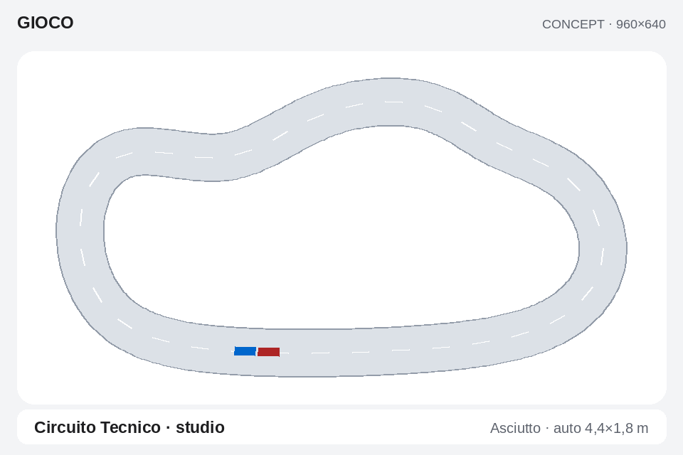

# Gioco — impostazioni Apple Calm e secondo circuito

11 ottobre 2026 · revisione 1 · **analisi e concept, prima dell'implementazione**.

Baseline documentata: **0.9.0-rc.6 / Theme API 2.9 / 68 superfici / Apple Calm 1.6.2**. Questo studio esamina il checkout e la ricevuta della [rc.6](v09-pilot-dossier-report.md); non costituisce una nuova verifica live della board. Nessuna modifica al runtime, allenamento dei piloti utente, installazione o riavvio accompagna lo studio. Tavole e script nella [cartella di evidenze](evidence/v09-settings-circuits-study-2026-10-11/README.md).

**Seguito autorizzato:** A/B/C implementati nella [rc.7](v09-settings-circuits-report.md). Questo documento conserva osservazioni e concept precedenti; stato runtime, prove e residui sono nel report di consegna.

## 1. Decisione proposta

Il secondo circuito è fattibile come estensione del gioco 2D esistente. Servono una geometria comune a disegno/fisica/sensori, percorsi di apprendimento distinti per circuito e nuove prove di guida. Il catalogo attuale, da solo, non rende il motore capace di correre su una pista arbitraria.

Per le impostazioni si propone **Sessione / Allenamento / Gestione**, tre sezioni stabili con tre righe descrittive visibili e azione principale separata. Le regolazioni tecniche sono raggiungibili in **Parametri avanzati**, senza attraversarle ogni volta per iniziare. Il dossier Pilota resta la sede dello storico. Le modifiche diventano una bozza confermata, con esito esplicito quando cambiano il percorso di apprendimento.

Ordine: **A. impostazioni e navigazione → B. geometria generale con ovale invariato → C. circuito tecnico curato e qualifica**. Sono lavori proposti per la famiglia v0.9.x, non release già implementate o date promesse. Compagno v0.10 e Memoria v0.11 mantengono la sequenza del MasterPlan.

## 2. Evidenze nel codice attuale

| Area | Riscontro nel checkout rc.6 | Conseguenza |
| --- | --- | --- |
| Menu Impara | `Main.qml`, `gameMenuRows`: Evoluzione 11 righe, NEAT 10, PPO 14, comprese Modalità/Pilota/Crea/Start. | Troppe regolazioni sulla strada verso Start. |
| Paginazione | `GameVisual.qml`: 5 righe, 4 a scala testo 1,1. | Evoluzione richiede 3 pagine a scala 1,1; PPO 4. Una descrizione in più non risolve il percorso. |
| Scritture | `gameOption` chiama `configure` per ogni pressione; `GameStore.set_profile` salva profilo e evento. | Scorrere valori è già una modifica persistente, senza revisione dell'insieme. |
| Cambio strutturale | Algoritmo, hidden, osservazione, popolazione, traffico o seed diversi cancellano checkpoint, candidato e curriculum attivi; il vecchio modello salvato resta. | Va spiegata la differenza tra riprendere e iniziare un nuovo percorso prima della conferma. |
| Focus | `gameMenuIndex` è un indice numerico. Nel menu PPO Nuovo pilota è indice 12; un pilota nuovo usa il menu Evoluzione da 11 righe. | Rischio concreto ricavato dal codice: indice fuori lista dopo la creazione. Da riprodurre nel gate runtime; selezionare per ID e normalizzare dopo ogni cambio di lista. |
| Comandi | Nel menu 4/6 e 5 cambiano direttamente il valore. Nel dossier 4/6 cambia scheda, ma il riferimento pubblico mostra ARGOMENTO. | Contratto comandi, focus e indicatori devono descrivere il livello realmente aperto. |
| Dossier | La riga Pilota usa 5 per ciclare identità; Reset è una scheda accanto a consultazione/metodo/storico. | Selettore esplicito e gestione separata rendono l'esito più prevedibile. La conferma del reset già consegnata va conservata. |
| Identità grafica | Token Apple Calm: spaziatura 24, 3 righe, superfici chiare, focus blu, raggi 24/14/18. Il menu gioco ha ancora una composizione propria. | Riutilizzare il sistema visivo e i template lista/dettaglio invece di aggiungere un pannello diverso. |
| Pista | `game_catalog.py` espone un solo `TRACK`; `game_simulation.py` usa capsula analitica, `LAP_LENGTH`, raggi, partenze e checkpoint dell'ovale. `GameVisual` disegna la stessa capsula. | La seconda pista richiede lavoro nei tre livelli, non il solo disegno. |
| Persistenza | Una policy/checkpoint attivi per identità; risultati congelati e configurazione già presenti. | Aggiungere percorsi per ambito prima di consentire un cambio pista che sovrascriva l'allenamento. |

I conteggi e il rischio di focus sono analisi statica, non nuove prove di input sul dispositivo. La legenda fissa del menu è già stata tolta nella rc.3: non va reintrodotta. Le descrizioni esistono già; questa proposta riguarda organizzazione, gerarchia e operazioni.

## 3. Ricerca primaria e applicazione al progetto

Fonti consultate l'11 ottobre 2026. Le applicazioni nella terza colonna sono scelte progettuali SmartPC, non risultati sperimentali attribuiti alle fonti.

| Fonte | Indicazione verificata | Applicazione proposta |
| --- | --- | --- |
| [Apple — Settings](https://developer.apple.com/design/human-interface-guidelines/settings), testo letto anche nel [JSON ufficiale](https://developer.apple.com/tutorials/data/design/human-interface-guidelines/settings.json) | Opzioni pertinenti al compito vicino al compito; impostazioni essenziali, raggruppamento stabile e ripristino del punto consultato. | Sessione breve, parametri rari avanzati, ritorno alla stessa riga. Le impostazioni del gioco rimangono nel gioco. |
| [Apple — Design principles](https://developer.apple.com/design/human-interface-guidelines/design-principles) | Comportamenti coerenti, feedback comprensibile, possibilità di correggere e recuperare le azioni. | Bozza, annullamento, esito di Start e cambio percorso leggibili. Coerenza dei comandi con il resto della Dashboard. |
| [Android Developers — Focus system](https://developer.android.com/design/ui/tv/guides/styles/focus-system) | Nella navigazione direzionale serve un elemento con focus distinguibile; selezione e pressione sono stati diversi. | Si adotta il principio del focus esplicito per il keypad, mantenendo i token Apple Calm. Non si importano estetica o dimensioni da TV. |
| [Qt 6.8 — Shape](https://doc.qt.io/qt-6.8/qml-qtquick-shapes-shape.html) | Il renderer geometrico usa preprocessamento dei path; mutarli può richiedere nuova triangolazione. La documentazione suggerisce più path in una Shape ove possibile. | Preparare la pista prima di Start, mantenerla statica durante la guida e aggiornare le sole pose. Renderer alternativo da confrontare sulla PowerVR. |
| [Qt 6.8 — Canvas](https://doc.qt.io/qt-6.8/qml-qtquick-canvas.html) | Aggiornamenti frequenti di un grande Canvas.Image comportano caricamenti della texture. | Evitare di ridisegnare l'intera pista in Canvas a ogni passo. Un'immagine statica è un'alternativa da misurare. |
| [Qt 6.8 — Performance](https://doc.qt.io/qt-6.8/qtquick-performance.html) | L'obiettivo 60 FPS richiede un budget di circa 16 ms e lavoro pesante fuori dal thread GUI; va profilato il carico reale. | Geometria e training nel worker, snapshot limitati, prove frame pacing con carico finale. Non dedurre 60 FPS dal solo disegno statico. |
| [Shapely — STRtree 2.1.2](https://shapely.readthedocs.io/en/2.1.2/strtree.html), [operazioni lineari](https://shapely.readthedocs.io/en/stable/linear.html) | Indicizzazione spaziale 2D, proiezione/interpolazione lungo una linea; la distanza geometrica da sola non stabilisce la continuità del percorso. | Possibile validatore offline. Nel runtime valutare segmenti NumPy e griglia spaziale: nessuna dipendenza Shapely nuova è necessaria per decidere adesso. |
| [Farama — CarRacing](https://gymnasium.farama.org/environments/box2d/car_racing/) | Ambiente con piste generate, osservazioni RGB 96×96, azioni sterzo/gas/freno e ricompensa legata a copertura e tempo. | Riferimento di confronto, non sostituzione diretta del mondo numerico, della Gara multigiro e delle due azioni correnti. |
| [Farama — Env](https://gymnasium.farama.org/api/env/) | `terminated` e `truncated` hanno significati differenti per il bootstrap; reset e seed appartengono al ciclo dell'episodio. | Audit PPO del tempo per copia e del timeout prima di qualificare il circuito nuovo. |
| [Portelas et al., 2020 — Automatic Curriculum Learning for Deep RL](https://arxiv.org/abs/2003.04664), abstract e versione bibliografica v2 | Rassegna dell'adattamento dei compiti alla capacità del learner e dei problemi di generalizzazione. | Prova ovale → circuito tecnico e confronto con partenza da zero. Lo studio non dimostra che questo curriculum specifico sia migliore. |

Le pagine Qt sono della serie 6.8; la board documentata usa 6.8.2. I dettagli dei renderer devono essere verificati su quella build e sul driver reale. Non sono stati introdotti SDK o modelli scaricati.

## 4. Organizzazione di tutte le impostazioni

### 4.1 Sessione

Tre righe visibili: **Modalità**, **Pilota** (oppure **Schieramento**), **Circuito**. L'azione **Avvia allenamento / Avvia gara / Avvia prova** resta nello stesso posto. Gara aggiunge Giri nella pagina successiva o nel dettaglio Schieramento, con riepilogo della distanza nell'azione principale. Non nascondere Giri soltanto per conservare tre righe: la paginazione è esplicita.

- Impara: una identità, un percorso, metodo scelto in Allenamento. L'azione riepiloga metodo e se si riprende o si parte da zero.
- Gara: 2–4 piloti con modelli congelati, 3/5/10 giri e circuito comune; elenco partecipanti con eleggibilità e ragione dell'esclusione. I parametri di training non compaiono.
- Prova standard: lista piloti, protocollo/evidenza attesa e circuito congelati; non è una gara con vincitore.
- Campione: proposta di etichetta **Guida modello**, perché il modello può essere precedente/non qualificato. Stato «Verificato» soltanto con valutazione pertinente al circuito. ID di modalità e compatibilità restano una decisione di implementazione.
- Vettura/fondo/meteo: nella prima estensione si leggono **Standard · asfalto · asciutto**, senza selettori fittizi. Cataloghi predisposti; controlli nuovi quando i contenuti funzionano.
- Circuito: finché esiste solo Ovale, riga informativa. Circuito Tecnico compare selezionabile soltanto dopo la consegna B/C e mostra il proprio stato di qualifica.

### 4.2 Allenamento

**Metodo**, **Scenario**, **Parametri avanzati**. Metodo: Evoluzione, NEAT sperimentale, PPO sperimentale; disponibili soltanto se backend pronto. Scenario: Solo pista oppure Avversario fisso, con avvertenza di competenza traffico ancora aperta. Controllo → Passo è informazione sul curriculum già esistente, non un secondo algoritmo né un selettore di velocità manuale.

Parametri avanzati ha gruppi stabili **Rete / Apprendimento / Riproducibilità**; si apre un gruppo come lista a tre righe, con pagina indicata. Questo aggiunge un livello per le regolazioni rare: verificare che il guadagno nella preparazione ordinaria compensi il percorso avanzato. Preset comprensibili sono un'ipotesi successiva: non etichettare «Veloce/Esperto» combinazioni mai misurate.

### 4.3 Gestione

**Nuovo pilota**, **Scheda pilota**, **Gestisci apprendimento**. Scheda pilota apre la vista/dossier già consegnati senza duplicarne storico e risultati. Gestisci apprendimento identifica pilota e circuito, spiega cosa si azzera e conserva la conferma nominativa con Annulla iniziale. Niente creazione automatica di un pilota al cambio metodo/pista. Reset corrente va adattato all'ambito multipista prima di essere esposto come operazione per singolo percorso; l'azzeramento di tutti i percorsi è un'azione distinta, non implicita.

Nel dossier mantenere Sintesi/Metodo/Storico/Risultati per consultazione, spostando l'accesso al reset nella gestione. Il selettore pilota apre una lista di nomi e stato: 5 non deve cambiare identità senza mostrare una scelta.

## 5. Inventario parametri e microtesti

Valori/opzioni qui sono quelli del codice corrente, non combinazioni tutte qualificate sulla board. L'asterisco indica cambi oggi incompatibili con il checkpoint attivo. Il nuovo draft dovrà calcolare l'impatto dell'insieme prima di applicarlo.

| Impostazione | Destinazione | Spiegazione breve e valori correnti | Impatto da rendere chiaro |
| --- | --- | --- | --- |
| Modalità | Sessione | Allenamento, gara o osservazione del modello salvato. | Cambia attività; salva/pausa prima, mai avvio automatico. |
| Pilota / partecipanti | Sessione, selettore | Identità con allenamento proprio / una vettura per concorrente. | La scelta non modifica la rete. 2–4 in Gara; modello mancante esplicito. |
| Giri | Sessione Gara | Distanza della gara: 3, 5, 10. | Regole congelate a Start; non modifica la rete. |
| Circuito, nuovo | Sessione | Pista su cui allenare o correre. | Percorso e classifica distinti; trasferimento non equivale a qualifica. |
| Metodo* | Allenamento | Come il pilota modifica la propria rete. | Evoluzione/PPO/NEAT; cambio percorso confermato. |
| Scenario / traffico* | Allenamento | Solo pista oppure un avversario fisso. | Scenari differenti; competenza non presunta. |
| Popolazione* | Avanzate → Rete, Evo/NEAT | Reti candidate per generazione: 8/16/32/64/128/256. | Non è il numero dei piloti né delle auto di Gara; carico/nuovo percorso. |
| Copie ambiente* | Avanzate → Rete, PPO | Tentativi paralleli: stessi valori del campo population. | La vista mostra una guida dimostrativa; più copie aumentano il carico. |
| Neuroni nascosti* | Avanzate → Rete, Evo/PPO | Dimensione dello strato interno: 8/16/32/64. | Nuova architettura. NEAT cambia topologia durante l'evoluzione: non esporre questo controllo. |
| Mutazione | Avanzate → Apprendimento, Evo/NEAT | Intensità delle modifiche ai pesi; NEAT include bias: 0,05/0,15/0,30. | Nel codice corrente non cancella il checkpoint; versione del profilo registrata. Non promette più velocità. |
| Learning rate → Passo di apprendimento | Avanzate → Apprendimento, PPO | Ampiezza degli aggiornamenti: 0,0001/0,0003/0,001. | Nome tecnico disponibile nel dettaglio; più alto non significa migliore. |
| Rollout → Raccolta per aggiornamento | Avanzate → Apprendimento, PPO | Passi per copia: 64/128/256/1.024/2.048. | Unità «passi/copia». Evitare di confonderli con secondi reali. |
| Epoche | Avanzate → Apprendimento, PPO | Passaggi sugli stessi dati: 1/2/4/8. | Più lavoro per aggiornamento; nessun guadagno garantito. |
| Gamma → Peso dei risultati futuri | Avanzate → Apprendimento, PPO | 0,95/0,99/0,995/0,999. | Ricompense lontane, non aderenza o velocità dell'auto. |
| Limite tentativo | Avanzate → Riproducibilità | Massimo tempo simulato: 30/60/120/180 s. | Non durata totale dell'allenamento. Nuova pista richiede taratura del timeout. |
| Seme allenamento* | Avanzate → Riproducibilità | Partenza casuale riproducibile: 1/2/3/4/5/11/21/42. | Non genera un circuito. Cambio percorso confermato. |
| Nuovo pilota | Gestione | Crea una identità con allenamento indipendente. | Focus sul nuovo nome; mai indice oltre lista. |
| Reset apprendimento | Gestione | Azzera il percorso scelto; storico e risultati precedenti restano. | Conferma separata da fermo/salvato; errori non presentati come successo. |
| Start/Pausa | Sessione/Pista | Avvia o sospendi l'attività selezionata. | Ack del worker, stato reale e salvataggio osservabili. |
| Auto osservata / disegno | Solo simulazione attiva | Scegli chi seguire o cambia rappresentazione. | Non cambia politica, fisica, partecipanti o circuito. |

Il default esistente è Evoluzione, 32 candidati, 16 neuroni, seed del pilota e parametri correnti del suo profilo. Conservare i valori dei piloti esistenti; non sostituirli con preset arbitrari durante la migrazione.

## 6. Contratto di navigazione

| Stato | 2/8 | 4/6 | 5 | 7 |
| --- | --- | --- | --- | --- |
| Dashboard, gioco fermo | Vista principale | Argomento Dashboard | Apri interazione/dettaglio | Ritorno secondo shell |
| Impostazioni, navigazione | Riga, anche azione finale | Sessione/Allenamento/Gestione | Apri selettore o campo | Torna al punto precedente; bozza pendente visibile |
| Lista avanzata | Riga e pagina | Nessuna modifica nascosta | Apri campo/gruppo | Torna al gruppo/sezione |
| Campo in modifica | Non cambia altre righe | Valore precedente/successivo | Conferma campo nella bozza | Annulla campo |
| Selettore pilota/pista | Elemento | Nessun cambio di argomento | Conferma selezione | Annulla scelta |
| Conferma bozza/cambio percorso | Azione | Nessun valore implicito | Applica o Annulla | Annulla, conservando la bozza |
| Simulazione con ack attivo | Rappresentazione | Auto osservata | Pausa e salvataggio | Pausa/uscita secondo lifecycle esistente |

Modifica campo indicata da focus attorno al valore e stato breve «Modifica». Sezione attiva e riga con focus sono stati distinti. Niente legenda fissa; aiuto Comandi deve riflettere lo stato, e nella scelta/modifica può comparire un suggerimento contestuale breve. Il costo è un 5 aggiuntivo per modificare un valore: misurarlo nel walkthrough.

**Bozza:** confermare un campo non scrive subito il profilo. «Applica modifiche» o Start rivedono e applicano l'insieme atomicamente. 7 con bozza non deve perderla: Tornare alla bozza / Scartare, con scelta conservativa iniziale. 1/Home, urgente e fault devono chiudere in modo deterministico senza applicare valori pendenti; la bozza può restare in memoria, chiaramente non salvata. Nessuna conferma extra se non ci sono modifiche. Per un cambio incompatibile: «Nuovo percorso di allenamento. Il modello precedente resta disponibile» con nome/ambito, senza descriverlo come reset.

**Focus:** chiave `(sezione, gruppo, rowId, driverId)`; dopo cambio metodo scegliere la riga omologa o la prima valida. Dopo Crea selezionare il nuovo pilota e mostrarne l'esito. Tornando da dossier o selettore ripristinare posizione/scroll. Frecce non riusate dalla shell mentre un overlay possiede l'interazione; durante training/Gara vale ancora cattura con ack. Tema in preparazione/urgente/uscita sospendono; al ritorno serve Start esplicito.

## 7. GUI su schermo 3,5″ orizzontale

960×640 nativi; header globale 56 px, contenuto **x24/y72/912×552**. Non aggiungere il titolo «auto che impara» alla Pista. Nei menu evitare doppio GIOCO locale/globale; titolo della sezione, descrizione selezionata e valore bastano.

- Tab di sezione 46 px, margine 24; tre etichette sempre visibili.
- Tre righe da circa 92–104 px, titolo 26 px semibold, descrizione 20 px grigia, valore 25 px. Sono quote del concept, da tradurre in token/layout adattivo, non nuovi numeri obbligatori hardcoded nel renderer.
- Azione principale in una riga raggiungibile col focus. Titolo lungo, errore o scala 1,1 devono aumentare altezza/paginazione; nessun testo sovrapposto, tagliato senza accesso al dettaglio o azione sotto lo schermo.
- Raggi card/panel 24, riga/button 14, pill 18; focus 3 px. Giorno #F3F4F6/#FFFFFF/#E7F0FF e accento #0066CC sono i token approvati. Notte, Base e Funzionale usano i loro token, non gli stessi hex imposti a tutti.
- Le tavole usano i font Liberation Sans già presenti nel bundle per una prova statica riproducibile. Il runtime deve continuare a usare famiglie/pesi esposti dal tema, comprese preferenze utente.
- Niente nuova palette, ombre/glow o espansione delle righe al focus: il focus visibile usa il sistema già approvato. Descrizione breve sempre presente per il significato; dettaglio esteso su azione esplicita.

Concept: [Sessione](evidence/v09-settings-circuits-study-2026-10-11/sessione-concept.png), [Allenamento](evidence/v09-settings-circuits-study-2026-10-11/allenamento-concept.png), [Avanzate](evidence/v09-settings-circuits-study-2026-10-11/avanzate-concept.png). Sono immagini di progetto: non QML eseguito, non leggibilità fisica già accettata.

## 8. Circuito tecnico: proposta e primo controllo offline

Seconda pista **curata e deterministica**, asfalto asciutto, carreggiata costante 10 m, stessa auto 4,4×1,8 m. Rettilineo, curve di raggio diverso e una S larga con entrambe le direzioni di sterzo. Niente incroci, sovrappassi o generatore nel primo passo. Non serve che sia più lunga dell'ovale: deve richiedere frenata, inserimento e ripresa differenti.

| Misura offline del concept | Valore |
| --- | --- |
| Linea centrale | B-spline cubica chiusa, 12 punti di controllo, 384 campioni equidistanti per lunghezza |
| Lunghezza approssimata | **272,07 m**, ovale corrente circa 338,78 m |
| Raggio minimo campionato | **11,28 m**; ovale raggio 31 m |
| Carreggiata | 10 m; raggio interno locale minimo indicativo circa 6,28 m |
| Incroci propri dei segmenti campionati | 0 linea centrale, 0 ciascun bordo, 0 tra bordi |
| Scala uniforme sul concept | **6,647 px/m**; pista in arena 912×496 con margine di progetto |
| Vettura | **29,25×11,96 px**; rapporto con strada 4,4×1,8 / 10 m invariato |

[Script](evidence/v09-settings-circuits-study-2026-10-11/render_study.py), [misure/limiti](evidence/v09-settings-circuits-study-2026-10-11/geometry-study.json) e [campioni in metri](evidence/v09-settings-circuits-study-2026-10-11/candidate-centerline.json) consentono di riprodurre la tavola. Il primo tentativo Catmull-Rom sugli stessi controlli aveva raggio minimo 5,42 m, troppo vicino alla mezza carreggiata: è stato scartato come proposta per insufficiente margine interno.

Questi controlli verificano intersezioni proprie di segmenti campionati. **Non** certificano tangenze/collinearità, margine continuo, spawn/griglia, sensori, collisioni, learning o renderer EGLFS. Il circuito è una candidatura grafica/geometrica; la forma finale può cambiare dopo prova dinamica. La linea tratteggiata è un aiuto del concept, non un requisito del render.

## 9. Contratto geometrico da preparare

**TrackSpec versione successiva**, come descrizione serializzabile: ID/revisione/unità SI, tipo di geometria, controlli, larghezza, senso di marcia, linea di partenza, griglia, cancelli ordinati, bounds, collegamento fondo e hash canonico. Ovale conserva ID/revisione e configurazione storici finché la geometria effettiva resta equivalente. Un cambio geometrico cambia revisione/hash, non solo nome.

**TrackRuntime immutabile**, costruito prima di Start nel worker: campioni, segmenti, lunghezze cumulative, tangenti/normali/curvatura, bordi validati e indice spaziale. Da questo oggetto derivano:

1. Proiezione posizione → distanza lungo pista, offset con segno, tangente e segmento.
2. Raycast dei cinque sensori sulle stesse barriere disegnate.
3. Contatto della sagoma auto con strada e bordo, inclusa verifica del percorso durante il sottopasso.
4. Spawn e griglia su posizioni/tangenti della pista, senza coordinate della retta inferiore dell'ovale.
5. Passaggio dei cancelli ordinati e arrivo multigiro, con orientamento e tempo interpolato.
6. Mesh/path statici per QML, camera e scala uniformi calcolate dai bounds.

**Continuità:** una proiezione globale sul segmento più vicino può saltare a un tratto accanto. Usare segmento precedente, ricerca locale topologica e recupero globale motivato; limitare progresso plausibile alla distanza percorsa nel passo. Ritorno all'indietro, taglio della S, salto di un cancello o inversione non danno progresso/giro valido. Intersezione del movimento con un gate, ordine e direzione devono essere controllati insieme. Quarter-lap numerico e `LAP_LENGTH` globale non sono un contratto sufficiente.

**Validazione offline:** anello chiuso, nessun punto/segmento degenere, continuità tangente, errore di discretizzazione sotto tolleranza scelta, entrambi i bordi semplici e separati, margine tra tratti vicini, larghezza e curvature compatibili, intera griglia dentro strada. La tolleranza va giustificata rispetto alla sagoma fisica, non alla sola risoluzione del disegno. Non far partire una pista invalida con un messaggio «Start riuscito».

Per preservare le ottimizzazioni rc.4, l'ovale può mantenere un kernel analitico dietro lo stesso contratto se il generico è più lento. Prima confrontare proiezioni, raggi, contatti e giri con le fixture correnti; non sostituire subito l'algoritmo veloce con un loop Python per segmento.

## 10. Fisica, sensori e apprendimento

La fisica F1 resta su CPU; una strada diversa cambia orientamento/curvatura, non impone una nuova rete preaddestrata o un modello linguistico. Evoluzione, NEAT e PPO continuano a creare politiche locali dei piloti. Il secondo circuito non è, di per sé, un carico utile per la NPU.

- Osservazione `race-32-v1`: cinque raggi, velocità/stato, offset/angolo, avversari. Verificare capacità nelle curve nuove prima di ampliarla. Offset oggi normalizzato con 5 m: non cambiare significato/range in silenzio quando cambia la larghezza. Lookahead della curvatura o velocità consigliata sono ipotesi con nuovo schema/versione e confronto separato.
- Azioni correnti e fisica non cambiano per il solo circuito. Bot di riferimento può usare curvatura e frenata anticipata per diagnostica, ma non sostituire la policy mostrando un falso apprendimento. Il limite ideale `sqrt(mu*g/|curvatura|)` è soltanto un riferimento semplificato, da verificare contro F1.
- Ricompensa: progresso in metri lungo il percorso valido; completamento soltanto con cancelli; riferimenti temporali per circuito/configurazione congelati nella valutazione. Non sommare fitness privata tra circuiti o normalizzare sul record utente che cambia durante l'episodio.
- **PPO, problema da chiudere:** in `World.step` il bonus terminale del passo usa il tempo globale del mondo; reset di singole copie può far dipendere il bonus dal tempo di copie precedenti. Introdurre tempo episodio per copia, controllare timeout/truncation e bootstrap, e versionare la ricompensa. Verificare il difetto e la correzione con episodi consecutivi equivalenti, non solo con una guida dimostrativa fluida.
- Il limite 60 s non si trasferisce per abitudine: nuova lunghezza/raggio richiedono timeout e riferimento misurati. Controllo prima, Passo dopo completamenti indipendenti; promozione confrontata sugli stessi scenari. Fermarsi/prudenza e instabilità ad alta velocità restano problemi da misurare.

**Protocollo di studio:** almeno cinque seed, stesso algoritmo/architettura e budget di passi, tempo reale riportato; gruppo da zero sul circuito tecnico e gruppo con pesi trasferiti dall'ovale. Dieci scenari indipendenti per confronto di promozione, completamenti/ritiri/mediana e dispersione del tempo valido. Valutazione su partenze/perturbazioni tenute fuori dal training e nuova prova dell'ovale per quantificare perdita di competenza. Evidenza del bot o di una sola policy non qualifica tutti gli algoritmi. Esplicitare scenari ancora asciutti/standard: niente generalizzazione a bagnato o sterrato dichiarata.

## 11. Piloti persistenti e classifiche per circuito

Separare **identità del pilota → percorso di apprendimento → versioni di modello → sessioni/valutazioni/gare**. Un pilota può avere un percorso Ovale e uno Circuito Tecnico, senza perdere quello precedente.

Chiave di ambito: circuito ID/revisione/hash, vettura/gomme/fondo/meteo, versione fisica/osservazioni/azioni/reward/protocollo pertinenti. Algoritmo e architettura identificano il percorso/checkpoint; un risultato Gara può confrontare metodi diversi con la stessa configurazione fisica e regole. Non usare il seed del training per separare le classifiche di gara; i seed/scenari del protocollo di valutazione sono congelati nelle sue evidenze.

- Migrazione: gli attuali campioni/checkpoint appartengono al loro ambito Ovale storico, con durata e profilo originali. Backup/migrazione transazionale e schema versionato; nessun artefatto o evento riscritto come se fosse stato allenato sul circuito nuovo.
- Campione per ambito; riepilogo del dossier distingue tempo attivo/passi del percorso e totali storici. Sessioni senza vecchie statistiche restano «non registrate». Reset per percorso conserva storico e risultati congelati, e rende i campioni archiviati esplicitamente precedenti.
- Trasferimento: se osservazioni/azioni/pesi compatibili, copia dei pesi come inizializzazione di un percorso distinto, optimizer/curriculum/tempo/RNG propri. Qualifica sulla nuova pista prima del badge Verificato; conservare anche il modello originale dell'ovale. Topologia NEAT richiede compatibilità propria.
- Classifica seleziona circuito e protocollo. Tempi assoluti fra piste diverse non producono un ordine sensato; nessuna graduatoria universale inventata.
- Gara congela pista, giri, regole, modello e ambito per ciascun concorrente a Start. Fino alla qualifica della nuova pista, eventuale uso di modello trasferito è una **prova di trasferimento** esplicita e non viene mescolato a risultati ufficiali qualificati. Migrare l'eleggibilità senza invalidare le gare ovali già consegnate.

## 12. Prestazioni e RAM

Il disegno statico è una buona base per la fluidità; il rischio principale aggiunto è la geometria nel worker. Una ricerca esaustiva con 32 copie × 5 raggi × 384 segmenti comporta **61.440 candidati** per decisione; con 256 copie **491.520**. Sono conteggi algoritmici, non misure di tempo o capacità accertate. Raycast e contatti hanno ricerche diverse, da profilare separatamente.

Preparare un indice spaziale/griglia uniforme per i bordi, vettorizzare batch e riutilizzare buffer. Caricare il circuito attivo una volta; rappresentazioni per display memorizzate per hash/bounds/tema, invalidazione esplicita. Profilare numero di candidati dopo indice, decisioni/s, costi fisica/sensori, code snapshot, tempo di pausa/salvataggio, CPU e temperature. Niente lavoro di collisione o I/O nel QML.

Shape con path statici, mesh oppure immagine prerenderizzata sono opzioni; scegliere sulla build/PowerVR reali. Pose interpolate con campioni correnti e ritmi distinti; interpolare non moltiplica i passi fisici. Tempi Qt/frameSwapped non sono una misura ottica del display e non provano input fisico o 60 FPS costanti.

L'utente autorizza tutta la RAM **effettivamente disponibile** dopo Start: nessun tetto artificiale ripristinato. Buffer/reti crescono secondo necessità e disponibilità osservata; la disponibilità di memoria non toglie il budget CPU/GUI. La misura storica della piccola rete è CPU 42,3 µs / NPU 63,1 µs mediane; CPU resta la scelta documentata per quel carico, non un verdetto su tutti i modelli futuri. Nessuna nuova misura NPU eseguita in questo studio.

## 13. File e contratti coinvolti nell'implementazione futura

| Area | Intervento previsto |
| --- | --- |
| `Main.qml` / navigation | Sezioni, selettori, draft, focus per ID e comandi contestuali. Non aggiungere branching geometrico nel router. |
| `GameVisual.qml` / `DriverVisual.qml` | Template impostazioni coerenti, layout adattivo, dossier/gestione e arena da geometria condivisa. |
| `game.py` | API servizio per validare/applicare bozza e selezionare ambito; esito Start effettivo. |
| `game_store.py` / `game_dossier.py` | Percorsi per ambito, migrazione, campioni/versioni, reset mirato e totali/storico. |
| `game_catalog.py`, modulo geometria futuro | Specifica circuito versionata, validatore e TrackRuntime. |
| `game_simulation.py` / `game_preview.py` | Iniezione pista, raggi/contatti/gates/spawn, tempo per episodio e uso comune nella guida dimostrativa. |
| `game_worker.py`, curriculum/backend | Ambito congelato, checkpoint compatibili, ricompensa versionata e valutazioni per pista. |
| Theme API / fixture / renderer esterni | Contratti additivi per sezioni/edit/draft/circuito, fallback leggibile; verificare versionamento solo sul diff reale. Non assegnare ora API 3.0 o nuove superfici arbitrarie. |

Niente parser di SVG come fisica: eventuale asset della pista viene dalla stessa geometria in metri. Mantenere il confine Python/worker per I/O e modello, QML per presentazione.

## 14. Piano e criteri di accettazione

| Blocco | Risultato | Gate concreti prima della consegna |
| --- | --- | --- |
| **A — Impostazioni** | Tre sezioni, avanzate, draft, selettori, dossier/gestione e focus coerenti. | Walkthrough Impara/Evo/PPO/NEAT/Gara/Prova/Guida; creazione dal fondo menu PPO; cambio metodo ripetuto; annulla/conferma/campo; nessuna scrittura per freccia; errori Start/reset; focus ritorna allo stesso elemento. |
| **A — Tema/input** | Apple Calm coerente, leggibile senza legenda fissa. | Base/Funzionale/Apple Calm giorno/notte, scale 1/1,1, nomi/descrizioni lunghi e rosa ampia; nessun clipping, focus unico, contratto Comandi corretto; cattura con ack, Home/urgente/fault/tema in cambio. PC e EGLFS 960×640, poi lettura/keypad fisici. |
| **B — Geometria** | Motore capace di piste chiuse, ovale preservato. | Confronto con kernel ovale corrente; seam, inversione, tagli/S/tratti vicini, progressione plausibile, cancelli saltati, collisioni swept e grid; stessa sagoma/bordi su sensori, fisica e disegno. Perf per carico scelto. |
| **B — Persistenza** | Due ambiti per lo stesso pilota senza perdita. | Migrazione fixture rc.6, ripresa indipendente, cambio/reset solo ambito scelto, profilo modello storico conservato; crash tra scrittura artefatto e commit; vecchie gare/classifiche immutate. |
| **C — Circuito tecnico** | Contenuto curato, percorso allenabile, gara multigiro. | Validatore continuo e controller diagnostico; cinque seed/confronto trasferimento, valutazioni indipendenti; 2/4 modelli, una auto per pilota, 3/5/10 giri, arrivi/ritiri/timeout e classifiche corrette. PPO/NEAT qualificati soltanto con prove proprie. |
| **C — Board/release** | Consegna con carico e limiti dichiarati. | Tempi sensori/fisica/pause/frame pacing e sessione prolungata pertinente; nessun warning QML; manifest/backup/preferenze/piloti/artefatti; rollback; reboot attribuito alla candidata quando effettuato. Non trasferire il soak rc.2 alla nuova build. |

**Misura UX proposta:** partire da stesso stato, preparare un allenamento sul pilota esistente; poi cambiare un parametro raro, creare un pilota PPO e preparare una Gara a quattro. Registrare pressioni, cambi pagina, errori, ritorni e tempo percepito. Il nuovo flusso deve ridurre traversate nella preparazione ordinaria, mantenere focus sempre visibile e permettere annullamento senza modifiche persistenti. Non inventare una percentuale di miglioramento prima del walkthrough.

## 15. Questioni da risolvere nei prototipi

1. Tre sezioni funzionano meglio delle righe attuali con il keypad fisico? Verificare il costo del 5 per editare e del livello avanzato.
2. Quale discretizzazione/indice preserva sensori e fisica senza rallentare grandi popolazioni? Il concept a 384 campioni non è la scelta finale automatica.
3. Bastano cinque raggi e `race-32-v1` per apprendere la S, o servono lookahead osservativi? Provare prima il contratto esistente.
4. Quale trasferimento migliora il tempo alla qualifica senza perdere l'ovale? Distinguere pesi compatibili e competenza dimostrata.
5. Quanto sono leggibili curva/auto su 3,5″ durante una gara? Concept nativo e rapporto metrico corretto non sostituiscono la prova fisica.

**Conclusione:** fattibilità architetturale positiva; prestazioni e apprendimento sul circuito tecnico restano da dimostrare. È pronto il piano di lavoro, non una nuova pista installata. Per procedere, implementare A, poi B, poi C con consegne e gate separati nel MasterPlan.
