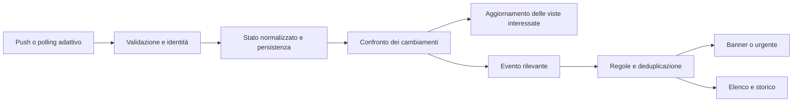

# SmartPC — Notifiche coerenti e aggiornamento a eventi

**Revisione 3 · 10 ottobre 2026 · Europe/Rome · Piano consolidato e studio approfondito delle fonti a 0 €/mese, nessuna implementazione o installazione.**

> Questo dossier conserva lo studio precedente all’implementazione. Per lo stato attuale, l’installazione e i gate residui vedere il [report 0.8.8-rc.4](v088-notifications-implementation-report.md).

## 1. Obiettivo e decisione proposta

L'utente non ha mai visto notifiche Sport; vede soprattutto avvisi Account e Meteo nel richiamo in alto, da aprire manualmente. Occorre rendere coerenti ricezione, interruzione, consultazione e aggiornamento dei dati in tutto SmartPC.

**Perimetro confermato dall'utente:** Casa esclusa per questa manutenzione; notifiche automatiche per **tutte le partite di Serie A**, indipendenti dalla preferita e dalla pagina aperta; Fantacalcio soltanto su consultazione. Restano nel piano F1, MotoGP, Meteo/DPC, Account e Rete.

Adottare un sistema ibrido: ascolto dei cambiamenti dove la fonte lo permette, polling adattivo negli altri casi, riconciliazione dopo interruzioni. Separare il cambiamento di un dato dalla decisione di mostrarne una notifica. Un minuto di partita aggiornato non deve generare un banner; un gol attendibile di una partita di Serie A sì.

Il piano è organizzato come manutenzione **v0.8.8**: rc.1 gestione/presentazione, rc.2 Serie A e Fantacalcio su richiesta, rc.3 altre fonti e aggiornamento a eventi, rc.4 consegna e qualifica. Il MasterPlan registra questa fase come pianificata, senza cambiare versione del software o attestare un'installazione. La sequenza dei nuovi moduli resta v0.9 Gioco, v0.10 Compagno, v0.11 Memoria/AI. La scelta/accessibilità della fonte calcio rimane un gate separato, descritto nella sezione 10; non blocca il gestore comune.

## 2. Evidenze del checkout

Riferimento documentale corrente: [0.8.7-rc.3](v087-sport-live-fix-report.md). L'analisi legge il checkout; non verifica l'installazione attuale, le preferenze della board o il comportamento durante una partita reale. La testimonianza dell'utente è il riscontro sull'uso fisico.

| Area | Comportamento trovato | Conseguenza |
| --- | --- | --- |
| Gol | `SportService` richiede `SMARTPC_SPORT_LIVE_VERIFIED` e opt-in; `toggleGoals()` rifiuta se non qualificato. | Vedere il risultato «in corso secondo la fonte» non abilita le notifiche. La rc.3 dichiara esplicitamente che non abilita il gate. |
| Dettaglio partita | `refresh_detail()` legge la partita selezionata; senza selezione sceglie la prima attiva. | Gli eventi completi non vengono acquisiti sistematicamente per tutte le partite seguite. La navigazione può cambiare la copertura del rilevatore. |
| Perimetro calcio | Impostazioni: «Banner della squadra preferita». `GoalTracker.update()` percorre tutte le `activeMatches`. | Discrepanza riprodotta. La scelta successiva dell'utente conferma tutte le partite di Serie A: correggere testo e policy per competizione, senza introdurre un filtro preferita. |
| Conferma gol | Richiede ID nuovo, `pendingVAR is False`, conferma e nuovo punteggio coerente. ESPN normalizza `confirmed=False`, `score=None`. | Il fallback attuale non produce notifiche di gol confermati; non va presentato come equivalente. |
| F1 e MotoGP | `MotorsportService._publish_home()` pubblica soltanto il prossimo GP come promemoria, priorità 1. | Dati live e Race Control non hanno ancora adapter di notifiche. La mancata comparsa non prova un problema del renderer. |
| F1 push | `F1Timing` mantiene `QWebSocket`/SignalR Core nelle finestre di sessione. | Il trasporto a eventi esiste già. Il probe che chiude il socket è distinto dal servizio. |
| Aggiornamento F1 | I delta SignalR di tipo 1 aggiornano lo stato senza emettere `changed`; il tick di Motorsport a 1 s rileva la nuova revisione. | Parte della pubblicazione dipende ancora dal timer, pur avendo già ricevuto il cambiamento. |
| Presentazione | Priorità 1: elenco; 2: banner; 3: urgente. Banner ordinari: 8 s, soltanto con `overlay === ""`. | Aprire dettaglio, elenco o impostazioni impedisce i banner ordinari. Non sappiamo se questa sia la causa di ogni avviso mancato dell'utente. |
| Disponibilità banner | La shell richiede contemporaneamente il renderer piccolo e quello grande. | Verificare la disponibilità del formato richiesto e un fallback: un errore del formato inutilizzato non dovrebbe bloccare l'altro. |
| Account | Prima soglia: priorità 1; soglia critica: priorità 2. | Il primo avviso è intenzionalmente solo nell'elenco. Il dato rappresenta limiti di utilizzo Account, non necessariamente saldo token o crediti API. |
| Meteo | Gialla: banner; arancione/rossa: urgente. L'allerta futura attende `startsAt` per interrompere. | Ricezione del bollettino e inizio validità sono distinti; introdurre eventualmente un preavviso esplicito. |
| Silenzio | Default 22:00–07:00; categorie Meteo/Account possono essere nascoste anche per gli urgenti. | Esporre chiaramente la policy effettiva. Nessuna modifica implicita alle preferenze già salvate. |
| Storico | SQLite conserva dati per 7 giorni dopo scadenza, ma `snapshot()` espone solo eventi non scaduti/non cancellati, fino a 20; anche il conteggio non letti è limitato a queste righe. | L'elenco visibile non è ancora uno storico consultabile completo. Separare storico, coda e conteggio. |
| Riattivazione | Cancellare e reinserire lo stesso ID azzera notified/dismissed/seen. | È il contratto corrente, confermato dai test. Un futuro delta push non può essere tradotto in snapshot parziale/vuoto: riaprirebbe o cancellerebbe eventi impropriamente. |

Punti del codice: [sport.py](../sport.py), [sport_core.py](../sport_core.py), [motorsport.py](../motorsport.py), [racing_timing.py](../racing_timing.py), [events.py](../events.py), [event_core.py](../event_core.py), [Main.qml](../Main.qml), [SettingsPanel.qml](../SettingsPanel.qml), [account.py](../account.py), [state.py](../state.py).

## 3. Push come sul telefono: cosa è possibile

Sul telefono un server che conosce l'evento invia il messaggio attraverso un servizio di consegna; non è il push stesso a scoprire che è avvenuto un gol. [Architettura FCM](https://firebase.google.com/docs/cloud-messaging/fcm-architecture).

Su Orange Pi possiamo lasciare l'acquisizione in attesa su socket asincroni e reagire quando arriva un messaggio. Qt espone già i segnali di ricezione e disconnessione di [QWebSocket](https://doc.qt.io/qt-6/qwebsocket.html). Non serve inserire un broker esterno per il solo gestore locale.

«Risveglio» significa attivare il lavoro del provider mentre Linux e l'interfaccia rimangono operativi. Non equivale a sospendere la Orange Pi: il risveglio fisico richiederebbe un percorso hardware/rete specifico da provare. Orologio, rendering, supervisione, heartbeat e timeout conservano scadenze proprie. Un sistema a eventi riduce lavoro inutile, non garantisce zero CPU o zero traffico.

| Fonte | Stato e proposta | Limite da conservare |
| --- | --- | --- |
| F1 | SignalR già presente: pubblicare delta consolidati e derivare eventi selezionati. Il [client FastF1](https://github.com/theOehrly/Fast-F1/blob/main/fastf1/livetiming/client.py) conferma lo stream SignalR Core. | Il client upstream avverte che senza autenticazione i dati possono essere parziali o assenti. Qualificare ogni capacità effettivamente ricevuta, oltre a identità GP/sessione, freschezza e riconnessione reali. |
| iliadbox | WebSocket eventi documentato; lo [studio locale](v08-iliadbox-api-study.md) conserva handshake e registrazione LAN riusciti dal PC. Usarlo per invalidare/rileggere l'host interessato. | Iscrizione accettata non certifica transizioni fisiche, replay o consegna senza perdite. Raggiungibilità IP non prova presenza/spegnimento del dispositivo. [SDK Freebox](https://dev.freebox.fr/sdk/os/). |
| Account | `QFileSystemWatcher` reagisce già al file normalizzato pubblicato dal helper PC. | Il watcher migliora il tratto locale; non rende push l'acquisizione a monte. Conservare scadenza e recupero delle sostituzioni atomiche. |
| Calcio | Trasporto attuale HTTP; nuovo adapter indipendente dal trasporto. Esiste un WebSocket calcio documentato, ma richiede un servizio diverso e accesso da qualificare. | Fonte, copertura Serie A, costo/quota e significato dei gol restano gate. Un relay nostro sulle stesse GET sposta il polling, senza eliminarlo. |
| Fantacalcio | Una lettura all'apertura se necessaria, cache e refresh manuale; nessun timer ricorrente e nessuna notifica. | Disponibilità dei voti esplicita. Questa scelta non richiede la qualifica del feed voti live per consegnare le notifiche partite. |
| MotoGP | Timing acquisito tramite HTTP; nessun adapter push verificato nel checkout. | Mantenere polling circoscritto alle sessioni pertinenti. |
| Meteo/DPC | Previsioni ogni 15 min, bollettino ogni 30 min; nessun push integrato. | Il bollettino è una valutazione giornaliera, non un feed di emergenze istantanee. Letture condizionali solo se supportate e provate. |

## 4. Percorso unico dei cambiamenti

Mantenere Python proprietario di I/O, freschezza e regole; QML riceve stato e presenta. Riutilizzare `EventEngine`, `EventService`, `NotificationHost` e il contratto Theme esistenti, migrando soltanto le estensioni necessarie.

Ogni adapter mantiene uno stato completo. Un delta si applica a quello stato, con identità fonte/account/sessione e ordine verificato; soltanto dopo si ricavano eventi. `publish_snapshot()` attuale significa sostituzione **completa della fonte**, compresa la cancellazione degli eventi assenti. Non passargli direttamente singoli messaggi push.

Distinguere tempo osservato dalla fonte, ricevuto localmente, controllato e salvato. Un heartbeat prova il collegamento, non rende nuovo un valore vecchio. L'assenza di variazioni non è una disconnessione; la freschezza dei singoli campi resta distinta dalla salute del canale.

Su perdita del collegamento: dati precedenti espliciti, tentativi con backoff/jitter e rispetto di Retry-After; al ritorno acquisire una baseline completa. Nessuna raffica dei gol avvenuti mentre eravamo offline. Un riepilogo «risultato aggiornato dopo la riconnessione» può essere consultabile senza fingere un evento appena avvenuto. Replay e cursori sono utilizzabili soltanto se il provider ne garantisce il significato.

## 5. Gestione visibile proposta

Le preferenze devono separare tre decisioni: acquisire i dati, registrare gli eventi, interrompere la vista. Nascondere un modulo dal carosello non deve spegnere silenziosamente le notifiche richieste. Silenziare i banner non cancella l'elenco; un evento può essere registrato ma risultare troppo vecchio per interrompere.

| Tipo | Presentazione iniziale proposta | Regola |
| --- | --- | --- |
| Aggiornamento ordinario | Solo valore nella pagina | Nessun avviso per minuto, campione meteo o posizione di ogni giro. |
| Informazione utile | Elenco e richiamo persistente | Non impone apertura o cambio pagina. |
| Evento seguito | Banner leggibile e non modale | Gol confermato, inizio/fine partita o sessione scelta, soglia significativa. |
| Urgenza qualificata | Superficie urgente con conferma esplicita | Mantiene fallback Base e policy di categoria esistente; le preferenze si cambiano esplicitamente. |

Un solo banner alla volta. Nuovi eventi importanti entrano in una coda distinta dall'elenco; ordine per priorità e poi ricezione, raggruppamento soltanto per lo stesso contesto. Deduplicare per ID evento stabile e revisione significativa, non per titolo o istante del refresh. Un evento revocato rimane nello storico come corretto, ma esce dalla coda.

Proposta visiva: usare i renderer piccolo/grande già disponibili, palette, font e icone correnti. Piccolo per Account e informazioni sintetiche; grande per gol o eventi che richiedono punteggio e contesto. Posizione concordata con la shell, evitando dati e comandi. Banner ordinari anche sopra dettagli di consultazione, senza rubare focus; rinvio breve durante conferme o editing. Restare a 960×640 con poche righe. La durata attuale di 8 s è il punto di partenza, da verificare sul pannello.

Il banner inizia il tempo di permanenza dopo il frame presentato, come già avviene. L'arrivo non equivale a «visualizzato»; visualizzato non equivale a «letto». Dettaglio o azione esplicita segnano la lettura. Il banner offre il percorso alla partita/sessione/account pertinente, con ID e revisione ancora validi, conservando il ritorno alla pagina precedente. Instradamento dei tasti attraverso il controller, senza azioni dirette del renderer.

Elenco: recenti e storico, gruppo per fonte/contesto, ora e provenienza, lettura stabile per ID. Conservazione iniziale di 7 giorni da formalizzare, separata dall'idoneità al banner. Il limite di righe a schermo non determina quanti eventi sono non letti. Dopo silenzio o rinvio, presentare soltanto eventi ancora tempestivi; eventuale riepilogo per gli altri, senza una sequenza di banner arretrati.

Aggiungere uno stato comprensibile per fonte e notifiche: «attive», «solo elenco», «silenzio fino alle…», «fonte da verificare», «dati precedenti». Diagnostica locale con motivi: non generato, escluso dalla preferenza, sospeso per silenzio, rinviato, scaduto, presentato, letto. Evitare di etichettare come attiva una funzione che non dispone di dati sufficienti.

## 6. Sport: eventi e copertura

Prima versione: **tutte le partite di Serie A della stagione corrente**, indipendentemente dalla squadra preferita, dalla pagina aperta e dal dettaglio selezionato. Nessuna estensione automatica a coppe o altri campionati. Raccolta centralizzata di scoreboard e dettagli necessari, condivisa con le viste; il dettaglio scelto dall'utente non deve sostituire quello richiesto dalle notifiche.

Eventi candidati: inizio, gol segnalato/confermato secondo capacità della fonte, gol annullato/correzione e finale. Intervallo nel registro, banner configurabile; preavviso opzionale, non un banner obbligatorio per ogni partita. Per F1/MotoGP: inizio/fine sessione e messaggi selezionati della direzione gara se la fonte li identifica senza ambiguità. Nessun banner per ogni variazione di posizione. Ogni tipo ha una capacità dichiarata: disponibile, consultabile ma non notificabile, da qualificare.

Distinguere «Risultato aggiornato» (cambiamento punteggio), «Gol segnalato dalla fonte» (cronologia coerente) e «Gol confermato» (conferma verificabile). Un punteggio ripetuto due volte non prova da solo la conclusione del VAR. In assenza dei dati necessari usare il primo livello, senza marcatore o conferma inventati. Rigori in partita e serie di rigori restano distinti.

Raccogliere il dettaglio al cambio del punteggio/stato; quando serve una conferma VAR, continuare le letture mirate entro budget anche se lo scoreboard non cambia più. Il punteggio finale può cambiare quando la partita esce da `activeMatches`: controllare anche la transizione a conclusa. Più gol tra due letture vanno ricostruiti soltanto se la cronologia li identifica; altrimenti mostrare un aggiornamento risultato senza inventare un gol singolo.

Ripresa dopo riconnessione e cambio provider: baseline silenziosa; ID canonico partita + ID evento della fonte con mappatura prudente, nessuna deduzione da nomi simili. Se la fonte non offre ID degli incidenti, definire identità sintetiche persistenti e qualificarle su correzioni/gol multipli prima di usarle per le notifiche. Conferma negativa/ignota non diventa positiva per timeout. Risultato corretto e revoca devono aggiornare sia la pagina sia l'evento già registrato.

**Fantacalcio su apertura:** il codice già seleziona il provider entrando nella scheda e chiama `clearFantacalcio()` uscendo. Tuttavia `FantacalcioService._finished()` programma ancora aggiornamenti ricorrenti, da 30 s nelle finestre live. La nuova policy elimina questa ricorrenza: cache immediata, una richiesta se scaduta/assente, refresh manuale disponibile. Uscita: nessun nuovo retry o fetch; un worker già partito può completare e salvare dati pubblicati, ma non aggiornare la nuova selezione né ripartire. Dati provvisori scaduti restano precedenti o indisponibili. Nessuna notifica voti.

## 7. Risorse e scadenze

Oggi Serie A ha polling adattivo già utile: 30 s durante live/prepartita vicina, 15 min in alcune finestre, fino a 6 h fuori evento. Due ore a 30 s sono **240 cicli di aggiornamento**, non necessariamente 240 richieste: ogni ciclo può effettuare più GET. Sport pubblica inoltre da un timer locale di 15 s; F1 valuta stato ogni secondo; EventService ogni minuto. Il launcher ha un timer di 250 ms per i segnali Python: è un'altra ragione per cui «zero risvegli» non è un risultato realistico del solo gestore.

Interventi proposti:

1. Pubblicare quando cambia lo stato significativo; consolidare burst del feed prima di aggiornare QML. Una finestra iniziale di 100–250 ms è un parametro da misurare, non un requisito universale o una latenza garantita.
2. Sostituire i tick di sola rivalutazione con timer single-shot alla prossima scadenza: freschezza, evento programmato, fine banner, fascia silenzio, retry. Conservare le rivalutazioni per cambi orologio/fuso.
3. Separare l'interesse delle viste dall'interesse delle notifiche. Socket/sessione e dettagli restano attivi quando servono agli avvisi; le statistiche pesanti possono rallentare se non consultate.
4. Condividere richieste, worker e cache per risorsa; rispettare limiti e concorrenza bounded. Scoreboard unico per tutta Serie A, dettagli mirati alle variazioni e a VAR/correzioni pendenti; profilo/rosa/classifiche con cadenze separate. Fantacalcio su richiesta e Casa fuori scope.
5. Persistenza fuori dal thread UI per le operazioni costose, con writer ordinato e commit confermato. ID e stato di consegna devono sopravvivere al riavvio senza doppie presentazioni; il commit non deve essere confuso con il frame visibile.
6. Socket con heartbeat/retry; polling di recupero a intervallo coerente con la fonte. Dopo un gap senza replay affidabile, nessuna promessa di consegna di tutti gli eventi intermedi.

Misurare separatamente cicli HTTP, numero richieste, byte, messaggi push, timer, pubblicazioni UI, transazioni, CPU/RSS e ritardo. Confrontare stessa finestra/evento con e senza pagina aperta. Ricezione→notifica è distinta da evento reale→ricezione e dal tempo ottico del pannello. Nessuna percentuale di risparmio o garanzia di 60 FPS è dimostrata in questa analisi.

## 8. Piano candidato per candidato

| Proposta | Lavoro | Criterio di uscita |
| --- | --- | --- |
| **0.8.8-rc.1 — Avvisi coerenti** | Policy unica, coda separata, storico, motivi di soppressione, banner nelle viste di consultazione e fallback del formato. Conservare Theme e preferenze con migrazione esplicita. | Evento ricevuto appare secondo la policy; navigazione non lo perde; niente doppie presentazioni al cambio tema, quiet hours o reboot. Prove sui tre temi e tastierino. |
| **0.8.8-rc.2 — Tutta Serie A** | Scoreboard e dettagli indipendenti dalla selezione, filtro competizione/stagione, inizio/fine e gol/correzioni secondo capacità; Fantacalcio senza ricorrenza. Fonte calcio qualificata prima di attivare il live. | Replay con partite simultanee più incontro reale: identità e semantica valide, latenze annotate, offline/reconnect senza raffica. Zero acquisizioni Fantacalcio automatiche a scheda chiusa e zero polling ricorrente anche quando aperta. |
| **0.8.8-rc.3 — Altre fonti e risorse** | Delta F1, adapter inizio/fine e Race Control disponibili, MotoGP mirata, Meteo/Account a soglie, listener iliadbox e riconciliazione. Scadenze mirate e richieste condivise. | Confronto nativo con carico equivalente: meno lavoro inutile senza perdita di freschezza, eventi o stabilità. Canali e transizioni reali qualificati; notifiche LAN soltanto dopo identità/copertura affidabili. Capacità opzionali non provate restano disattivate e dichiarate. |
| **0.8.8-rc.4 — Consegna** | Installazione con manifest, backup/rollback, preferenze conservate; verifica su board e reboot reale. | EGLFS 960×640, tre temi, nessun warning QML inatteso, servizio stabile e GUI fresca. Accettazione fisica banner, comandi e prove prolungate pertinenti; residui espliciti. |

Ogni candidata distingue implementazione PC, installazione e qualifica live. Non aggirare il gate dei gol semplicemente impostando la variabile d'ambiente: collaudare adapter e policy e poi abilitarne soltanto le capacità provate.

## 9. Verifiche effettuate per questa analisi

- Lettura dei provider, collegamenti di `DashboardState`, engine SQLite, shell e impostazioni; consultazione delle fonti primarie sopra indicate.
- `python3 dashboard/check_events.py`: **7 test OK**.
- `python3 dashboard/check_sport.py`: **11 test OK**. Output di errore dettaglio e warning di cleanup HTTPError provengono dai casi simulati; non sono prove di disponibilità delle API.
- Replay isolato nella prima revisione, senza rete/preferenze reali: gol di una partita estranea alla preferita genera un avviso nel tracker; cancellazione/reinserimento dello stesso ID riapre il banner nel contratto attuale. La preferenza successiva per tutta Serie A cambia il requisito del filtro, non l'evidenza del replay.
- Revisione 2: studio online delle fonti e dei piani pubblici, verifica del lifecycle Fantacalcio e della sincronizzazione Account. Test della prima revisione non ripetuti: nessun codice applicativo modificato.
- Revisione 3: [studio approfondito delle fonti](notification-source-feasibility-study-2026-10-10.md), budget zero riconfermato, candidata BSD REST, probe HTTP pubblici e schema Account offline. Il dossier conserva risultati e limiti; nessuna qualifica live attribuita a queste letture.
- Nessun runtime applicativo, flag, preferenza, servizio o file della board modificato. Aggiornati documento di analisi e MasterPlan; non eseguiti nuovi controlli EGLFS, misure di carico o qualifiche live.

**Decisione raccomandata:** partire dalla rc.1 e dalla copertura Sport della rc.2. Il push è un miglioramento mirato della rc.3; il beneficio principale per l'utente arriva quando un evento affidabile diventa un avviso visibile e utile, qualunque sia il trasporto.

## 10. Studio online: fonti calcio e decisione ancora aperta

**Aggiornamento dello studio approfondito:** vincolo **0 €/mese riconfermato dall'utente**. Il [dossier delle fonti](notification-source-feasibility-study-2026-10-10.md) propone **BSD REST v2 come prima candidata da qualificare**: Serie A/incidenti/VAR documentati, 7.500 richieste/giorno e licenza dati per dashboard. Accesso live richiede account/token, non creati o usati nello studio. Gli abbonamenti sotto restano confronto, esclusi dal piano corrente. Nessun push calcio gratuito completo è stato provato.

Consultazione delle pagine ufficiali il 10 ottobre 2026. Prezzi e copertura sono quanto pubblicato, non abbonamenti attivati o risultati misurati. Non sono stati creati account, avviati trial, contattati fornitori o chiamati endpoint calcio durante questo studio.

| Fonte | Evidenza ufficiale | Esito per questa integrazione |
| --- | --- | --- |
| **BSD REST v2** | [Piano gratuito](https://sports.bzzoiro.com/pricing/), [copertura Serie A](https://sports.bzzoiro.com/football-coverage/), [eventi](https://sports.bzzoiro.com/docs/football/events/) e [licenza](https://sports.bzzoiro.com/docs/api-license/). Il probe pubblico conferma 401 sul live senza token. | Prima candidata nel vincolo zero: lista aggregata e incidenti mirati, polling adattivo. Il campo `confirmed` della decisione VAR non è conferma generale del gol; ordine/ID/correzioni e copertura reale restano gate. |
| FotMob, attuale | I [termini pubblici](https://www.fotmob.com/tos.txt) vietano il recupero automatico sistematico e richiedono consenso scritto per l'uso dei dati. | Non approvare un aumento del polling su questa fonte senza chiarire l'accesso consentito. Riuscita tecnica delle GET e disponibilità di un contratto per l'integrazione restano distinte. |
| ESPN, fallback attuale | Il parser nel checkout dispone di score/stato, ma non di conferma gol e nuovo punteggio per incidente. Non è stato verificato un contratto push supportato per gli endpoint usati. | Può guidare i livelli di disponibilità dell'adapter esistente; non basta per promettere gol confermati o un nuovo servizio live completo. |
| **APIfootball.com** | [Documentazione WebSocket](https://apifootball.com/documentation/): modifiche punteggio/statistiche, filtri competizione/partita e chiave account. [Piano European](https://apifootball.com/): **21 USD/mese**, 1.000 chiamate/ora per endpoint; [copertura European](https://apifootball.com/coverage/?plan=1) include Serie A. Il gratuito copre Championship inglese e Ligue 2 francese. | È un candidato concreto per il push richiesto su tutta Serie A. Inclusione del socket nel piano effettivo, ritardo, correzioni/VAR, identità incidenti e recupero dopo gap devono essere provati. Nessuna garanzia di consegna/latency dedotta dal sito. |
| **API-FOOTBALL / API-Sports** | Servizio diverso da APIfootball.com. [Guida ufficiale](https://www.api-football.com/news/post/how-to-get-started-with-api-football-the-complete-beginners-guide): fixtures/eventi aggiornati ogni 15 s e integrazione tramite polling. [Piani](https://www.api-football.com/pricing): gratuito 100 richieste/giorno con stagioni limitate; Pro **19 USD/mese**, 7.500/giorno. | Alternativa REST documentata. Un solo poll ogni 30–60 s per 2 h richiede già 240–120 richieste, prima dei dettagli: il gratuito non sostiene questa cadenza per il requisito completo. Copertura stagione e conferme gol da verificare. |
| **football-data.org** | [Piani ufficiali](https://www.football-data.org/pricing): gratuito con punteggi ritardati, livescore a **12 EUR/mese**, Deep Data con marcatori a **29 EUR/mese**; eventuale IVA indicata dal sito. | Utile candidato per calendari/risultati; il gratuito non soddisfa l'obiettivo di gol tempestivi. Il livello con livescore non implica automaticamente cronologia completa o conferma VAR. |

**Conclusione:** è confermata l'architettura del gestore e la copertura di tutte le partite; non è ancora qualificata una fonte che fornisca tutto il live richiesto. BSD REST è la prima candidata a costo zero. Gli altri piani a pagamento sono esclusi dalla scelta corrente. Prima della rc.2 ottenere accesso consentito e provare copertura/semantica durante incontri reali; nel frattempo rc.1 e integrazioni indipendenti sono concretamente sviluppabili. Nessun provider attuale è stato cambiato.

Il protocollo push risolve il trasporto, non la qualità dei dati: il payload WebSocket documentato non basta a certificare una conferma VAR. Anche con un nuovo servizio i testi restano «risultato aggiornato», «gol segnalato» o «gol confermato» secondo l'evidenza disponibile. Non attivare un livello più forte usando la sola persistenza del punteggio.

## 11. Contratto d'integrazione delle altre fonti

### F1

Riutilizzare `F1Timing`, normalizzatore e associazione GP/sessione attuali. I delta ricevuti devono notificare il cambio significativo attraverso un consolidamento breve; i heartbeat aggiornano salute/scadenze senza ricalcolare tutte le righe. Disattivare il tick di un secondo soltanto dopo aver coperto fine freschezza, cambio anno/sessione e apertura/chiusura delle finestre di ascolto.

Adapter iniziale: inizio/fine sessione, bandiera rossa, Safety Car/VSC e comunicazioni selezionate quando i campi del feed le identificano. Non inferire una penalità applicata da un messaggio «under investigation»; non trasformare ogni testo della direzione gara in un banner. Priorità 2 per Sport, senza equipararlo agli urgenti Meteo.

Il [client upstream FastF1](https://github.com/theOehrly/Fast-F1/blob/main/fastf1/livetiming/client.py) elenca SessionInfo, SessionStatus, TrackStatus, RaceControlMessages e avverte sui dati parziali senza autenticazione. Il probe già conservato dimostra uno snapshot reale di qualifiche concluse, non la copertura in gara. Primo snapshot e sessione ritrovata dopo reconnect sono baseline silenziose; eventi nuovi solo dalla sessione identificata e dalle capacità effettivamente disponibili.

### MotoGP

Conservare il trasporto REST corrente; non è stato trovato e qualificato un contratto pubblico push utilizzabile per il gateway attuale. La [documentazione del prodotto TimingPass](https://www.motogp.com/it/news/2025/06/20/il-timingpass-si-evolve-arrivano-live-timing-sync-e-lap-chart/752169) descrive timing/sincronizzazione per utenti, senza attestare un'API di integrazione disponibile.

Separare programma/risultati dalle letture timing: oggi `_near()` mantiene la cadenza di 60 s durante una larga finestra di weekend. Proposta: timing vicino alle singole sessioni e durante attività confermata; rallentare tra sessioni, mantenere controlli sul programma per ritardi. Un orario passato non genera «sessione iniziata». Inizio/fine notificabili solo da stato identificato; bandiere e comunicazioni rimangono capacità non disponibili finché il payload non le offre. Nessun requisito di polling a 1 s.

### Meteo e Protezione Civile

Previsioni ogni 15 min e bollettino ogni 30 min come baseline iniziale, con backoff e cache. Non aumentare automaticamente la frequenza per imitare un feed istantaneo. Il [repository ufficiale DPC](https://github.com/pcm-dpc/DPC-Bollettini-Criticita-Idrogeologica-Idraulica) descrive una valutazione oggi/domani pubblicata giornalmente, di norma entro le 16:00.

Notificare nuova allerta pertinente, aggravamento e correzioni rilevanti, non ogni controllo dello stesso bollettino. Separare arrivo, preavviso per domani e inizio validità. Conservare fonte, territorio, colore e periodo. Richieste condizionali con ETag/Last-Modified soltanto dopo riscontro sul percorso realmente usato: [RFC 9110](https://www.rfc-editor.org/rfc/rfc9110.html#name-conditional-requests). Un 304 riduce corpo/elaborazione, non elimina la richiesta né rende push la fonte. Se si sceglie GitHub REST, verificare separatamente auth/quota e le [regole specifiche GitHub](https://docs.github.com/en/rest/using-the-rest-api/best-practices-for-using-the-rest-api#use-conditional-requests); non attribuirle automaticamente a raw.githubusercontent.com.

Il probe della revisione 3 sull'indice DPC ha restituito HTTP 200 e circa 0,98 MB anche con `If-None-Match` e ETag invariato, con `Cache-Control: no-store`. Il risparmio tramite 304 non è dimostrato su quel percorso; valutare discovery più piccola o cadenza mirata conservando gli aggiornamenti/errata corrige dopo le 16:00. [Evidenza](evidence/v088-source-study-2026-10-10/public-readonly-probes.json).

### Account

Conservare `QFileSystemWatcher`, riaggancio dopo sostituzione atomica e stato precedente alla scadenza. `smartpc-account-sync.timer` sul PC è configurato ogni 10 min: osservare il file sulla board non rende istantaneo il cambiamento a monte. Questa latenza va indicata nello stato, senza confonderla con il tempo di presentazione del banner.

Notifiche per attraversamento delle soglie configurate e per esaurimento se dichiarato dai dati; revisioni percentuali ordinarie aggiornano la pagina. ID stabile della finestra/bucket e reset, anziché posizione nell'array; un riordino non deve produrre nuovi avvisi. Reset o ritorno sotto soglia chiudono la condizione. Isteresi e riarmo vanno esplicitati, conservando soglie e scelta dei banner già salvate. Nessuna nuova infrastruttura PC è richiesta per la prima candidata.

Lo studio approfondito individua `account/rateLimits/updated` nella [documentazione ufficiale OpenAI](https://learn.chatgpt.com/docs/app-server) e nello schema offline di Codex 0.159.0 sul PC. Candidato per rc.3: helper persistente che osserva il cambio e pubblica atomicamente i soli dati normalizzati, con baseline/ripresa e riconciliazione. Prima di ridurre il timer, provare che il processo osservato riceva cambi dovuti all'uso reale, anche da altri processi/dispositivi; il metodo presente nello schema non prova quella copertura. Nessun nuovo helper attivato nello studio.

### Rete/iliadbox

Listener locale autenticato per gli eventi già documentati; messaggio come indizio per invalidare e rileggere l'host pertinente. Prima snapshot completo; riconciliazione completa iniziale ancora ogni 5 min. Ridurla soltanto se le prove dimostrano copertura e recupero sufficienti. Le metriche di traffico/stazioni restano letture con interesse della vista: l'evento LAN non sostituisce i campioni dei contatori.

Il client HTTP corrente apre e chiude sessioni; il listener deve avere un proprietario del lifecycle che non esegua logout mentre il socket è in ascolto. Valutare sessione dedicata o coordinamento condiviso, con stesso token autorizzato, TLS verificato, API base scoperta e UID router verificato. Nessun percorso hardcoded dalla versione di esempio e nessuna nuova autorizzazione amministrativa implicita.

Le evidenze conservate attestano handshake 101 e registrazione accettata dal PC, con `physicalEventObserved=false`: [riscontro](evidence/v08-iliadbox-study-2026-10-07/network-extra-capabilities.json), [catalogo](evidence/v08-iliadbox-study-2026-10-07/api-catalog.json). Il sito SDK esterno non è stato acquisito in questa revisione per timeout; non sostituiamo quel limite con una nuova dichiarazione di copertura.

Prima delle notifiche LAN: identità e confronto fisico acceso/sonno/scollegato, IPv4/IPv6, router reboot e perdita del canale. Niente «intruso», «dispositivo spento» o allarme per la sola chiusura WebSocket. Tipo iniziale possibile: «Nuova identità osservata», dopo baseline e riscontri comparabili; event-specific notification solo per capacità qualificate. Il listener può migliorare la freschezza prima che gli avvisi di presenza siano abilitati.

### Gestore comune e limite di carico

Un coordinatore di scadenze sceglie il prossimo lavoro necessario, senza riscrivere tutti i provider insieme. Usare i [timer single-shot Qt 6.8](https://doc.qt.io/qt-6.8/qtimer.html) nel thread proprietario. Mantenere un limite al tempo di ogni callback e una sola acquisizione per risorsa; mancato timer per loop occupato non deve riprodurre una raffica di aggiornamenti scaduti.

Per Serie A simultanea: una raccolta del campionato, dettagli per le partite cambiate e per conferme/correzioni pendenti, sotto budget del provider. Calendario alla scadenza più vicina tra prossimo controllo e finestra prepartita: un poll lungo non deve far saltare il calcio d'inizio. Le viste consumano gli stessi dati. Statistiche/formazioni/rosa si aggiornano quando consultate o a cadenza lenta propria.

Coda: priorità prima, ricezione poi; eventi Sport di partite diverse hanno pari diritto di presentazione. Una raffica può produrre una scheda «3 aggiornamenti Serie A» con accesso agli eventi, mantenendo ogni voce individuale nel registro. Preavvisi/intervalli configurabili; gol/finali visibili; nessun favoritismo implicito verso la squadra preferita. Non utilizzare il limite di 20 righe dell'elenco come limite della coda o dei non letti.

## 12. Accettazione prima della consegna

| Prova | Risultato richiesto |
| --- | --- |
| Serie A simultanea | Tutte le partite della competizione considerate; dettaglio aperto diverso non interrompe acquisizione/notifiche delle altre; nessun evento di altra competizione. |
| Gol multipli/VAR/finale | Segnalazione, conferma e correzione distinguibili; uscita dallo stato live non perde il finale; dati incompleti conservano lo stato valido. |
| Fantacalcio | Una richiesta su apertura quando necessaria; manuale esplicito; nessun polling ricorrente, retry alla chiusura o callback che riattivi una scheda diversa. |
| Presentazione | Banner su Home, altre dashboard e dettagli di lettura; editing rinvia; primo frame avvia permanenza; focus e tasti restano coerenti. Tre temi, preferenze conservate. |
| Coda/storico | Più di 20 eventi, raffiche e urgenza durante banner; ordine, conteggio e lettura stabili; nessuna ripresentazione da refresh invariato o riavvio. |
| F1/MotoGP | Sessione reale identificata, inizio/fine e messaggi solo se ricevuti; feed parziale esplicito; disconnessione e nuova baseline silenziosa. |
| Meteo/Account | Attraversamento soglie/aggravamento una sola volta, quiet hours anche a cavallo di mezzanotte, reset e revisione senza duplicati. |
| iliadbox | Transizioni fisiche e riaggancio provati; sessione/TLS conservati; socket perso non genera assenza dispositivo. |
| Risorse | Confronto HTTP/byte, callback, pubblicazioni UI, transazioni e CPU/RSS su scenari equivalenti: idle, Serie A simultanea, sessione F1, navigazione e offline. Misure di latenza separate dal ritardo della fonte. |
| Board | Manifest e rollback, EGLFS 960×640, servizio stabile, GUI fresca e reboot reale della nuova candidata; qualifiche live/prolungate distinte dai replay. |

**Confermato per la pianificazione:** perimetro, percorso unico dei cambiamenti, presentazione e sequenza delle candidate. **Ancora da chiudere:** fonte/accesso calcio, capacità dei feed reali, prove fisiche LAN e misure board. Casa non rientra nei gate di questa manutenzione; voti Fantacalcio live non condizionano le notifiche delle partite.
