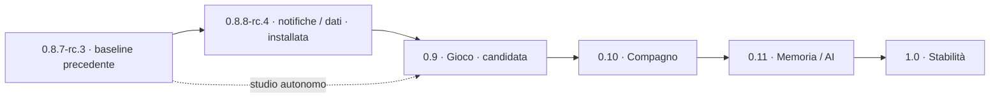

# DeskPulse / SmartPC — MasterPlan dei rilasci

**Revisione 2.53 · 11 ottobre 2026 · Europe/Rome**

**Baseline corrente documentata: core 0.9.0-rc.3 · Theme API 2.8 · 67 superfici · Apple Calm 1.6.2.**

Questo è il piano operativo unico del progetto: descrive il prodotto attuale, le consegne acquisite, le verifiche residue e le release successive. Sostituisce l'organizzazione per aggiunte delle revisioni precedenti. Le analisi e i report collegati conservano dettagli tecnici, misure, manifest e risultati storici; non si ripetono come nuove attività le migrazioni già consegnate.

L'aggiornamento registra Gioco 0.9.0-rc.3 implementato e installato: impostazioni senza legenda e con descrizioni, Controllo/Passo, valutazioni abbinate, campione verificato e Progressi basati sui tempi. [Report rc.3](v09-game-settings-pace-report.md). Cinque seed Evoluzione: tempi migliori rispetto al primo campione, 49/50 giri validi; il confronto con reward precedente è misto, quindi coefficienti sperimentali. Traffico, PPO/NEAT e gate fisici restano aperti. Compagno v0.10 e Memoria v0.11 mantengono la sequenza.

## 1. Stato attuale e lettura delle evidenze

| Elemento | Stato corrente | Evidenza e limite |
| --- | --- | --- |
| Core | **0.9.0-rc.3**, checkout e installazione | [Consegna impostazioni/passo](v09-game-settings-pace-report.md): manifest 545 file, backup, preferenze, tema e piloti conservati; qualifica completa ancora aperta. |
| Tema attivo documentato | **Apple Calm 1.6.2** | Conservato nella 0.9.0-rc.3 anche dopo reboot; palette, font, icone e personalizzazioni mantenuti. Base e Functional verificati in EGLFS. |
| Contratto dei temi | **SmartPC.ThemeApi 2.8**, 67 superfici | Cinque superfici Gioco additive, fallback, corpus e kit aggiornati; [report](v09-game-implementation-report.md). |
| Reboot | Reboot reale **0.9.0-rc.3** verificato | [Ricevuta](evidence/v09-game-settings-pace-2026-10-11/board-install/final-receipt.json): boot ID cambiato, preferenze/tema e registri dei piloti conservati; GUI pronta, checkpoint dei tre backend e risultati Gara conservati in store isolato. |
| Sport in corso | Priorità e apertura del dato pertinente corrette in rc.3 | Serie A dalla cache recente e F1 dalle qualifiche concluse osservate. Sessione F1 attiva, latenza e reconnect durante l'evento restano da qualificare. |
| Notifiche v0.8.8 | **Implementate/installate; qualifica live parziale** | [Report](v088-notifications-implementation-report.md): banner nelle consultazioni, coda/storico, feed BSD Serie A autenticato, Fantacalcio su richiesta e scheduling a eventi/scadenze. 0 €/mese; gol/VAR e latenze reali ancora da qualificare. |
| Gioco v0.9 | **Candidata implementata/installata; qualifica parziale** | [Report rc.3](v09-game-settings-pace-report.md): menu spiegato, Controllo/Passo, campione verificato e valutazioni riprendibili. Evoluzione 49/50 giri finali PC e tempi migliori del primo campione; confronto reward misto. UI nativa/120 s rc.3; soak 30 minuti e confronto CPU/NPU della rc.2 restano storici. Traffico, PPO/NEAT e gate fisici aperti. |

**Vocabolario:** “implementato” indica codice presente; “installato” richiede ricevuta/manifest; “verificato sulla board” ha un perimetro esplicito; “qualificato live” richiede un evento reale; “pianificato” e “in analisi” non dichiarano software attivo. Un tag, una versione nel README o un servizio active non sostituiscono manifest, heartbeat e prove funzionali.

Le differenze storiche v0.6.5/v0.6.1 e tag stabili rispetto alle candidate installate sono già registrate nei report delle singole consegne. N0 Rete ed E0 metriche hanno riconciliato le baseline pertinenti: oggi non sono una nuova attività “installare v0.7” o “iniziare discovery v0.8”. Prima di ogni prossima distribuzione si confrontano comunque runtime, manifest, checkout e modifiche presenti.

## 2. Regole di prodotto da conservare

- **Hardware/UI:** Orange Pi Zero 3W/A733, Debian/Qt 6.8.2, EGLFS/KMS PowerVR, display nativo 960×640 a 60 Hz. Animazioni a 60 fps sono un obiettivo da misurare, distinto dalla frequenza del pannello.
- **Grafica:** conservare colori, font, icone e stile approvati; migliorare geometrie, gerarchie, scorrimento e risposta. Profilo attuale: barra 56 px, margini laterali 24 px, fondo 16 px. La verifica fisica a 50–60 cm rimane necessaria.
- **Home dinamica:** ora e meteo; evento solo se presente e pertinente. Niente spazi vuoti o dati inventati per completare una griglia. Oggi mantiene Ora, Orologio e Giornata.
- **Input:** 4/6 cambia argomento, 2/8 dashboard dello stesso argomento; nei pannelli agiscono sul loro contenuto. 5 approfondisce/conferma, 7 torna, 1 Home, 3 Avvisi, 9 Menu. Gioco attivo acquisisce le frecce per auto/visualizzazione e 5 richiede pausa prima dello sblocco della navigazione. Ritorno con vista, selezione e scorrimento coerenti. Legende permanenti eliminate dalle viste ordinarie; Comandi resta accessibile.
- **Dati:** distinguere corrente, precedente, assente, errore e fonte da qualificare. Zero reale, false e dato mancante hanno significati diversi. Ricezione cloud, raggiungibilità router e osservazione fisica non sono equivalenti.
- **Architettura:** Python per acquisizione/stato/persistenza, QML per presentazione; I/O e lavoro costoso fuori dalla GUI. Non cambiare linguaggio o distribuire lavoro su più core senza una misura che ne dimostri il beneficio.
- **Temi:** provider comune, contratto pubblico tipizzato, renderer sostituibili e compatibilità additiva. Nuove superfici includono Base/Functional, Apple Calm o fallback verificato, fixture e kit AI aggiornati.
- **Rete:** acquisizione sulla board/router, nessun agent sugli altri computer. Il sincronizzatore PC dell'Account già esistente resta un'integrazione distinta.
- **Risorse:** dispositivo dedicato; RAM/CPU sono misure diagnostiche, non i vecchi limiti del prototipo. Risposta, stabilità, crescita delle cache e recupero restano criteri. Misure software, tempo GPU e latenza ottica sono separati.
- **Verifica:** prove mirate ai rischi della modifica; conservare risultati falliti e residui. Nessuna ripetizione indefinita degli stress storici già superati.

## 3. Esperienza già disponibile

| Famiglia | Dashboard correnti | Approfondimenti e comportamento |
| --- | --- | --- |
| **Oggi** | Ora / Orologio / Giornata | Evento condizionale, ora dominante nella vista Orologio, meteo compatto e Giornata riferita alla data corrente. |
| **Meteo** | Adesso / Previsioni | Condizione dominante, vento/umidità/raffiche/precipitazioni, date locali e stato della fonte. |
| **Account ChatGPT** | Utilizzo | Finestre con durata/percentuale/reset, piano e crediti quando esposti; 5 apre le informazioni disponibili. Cache sincronizzata dal PC, dati precedenti riconoscibili. |
| **Sport** | Serie A / La mia squadra / F1 / MotoGP | Serie A è il campionato completo, separato dalla preferita. 5 apre tutte le partite della giornata, il club personale o il GP/sessione pertinente. Calendari e classifiche restano nel Menu contestuale. |
| **Casa** | Preferiti / Ambiente condizionale / Dispositivi | Consultazione Tuya, inventario e dettaglio; disponibilità cloud e valori riportati distinti. Nessun comando ai dispositivi. |
| **Rete** | Traffico / iliadbox / Dispositivi | WAN, sensori box, Wi-Fi/porte/storico, inventario e dettaglio; copertura e tempi espliciti. Nessuna telemetria CPU/GPU/RAM dei client. |
| **Gioco** | Pista / Classifica / Progressi | Impara un pilota, Controllo/Passo, campione verificato e tempi; Gara con 2–4 reti congelate, Prova/Campione, impostazioni spiegate e salvataggi. Calcolo solo dopo Start; 5 pausa prima di tornare alla navigazione. PPO/NEAT sperimentali, traffico da qualificare. |

Le sette macroaree sono filtrate dalle preferenze senza creare pagine vuote. Per i moduli informativi nascondere una famiglia non equivale a sospendere il suo provider; l'interesse di una vista e quello di un avviso sono concetti distinti. Il calcolo del Gioco è invece esplicito e si sospende all'uscita.

**Impostazioni attuali:** Schermo, Aspetto, Moduli e Home, Avvisi, Servizi collegati, Dati e aggiornamenti. Gestione temi raccoglie import/export/revisioni; Sport e Home raccoglie discipline e riepiloghi. Informazioni è autonoma e in sola lettura. Le modifiche di aspetto hanno anteprima/salvataggio/annullamento dove previsto; refresh e completamento persistente sono distinti. [Guida UX](v083-ux-operations.md), [dashboard correnti](v086-dashboard-implementation-report.md), [correzione Serie A](v086-serie-a-fix-report.md).

## 4. Registro delle versioni consegnate

Questa sezione è lo storico acquisito. I suoi numeri e contratti descrivono la singola consegna, non una seconda baseline corrente.

| Versione | Risultato acquisito | Stato / riferimento |
| --- | --- | --- |
| **v0.1** | Kiosk, ora/data, tastierino, systemd e diagnostica passiva. | Base rilasciata; [README dashboard](../README.md). |
| **v0.2** | Meteo Open-Meteo, Angri, previsioni/cache e avvio offline. | Rilasciata; prove storiche nel README. |
| **v0.3** | Home dinamica, navigazione a due assi, componenti e preferenze. | Rilasciata; conservata nel prodotto attuale. |
| **v0.4** | Account/piano ChatGPT, utilizzo/crediti quando disponibili e reset. | Rilasciata; sincronizzazione normalizzata dal PC, segreti fuori dalla board/QML. |
| **v0.5** | Engine eventi persistente, priorità/TTL/dedup, badge, banner, urgenti e bollettino. | Rilasciata; esistenza del motore non prova copertura di tutte le fonti Sport. |
| **v0.6 e revisioni** | Serie A, squadra/coppe/rosa, Fantacalcio, F1/MotoGP, impostazioni/Info. | Consegne acquisite; [Serie A](v06-sport-release.md), [Motorsport](v06-motorsport-release.md). Gate live distinti. |
| **v0.6.6** | Theme Engine T0–T5/A1–A6, bundle QML/JS, API pubblica, motion/scene, recovery e kit AI. | Implementato/installato; [migrazione](v066-migration-report.md), [A1–A6](theme-engine-a1-a6-implementation-report.md), [Avvisi personalizzabili](theme-engine-notification-migration-report.md). |
| **v0.7 rc.1–rc.3** | Casa/Tuya, preferiti/inventario/dettagli, manutenzione e primo Apple Calm completo. | Installazioni/reboot documentati; [Casa](v07-implementation-report.md), [manutenzione](v07-maintenance-report.md), [Apple iniziale](../../theme-projects/apple-calm/CONSEGNA.md). Quota/collaudi fisici separati. |
| **v0.8.0-rc.1** | Inventario iliadbox dalla board, preferiti/cache, quattro superfici, Theme API 2.3. | Installata, EGLFS e reboot; [report](v08-implementation-report.md). N0/N1/N2/N3 e distribuzione consegnati nel perimetro documentato; N4 e copertura fisica residui. |
| **v0.8.1-rc.1** | WAN/fibra, radio/stazioni, porte, RRD 1 h/24 h, Theme API 2.4. | E0–E4 consegnate, installazione/reboot; [report](v081-implementation-report.md). |
| **v0.8.2-rc.1** | Affidabilità cache/refresh, writer, lifecycle, feedback e costi. | Installata; [report](v082-implementation-report.md). Apple Calm 1.2.1. |
| **v0.8.3 rc.1/rc.2** | Sport unico, impostazioni per compito, icone, layout/liste conservando lo stile. | Candidate consegnate; [UX](v083-implementation-report.md), [spazi](v083-space-optimization-report.md). API 2.5, Apple 1.3.0/1.3.1. |
| **v0.8.4-rc.1** | Dashboard più ampie, margini/focus e quattro preferiti completi. | D1/D2 consegnati; [report](v084-dashboard-optimization-report.md). API 2.6, Apple 1.4.0. |
| **v0.8.5-rc.1** | Impostazioni/Info, chooser, cambio tema/readiness e correzioni di recovery. | Installata e reboot; [report](v085-settings-implementation-report.md). Apple 1.5.0; incidenti precedenti conservati nelle evidenze. |
| **v0.8.6 rc.1/rc.2** | Dashboard principali dirette, griglia orizzontale, Serie A e squadra separate. | Installazioni/reboot; [dashboard](v086-dashboard-implementation-report.md), [fix Serie A](v086-serie-a-fix-report.md). API 2.7, Apple 1.6.0. |
| **v0.8.7-rc.1** | Normalizzazione/stile/contesti e pubblicazioni più leggere. | Installata e reboot; [performance](v087-performance-implementation-report.md). Apple 1.6.1. |
| **v0.8.7-rc.2** | Cache riaperture, contesti costruiti una volta, dati team mirati e motion 100 ms. | Installata e reboot; [aperture](v087-opening-implementation-report.md). Apple 1.6.2. |
| **v0.8.7-rc.3** | Priorità alle partite attive e timing/sessioni Sport, offset F1 e apertura con 5. | Candidata consegnata; [fix Sport](v087-sport-live-fix-report.md). Riavvio servizio, non nuovo reboot OS. |
| **v0.8.8-rc.4** | Notifiche nelle consultazioni, scheduling/fonti e aggiornamenti. | Installata e reboot; [report](v088-notifications-implementation-report.md), gate live distinti. |
| **v0.9.0-rc.2** | Gioco/Piloti, tre algoritmi, Gara/Prova, F1 e persistenza, API 2.8. | Candidata installata; prove native, reboot e checkpoint, CPU scelta dopo confronto NPU. Qualifica traffico/fisica ancora aperta; [report](v09-game-implementation-report.md). |
| **v0.9.0-rc.3** | Impostazioni descritte, Controllo/Passo, campione distinto, valutazioni abbinate/riprendibili e Progressi dei tempi. | Candidata installata e reboot verificato; cinque seed, prove native e piloti preservati. Coefficienti sperimentali; [report](v09-game-settings-pace-report.md). |

Le promozioni/tag storici 0.7.0/0.8.0/0.8.1 e i manifest delle candidate rimangono nei resoconti. Non cambiano retroattivamente gli esiti dei test né attestano qualifiche mancanti. “Consegna acquisita” non significa che tutti i collaudi fisici/prolungati siano conclusi.

## 5. Theme Engine e direzione grafica attuali

**Il motore è consegnato.** Non ripartire da T0–T5, dalla facade o dalla migrazione dei vecchi hardcode. Presentazioni, icone, motion, regioni, contesti, domini, readiness, revisioni immutabili, import/export, journal/rollback e supervisore sono infrastruttura riutilizzabile.

Il riferimento attuale è **API 2.8 / 67 superfici / Apple Calm 1.6.2**, insieme a Base e Functional. Apple Calm 1.2.0 e il kit v0.6.6 sono tappe storiche: i loro conteggi e le misure di quel momento non descrivono la build corrente. Il kit per nuove superfici va rigenerato dal contratto corrente; non applicare una patch rc.3 a un vecchio SDK assumendone la compatibilità.

Ogni nuova release con UI deve includere:

1. Contratti sorgente e generatori, contesti/azioni/DTO e dominio pubblico pertinente.
2. Presentazioni Base/Functional, compatibilità Apple Calm e fallback dei bundle precedenti; pacchetti importati immutabili.
3. Fixture di assenza/cache/errore e scale testo, giorno/notte, Normal/Reduced/Off, focus e ritorni.
4. Kit AI/reference/qmltypes/registry allineati alla release effettiva, senza assegnare una nuova minor soltanto nel piano.
5. Recovery e cambio tema durante il lavoro, con preferenze conservate e priorità agli urgenti.

Il cambio completo di stile è occasionale e può mostrare caricamento; la navigazione comune richiede feedback e prontezza. Hardware/Cyberdeck restano profili senza release obbligatoria assegnata. Cozy segue il Compagno **v0.10**; non crea il cane tramite il solo tema.

Riferimenti tecnici: [spec AI](theme-engine-ai-authoring-spec.md), [piano engine acquisito](theme-engine-ai-execution-plan.md), [guida](theme-engine-implementation-guide.md), [graphic study attuato](v086-landscape-graphic-study.md).

## 6. Rete locale: capacità consegnate e confini

**Rete base ed estesa sono già installate.** La fonte primaria è iliadbox Wi-Fi 7, gateway 192.168.1.254, una LAN; API/token/TLS, inventario e metriche sono stati provati dalla Orange Pi nelle consegne 0.8.0/0.8.1. Il token esistente è sufficiente alle letture qualificate con settings=false.

| Dati | Comportamento acquisito | Limite da conservare |
| --- | --- | --- |
| Inventario, nomi, IP/MAC, preferiti e riscontri | Identità/provenienza/tempi, persistenza e cache. | Snapshot storico 39 record contro contatore box 54; guest indisponibile. Non è “54 dispositivi accesi”. |
| Associazioni Wi-Fi/porta | Join con host/stazione/MAC qualificati. | MAC privati, roaming e switch a valle richiedono prudenza; IP/nome non bastano per fondere identità. |
| WAN/fibra e router | Rate normalizzati, capacità separata dal traffico, potenza ottica, sensori/ventola/uptime. | Non è speed test, temperatura della board o telemetria dei PC. |
| Radio/stazioni e porte | Link/velocità/segnale riportato, contatori e dettagli. | Traffico Wi-Fi per stazione; Ethernet condiviso per porta; WAN totale. Non sommare i livelli o attribuire una porta intera a ciascun host. |
| RRD e cache metriche | Storico 1 h/24 h, serie/unità/direzioni e reset qualificati nel perimetro. | Null resta buco; cache resta precedente; niente consumo mensile universale per dispositivo. |
| Acquisizione | Inventario circa ogni 300 s; metriche estese solo con interesse visibile, default qualificato 30 s. | Non ripristinare come comportamento corrente i 5–10 s ipotizzati nello studio. |

Residui: transizioni fisiche acceso/sonno/scollegato e perdita/ripresa LAN, segmenti isolati/IPv6, riduzione dei permessi superflui, survey fresco e MLO operativo. WebSocket/notifiche Rete sono capacità da qualificare, non N4 già consegnato. Discovery/helper si valutano soltanto per lacune misurate; nessuna scansione indiscriminata, agent client o enumerazione IPv6 /64.

[Uso Rete](v08-network-operations.md), [uso metriche](v081-network-operations.md), [fonti/capacità](v08-router-capabilities-and-views.md). Non avviare nuovi endpoint soltanto perché compaiono nel catalogo: storage, telefonia, VPN, media e comandi router sono possibilità separate senza versione assegnata.

## 7. Performance e Sport: risultato attuale e residui

Le ottimizzazioni 0.8.7 conservano la grafica approvata. Cache dei renderer limitata, sospensione dei nascosti, proiezioni mirate e pubblicazione dei campi cambiati riducono lavoro inutile; readiness e lifecycle restano controllati.

| Confronto rc.2 sulla board | Mediana software prima → dopo | Interpretazione |
| --- | --- | --- |
| Apertura Serie A | 466 → 138 ms | Stesso protocollo con motion disattivato; non latenza USB/ottica. |
| Apertura Casa | 153 → 71 ms | Non qualifica latenza cloud o cambi fisici del dispositivo. |
| Apertura Rete | 249 → 111 ms | Non qualifica durata acquisizione o copertura LAN. |

Primi ingressi, Impostazioni, selettore squadra e alcuni cambi argomento restano da migliorare; il report conserva casi senza beneficio e regressioni. Otto core disponibili e PowerVR attiva sono accertati; distribuzione ottimale del lavoro e saturazione GPU non sono dimostrate. Non serve una riscrittura generale per applicare le correzioni già identificate.

**Sport rc.3:** Serie A dà precedenza a stato attivo/intervallo con freschezza e plausibilità, anche quando il badge Live resta da qualificare. F1 normalizza l'offset, associa il timing al GP/sessione e conserva qualifiche concluse/ultimi tempi in attesa dei risultati pubblicati. 5 apre ciò che la dashboard mostra. Una corrispondenza ambigua o cache scaduta non attiva la diretta.

Le qualifiche di Singapore con 22 piloti sono state lette dal feed reale; le prove EGLFS del timing attivo usano stato/orario simulati. **La rc.3 non abilita notifiche gol né certifica una sessione F1 attiva.** Vedere “in corso secondo la fonte” e ricevere un evento confermato sono qualifiche distinte. [Fix e perimetro](v087-sport-live-fix-report.md).

## 8. Sequenza del lavoro futuro

| Versione | Risultato per l'utente | Stato / dipendenza |
| --- | --- | --- |
| **v0.8.8 — Notifiche e aggiornamento dati** | Avvisi visibili/coerenti e acquisizione autonoma, meno lavoro ripetuto. | 0.8.8-rc.4 implementata/installata; capacità live e uso fisico residui nel report. |
| **v0.9 — Gioco / Piloti che imparano** | Ovale 2D asciutto, vettura standard/F1 candidata, piloti persistenti, Impara individuale/Gara simultanea, Pista/Classifica/Progressi e Start/Pausa. | Candidata 0.9.0-rc.3 implementata/installata: impostazioni spiegate e miglioramento del passo con promozione verificata. Taratura, traffico, algoritmi sperimentali e gate residui da completare. |
| **v0.10 — Compagno animato** | Cane locale, scene e reazioni agli eventi, profilo Cozy. | Dopo Gioco nella numerazione; SceneHost già disponibile, asset/comportamenti da implementare. |
| **v0.11 — Memoria e scene AI** | Preferenze/storia del compagno e planner di scene validato. | Compagno deterministico funzionante; budget/fallback e gestione dei dati espliciti. |
| **v1.0 — Stabilità integrata** | Configurazione, aggiornamento e recupero riproducibili, moduli selezionati qualificati. | Qualifica integrata delle release effettivamente incluse. |

v0.8.8 è manutenzione della piattaforma. L'utente ha autorizzato l'implementazione completa di Gioco; 0.9.0-rc.3 è la candidata consegnata, con gate residui espliciti. Gli eventi live delle notifiche continuano ad avere una qualifica separata.

## 9. v0.8.8 — Notifiche coerenti e aggiornamento dati

**Stato:** 0.8.8-rc.4 implementata e installata, con 79 casi PC e prove native dei tre temi sulla board. [Report e residui](v088-notifications-implementation-report.md). Piano originale: [dossier del 10 ottobre, revisione 3](notification-data-update-analysis-2026-10-10.md) e [studio delle fonti](notification-source-feasibility-study-2026-10-10.md). Perimetro confermato: **tutte le partite di Serie A**, **Fantacalcio solo quando si apre la schermata**, **Casa esclusa da questo nuovo lavoro per ora**, **0 €/mese**. La copertura calcio è il campionato, indipendentemente dalla squadra preferita e dalla pagina aperta.

### Obiettivo e grafica

Un evento affidabile deve diventare un avviso utile anche mentre si consulta un altro modulo. Riutilizzare banner piccoli/grandi e superfici urgenti esistenti, stile/focus/icone attuali. Banner non modali sopra le consultazioni; rinvio durante editing/conferme delicate; coda con un evento alla volta, storico/letto separati dalla consegna e motivi di soppressione comprensibili. Fascia silenzio e categoria restano esplicite; urgenza non inventata dal solo stato del punteggio.

La nuova policy è attiva: banner sopra le consultazioni, differimento durante editing, storico e consegna separati dalla lettura. Il feed Serie A è indipendente dalla pagina e dalla preferita. Qualifica dei gol confermati e latenza reale restano distinte dagli aggiornamenti risultato della fonte.

### Fonti e trasporti

- **Serie A:** acquisizione delle partite indipendente dalla vista aperta; polling adattivo e dettagli mirati a punteggio/stato/conferma. Gol, inizio/intervallo/finale e correzioni sono candidati per capacità, da qualificare. Una variazione di score non prova da sola il singolo gol o la conferma VAR.
- **F1:** stream SignalR già presente, consolidamento dei messaggi e generazione degli eventi selezionati; accesso senza autenticazione potenzialmente parziale secondo upstream. Qualificare capacità effettive, identità/sessione e reconnect reali.
- **MotoGP:** mantenere il percorso verificato e polling pertinente fino a un canale eventi qualificato; non promettere push perché un altro sport lo supporta.
- **Account:** watcher del file e soglie significative; helper persistente `--watch` implementato per `account/rateLimits/updated`, con merge parziale e riconciliazione. Non attivato: push da altro processo idle ancora da provare, timer PC conservato; non crea billing API.
- **Meteo/bollettino:** acquisizione e riconciliazione mirate, nuove revisioni e scadenze; nessun push universale dimostrato.
- **Rete:** WebSocket implementato e registrazione TLS verificata PC/board; invalidazioni con snapshot di recupero e riconciliazione cinque minuti. Transizioni fisiche/reconnect ancora da qualificare, nessun evento di assenza inferito dal socket chiuso.
- **Fantacalcio:** cache immediata, una lettura all'apertura se necessaria e refresh manuale; nessun timer ricorrente, retry alla chiusura o notifica voti.
- **Casa:** conserva il provider già disponibile; nuovi eventi/push Tuya e relativi studi quota sono rinviati.

Il “risveglio” riguarda il lavoro di acquisizione/elaborazione: la Orange Pi resta operativa. Usare cambiamenti e scadenze dove utile, polling dove necessario, baseline silenziosa al recupero. Timer, HTTP, pubblicazioni UI e transazioni si misurano separatamente; nessuna percentuale di risparmio garantita nel piano.

### Piano iniziale e criteri di qualifica

Le fasi rc.1–rc.3 sono integrate nella candidata installata rc.4; i criteri relativi a eventi reali, energia/CPU e accettazione fisica rimangono aperti secondo il report. La numerazione della candidata non dichiara superati tutti i gate della tabella.

| Fase proposta | Lavoro | Criterio di uscita |
| --- | --- | --- |
| **rc.1 · Policy/presentazione** | Coda/storico, banner nelle consultazioni, soppressione/differimento e preferenze chiare. | Tre temi, nessun furto del focus o doppia presentazione al cambio tema/reboot; avviso ricevuto mostrato secondo policy. |
| **rc.2 · Tutta Serie A** | Fonte/accesso qualificati, acquisizione autonoma di tutte le partite, adapter gol/correzioni e transizioni finali; Fantacalcio su apertura senza ricorrenza. | Replay con partite simultanee più incontro reale; identità e semantica valide, latenze annotate, reconnect senza raffica, zero polling ricorrente Fantacalcio. Attivazione per capacità provata. |
| **rc.3 · Altre fonti e risorse** | Delta/adapter F1, MotoGP mirata, Meteo/Account a cambi significativi, iliadbox con riconciliazione; scadenze mirate e richieste condivise. | Meno lavoro inutile su carico equivalente senza perdere freschezza/avvisi/stabilità; fonti e transizioni reali qualificate. Notifiche LAN dopo identità/copertura affidabili; Casa esclusa. |
| **rc.4 · Consegna** | Manifest/backup, preferenze e stato eventi, EGLFS, reboot e qualifica fisica pertinente. | Servizio/GUI pronti, tre temi senza warning inattesi, recupero e residui dichiarati. |

**Fonte calcio:** BSD REST v2 gratuito autenticato con token privato. Calendario completo (380 partite), classifica (20 squadre) e identità Serie A/stagione verificati PC e board; polling adattivo con quota persistente e baseline silenziosa al recupero. Nessun push calcio gratuito completo provato. Gol/VAR, latenza e riconnessione durante un incontro reale restano da qualificare; gli avvisi descrivono ciò che la fonte segnala.

Non aggirare il gate dei gol cambiando una variabile d'ambiente. Se una fonte non conferma l'evento, può mostrare un aggiornamento risultato qualificato senza inventare un gol confermato.

## 10. v0.9 — Gioco / Piloti che imparano

**Stato:** candidata **0.9.0-rc.3 implementata e installata**, con [nuovo report](v09-game-settings-pace-report.md); la [consegna rc.2](v09-game-implementation-report.md) conserva le evidenze precedenti. Tre viste, piloti individuali, tre backend, Gara/Prova e persistenza, ora menu spiegato, Controllo/Passo, campione distinto e tempi verificati. **S0–S5 non sono globalmente chiusi:** traffico, PPO/NEAT, profili ampliati, lettura/input fisici e uso prolungato della build finale restano da qualificare. Coefficienti di reward sperimentali: tre confronti favorevoli e due sfavorevoli rispetto alla ricompensa precedente.

**Risultato:** gioco locale con piloti persistenti e profili/cervelli propri; primo ovale 2D asfaltato asciutto interamente visibile, vettura/gomme standard, camera fissa, poche auto rappresentative e progresso reale. La rosa candidata iniziale è quattro piloti, ognuno con tentativi interni distinti dall'identità del personaggio. Aprire Gioco non avvia il calcolo. **Start** avvia la sessione, **Pausa** la sospende; uscita/Home e urgente sospendono il lavoro; al ritorno serve un nuovo Start. **Impara allena il solo pilota selezionato**, con parametri/profilo scelti da fermo e salvataggio persistente. **Gara schiera più piloti già addestrati, contemporaneamente, ciascuno con la propria rete congelata**; Prova standard e Campione sono modalità distinte; replay registrato rinviato dopo l’MVP. Generazione, avanzamento, giri e andamento provengono dalla simulazione.

**GUI/UX aggiornata, revisione 4 su layout/tavole r2:** famiglia Gioco dopo Rete e **Pista/Classifica/Progressi**. Display **3,5″ orizzontale 960×640, 3:2**; rimosso il titolo locale "Auto che impara" e il pannello laterale. Arena **912×496** con fascia **912×48**; meno scritte e dati, stesso linguaggio del tema. Pista/auto condividono unità fisiche e scala uniforme; modello candidato veicolo 4,4×1,8 m, strada 10 m. Concept anche con più curve, senza anticipare il generatore.

**Impostazioni rc.3:** legenda permanente 2/8–4/6–5–7 eliminata dal menu Gioco, comandi e feedback conservati. Titolo evidente, descrizione più piccola in `textSecondary` e valore distinto; testi specifici per Evoluzione/PPO/NEAT, mutazione descritta come intensità. Verificate tutte le righe a 960×640, scala 1/1,1, paginazione e temi/fallback; kit aggiornato. [Studio e stato attuale](game-settings-speed-study.md), [report](v09-game-settings-pace-report.md).

**Controlli concordati:** in Simulazione **4/6 selezionano l'auto**, **2/8 cambiano visualizzazione** (Tutte / Solo auto / Sensori), con navigazione tra viste/famiglie bloccata anche per le azioni broker. **5 Pausa** restituisce il controllo Navigazione solo dopo conferma dell'arresto; allora 2/8 cambiano vista e 4/6 modulo. Avvio/Pausa in corso trattengono le frecce, nessun evento ripetuto attraversa lo sblocco. Home/Indietro, Inbox/Menu, cambio tema e urgenti mantengono le uscite con pausa; ritorno senza ripresa implicita. “Pausa” e “Salvato” richiedono esiti reali. Le quattordici tavole r2 e la preview restano concept evolutivi a dati demo, senza Gara e la nuova Classifica: proporzioni, input capture, QML/Theme e lettura fisica restano gate di implementazione.

**Costruzione:** fisica a passo fisso, sensori virtuali e reti proprie dei piloti; selezione/mutazioni come primo backend. S1 confronta F0 cinematica e F1 dinamica 2D con trazione/frenata, velocità laterale e limiti combinati di aderenza; la prima v0.9 simulativa qualifica F1 standard sull'asciutto. Un solo pilota selezionato in apprendimento alla volta, senza rotazione automatica della rosa; tentativi indipendenti tra copie di allenamento, avversari fissi nel curriculum di traffico, processo dedicato e snapshot limitati verso QML. La candidata adotta **race-32-v1** e rete iniziale **32→16→2**, con tre avversari osservabili; numeric7/numeric9 restano candidati storici degli studi. Il curriculum di traffico è implementato, la competenza resta da qualificare. Salvare checkpoint/campione atomicamente e recuperarlo senza avvio automatico al reboot. Sfondo/statici preparati una volta; rendering, fisica e training hanno ritmi distinti.

**Algoritmi, approfondimento S0:** [ricerca Evoluzione/PPO/NEAT](game-learning-algorithms-study.md) basata su lavori originali, documentazione e sorgenti. Ambiente numerico comune, tentativi indipendenti, evoluzione fissa iniziale, poi PPO e NEAT come estensioni con gate propri. S1b propone confronto PC su cinque seed, valutazione separata e budget per passi/tempo; S2 verifica dipendenze PyTorch/ARM, memoria, thread e pause. GUI con metodo da fermo, generazioni per Evoluzione/NEAT e passi/aggiornamenti per PPO; checkpoint separati. Tutti e tre i backend sono implementati; Evoluzione ha una prima prova di apprendimento su cinque seed, PPO/NEAT restano sperimentali con gate di competenza aperti. La richiesta piloti/Gara/Classifica/F1 amplia invece esplicitamente il perimetro minimo v0.9, con il lavoro aggiuntivo descritto nello studio simulativo.

**Miglioramento del passo rc.3:** Controllo → Passo dopo due finestre diverse da almeno 9/10 giri validi; pressione sul tempo graduale in otto aggiornamenti. Traffico scelto esplicitamente nel profilo, competenza non automaticamente acquisita. Dieci scenari uguali per candidato/campione: promozione con arrivi almeno pari al precedente e mediana migliore di oltre 0,05 s, oppure recupero se il precedente scende sotto soglia. Campione/prova/checkpoint atomici, RNG e valutazione interrotta recuperabili; criterio/reward versionati, élite rivalutati e transizione PPO tra aggiornamenti. Cinque seed e prove finali indipendenti: 49/50 arrivi, guadagni di 5,94–16,53 s sul primo campione; un seed perde un arrivo. Confronto a budget simile con reward Controllo: nuovo criterio migliore in 3/5, peggiore in 2/5. **Coefficienti sperimentali, nessuna superiorità universale o progresso monotono dichiarati.** Progressi mostra tempi e validità; [dati/report](v09-game-settings-pace-report.md).

**Piloti e classifica:** identità/storia persistenti, profilo versionato e checkpoint/campioni propri; individui evolutivi e copie ambiente PPO sono tentativi del pilota, non nuovi personaggi. Classifica consultabile senza avvio del calcolo: Gare concluse con ordine di arrivo e categoria distinta Prova standard (configurazione uguale, cinque scenari candidati, modelli congelati). Giri/checkpoint/tempi validi e regolamento determinano gli ordini; fitness private non confrontate, dati assenti/incompleti/precedenti espliciti e snapshot immutabili. Riaddestrare un pilota preserva gli esiti delle sue versioni precedenti.

**Gara simultanea, nel primo perimetro:** prima due piloti, quattro come obiettivo candidato dopo misure; mondo condiviso F1 e azioni raccolte dallo stesso snapshot prima dell'integrazione. Griglia, giri, finestra finale/timeout e regole congelati a Start. Contatti tra sagome/bordi con ritiro dei coinvolti come prima regola candidata, senza attribuzione di colpa né urti con danni promessi. Allenamento al traffico contro bot/piloti congelati: solo il selezionato impara. 5/urgente sospende tutto il mondo; 4/6 osserva un concorrente, 2/8 cambia solo il disegno. Gara interrotta non pubblica un vincitore. Dettagli, sensori e gate nello [studio piloti/Gara](game-drivers-simulation-study.md).

**Cataloghi e sviluppi:** TrackSpec, VehicleSpec, TireProfile, SurfaceProfile e ConditionProfile separati da pilota/renderer. Prima contenuti standard soltanto; predisposizione a circuiti curati, vetture con massa/potenza/sterzo diversi, gomme, asfalto/sterrato e asciutto/bagnato con effetti reali nel modello. Estensioni della famiglia v0.9.x dopo gate, senza date/versioni di dettaglio inventate; generatore, campionati, scia/urti con danni, usura/aquaplaning/terreno avanzato hanno nuova fattibilità. Compagno v0.10 e Memoria v0.11 conservano la numerazione.

**RAM, indicazione aggiornata dell'utente:** Gioco può usare tutta la RAM effettivamente disponibile dopo Start; rimosso il tetto candidato di 256 MiB. Dimensionare modello/buffer/popolazione secondo disponibilità rilevata e necessità, rivalutare durante la sessione e rilasciare alla chiusura. PPO non viene escluso per la sola memoria del runtime. I profili iniziali possono crescere dopo misure di CPU, pause e GUI: nessun numero del vecchio inventario è una prenotazione fissa. Lo studio propone confronti fino a popolazioni 128/256, copie PPO 16/32, rollout 1.024/2.048 e reti dense più ampie; sono candidati, non capacità della board già accertate o massimi imposti.

**NPU:** una politica Evoluzione appresa 32→16→2 è convertita per il CID A733 ed eseguita sulla board. Parità su 512 vettori: errore massimo 0,0000983. Inferenza residente completa NPU mediana 63,1 µs, CPU NumPy 42,3 µs; **CPU selezionata per questa candidata**. Non si dichiara training NPU né guida NPU a ciclo chiuso/Gara con più pesi propri. Nuove reti/carichi potranno essere adottati sulla NPU solo dopo correttezza e beneficio completi; il benchmark di un solo modello non qualifica l'intera rosa. [Misure e scelta](v09-game-implementation-report.md).

| Fase | Lavoro | Evidenza richiesta |
| --- | --- | --- |
| **S0 · Fattibilità e GUI/UX** | Hardware, algoritmo, scena/controlli, lifecycle, contratti e piano sperimentale. | Studio GUI/UX r4 con layout/tavole r2, input capture Simulazione/Navigazione, proporzioni e gate G1–G13; prove NPU di esempio già acquisite. Ricerca algoritmi, piloti, Gara condivisa, Classifica e F1/cataloghi aggiunti; le prove runtime e i residui attuali sono nel report di implementazione. |
| **S1 · Prototipo PC** | S1a: F0/F1, ovale/vettura standard, collisioni/checkpoint, piloti/Evoluzione e salvataggi. S1b: Gara headless 2/4, sensori/curriculum traffico, contatti/arrivi e Prova standard; PPO/NEAT come confronto aggiuntivo. Rc.3: baseline dei tempi, Controllo/Passo e promozione del campione implementati. | Dinamica stabile e sensibile ai parametri, identità/pesi propri, cinque semi, giri/contatti/arrivi validi e classifiche riproducibili; Gara nel minimo, PPO/NEAT estensioni. Rc.3: cinque seed, 49/50 giri finali; tempi migliori del primo campione e reward ancora sperimentale. Migrazione/ripresa verificate; robustezza ulteriore aperta. |
| **S2 · Carico board** | F1/sottopassi, un learner e cambio pilota esplicito, Impara/Gara 2/4/Prova/Campione; profili ampliati, dipendenze ARM e GUI concorrente. | Passi/s, apprendimento, CPU/RAM/temperature e stop; carico sostenibile scelto con misure. |
| **S3 · CPU/NPU** | Politiche congelate proprie dei piloti, profili osservativi qualificati per solitario/traffico e confronto CPU/NPU completo anche in Gara. | Guida equivalente e scelta motivata del runtime; niente ricompilazione continua dei pesi implicita. |
| **S4 · Vista/Theme** | Pista/Classifica/Progressi 960×640, Impara/Gara, piloti/profili/partecipanti, Start/Pausa, dati reali, contesti/azioni additive, fallback e kit. Rc.3: menu senza legenda, descrizioni/valori distinti e Progressi di tempi/validità implementati. | Tre temi e geometria arena, cattura/rilascio delle frecce con ack, focus, urgenti/fault worker, checkpoint e frame pacing sotto training e Gara. Nuove righe leggibili a scala 1/1,1, focus sempre visibile, compatibilità delle presentazioni. |
| **S5 · Qualifica** | Manifest/backup, installazione, input reale, reboot e sessione almeno 30 minuti. | Preferenze, piloti/checkpoint e risultati Gara/Prova conservati; sessioni interrotte corrette, GUI/lettura fisica e limiti pubblicati. |

**Avanzamento al 11 ottobre, rc.3:** S0 acquisito; S1a Evoluzione e nuovo percorso Controllo/Passo verificati su cinque seed, S1b protocolli Gara/Prova verificati ma competenza traffico aperta; S2 standard e soak 30 minuti rc.2 storici, nuove sessioni native 120 s rc.3 e ripresa valutazioni verificate, profili ampliati/uso finale aperti; S3 confronto NPU acquisito nella rc.2 e CPU selezionata; S4 menu/Progressi/input/lifecycle nativi verificati, lettura fisica aperta; S5 installazione/manifest 545 file/backup, reboot, preferenze/piloti e checkpoint/risultati in store isolato verificati, accettazione fisica aperta.

**Prossimi passi:** taratura/robustezza Controllo/Passo su altri scenari, competenza nel traffico e Gara, PPO/NEAT, carico/frame pacing e uso fisico. Il menu spiegato e il campione verificato sono consegnati; preset, mutazione adattiva e nuove penalità rimangono evoluzioni da studiare.

**Uscita:** piloti persistenti con apprendimento riproducibile, F1 standard contenuta e Gara simultanea qualificate, Classifica corretta, sessione esplicita/recuperabile e obiettivo 60 FPS sotto training e Gara sul carico scelto. Se non raggiunto, adattare simulazione/carico e riportare il limite prima della promozione. CarRacing-v3 è un riferimento, non una dipendenza della prima pista. Circuiti/vetture/fondi aggiuntivi, generatore e guida da immagini arrivano dopo l'ovale standard; un giro sull'ovale non prova guida generale.

## 11. v0.10 — Compagno animato

**Pianificata, non implementata.** Cane con riposo/attenzione/gioco e reazioni preparate agli eventi. Riutilizzare SceneHost persistente già consegnato, con regioni dichiarate dalle presentazioni e priorità ai dati/focus/urgenti. Nessuna riprogettazione dell'engine per introdurre il cane.

Percorso: stile/dimensioni e set piccolo di asset; macchina a stati deterministica; comandi e reazioni ai moduli qualificati; profilo Cozy; carico/frame pacing e lifecycle. Palette notte, silenzio Avvisi, movimento ridotto e riposo del cane rimangono controlli distinti.

**Uscita:** funzionamento locale senza AI/cloud, scene giorno/notte, asset precaricati durante la sequenza, stop/ripresa, urgenze e dati mancanti; compatibilità dei temi supportati. Nessuna reazione da una presenza LAN ambigua.

## 12. v0.11 — Memoria e scene AI

**Pianificata.** Preferenze/storia del compagno e planner AI opzionale, tramite JSON validato e catalogo di azioni/asset consentiti. Cache/eventi già persistenti e checkpoint del Gioco non vengono presentati come nuova memoria AI del compagno.

Percorso: dati/retention/cancellazione, schema SQLite versionato, contesto minimo, validazione scene, quota/costo/timeout e alternative locali. Fonte esecutiva e budget AI sono espliciti, non dedotti dal piano ChatGPT monitorato nella v0.4. Nessun codice generato viene eseguito.

**Uscita:** scene invalide respinte, preferenze recuperate al reboot, AI assente senza effetto sulla dashboard, consumo tracciabile e cancellazione verificata. Richiede Compagno deterministico già utile.

## 13. v1.0 — Stabilità integrata

Consegna dei moduli effettivamente selezionati con configurazione iniziale, versione/manifest identificabili, aggiornamento e recupero riproducibili. Verificare backup/ripristino, preferenze, cache corrotte/non scrivibili, offline, credential management, fonti live qualificate e matrice dei temi.

Una build fissa resta in uso normale almeno 24 ore con osservazione passiva di processo, RAM/CPU/temperature, fonti e log; uptime board, processo e versione sono distinti. Non bloccare la chat nell'attesa né inventare un soak dal breve controllo post-reboot. Animazioni e input sono misure separate.

Timeout microSD/SDIO, rumore audio/Bluetooth e aggiornamenti vendor restano approfondimenti se nuove evidenze li rendono pertinenti. I vecchi binding corretti, scollegamenti tastierino manuali e incidenti storici di recovery sono spiegati nei report: non riportarli come guasti nuovi senza riscontro. [Audit OS](../../os/board-audit-2026-09-29.md), [osservazione storica](../../os/diagnostics/2026-10-01-24h/report.md).

## 14. Gate aperti e priorità

| Area | Verifica/lavoro ancora aperto | Trattamento attuale |
| --- | --- | --- |
| Notifiche/dati | Gol/VAR e latenza durante partita, reconnect reale, accettazione dei comandi/banner. | 0.8.8-rc.4 implementata e installata; tutta Serie A, Fantacalcio su consultazione, Casa esclusa. |
| Sport live | Incontro Serie A, sessione F1/MotoGP attiva e reconnect: capacità per fonte da qualificare. | BSD autenticato e calendario/classifica verificati; avvisi etichettati secondo la fonte, nessuna conferma VAR inventata, flag globale live non attivato. |
| Reattività | Primi ingressi, Impostazioni/selettore, casi senza beneficio, feedback del tastierino. | Migliorie mirate secondo uso/profilo, senza cambiare stile o ripetere la matrice storica intera. |
| Input/lettura | Tastierino reale, risposta ottica e pannello a 50–60 cm. | Distinti dalle simulazioni; richiesti dove cambiano comandi o composizione. |
| Rete | Presenza/sonno/isolamento, transizioni LAN, token/coverage, survey/MLO non qualificati e N4. | Consultazione utile già consegnata; eventi/nuove capacità richiedono prove pertinenti. |
| Casa | Quota/consumo/scadenza e polling controllato; app/dispositivi/hub/rete reali. | **Rinviata come nuovo lavoro**; conservare candidata/consultazione e non dichiarare superati i residui. Non blocca Gioco o Notifiche. |
| Theme/stabilità | Power-cut, uso prolungato, qualifica di nuovi bundle e persistenza. | Conservare recovery e prove acquisite; ulteriori test solo per nuovo rischio. |
| Gioco | Taratura del passo, robustezza, traffico/Gara, PPO/NEAT, profili ampliati e gate fisici/frame pacing. | Rc.3 installata: menu spiegato, campione distinto, valutazioni e Progressi consegnati. Reward sperimentale, qualifiche residue nel [report](v09-game-settings-pace-report.md). Confronto CPU/NPU precedente conservato. |
| Identità distribuzione | Conservare ricevuta 0.9.0-rc.3, manifest 545 file, API 2.8 e tema 1.6.2. | Verificare hash/preferenze e heartbeat per ogni nuova installazione; reboot attribuito soltanto alla versione provata. |

## 15. Ordine operativo e scheda di ogni release

1. **Baseline:** partire da 0.9.0-rc.3 / API 2.8 / Apple Calm 1.6.2; verificare manifest/stato effettivo quando si modifica la board. Preservare modifiche locali e preferenze.
2. **Manutenzione v0.8.8:** conservare la gestione consegnata e chiudere i gate live durante occasioni pertinenti; misurare il beneficio delle scadenze con carico confrontabile. Nessuna nuova integrazione Casa.
3. **Gioco v0.9:** usare la candidata 0.9.0-rc.3 con menu descritto, Controllo/Passo e campione verificato. Migliorare taratura/robustezza secondo il [report](v09-game-settings-pace-report.md); completare traffico/Gara, PPO/NEAT, carico ampliato, frame pacing, uso prolungato finale e qualifica fisica S5. Conservare i risultati acquisiti e i limiti del confronto reward. Timing Qt e pannello a 60 Hz non certificano 60 FPS costanti.
4. **Occasioni reali:** chiudere singoli gate Sport/notifiche durante partita/sessione pertinente; non mettere in attesa tutto il progetto per un evento futuro.
5. **Poi:** Compagno v0.10, Memoria/scene AI v0.11 e qualifica integrata v1.0. Hardware/Cyberdeck, Media/Spotify, camera/audio, altri giochi e nuove piste non hanno una release obbligatoria assegnata.

Per ogni chat/release usare la scheda: **baseline → risultato utente/schermate → sorgenti/capacità → implementazione → verifica PC/board/live → distribuzione/rollback → residui/decisione**. Le nuove feature entrano quando hanno contenuti utili; offline resta consultabile dopo il primo uso. Ogni azione ha esito reale, cancellazione/errori e focus coerenti.

**Regola di aggiornamento del MasterPlan:** aggiornare tutte le sezioni coinvolte — baseline, esperienza, registro, sequenza, versione futura, gate e ordine operativo. Sostituire le frasi superate; spostare il dettaglio storico nel report. Nessuna nuova consegna va aggiunta soltanto come prefazione lasciando il resto del piano a una baseline precedente.
