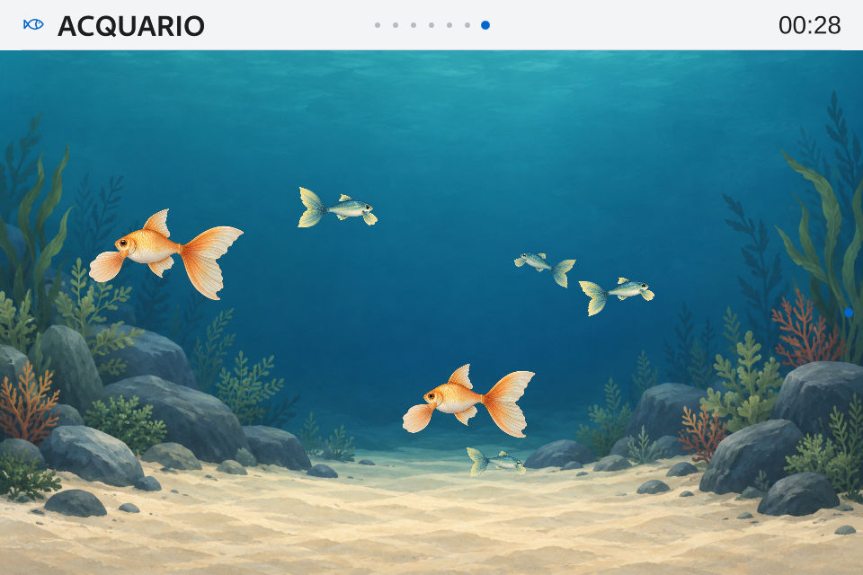
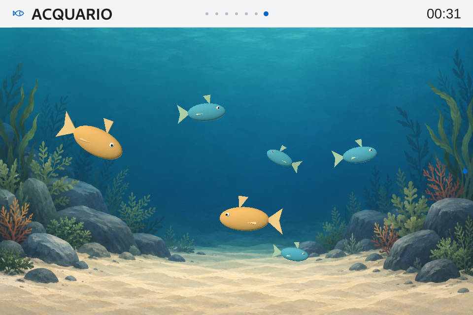

# Acquario — costo del vero 3D sulla Orange Pi

**Misurato 26–27 ottobre 2026 · esperimento isolato, nessuna consegna 3D.** Produzione ripristinata sulla **0.10.0-rc.2 / Apple Calm 1.6.5**, 682 hash conformi, GUI pronta/NRestarts=0. Manifest, preferenze, tabelle e artefatti Gioco e bootID invariati. Nessun aggiornamento/installazione di pacchetti nel sistema, nessun nuovo reboot OS. Dieci casi misurati; un’opzione non supportata nella configurazione provata. [Primo stadio interrotto su MSAA](evidence/v010-aquarium-3d-cost-2026-10-26/board/measure-receipt.json), [due prove residue completate](evidence/v010-aquarium-3d-cost-2026-10-26/board/supplement-receipt.json), [controllo finale](evidence/v010-aquarium-3d-cost-2026-10-26/board/final-health.json).

## Risultato principale

Il campione 3D resta vicino a 60 callback/s di media, ma nessuna delle tre repliche nominali supera il gate di regolarità. Rispetto al 2D, con sei pesci, la mediana delle tre prove comporta **+45.24 punti percentuali di un core CPU** e **+28.61 MiB di RSS**. Rapporto di CPU 2.49×. È il costo di questo modello e di questo rig: non una misura universale del 3D né un’approvazione dei modelli artistici finali.

| Sei pesci · tre repliche per renderer | Callback/s mediana | p95 min–max ms | CPU mediana, % di un core | RSS mediano MiB | Gate superati |
| --- | --- | --- | --- | --- | --- |
| 2D illustrato | 59.974 | 17.99–18.07 | 30.28% | 214.50 | 3/3 |
| 3D procedurale | 59.970 | 18.95–19.74 | 75.52% | 243.11 | 0/3 |

CPU 2D, intervallo tra repliche: **28.98–31.67% di un core**. La mediana riassume questi campioni; frequenze CPU/GPU e relativo margine non sono stati registrati durante le finestre.

CPU 3D, intervallo tra repliche: **53.63–84.79% di un core**. La mediana riassume questi campioni; frequenze CPU/GPU e relativo margine non sono stati registrati durante le finestre.

CPU indica user+system di tutti i thread, rapportati a **un solo core**, non all’intera CPU a otto core. RSS è memoria fisica del processo, non memoria GPU. Temperatura massima campionata nelle repliche: 2D 61.4 °C, 3D 61.9 °C. Nessun dato sui watt assorbiti.

## Campione e confronto controllato

Il prototipo è volumetrico: mesh con posizioni/normali/indici, prospettiva, occlusione e orientamento tridimensionale; coda e pinne sono parti solide animate con trasformazioni. Nove Model per pesce: corpo, coda, tre pinne, due occhi e due pupille. Geometrie condivise: **900 triangoli per pesce** nel profilo leggero, **3.492** nel profilo più fitto. Due luci direzionali, materiali Principled opachi; niente texture sui pesci, skinning dei vertici, ombre, caustiche, particelle, riflessi o postprocessing.

Sono copie private della stessa Main e degli stessi provider/contesti isolati. Il 2D usa il renderer illustrato installato; il 3D sostituisce soltanto il visuale. Controller, seed, traiettorie Bézier, velocità/fase, popolazione, geometria nominale, fondale, barra, orario e tema salvato sono conservati. La prospettiva è compensata per mantenere una taglia comparabile in pixel; la sagoma resta diversa, soprattutto nelle virate. La qualità artistica dei due campioni non è equivalente: il modello 3D è una sonda geometrica, senza i dettagli delle illustrazioni.

La scena 3D usa View3D Offscreen a **960×640 effettivi**, integrato sotto la stessa shell. La texture intermedia comporta un costo possibile, documentato da [Qt](https://doc.qt.io/qt-6.8/qml-qtquick3d-view3d.html). Non sono state usate riduzioni di risoluzione, modifiche del governor, priorità o driver per far passare il 3D.

Le sei dipendenze compatibili sono state **scaricate ed estratte in una cartella separata**: 3.21 MiB compressi, 20.50 MiB di file estratti. Qt Quick 3D 6.8.2 e binding PySide6 6.8.2.1. LD_LIBRARY_PATH, QML_IMPORT_PATH e percorso del modulo Python valgono soltanto per i processi di prova. [Inventario e hash](evidence/v010-aquarium-3d-cost-2026-10-26/dependency-overlay.json).

## Tutte le misure native

| Caso | Secondi | Callback/s | Pose/s | p95 ms | p99 ms | max ms | CPU % di un core | RSS MiB | Stalli >50 ms | Gate |
| --- | --- | --- | --- | --- | --- | --- | --- | --- | --- | --- |
| one-2d | 60.0 | 59.972 | 59.988 | 17.38 | 17.92 | 18.73 | 16.35 | 213.53 | 0 | passa |
| one-3d | 60.0 | 59.956 | 59.973 | 17.37 | 17.89 | 41.38 | 30.24 | 243.13 | 0 | passa |
| nominal-2d-1 | 120.0 | 59.974 | 59.982 | 17.99 | 18.35 | 27.56 | 28.98 | 215.64 | 0 | passa |
| nominal-3d-1 | 120.0 | 59.970 | 59.978 | 19.38 | 20.84 | 35.08 | 84.79 | 243.57 | 0 | non passa |
| nominal-3d-2 | 120.0 | 59.961 | 59.969 | 19.74 | 20.77 | 40.61 | 75.52 | 243.11 | 0 | non passa |
| nominal-2d-2 | 120.0 | 59.966 | 59.974 | 18.07 | 18.58 | 40.36 | 31.67 | 214.13 | 0 | passa |
| nominal-2d-3 | 120.0 | 59.976 | 59.984 | 17.99 | 18.32 | 23.67 | 30.28 | 214.50 | 0 | passa |
| nominal-3d-3 | 120.0 | 59.970 | 59.978 | 18.95 | 20.54 | 42.98 | 53.63 | 243.11 | 0 | non passa |
| highmesh-3d | 60.0 | 59.959 | 59.975 | 18.79 | 20.63 | 40.29 | 65.26 | 243.24 | 0 | non passa |
| stress16-3d | 30.0 | 59.951 | 59.984 | 19.24 | 20.93 | 32.24 | 86.51 | 243.37 | 0 | non passa |
| aa4-3d | n/d | n/d | n/d | n/d | n/d | n/d | n/d | n/d | n/d | MSAA disabilitato da Qt: non qualificato |

Un pesce: 30 s di riscaldamento + 60 s registrati per renderer. Nominale: **60 s + 120 s, tre processi per renderer**, ordine 2D→3D→3D→2D→2D→3D. Mesh più fitta: 30 s + 60 s; stress a 16 pesci: 15 s + 30 s. Questi ultimi due sono screening brevi, non repliche nominali né durata prolungata.

**MSAA 4× non qualificato:** alla richiesta `MSAA / High`, Qt segnala `Multisample renderbuffers are not supported, disabling MSAA for Offscreen View3D`. Il banco rifiuta il ripiego e conserva il primo stadio come incompleto. Nessuna prestazione senza antialiasing viene attribuita a MSAA. Le due prove residue usano lo stesso codice e gli stessi hash in un protocollo separato, senza antialiasing. Non è una diagnosi dell’intera capacità hardware: riguarda questa integrazione EGLFS/Offscreen.

Soglie congelate prima della misura: callback medi ≥59/s, p95 ≤18,5 ms, slot mancati stimati ≤1%, meno di 2 stalli >50 ms, almeno 58 pose/s. Un esperimento completato può contenere configurazioni che falliscono il gate: non si eliminano righe o picchi e non si modificano le soglie. Percentili nearest-rank; risorse ogni 10 s; catture e contatori di rendering estesi raccolti dopo la finestra. Il tempo di apertura parte dall’inizializzazione della Main, esclude l’import Python e non equivale al boot/cold-start della dashboard.

[Protocollo congelato](evidence/v010-aquarium-3d-cost-2026-10-26/board/measure-protocol.json), [protocollo residuo](evidence/v010-aquarium-3d-cost-2026-10-26/board/supplement-protocol.json), [log MSAA](evidence/v010-aquarium-3d-cost-2026-10-26/board/measure/aa4-3d/run.log), [riepilogo verificato](evidence/v010-aquarium-3d-cost-2026-10-26/comparison-summary.json), [finestre di 1/10 s](evidence/v010-aquarium-3d-cost-2026-10-26/worst-windows.csv). I dati grezzi sono sotto `evidence/v010-aquarium-3d-cost-2026-10-26/board/measure/` e `evidence/v010-aquarium-3d-cost-2026-10-26/board/supplement/`. Le code parziali delle finestre restano nei raw e nel gate complessivo.

## Driver, contatori e limiti

Contesto ottenuto durante il rendering: **Imagination Technologies / PowerVR B-Series BXM-4-64 / OpenGL ES 3.2 build 24.2@6603887**. Il formato Qt espone 2.0; non va confuso con la stringa di versione del driver. Nessuna deduzione della GPU dal solo nome del pacchetto.

Il runtime segnala che nel backend provato non sono abilitate le texture RGBA32F/RGBA16F per le particelle. Il messaggio esatto è registrato in capabilityWarnings; ogni altro warning QML viene rifiutato. Il controllo è eseguito anche creando una scena priva di particelle nel [codice Qt 6.8.2](https://github.com/qt/qtquick3d/blob/v6.8.2/src/runtimerender/rendererimpl/qssglayerrenderdata.cpp). È un limite della configurazione provata: non dimostra l’assenza della capacità nell’hardware e non qualifica future particelle/HDR.

I contatori Qt Quick 3D riportano draw call, vertici emessi, buffer mesh e passaggi della scena; sono conservati nei report, con raccolta estesa fuori dalla finestra. `renderTime` è preparazione/registrazione CPU, non durata GPU. `lastCompletedGpuTime=0` è marcato non misurato; i timestamp non sono raccolti e Qt 6.8 non li supporta su OpenGL ES. `vmemUsedBytes=0` non prova assenza di consumo VRAM. [RenderStats](https://doc.qt.io/qt-6.8/qml-qtquick3d-renderstats.html), [timestamp Qt Quick](https://doc.qt.io/qt-6.8/qquickgraphicsconfiguration.html#setTimestamps).

Callback frameSwapped e tick delle pose restano **misure software**, non fotogrammi ottici o latenza del tastierino. Le fixture negano la rete e non qualificano fonti live concorrenti. Non sono provati uso 24/7, consumo energetico, intero acquario 3D, materiali testurizzati, rig scheletrico o effetti avanzati.

## Catture della prova

Campione 2D nativo, stessa Main e popolazione nominale:

Campione 3D nativo di costo, grafica procedurale di prova:

## Decisione e seguito

La media rimane vicina a 60 anche con la mesh più fitta e con 16 pesci; in nessun caso registrato compaiono intervalli oltre 50 ms. Nel nominale, tutti gli altri criteri passano: è il p95 a superare la soglia di 18,5 ms. Questo non certifica scatti visibili: callback e pose sono osservati dal banco software, con la stessa modalità di campionamento per i due renderer.

Con la mesh più fitta, i triangoli per pesce crescono di 3,88 volte e le draw call restano 54. Nello stress salgono a 144 draw call. Questi screening non isolano il collo di bottiglia: la variabilità CPU e l’assenza di tempi GPU/frequenze impediscono di attribuire il risultato ai soli poligoni, alla GPU o alle chiamate di disegno.

Il primo seguito utile sarebbe profilare i thread e verificare la regolarità nell’event loop della dashboard con carichi reali; poi confrontare un rig con meno parti/materiali o instancing esplicito. Qt consente di disegnare copie di un Model con una sola chiamata, ma non trasforma automaticamente Repeater3D in instancing: vanno gestite anche le animazioni indipendenti delle parti. È una direzione da misurare, senza un guadagno garantito. [Documentazione Qt sull’instancing](https://doc.qt.io/qt-6.8/quick3d-instancing.html).

Un’eventuale versione 3D richiede il modello artistico Calm definitivo, rig/materiali scelti e ripetizione del confronto con quel modello; ombre, antialiasing e complessità vanno trattati come budget espliciti. La release installata resta il 2D, il Compagno resta alla v0.11. La scelta di integrare il 3D è successiva a questa prova.
