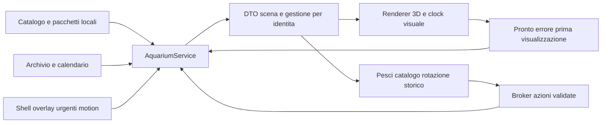

# Acquario 3D dinamico — analisi di integrazione

**Revisione 1 · 28 ottobre 2026 · Europe/Rome · solo analisi e piano.**

La richiesta del 28 ottobre cambia la direzione di prodotto: **pesci realmente 3D e curati hanno precedenza sul raggiungimento dei 60 fps; 50–55 fps sono accettabili se il movimento è gradevole**. Servono catalogo estendibile, scelta dei tipi, singoli pesci riconoscibili, informazioni conservate e sostituzioni programmate. L’utente ha scelto esplicitamente **giorni di calendario, compreso il tempo a board spenta**.

Questo studio prepara l’implementazione. Non modifica applicazione, contratti pubblici, pacchetti, servizio o dati della board. La baseline documentata resta **0.10.0-rc.2 / Apple Calm 1.6.5 / API 2.13 / 69 superfici**, verificata nella ricevuta del 27 ottobre, senza nuova verifica live oggi. Il seguito resta nella linea Acquario v0.10; Compagno v0.11 e Memoria/AI v0.12 conservano la propria posizione.

Durante lo studio sono comparsi lavori concorrenti nel checkout, incluso `version.py` a **0.10.1-rc.1**. Sono esterni a questa analisi e non indicano un’implementazione 3D o una nuova installazione verificata da questa chat. Il numero della candidata 3D verrà assegnato dopo aver riallineato quei lavori; lo studio non riserva la 0.10.1.

[Piano esecutivo](v010-aquarium-3d-dynamic-plan.md) · [misure 3D del 27 ottobre](v010-aquarium-3d-cost-report.md) · [MasterPlan](release-masterplan.md) · [audit dei sorgenti letti](evidence/v010-aquarium-3d-dynamic-analysis-2026-10-28/source-audit.json).

## 1. Evidenze e conseguenze

| Verificato nel codice o nelle prove conservate | Conseguenza per il progetto |
| --- | --- |
| `aquarium_catalog.py` valida manifest e immagini; schema 1 orientato ad atlanti/sprite, massimo otto specie. | Riutilizzare i controlli di integrità, introducendo uno schema distinto per asset 3D. Separare dimensione del catalogo da numero di pesci visibili. |
| `AquariumService._publish()` costruisce sempre sei attori, quattro della prima specie e due della seconda; `configurationRevision=1`. | La popolazione va prodotta da configurazione e stato persistenti. Nessuna lista fissa nel renderer o nel servizio. |
| `AquariumVisual.qml` reinizializza tutti gli attori quando cambia `sessionId:assetRevision`; `configurationRevision` non governa le modifiche alla popolazione. | Servono aggiornamenti per identità: aggiunta/sostituzione di un pesce senza ricreare gli altri. Un nuovo individuo non deve far ripartire tutte le traiettorie. |
| Il servizio corrente non conserva pesci, permanenze o storico. | Aggiungere un archivio Acquario indipendente dal Gioco e dalle preferenze dei temi. |
| Controller Python e singolo clock visuale QML, pausa/urgenti/Reduced/Off già integrati. | Conservare la separazione. Calendario a bassa frequenza in Python; nuoto e rig nel renderer. |
| API 2.13 espone `AquariumSpecies` con campi obbligatori 2D e `AquariumInstance` con profondità 0–2. | Il DTO 2D non è un contenitore adeguato per mesh, rig e pose 3D. Evitare una reinterpretazione incompatibile dei campi esistenti. |
| Tre prove a sei pesci: 2D 30,28% di un core / 214,50 MiB; 3D 75,52% / 243,11 MiB. Media circa 59,97 callback/s per entrambi; p95 3D 18,95–19,74 ms. | Il 3D essenziale è una base plausibile. La nuova tolleranza elimina l’obbligo di chiudere il vecchio gate p95 ≤18,5 ms, ma non qualifica ancora modelli finali, carichi reali o fluidità ottica. |
| Sonda 3D con nove Model per pesce: 54 draw call nominali, 144 a sedici pesci. CPU 3D tra 53,63 e 84,79% di un core. | Ridurre parti e materiali è una prima ipotesi da confrontare. La variabilità e l’assenza di tempi GPU impediscono di dichiararla già causa del costo. |
| MSAA Offscreen disabilitato dal backend provato; capacità delle particelle limitata nella stessa configurazione. | MSAA, particelle e HDR non fanno parte del profilo iniziale promesso. La qualità del modello deve reggere senza dipendere da questi effetti. |

## 2. Esperienza da costruire

L’Acquario si apre sulla scena Calm: pesci con volume leggibile nelle virate, colori curati, pinne e corpo che si muovono con continuità. Barra, orario, dimming e avvisi rimangono quelli approvati. Schede e controlli compaiono su richiesta; la scena principale conserva spazio libero.

Il menu aggiunge **Gestisci pesci**, con sezioni Pesci presenti, Catalogo, Rotazione e Storico. Per un pesce si possono scegliere tipo, variante e nome facoltativo, leggere la scheda, mantenerlo fisso, assegnargli una durata, sostituirlo o rimuoverlo. Nel catalogo si abilitano le specie che possono partecipare alla rotazione. Una scheda distingue informazioni della specie da informazioni di quell’individuo e della sua permanenza.

Esempio: due pesci fissi e quattro posti in rotazione; uno resta tre giorni, uno sette e due quattordici. Alla scadenza un altro tipo ammesso entra gradualmente. Il pesce precedente rimane nell’archivio e può tornare con la stessa identità e lo stesso nome.

| Modalità di un posto | Comportamento |
| --- | --- |
| Fisso | Il pesce rimane fino a un intervento dell’utente. |
| A giorni, successore esplicito | Permanenza di N giorni; il prossimo individuo o tipo è scelto dall’utente. |
| A giorni, gruppo automatico | Alla scadenza si sceglie tra le specie abilitate, rispettando disponibilità, varietà, numero di copie e costo qualificato. |

Prima dotazione proposta: **quattro tipi con sagome diverse**, almeno una variante cromatica ciascuno e profilo nominale di sei pesci. I tipi artistici definitivi si fissano dopo il primo modello campione. Il catalogo può crescere senza caricare tutte le mesh; sei è il carico iniziale da qualificare, non un limite strutturale al numero di specie.

Nella prima funzione entrano selezione manuale, durate personalizzabili, gruppo automatico, schede e storico. Cura, fame, riproduzione, commercio, simulazione biologica e generazione cloud nel runtime restano fuori da questo perimetro. L’architettura può ospitare nuove regole future senza introdurle adesso.

## 3. Quattro identità separate

| Entità | Identità e dati | Durata |
| --- | --- | --- |
| Specie/tipo | `speciesId`, nome, descrizione, categorie, caratteristiche del nuoto, varianti ammesse, scheda e fonti facoltative. | Catalogo versionato. |
| Asset visuale | `assetId + version + digest`, mesh, materiali, rig, animazioni, miniature, profili di qualità e compatibilità. | Pacchetto immutabile; aggiornare il modello non cambia l’identità del pesce. |
| Singolo pesce | `fishId` UUID, specie, variante, nome, seed del movimento, creazione, prima apparizione, eventuali note. | Archivio utente persistente, anche dopo la rimozione dalla scena. |
| Permanenza | `visitId`, pesce, posto, ingresso, durata/scadenza prevista, uscita effettiva, motivo e versione dell’asset usato. | Una riga storica per ogni soggiorno. |

Un posto (`slotId`) è una posizione logica nella composizione, non una coordinata fissa nello spazio. Ha una politica e al massimo una permanenza corrente. Il pesce continua a nuotare liberamente. Il ritorno dello stesso individuo crea una nuova permanenza; scegliere un nuovo pesce della stessa specie crea un nuovo `fishId`.

Le schede della specie possono contenere descrizioni artistiche e, quando verificate, nome scientifico e curiosità con fonte. Dati biologici assenti restano assenti. Nello storico si conserva un piccolo snapshot di nome/specie/variante/asset, così una revisione del catalogo non rende il passato illeggibile. Ingressi committati e prime visualizzazioni confermate dal renderer sono campi distinti: un crash prima del primo frame non deve contare come apparizione. Questi ACK restano evidenza software, non visibilità ottica misurata.

## 4. Catalogo e pacchetti 3D

Catalogo dati, geometrie e stato utente devono poter evolvere separatamente. Aggiungere una specie compatibile con un rig già supportato richiede **asset, scheda e registrazione generata dal manifest**, senza condizioni `if speciesId` sparse nel codice.

Struttura prevista, da creare durante l’implementazione:

```text
assets/aquarium/calm-3d-v1/
  catalog.json
  species/<species-id>.json
  models/<asset-id>/<version>/...mesh, mappe, componente convertito
  thumbnails/...
  environment/...
```

Esempio di contratto dati, illustrativo e non ancora implementato:

```json
{
  "schemaVersion": 2,
  "speciesId": "calm.roundfin",
  "displayName": "Pinne tonde",
  "description": "Pesce stilizzato dalle forme morbide.",
  "assetRef": {"id": "roundfin", "version": "1.0.0"},
  "rigProfile": "swim-skin-v1",
  "variants": [{"id": "amber", "displayName": "Ambra"}],
  "motion": {"cruiseSpeed": 0.08, "turnRate": 0.6, "depthBand": "middle"},
  "rotationDefaults": {"stayDays": 7, "weight": 1, "maxCopies": 2},
  "info": {"scientificName": null, "sources": []}
}
```

Velocità in unità normalizzate della vasca al secondo, angoli in radianti ove previsti; unità e range devono comparire nello schema. Il manifest del pacchetto elenca tutti i file e i relativi hash. Il validatore verifica riferimenti, path, rig, varianti, limiti, dimensioni reali, estensioni ammesse e costi rilevati. Lo stato di qualifica e le misure dipendono dal digest effettivo e dal profilo della board; un campo dichiarato dal pacchetto non certifica le prestazioni.

Asset residenti: soltanto quelli della scena e della prossima sostituzione. Metadati e miniature del catalogo sono paginati separatamente. Rimuovere una specie dal gruppo automatico non cancella il catalogo, gli individui o lo storico. Un asset utilizzato viene mantenuto fino al rilascio dei riferimenti; nuove versioni si installano affiancate.

## 5. Come ottenere pesci belli e realmente 3D

La sonda geometrica precedente misura il costo, ma non è l’asset artistico di partenza da promuovere. Il primo risultato deve essere un modello campione valutabile di lato, davanti, dietro e durante una virata; corpo, occhi e pinne devono mantenere volume e identità. L’illuminazione deve rendere leggibili i dettagli anche nei piccoli pesci e nella palette notte.

Pipeline proposta: modello sorgente modificabile → UV/materiali → rig e ciclo di nuoto → esportazione glTF/GLB → validazione → conversione offline in formato Qt → adattatore comune del rig → prova sul renderer effettivo. Balsam produce componenti QML e risorse per Qt Quick 3D; il percorso artistico e la conversione vengono fissati a versioni riproducibili. [Balsam Qt 6.8](https://doc.qt.io/qt-6.8/qtquick3d-tool-balsam.html).

Rig preferito da provare: **una mesh principale, uno o due materiali e circa quattro–otto ossa**, con coda e pinne deformabili. Budget iniziale orientativo 1.000–5.000 triangoli per pesce, atlante condiviso da 512 o 1.024 px secondo la dimensione visibile. Sono ipotesi di authoring da misurare, non massimi hardware né obblighi a impoverire la sagoma. Occhi e decorazioni possono essere incorporati nella mesh/texture per evitare le nove parti separate della sonda. Qt supporta skinning di geometrie; il costo del rig importato va provato su Qt/PySide6 6.8.2 effettivi. [Vertex skinning](https://doc.qt.io/qt-6.8/quick3d-vertex-skinning.html), [Skin](https://doc.qt.io/qt-6.8/qml-qtquick3d-skin.html).

Confronto limitato per scegliere il rig: mesh con poche ossa contro deformazione procedurale equivalente su un solo campione. Non sviluppare tre motori completi. Il risultato deve sostenere frequenza e fase indipendenti per ogni individuo; nessun movimento dei vertici inviato da Python a ogni frame.

Per le ripetizioni numerose, l’instancing è una possibile ottimizzazione successiva. È esplicito e richiede gestire le differenze tra individui e animazioni; `Repeater3D` da solo non lo attiva. Non si assume che gli scheletri indipendenti vengano automaticamente raggruppati. [Instancing Qt 6.8](https://doc.qt.io/qt-6.8/quick3d-instancing.html).

Il pacchetto può provenire da modellazione originale o da una risorsa con diritti documentati; un modello generato richiede comunque verifica di topologia, UV, rig e licenza/provenienza. Lo studio non sceglie né acquista un servizio esterno. Il validatore glTF controlla struttura e risorse, ma non giudica bellezza, animazione o compatibilità con ogni funzione del renderer. [Khronos glTF Validator](https://github.com/KhronosGroup/glTF-Validator).

RuntimeLoader supporta glTF/GLB, ma questa funzione non deve dipendere dall’importazione estemporanea di modelli sul dispositivo. Preferenza per conversione e validazione offline; caricamento in scena di pacchetti preparati e revisionati. La sola apertura di un GLB non prova la corretta riproduzione di clip, skin e materiali nel nostro adattatore. [RuntimeLoader](https://doc.qt.io/qt-6.8/qml-qtquick3d-assetutils-runtimeloader.html).

## 6. Scena, movimento e costo visuale

Camera prospettica fissa, volume di nuoto XYZ, orientamento continuo rispetto alla tangente e vera rotazione nelle virate. Ogni pesce ha fase, velocità entro range, profondità e tempi di riposo visuale differenti. Separare locomozione del nodo radice da deformazione locale del rig; non cambiare la velocità del mondo quando scendono gli fps. Il movimento usa il tempo effettivo del frame con limiti contro catch-up dopo sospensione. [FrameAnimation Qt 6.8](https://doc.qt.io/qt-6.8/qml-qtquick-frameanimation.html).

Evitare compenetrazioni evidenti tramite separazione morbida e vincoli dell’inviluppo; non serve un motore fisico o una simulazione di fluidi. Fasce di profondità e costi di vicinato limitati bastano inizialmente. Traiettorie e pose non devono essere serializzate in un DTO Python ogni frame.

Ambiente iniziale: elementi 3D essenziali per profondità e occlusione, fondale lontano riutilizzabile come texture, colori e composizione Calm conservati. Un fondale illustrato non rende i pesci sprite: il requisito è che corpi, rig, rotazioni e spazio siano realmente 3D. Non presentare una sola texture di vasca come ambiente interamente volumetrico. Verificare la percezione 3D con registrazione delle virate e viste di controllo del modello.

Profilo iniziale a 960×640, poche luci e materiali prevalentemente opachi. Ombre, trasparenza delle pinne, bolle, caustiche e antialiasing diventano confronti di costo separati. Nessun affidamento sul MSAA disabilitato nella prova precedente. Un’eventuale riduzione della risoluzione 3D deve essere un profilo dichiarato e confrontato visivamente; shell e testo mantengono la risoluzione nativa. Il numero di pesci scelto dall’utente non viene ridotto di nascosto per far passare il benchmark.

## 7. Persistenza e modello transazionale

Archivio SQLite dedicato, ad esempio `<app-data>/aquarium/aquarium.sqlite`; `QSettings` conserva solo preferenze leggere di interfaccia. Un writer proprietario della connessione esegue transazioni brevi fuori dal percorso del frame; risultati restituiti sul thread GUI. Nessun accesso al database Gioco.

| Tabella prevista | Contenuto essenziale |
| --- | --- |
| `meta` | Versione schema, revisione configurazione, seed, ultima migrazione e ultimo tempo affidabile osservato. |
| `fish` | `fish_id`, specie, variante, nome, seed, creazione, prima apparizione, note facoltative. |
| `slots` | Identità del posto, abilitazione, politica, riferimento alla permanenza corrente. |
| `rotation_policies` | Modalità, durata, gruppo ammesso, pesi, cooldown e scelta successiva esplicita facoltativa. |
| `visits` | Identità della permanenza, pesce/posto, ingresso, scadenza prevista, prima visualizzazione confermata facoltativa, uscita effettiva e motivo, snapshot e asset. |
| `pending_changes` | Operazione idempotente, posto e permanenza attesi, candidato riservato, ragione, stato e errore. |

Vincoli: un pesce non occupa due posti contemporaneamente; un posto non ha due permanenze correnti; chiavi esterne e `operationId` unico. Lo storico non viene sovrascritto quando cambia il modello. Foto/miniature storiche sono risorse deduplicate, non copie per frame. Eliminazione e politica di conservazione dello storico sono azioni esplicite; niente scadenza automatica dei nomi o degli individui per contenere il catalogo.

Migrazione: creare lo store una volta sola e inizializzare sei individui in composizione equivalente alla scena attuale. La corrispondenza tra i tipi storici `teal`/`gold` e i nuovi tipi 3D deve essere esplicita nel pacchetto di migrazione, senza dedurla dall’ordine del catalogo. Non attribuire loro giorni o apparizioni non registrati in passato. Soggiorni fissi come default; l’utente può attivare la rotazione dopo aver scelto il gruppo. Lo schema 1 degli asset 2D resta leggibile dal percorso esistente. Backup prima della prima scrittura della candidata, migrazioni transazionali e prova di rollback su copie.

## 8. Calendario, scadenze e riconciliazione

Decisione acquisita: il tempo passa anche quando la scena è chiusa, in pausa o la board è spenta. Convenzione proposta da rendere esplicita nella specifica: **un giorno di permanenza equivale a 24 ore trascorse**. Salvare istanti UTC e durata; mostrare date e orari nel fuso dell’utente. Cambio dell’ora e del fuso non devono duplicare sostituzioni. Se si vorrà la regola “alla mezzanotte locale”, sarà una politica diversa, non un cambio implicito di significato.

All’ingresso: scadenza prevista = ingresso confermato + durata. Due pesci fissi e quattro a giorni hanno quindi calendari indipendenti. Modificare la durata di un pesce presente ricalcola dalla data di ingresso e mostra il risultato prima di salvare; un eventuale prolungamento da adesso è un comando distinto.

Il servizio si risveglia alla scadenza più vicina con attese limitate, ricontrolla il calendario almeno ogni minuto mentre il processo è attivo, e riconcilia all’avvio/rientro e dopo una correzione significativa dell’orologio. Nessun cron o processo separato è necessario. A board spenta non si eseguono azioni: la scadenza rimane salvata e viene applicata al ritorno.

Se l’assenza copre molte durate, si prepara **una sola sostituzione corrente per posto scaduto**, senza creare soggiorni o apparizioni immaginarie nei periodi non mostrati. La nuova durata parte dal commit del nuovo ingresso al ritorno, non da un punto remoto del calendario che produrrebbe altri cambi immediati. La permanenza precedente conserva sia scadenza prevista sia uscita effettiva: non sono ore di visibilità misurate.

Il tempo di permanenza non è il clock dell’animazione. Durante menu/urgenti la scadenza può maturare, ma il passaggio visuale aspetta che la scena sia nuovamente pronta e consentita; nessun catch-up del nuoto. Se l’orologio non è affidabile o torna indietro rispetto allo stato persistito, sospendere le nuove decisioni temporali e conservare la scena; il controllo iniziale deve definire quale evidenza di sincronizzazione espone il sistema attuale. Correzioni in avanti riconciliano una sola volta, attraverso gli stessi ID idempotenti.

### Scelta automatica

Filtrare specie disabilitate, asset mancanti/non compatibili con il profilo, limiti di copie e candidati in cooldown. Preferire varietà e tipi meno recentemente presentati; usare pesi e RNG persistenti per risolvere le parità in modo riproducibile. Riservare i candidati in una pianificazione comune per le scadenze simultanee. Il limite di costo è riferito alla composizione qualificata, non alla sola somma dei triangoli dichiarati.

Se non c’è un successore valido, mantenere il pesce attuale e registrare **sostituzione in attesa**, senza inventare un ingresso o azzerare continuamente la scadenza. Un gruppo di una sola specie può scegliere un altro individuo/variante se consentito dalla politica; nessuna ripetizione imposta quando l’utente ha richiesto varietà obbligatoria. Modificare il gruppo vale per le sostituzioni future; “Sostituisci adesso” è un’azione separata.

### Passaggio senza perdita di stato

1. Pianificare e riservare il candidato con `operationId`, `expectedVisitId` e revisione della politica. Il pesce corrente rimane valido.
2. Preparare risorse e rig fuori dalla transizione visibile; risultati tardivi vengono scartati se cambia la revisione. Preparare un solo nuovo pesce alla volta.
3. Solo con candidato pronto, scena consentita e revisione ancora attuale, eseguire una transazione che chiude la vecchia permanenza e apre la nuova. Il commit è l’inizio persistente della nuova durata.
4. Pubblicare una modifica per `fishId/visitId`; uscita/ingresso dolci senza resettare tutti gli attori. Il renderer conferma separatamente la prima visualizzazione; il tempo di commit non viene spacciato per misura ottica.
5. Dopo crash rileggere lo store: operazione non committata conserva il vecchio pesce; operazione committata ricostruisce il nuovo senza seconda riga storica. Un errore grafico dopo commit riprova la stessa permanenza e mantiene una rappresentazione di recupero, senza contare nuovi ingressi.

Se preparazione o I/O falliscono, il pesce corrente resta; tentativi con attesa crescente e limite esplicito, errore consultabile nella gestione. Nessuna raffica di popup per una rotazione decorativa.

## 9. Integrazione in Python, QML e Theme API



`AquariumService` orchestra lifecycle, catalogo, store, calendario e comandi. `aquarium_rotation.py` contiene funzioni pure con orologio/RNG iniettati. `aquarium_store.py` possiede persistenza e migrazioni. `aquarium_catalog.py` conserva validazione e distingue schema 1 e 2. QML possiede nuoto, rig, camera, luci, transizioni e cache visuale. Chiusura esplicita di timer e worker, annullamento per epoch delle risposte pendenti; callback `QTimer.timeout` con wrapper che termina senza valore, rispettando il percorso PySide6 già qualificato nel progetto.

Revisioni distinte: `catalogRevision`, `populationRevision`, `configurationRevision`, `runtimeSessionId`. HH:mm, una selezione nel menu o una scheda informativa non sostituiscono l’array degli attori. Il modello della popolazione applica diff per identità; eventuale cambio di asset riguarda soltanto gli individui interessati. Non serializzare intero catalogo/storico nello snapshot di scena.

**Scelta proposta per compatibilità:** conservare `aquarium.main` e `AquariumContext` 2D; aggiungere `aquarium.3d` con `Aquarium3DContext` e `aquarium.manage` con contesto di gestione. La famiglia resta nello slot 9; dopo qualifica la destinazione normale diventa `aquarium.3d`. I bundle precedenti ricevono il nuovo fallback builtin 3D, mantenendo la propria shell; il vecchio renderer 2D non interpreta dati mesh. Questa scelta evita di riempire campi atlas obbligatori con valori fittizi. API candidata **2.14 / 71 superfici**, da confermare con generazione e matrice, non modificata da questo studio.

Il contesto della scena espone soltanto popolazione attiva, risorse ammesse, profilo visuale e lifecycle. Il contesto di gestione espone pagine di righe, identità selezionata, scheda e bozza. Azioni previste: aprire gestione, aggiungere/rimuovere/sostituire un pesce, salvare nome/variante/permanenza, bloccare un posto, aggiornare gruppo e richiedere sostituzione immediata. Payload tipizzati, `requestId` e revisione attesa; validare disponibilità, capacità e identità sul servizio. Un risultato tardivo non applica la bozza a un altro pesce.

Main integra routing, menu, payload mirati e broker; non diventa proprietaria della logica del calendario. Nessun nuovo dominio informativo generale o accesso privato al servizio nei renderer. Import Qt Quick 3D confinato ai componenti 3D: Home e recupero possono aprirsi anche se il runtime è assente. La futura consegna deve includere le dipendenze ARM richieste; il vecchio overlay sperimentale non è un’installazione di produzione.

Comandi scena invariati: 4/6 argomento, 5 pausa/ripresa, 1/7 Home, 3 Avvisi, 9 Menu. Gestione: 2/8 selezione, 5 apertura/conferma del campo, 4/6 modifica quando prevista, 7 indietro, 1 Home, 3 Avvisi, 9 Menu. Nuove schermate ereditano focus, contrasto e geometria Calm; niente requisiti di mouse o touch. Scheda/anteprima usa un solo renderer attivo; la vasca è sospesa durante la gestione. Reduced/Off mostrano veri modelli 3D statici, senza perdere le scadenze.

## 10. Nuovo criterio di prestazione

La richiesta accetta 50–55 fps; **60 resta un miglioramento possibile, non una condizione per il rilascio 3D**. Non si limita artificialmente la scena a 55 con un timer. Sul pannello a refresh fisso, se confermato a 60 Hz nel preflight, una media di 50–55 può comprendere intervalli di uno e due refresh: non equivale a una cadenza uniforme di 18–20 ms. Questo è un effetto atteso dal modello di presentazione sincronizzata, da verificare con pacing e osservazione del display. [Render loop Qt 6.8](https://doc.qt.io/qt-6.8/qtquick-visualcanvas-scenegraph.html).

Gate di lavoro proposto, da congelare prima delle nuove prove:

| Aspetto | Criterio candidato |
| --- | --- |
| Qualità artistica | Quattro tipi distinguibili, volume e nuoto convincenti a dimensione reale, giorno/notte e virate; valutazione sul display oltre alle viste di controllo. |
| Frequenza | Obiettivo nominale ≥55; minimo ≥50 callback/s e pose effettivamente avanzate in ogni finestra completa di 10 s durante il nuoto. Contare separatamente frame duplicati, pause e preparazione. |
| Regolarità su 60 Hz | p95 ≤35,5 ms e p99 ≤40 ms; al massimo uno stallo >50 ms per 10 min e nessuna raffica consecutiva. Sono soglie software proposte, non una certificazione ottica. Con refresh diverso vanno ridefinite prima del test. |
| Durata | Tre repliche nominali sullo stesso digest; almeno 30 min con asset finali, rotazione, salvataggi e carichi dashboard. Sessione mista di 60 min prima della consegna. |
| Interazione | Home/Avvisi/urgenti sempre accessibili; nessuna attesa di import/I/O nel gestore del tasto. ACK software p95 candidato ≤250 ms, verifica fisica distinta. |
| Crescita | Rientri e sostituzioni ripetuti senza crescita progressiva di mesh/texture residenti, RAM o risorse aperte; misurare picco della preparazione. |

I 50 callback/s da soli non bastano se le pose cambiano molto meno spesso. Catture e video devono riferirsi a un digest e alla popolazione dichiarata. Il vecchio test resta un test della vecchia sonda con il vecchio gate: non va rinominato “qualificato” retroattivamente.

Raccogliere CPU per processo/thread, RSS e picchi, temperature, frequenze/governor osservati, draw call, geometrie, risorse della scena, tempi di caricamento e distribuzione degli intervalli. I valori GPU non disponibili rimangono non misurati; non dedurli da zeri di RenderStats. Confrontare un asset finale prima di moltiplicare specie ed effetti. Scaricare lavoro visuale quando la scena è nascosta; calendario e persistenza restano leggeri.

## 11. Rischi da chiudere prima della consegna

| Punto da approfondire | Risoluzione prevista |
| --- | --- |
| Qualità reale dei pesci | Campione curato e riproducibile, prova a dimensione nativa e nelle virate prima di produrre gli altri tipi. |
| Importazione/rig/clip su Qt 6.8.2 | Conversione offline di un GLB campione; verifica di pesi, normali, materiali, fase indipendente e pausa. Enumerare eventuali moduli aggiuntivi, compreso Timeline se generato. |
| Scadenze e orologio della board | Orologio finto nei test, UTC e durata esplicita; definire la sorgente locale di affidabilità e provare boot senza rete. |
| Aggiornamento per singolo attore | Sostituire un pesce mentre gli altri continuano le traiettorie; provare risposte asset tardive e cambio tema. |
| Picchi al cambio di modello | Cache limitata, preparazione di un candidato per volta, misura dei picchi e recupero senza cancellare il corrente. |
| Scelta automatica e dati | Simultaneità, gruppo vuoto, un solo tipo, cooldown, posti fissi, catalogo rimosso e crash nei passaggi transazionali. |
| Compatibilità e consegna | Nuove superfici e fallback nei tre temi, schema 1 preservato, backup/migrazione/rollback e dipendenze ARM incluse. |

## 12. Esito dello studio

La funzione si può preparare senza una riscrittura della dashboard: nuovo renderer 3D, archivio specifico, calendario e gestione per identità. La parte da risolvere per prima è **qualità/costo di un vero modello finale**, seguita dalla persistenza e dalla rotazione deterministica. Il [piano D0–D7](v010-aquarium-3d-dynamic-plan.md) definisce file, dipendenze e verifiche; tutti i lotti applicativi restano da implementare.
