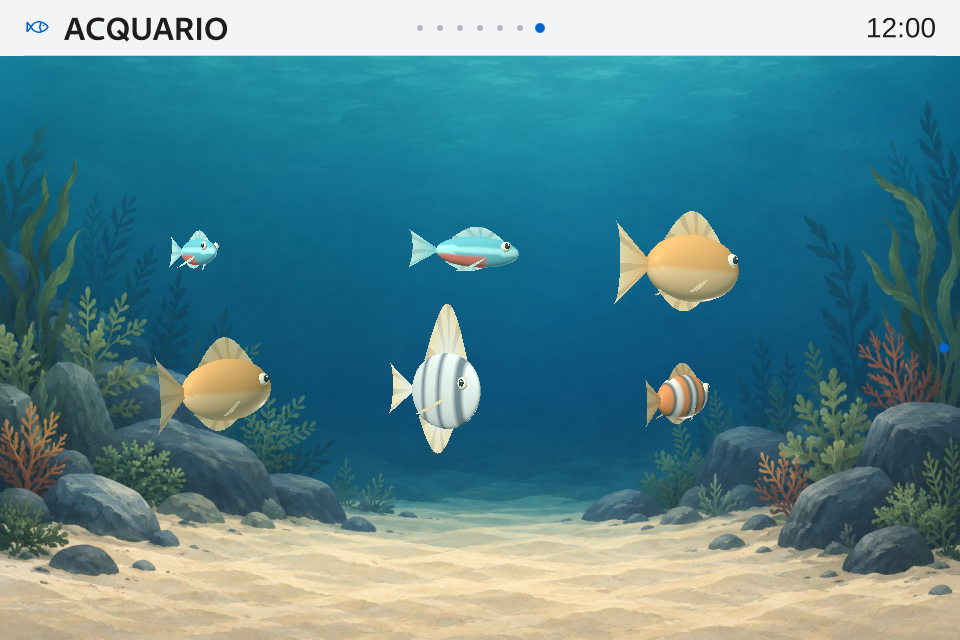
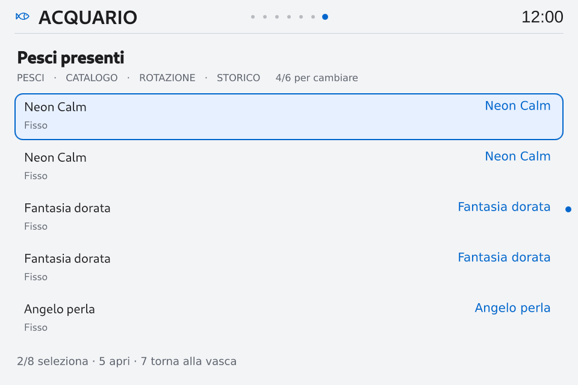

# Acquario 3D dinamico — implementazione e verifica

**Aggiornamento di consegna:** questo report conserva le prove precedenti all’installazione. La successiva autorizzazione ha portato alla rc.2 e alla **correzione0.10.2-rc.4 installata**. Stato corrente e limiti nel [report di correzione grafica](v010-aquarium-graphics-fix-report.md); delta selezionato e storia dei rollback nel [report di installazione](v010-aquarium-3d-installation-report.md).

**29 ottobre 2026 · sorgenti implementati, prove isolate PC/ARM completate; candidata non installata.**

Il nuovo percorso contiene veri modelli tridimensionali animati, catalogo estendibile e gestione persistente dei singoli pesci. La board continua a eseguire **0.10.1-rc.1 / Apple Calm 1.6.5 / API 2.13**, con i 533 file installati invariati. Nei sorgenti la Theme API passa a **2.14 / 71 superfici**. Non è stato assegnato un nuovo numero di release né installato il checkout contenente anche lavori Gioco/manutenzione precedenti a questo intervento.

## Funzioni disponibili

- Quattro tipi originali: Neon Calm, Fantasia dorata, Angelo perla e Corallo; sei individui iniziali, con due varianti cromatiche per tipo. Geometria volumetrica, occhi e pinne, illuminazione, profondità XYZ, virate e rig a tre ossa. Il fondale riusa l'illustrazione Calm esistente.
- **Menu → Gestisci pesci**: presenti, catalogo, gruppo di rotazione, storico e scheda individuale. Nome modificabile, variante, permanenza fissa o da 1 a 3650 giorni, prossimo tipo esplicito oppure automatico. Aggiunta entro sei posti, rimozione, sostituzione immediata e ritorno di un individuo dallo storico.
- Giorni di **24 ore di calendario**, istanti UTC: il tempo trascorre anche a board spenta. Alla riapertura viene preparata una sola sostituzione per posto scaduto, con nuova permanenza dal commit; nessuna storia di sostituzioni mai avvenute. Gruppo vuoto o assenza di candidati conservano il pesce corrente.
- Identità, nome, variante, ingressi, uscite, primo ACK di presentazione e profilo del modello conservati in SQLite. Storico paginato, cento permanenze per pagina. Un aggiornamento del catalogo conserva il profilo della permanenza corrente; le nuove permanenze usano il nuovo catalogo.
- Preparazione del successore prima del commit, transazioni, revisioni e richieste idempotenti. Pausa, overlay, urgenti, Home e Reduced/Off integrati; gli altri pesci mantengono identità e attore durante una sostituzione.

I quattro tipi sono un catalogo iniziale, non il limite dell'archivio dei tipi. La capacità contemporanea di questa prima configurazione è esplicitamente **sei pesci**. La selezione automatica usa un massimo di due copie per tipo e un criterio di varietà con storico recente di sette giorni; questi parametri sono attualmente tecnici, non opzioni del configuratore.

## Struttura e contenuti

| Area | Implementazione |
| --- | --- |
| Catalogo e validazione | `aquarium_catalog.py`, schema 2, ID, metadati, varianti, rig, hash e riferimenti locali. Schema 1 conservato per il vecchio renderer. |
| Archivio e calendario | `aquarium_store.py`, `aquarium_rotation.py`; connessione SQLite posseduta da un worker, clock/RNG verificabili, riserve e commit. |
| Controller e gestione | `aquarium_population.py`; proiezioni scena/gestione, tastierino, bozze, storico e I/O asincrono. Le responsabilità prima proposte in `aquarium_models.py` sono consolidate qui. |
| Grafica | `aquarium_geometry.py`, `Aquarium3DVisual.qml`, `Fish3DActor.qml`; un modello/materiale per pesce, pose QML e nessun aggiornamento Python per frame. |
| Integrazione | Tre host distinti in `Main.qml`: 2D, 3D, gestione. Entry point 3D lazy; il modulo opzionale non viene richiesto dal renderer di gestione. |
| Temi e API | Nuove `aquarium.3d` / `aquarium.manage`, contesti/azioni, SDK generato e fallback additivi Base/Functional/Apple Calm. Il bundle Apple installato non è stato modificato. |

Gli asset sono originali procedurali, ricostruibili con `python3 scripts/build-aquarium-models.py`, in `assets/aquarium/calm-3d-v1/`. Ogni pesce contiene **2564 triangoli**; il corpo, gli occhi e le pinne condividono una mesh colorata e skinnata. I nomi dei file includono il digest del contenuto. Il generatore mantiene i file di revisioni precedenti: quelli referenziati da permanenze esistenti non vanno rimossi.

È una scelta concreta alternativa alla conversione GLB ipotizzata nel piano: non servono Blender, Balsam o importer sulla board. Il formato locale `.fishmesh` viene validato per dimensioni, indici, valori finiti, ossa e pesi. Non è stato implementato un importatore universale di GLB.

Per aggiungere un tipo compatibile: produrre una mesh con lo stesso rig, assegnarle un nuovo nome immutabile, aggiungere voce/metadati/varianti e hash al catalogo, validare e riavviare l'applicazione. Non occorre modificare controller o renderer. Il caricamento a caldo e un installer grafico dei pacchetti non fanno parte di questa implementazione. Il test di estensione verifica una quinta voce compatibile tramite soli dati; non costituisce qualifica artistica di un quinto modello originale.

## Correzione del percorso grafico ARM

Il driver PowerVR restituisce **OpenGL ES 3.2**, mentre inizialmente Qt registrava un formato 2.0. Gli shader skinnati non venivano costruiti: zero draw call, pesci assenti e avvisi GLSL/texture. Quel percorso è fallito e non è usato come misura del 3D.

La sonda isolata ha identificato il disallineamento fra EGL del produttore e i simboli GL risolti dal build Qt desktop. Con il preload della libreria GLES corrispondente (`/usr/local/lib/libGLESv2.so.2`), Qt riconosce 3.2 e la scena disegna correttamente le mesh. `run.sh --device` prepara questo ambiente quando esistono le librerie del produttore e il modulo Qt Quick 3D; `SMARTPC_GLES_LIBRARY` permette un percorso esplicito oppure `off`. Il recupero `SMARTPC_AQUARIUM_RENDERER=2d` conserva il vecchio renderer e non applica questo preload.

Il servizio Acquario richiede inoltre un formato ES 3.0 prima della creazione delle finestre EGLFS; sugli altri backend usa l'helper Qt, senza MSAA. L'ordine di inizializzazione segue le indicazioni di [QQuick3D / QSurfaceFormat](https://doc.qt.io/qt-6.8/qquick3d.html). La verifica sui simboli diretti è coerente con il [sorgente Qt 6.8.2 di QEGLPlatformContext](https://github.com/qt/qtbase/blob/v6.8.2/src/gui/opengl/platform/egl/qeglplatformcontext.cpp).

Le sei dipendenze Qt Quick 3D/Shader Tools/PySide compatibili sono state **scaricate ed estratte soltanto nell'area di prova**, senza installazione di pacchetti, sostituzione di driver, modifica del governor o reboot. La consegna dovrà includere una procedura riproducibile per queste dipendenze.

## Verifiche proporzionate

L'autorizzazione dell'utente permette di ridurre i test totali. Sono state eseguite verifiche mirate, con file di evidenza separati; non una nuova matrice generale del sistema.

| Verifica | Esito e attribuzione |
| --- | --- |
| Archivio/calendario/profili | **14 test PC e 14 ARM**, fake clock e dati privati: persistenza, giorni offline, scadenza, rollback orologio anche con candidato pendente, pool, capacità, transazioni, crash/ripresa, replay, pagine storico, quinta voce e conservazione del profilo. |
| Theme API | Contratti, adapter e core temi passati; **40 test runtime API** passati dopo rigenerazione dei qmltypes. |
| Corpus | **171 scenari validati sul contratto dati**; le due nuove superfici hanno inoltre un caso UI mirato ciascuna su PC accelerato. Corsie 2D/3D separate; il backend software non riceve un PASS per le mesh. |
| Vecchio percorso2D | Base offscreen: 76 controlli, inclusi venti rientri, senza avvisi; regressione PC separata dalle prove3D. |
| Main PC | Percorso grafico con venti controlli passati, nessun avviso; llvmpipe/Xvfb è una verifica funzionale. |
| EGLFS Base e Functional | Venti controlli ciascuno: tema salvato, sei attori, pausa, gestione/salvataggio, sostituzione, storia, urgenti e Reduced/Off. Sei draw call; nessun avviso QML/grafico o accesso di rete. |
| EGLFS Apple Calm | Stesso percorso, misura nominale sotto; controllo finale sui file finali con **21 controlli**, inclusa la gestione effettivamente presentata. |
| Packaging | Pacchetto diagnostico verificato, **737 file**, incluse le quattro mesh. Sintassi del launcher controllata. Nessun pacchetto diagnostico installato come runtime. |

[Indice evidenze](evidence/v010-aquarium-3d-implementation-2026-10-29/WORK-STATE.md). I passaggi corretti non sono stati ripetuti senza modifiche pertinenti. I fallimenti di sviluppo sono conservati: mapping/conteggi API iniziali e qmltypes obsoleti, cambio di contesto in un unico host, cattura sincrona con handler Python, contesto GL errato, avvio del tema in anteprima nel banco e una prima directory ARM senza permessi. Le correzioni hanno ricevute successive; non sono successi retroattivi.

## Prestazioni osservate sulla board

**Apple Calm 1.6.5, 960×640, sei pesci/quattro tipi, un campione di 120 secondi dopo 60 secondi di riscaldamento**, header/clock attivi, fonti private e rete negata. Una sostituzione è effettuata prima del riscaldamento. Nessuna AA, ombra o post-elaborazione aggiuntiva.

| Metrica | Risultato |
| --- | --- |
| Callback `frameSwapped` / secondo | **59,955** |
| Minimo nelle dodici finestre complete di 10 s | **59,9 / s** |
| Passi pose QML / callback | **7196 / 7196** |
| Intervallo p95 / p99 | **18,15 / 20,52 ms** |
| Intervallo massimo / stalli >50 ms | **45,74 ms / 0** |
| Draw call dei pesci | **6** |
| CPU media del processo | **37,8% di un core** |
| RSS campionato | **277,38–277,71 MiB** |

[Riepilogo e finestre](evidence/v010-aquarium-3d-implementation-2026-10-29/performance-summary.json), [dati grezzi](evidence/v010-aquarium-3d-implementation-2026-10-29/board-measurement/results/apple/report.json). Questo campione supera i criteri software proposti di 50–55 e p95 ≤35,5 / p99 ≤40 ms. Non misura FPS ottici o tempo GPU; i callback sono ricevuti in coda sul thread GUI. I circa cinque slot mancati stimati dai timestamp sono un'approssimazione, non un contatore del display.

La sonda precedente a nove modelli per pesce e il nuovo percorso differiscono per asset, rig, draw call e risoluzione GL: **non attribuire il nuovo costo CPU a una sola ottimizzazione né trattare il confronto storico come un A/B controllato**.

Un controllo breve con appena un secondo di riscaldamento ha registrato uno stallo di **308 ms**, pur mantenendo 55,53 callback/s medi; è conservato in [board-short-cold](evidence/v010-aquarium-3d-implementation-2026-10-29/board-short-cold/report.json). Il successivo controllo finale è passato senza stalli >50 ms, ma questo non cancella il caso a freddo. Restano da profilare caricamento/compilazione/transizioni a freddo e ripetibilità. La prova nominale dopo 60 s non li qualifica.

La misura120s identifica il manifest `6faa8e29…`: successivamente sono stati aggiunti nomi file con digest, conservazione del profilo della permanenza, diagnostica fixture e rifiniture della gestione. Le quattro mesh sono **byte per byte identiche**, ma il sorgente finale ha un manifest distinto, con propria prova EGLFS breve. La misura120s non viene attribuita falsamente a tutti i byte successivi.

## Catture e stato della board

Le immagini documentano la prova isolata, non la schermata corrente della produzione. Preferenze/configurazioni, database Gioco e **215 artefatti**, manifest installato e boot ID risultano conservati. Il servizio originale è ripartito con **NRestarts=0**, heartbeat GUI pronto e Apple Calm 1.6.5. Ricevute e salute finali sono in `board-final/`. L’area di prova `maintenance-work` è stata rimossa dopo l’esportazione e la verifica di 1058 file/link nell’archivio PC, secondo la policy di manutenzione; [ricevuta](evidence/v010-aquarium-3d-implementation-2026-10-29/board-final/cleanup-receipt.json).

## Stato D0–D7 e passi di consegna

D0 e D2–D5 sono implementati con le verifiche mirate descritte. D1 dispone di quattro modelli originali e rig nativo verificato; la valutazione artistica sul display resta esplicita. D6 ha una prima misura nominale positiva, ma non la qualifica estesa. **D7 non eseguito: nessuna installazione della candidata.**

Restano: approvazione visiva sul pannello, comportamento a freddo, tre repliche nominali sul sorgente congelato finale, cicli estesi di sostituzione/rientro, durata30/60min, fonti live concorrenti, tastierino fisico e ottica. La futura consegna deve partire dalla baseline installata e includere soltanto il delta Acquario qualificato, backup/migrazione su copia, dipendenze ARM, manifest e rollback. Non deve trascinare i lavori Gioco non pertinenti già presenti nel checkout.

Compagno **v0.11**, Memoria/AI **v0.12** e Stabilità **v1.1** restano nell'ordine del MasterPlan.
