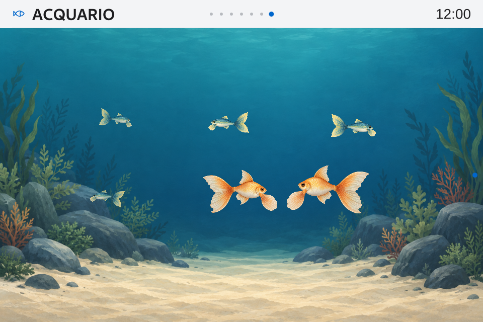

# v0.10 — chiusura dell’implementazione Acquario

26 ottobre 2026 · **core 0.10.0-rc.2 installata · Theme API 2.13 / 69 superfici · Apple Calm 1.6.5 attivo**.

Implementazione software completata e installata. [Ricevuta](evidence/v010-aquarium-completion-2026-10-26/board/final-receipt.json): 682 hash conformi, GUI pronta con PID corrente, NRestarts=0, backup disponibile e nessun nuovo reboot OS. Database e 215 artefatti Gioco conservati. Le preferenze mantengono i valori: cambiano soltanto l’identità del bundle attivo e il registro degli override per la nuova identità, con override correnti copiati e profili degli altri temi conservati.

## Che cosa completa questa consegna

La shell Apple mostrava il simbolo generico per Acquario. Il nuovo glifo a pesce segue lo stesso tratto, inset, palette e atlante PNG del tema. Le associazioni coprono la barra e le righe del modulo nelle impostazioni. È una revisione immutabile nuova; la precedente è recuperabile dal backup.

I 60 glifi precedenti restano identici pixel per pixel in tutti i 18 colori: **1.080 celle confrontate**, alias preesistenti conservati. Il delta del payload contiene soltanto versioni dei due manifesti, Format.js, IconPaths.js e l’atlante rigenerato. Nessun cambiamento a font, geometria, palette, movimento o contenuti delle altre viste. [Verifica artistica](evidence/v010-aquarium-completion-2026-10-26/artwork.json), [bundle installabile](evidence/v010-aquarium-completion-2026-10-26/apple-calm-1.6.5.smartpc-theme).

È corretto anche il banco dei rientri: prima manteneva il tema in anteprima, che Home annulla intenzionalmente. Per questo i vecchi venti cicli non dimostravano la permanenza del tema richiesto. Il banco ora salva la selezione **soltanto nelle preferenze private del test** e controlla l’identità dopo ciascun rientro. Nessuna modifica al comportamento di Home nell’applicazione. Il delta core rispetto alla rc.1 riguarda solo `check_aquarium_ui.py` e `version.py`; controller, asset, algoritmi e renderer Acquario sono byte per byte invariati. [Delta](evidence/v010-aquarium-completion-2026-10-26/runtime-delta.json).

## Verifiche finali

- Preflight reale di tutti i renderer pubblici: **1.098 combinazioni PC e 1.098 ARM**, sul digest Apple Calm 1.6.5 finale.
- Main reale PC/EGLFS: immagine del pesce pronta, giorno/notte, movimento Ridotto/Disattivo, menu e ritorno a Home con l’icona dell’orologio.
- **20 rientri con Base, 20 con Functional e 20 con Apple Calm**, sia PC sia EGLFS; tema salvato controllato ogni volta, un solo clock e sei attori, pausa/menu/urgenze/Reduced/Off e orario verificati. Nessun warning QML inatteso o tentativo di rete nelle fixture.
- SDK esportato API 2.13, fingerprint invariato, **673 file con hash conformi** e prova autonoma di venti rientri con tema salvato. [Kit](evidence/v010-aquarium-completion-2026-10-26/SmartPC-Theme-API-2.13-rc2.zip), [ricevuta](evidence/v010-aquarium-completion-2026-10-26/kit-check.json).

[Ricevuta nativa](evidence/v010-aquarium-completion-2026-10-26/board/native-receipt.json), [preflight PC](evidence/v010-aquarium-completion-2026-10-26/pc-preflight.json), [preflight ARM](evidence/v010-aquarium-completion-2026-10-26/arm-preflight.json), [icona/Main](evidence/v010-aquarium-completion-2026-10-26/board/icon-ui/report.json).

## Prestazioni e attribuzione

Nuova misura EGLFS/PowerVR, sei pesci con rig, **60 s di riscaldamento + 120.00 s registrati**, dopo i controlli di navigazione e con il tema salvato: **59.965 callback/s, p95 17.90 ms**; p99 18.29 ms, massimo 38.43 ms, 0 stalli oltre 50 ms, slot mancati stimati 0.042%. Gate software vicino a 60 superato, con le soglie precedenti invariate. [Report grezzo completo](evidence/v010-aquarium-completion-2026-10-26/board/aquarium-ui/report.json).

Le tre repliche nominali e la prova da **30 minuti / 59,971 callback/s / p95 18,03 ms** appartengono alla precedente **rc.1 con Apple Calm 1.6.4** e restano attribuite a quella combinazione. Non diventano un nuovo soak della 1.6.5. Le prove `--benchmark-only` precedenti non attraversavano Home e mantengono la loro validità; la correzione riguarda l’attribuzione dei cicli di navigazione. [Report iniziale e dati](v010-aquarium-implementation-report.md).

Queste sono misure software della presentazione e delle pose, non FPS ottici, tempo GPU o latenza del tastierino fisico. La nuova misura è un supplemento da 120 s: non sostituisce il protocollo esteso A1/A2 con tre repliche per ogni carico/renderer.

Cattura nativa del test con il tema nuovo; non è lo schermo corrente della produzione:

## Stato P0–P7

| Lotto | Implementazione e riscontro |
| --- | --- |
| P0 · Contratto/fixture | Completato nella rc.1: API 2.13, DTO/azioni, nove varianti e compatibilità additiva; invariato. |
| P1 · Lifecycle/controller | Completato: caricamento pigro, sospensione/ripresa/urgenze, epoch/close, senza timer Python di animazione. |
| P2 · Shell | Completato: routing/safeArea/barra/orario/dimming/menu, icona dedicata nella 1.6.5; tre temi verificati. |
| P3 · Pesce e movimento | Completato: rig e sprite locali, curve/clock/virate e test del JavaScript reale. |
| P4 · Scena | Completato: due specie/sei istanze, asset originali e profili giorno/notte/statici. |
| P5 · Capacità/strumenti | Implementati: banco, screening 1/4/8/16 e confronto rig/sprite acquisiti. Matrice prestazionale estesa ancora distinta. |
| P6 · Packaging/qualifica | Pacchetti/SDK/manifest e backup completati; 30 min precedenti e nuovo supplemento EGLFS attribuiti alle rispettive versioni. Fisico/live/uso lungo aperti. |
| P7 · Consegna | Rc.2 e Apple 1.6.5 installati con ricevuta, controllo GUI e conservazione dei dati; nessun reboot OS. |

## Conservazione e limiti

Backup quiescente: `/var/lib/smartpc-dashboard/aquarium-backups/completion-20261026-121653`. Runtime precedente: `/opt/smartpc/dashboard-before-completion-20261026-121653`. La transazione conserva anche configurazioni e intero stato dei temi; ripristino automatico in caso di errore. Il percorso di rollback è disponibile, senza simulare un guasto durante questa consegna.

Non restano segnaposto funzionali per il perimetro Acquario richiesto. Restano qualifica fisica di pannello/HID e qualità visiva umana, FPS ottici/tempi GPU, carichi concorrenti delle fonti reali, intera matrice A1/A2 e uso 24/7. Le fixture isolate non provano il carico live. La candidata non è promossa stabile. Compagno v0.11, Memoria/AI v0.12 e Stabilità v1.1 conservano sequenza e scopo; Gioco resta in manutenzione e nessun training/reset è eseguito.
