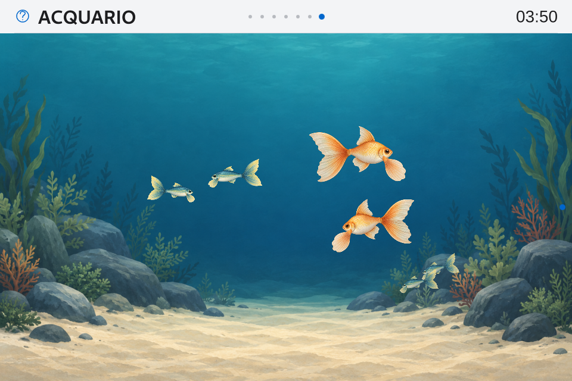

# v0.10 — Acquario Calm · implementazione e qualifica

25–26 ottobre 2026 · candidata **0.10.0-rc.1** · API **2.13 / 69 superfici**.

**Consegna iniziale rc.1: superata dalla [chiusura rc.2 / Apple1.6.5](v010-aquarium-completion-report.md).** Le misure di questo documento restano attribuite alla rc.1 / Apple1.6.4. 682 hash conformi, Apple Calm 1.6.4 conservato, GUI pronta e NRestarts=0; preferenze, database e artefatti Gioco preservati. Nessun nuovo reboot OS. [Ricevuta](evidence/v010-aquarium-2026-10-25/board/final-receipt.json).

## Esperienza consegnata

Acquario è un argomento autonomo dopo Gioco, con una scena locale 960×640, camera fissa, due specie originali e sei istanze: quattro pesci piccoli teal, due medi oro. Tre livelli di profondità regolano dimensione, ordine e opacità. Il fondale è statico, con masse laterali e centro aperto; nuoto lento, coda/pinna e virate sono animati. Non ci sono punteggi, cura, economia, audio o richieste AI durante il nuoto.

La barra con HH:mm resta sopra il canvas, la safeArea contiene il nuoto sotto il chrome, il dimming resta globale. 4/6 cambiano argomento; 5 pausa/riprende; 7/1 Home; 3 Avvisi; 9 Menu, con pausa/ripresa contestuale. Il modulo è visibile per default e disattivabile in Impostazioni → Moduli. Nessuna preferenza precedente richiede migrazione.

Overlay e cambio tema sospendono il clock senza recuperare il tempo trascorso. La pausa dell'utente sopravvive agli overlay. Un urgente impone pausa e ripresa esplicita, anche entrando con urgenza già presente. Reduced/Off mostrano una scena statica; notte modifica la palette senza disattivare implicitamente il nuoto. SceneHost ambientale è sospeso nell'Acquario. Caricamento ed errore hanno un fallback locale con uscite accessibili.

## Architettura e file

| Area | Implementazione |
| --- | --- |
| Controller | `aquarium.py`: caricamento pigro in un solo worker, snapshot stabile notificato soltanto ai cambiamenti, identità di visita, riduttore richiesto/effettivo e cause di sospensione; chiusura esplicita. Nessun timer di animazione o polling. |
| Catalogo | `aquarium_catalog.py`: percorsi risolti confinati al pacchetto, hash SHA-256, PNG/dimensioni reali, rettangoli e parametri finiti, identità delle specie uniche. |
| Movimento | `AquariumMotion.js`: PRNG con seed, Bézier cubiche, lookup di lunghezza a32 segmenti e velocità controllata. Una sola FrameAnimation avanza i sei attori in QML; i delta oltre100ms vengono registrati/scartati. |
| Disegno | `AquariumVisual.qml` e `FishRig.qml`: fondo opaco, texture condivise e tre parti per pesce, pivot calibrati, fase individuale, orientamento/virata progressivi. Nessun Canvas fullscreen dinamico o layer/blur obbligatorio. |
| API | AquariumContext e DTO specie/istanze/snapshot, azioni `aquarium.pause/resume`, sola nuova superficie `aquarium.main`. Nessun trasporto dei provider o delle posizioni a60Hz. |
| Shell | Main, PageHost e visibilità del modulo; geometria fullscreen, safeArea e azioni esistenti. Bundle anteriori usano il fallback builtin additivo. Apple Calm1.6.4 conserva payload/digest/versione. La shell della consegna iniziale usava l’icona generica; l’icona dedicata è consegnata nella [Apple1.6.5](v010-aquarium-completion-report.md). |
| Strumenti | `check_aquarium*.py`, corpus delle nove varianti, `scripts/benchmark-aquarium.py`, exporter Qt del rig in sprite, kit API rigenerato con asset del fallback e skeleton AquariumContext. |

Il caricamento asincrono ha richiesto un aggiornamento mirato di PublicContextAdapter/ViewHost: un candidato in preparazione riceve gli aggiornamenti senza diventare attivo; i renderer trattenuti nascosti restano congelati. Il catalogo tipizzato è materializzato in QML al termine della transazione GUI, evitando di leggere gli array prima della revisione. Le vecchie istanze sono rimosse prima di sostituire la lookup delle specie, anche passando a loading/error.

Durante la prova delle azioni pubbliche è stato riprodotto un SIGSEGV: un ActionResult creato in Python veniva liberato prima che QML completasse il ritorno del puntatore. La correzione in `theme_contexts.py` conserva il wrapper durante il passaggio e, se esposto a QML, fino alla distruzione gestita dal GC Qt; i ritorni solo Python lasciano il registro al turno successivo dell'event loop. Nessun risultato viene aggiunto come figlio persistente della superficie. Le prove mantengono un risultato QML attraverso GC, poi verificano il rilascio, anche dopo completamento/revoca. Questo riproduttore non attribuisce la causa agli incidenti Apple Calm storici. Riferimenti: [ownership Shiboken](https://doc.qt.io/qtforpython-6/shiboken6/typesystem_ownership.html), [qjsEngine in Qt for Python 6.8](https://doc.qt.io/qtforpython-6.8/PySide6/QtQml/QtQml_globals.html#PySide6.QtQml.qjsEngine).

## Asset originali e confronto renderer

Fondale e due atlanti sono generati con **imagegen integrato**, poi salvati in `dashboard/assets/aquarium/calm-v1`. [Prompt, dimensioni, derivazione e limiti](evidence/v010-aquarium-2026-10-25/asset-production.md). Nessuna immagine dei prodotti usati come ispirazione è importata.

Il fondale è1536×1024 e viene richiesto al renderer a960×640. Gli atlanti reali sono1254×1254 RGBA, alpha0–255: catalogo e pivot usano questi dati effettivi. Le sprite sheet3072×512, sedici pose384×256 con rig250×160 e padding trasparente, sono esportazioni deterministiche dello stesso FishRig tramite Qt, senza una seconda generazione di identità. Circa4,3MiB di PNG su disco; questo dato non è una misura della memoria GPU.

Rig e sprite finali seguono la stessa traiettoria e fase, con scala compensata per il padding. Il primo export tramite Window grab aveva alpha opaco e non costituisce un A/B equivalente: quei risultati restano dati di sviluppo. L’export finale usa Item.grabToImage, alpha0–255 e bordi trasparenti su tutti i16 frame; il confronto corretto è ripetuto sulla board. Si mantiene il **rig nominale** per la continuità delle pinne/coda; lo sprite resta una variante privata del banco. Le soglie non vengono cambiate dopo la correzione degli asset.

Il contenimento non usa soltanto l’altezza dell’Item: un raggio0,95×larghezza copre i bounding box alpha delle parti su ogni angolo di coda/pinna, più ogni rotazione del corpo e la compressione della virata. I massimi conservativi sono inferiori a0,94. La Main verifica che i cerchi di ingombro lungo la regione di nuoto restino interamente nella safeArea.

## Verifiche e perimetro delle misure

- **2 test degli asset reali**: alpha minimo/massimo, dimensioni e assenza di clipping su tutti i16 frame; ingombro articolato sull’intero intervallo delle rotazioni, non soltanto il centro del pesce.
- **18 test controller/catalogo**: caricamento pigro, nominale, pause/urgenze, idempotenza, snapshot stabile, callback obsolete/chiusura, cataloghi corrotti, path non dichiarati, numeri/dimensioni errati e fallback dei bundle senza mutazione.
- **5 test di durata dei risultati ActionResult**: chiamata QML reale, risultato mantenuto valido attraverso GC Python/JS, rilascio dopo uso, 300 richieste scartate, completamento/revoca e chiamata Python; eseguiti anche sul runtime ARM e nell’SDK esportato. Dodici controlli sul broker/router Main reale verificano accettazione, applicazione, allowlist, argomenti, overlay, urgenze, Off e contesto nascosto.
- **4 test del JavaScript reale via QJSEngine**: riproducibilità, confinamento su100 semi, velocità d'arco e raccordi/valori finiti.
- Contratto generato verificato, **31 controlli** del contratto con un'esclusione prevista; runtime API **40 test PC**, **39 passati/1 escluso ARM** perché qmllint non è installato. Lint reale PC dei nuovi renderer e del typeinfo; nessuna installazione implicita di strumenti ARM.
- **69 adapter reali Main**, 24 contesti, nessun warning/effetto provider o navigazione; corpus Aquarium con nove varianti nei profili Base giorno/Normal e Functional notte/Off: **18 casi**, verifiche semantiche effettive di status, pausa, policy, urgenza, overlay e notte.
- Main/QML nativa nei tre temi: primo ingresso asincrono, geometria e orario, pausa, menu, urgenza, Reduced/Off, notte, venti cicli di uscita/rientro e Home. Il tema era in anteprima e Home la annullava: questi cicli non qualificano la permanenza del tema richiesto. La prova corretta, con selezione salvata e identità verificata a ogni rientro nei tre temi, è nella [rc.2](v010-aquarium-completion-report.md). Fallback asset mancanti, Menu e uscita verificati separatamente. Nessun warning QML inatteso né tentativo di rete nei harness. Il test negativo di immagine non decodificabile conserva separatamente la diagnostica QML attesa.

I provider dei test sono fixture isolate con rete negata e controllo positivo del blocco; configurazioni, cache, store temi e SQLite dei test sono privati. Le fonti reali restano quelle dell'applicazione installata; le misure isolate non qualificano il loro carico live.

Il banco registra `frameSwapped` con timestamp monotoni e intervalli grezzi, tick delle pose, delta lunghi, p50/p95/p99/max, stalli e slot mancati stimati. La callback per frame aggiunge soltanto un timestamp; campioni CPU/RSS/thread/FD/temperature ogni10s, shell clock reale mantenuto attivo, catture fuori dalla finestra. La crescita RSS include anche il buffer dei timestamp del banco, mantenuto per conservare gli intervalli grezzi: non equivale da sola a una perdita di memoria dell’app. Sono misure **software della coda/presentazione**, non tempi GPU, fotogrammi ottici nuovi o latenza del tastierino fisico.

Soglia congelata: media≥59/s, p95≤18,5ms, slot mancati stimati≤1%, meno di2 stalli>50ms nella finestra; percentili nearest-rank. Il report conserva tutte le finestre, senza mediare p95 o eliminare i picchi. Nei run lunghi la condizione sugli stalli è applicata anche al totale, più severa del limite per120s. Repliche nominali:60s warm-up e120s registrati, tre processi distinti. Durata:60s warm-up e1800s registrati. Risultati finali acquisiti sulla stessa impronta dei sorgenti; nessuna soglia modificata dopo le prove.

## Prestazioni native finali

Tutte le righe seguenti usano EGLFS/PowerVR e i sorgenti finali congelati. Tre repliche nominali distinte; gli stress e gli sprite restano campioni più brevi, con durata esplicita.

| Caso | Pesci / renderer | Secondi | Callback/s | p95 ms | p99 ms | max ms | Slot stimati persi | Stalli >50ms |
| --- | --- | --- | --- | --- | --- | --- | --- | --- |
| nominal-1 | 6 / rig | 120.0 | 59.953 | 18.09 | 18.88 | 46.51 | 8 (0.111%) | 0 |
| nominal-2 | 6 / rig | 120.0 | 59.960 | 18.18 | 18.69 | 37.93 | 8 (0.111%) | 0 |
| nominal-3 | 6 / rig | 120.0 | 59.974 | 17.94 | 18.27 | 27.40 | 1 (0.014%) | 0 |
| scale-1 | 1 / rig | 30.0 | 59.947 | 17.21 | 17.92 | 19.67 | 0 (0.000%) | 0 |
| scale-4 | 4 / rig | 30.0 | 59.928 | 17.75 | 18.05 | 19.49 | 0 (0.000%) | 0 |
| scale-8 | 8 / rig | 30.0 | 59.897 | 17.96 | 18.95 | 39.89 | 1 (0.056%) | 0 |
| scale-16 | 16 / rig | 30.0 | 59.918 | 17.86 | 19.94 | 34.34 | 2 (0.111%) | 0 |
| sprite-one | 1 / sprite | 30.0 | 59.932 | 17.36 | 17.99 | 27.39 | 2 (0.111%) | 0 |
| sprite-six | 6 / sprite | 40.0 | 59.940 | 17.87 | 18.43 | 33.43 | 4 (0.167%) | 0 |
| soak30 | 6 / rig | 1800.0 | 59.971 | 18.03 | 18.73 | 46.31 | 119 (0.110%) | 0 |

Durata: **59.971 callback/s, p95 18.03 ms su 30 minuti**. Peggiore finestra completa da 1 s: 58.0 callback/s; massimo p95 nelle finestre da 10 s: 18.41 ms. Le code parziali sono esplicite e restano nel dataset grezzo e nel gate complessivo.

RSS 211.38→214.22 MiB, massimo 214.53 MiB; CPU media 32.18% di un core; temperatura massima campionata 44.6°C. Thread 7→7, FD 37→37. L’RSS comprende il buffer dei timestamp del banco.

Impronta sorgenti: `2f5dc437ba2c5c441b298f6fbc665f1c2c5bdfb8ef2a0e2be02ab7a1234e8259`. [Riepilogo/finestre](evidence/v010-aquarium-2026-10-25/benchmark-summary.json), [CSV 1/10/120 s](evidence/v010-aquarium-2026-10-25/benchmark-windows.csv), [ricevuta di qualifica](evidence/v010-aquarium-2026-10-25/board/qualification-receipt.json). I callback e le pose non certificano 60 FPS ottici.

Cattura del banco EGLFS al termine della prova da 30 minuti, con rig nominale e Apple Calm; è una cattura di test, non lo schermo corrente della produzione.

## Distribuzione e conservazione

Le prove di sviluppo interrotte e la durata precedente al fix del broker restano in `development-native` e `pre-broker-fix-native`. Non chiudono i gate della build finale: il runner congela gli hash prima delle prove e verifica che non cambino fra inizio e fine di ogni esecuzione.

La candidata viene costruita copiando la distribuzione ARM 0.9.4-rc.3 letta dalla board e sovrapponendo solo i file dichiarati nello [scope](evidence/v010-aquarium-2026-10-25/runtime-scope.json). **682 file**, 56 differenze rispetto alla baseline, di cui 28 aggiunte; libreria ARM nativa del Gioco invariata. [Delta e hash](evidence/v010-aquarium-2026-10-25/delivery-delta.json). I prototipi estranei del checkout non entrano nella distribuzione.

La procedura di consegna verifica che ogni byte distribuito corrisponda al sorgente qualificato, confronta il delta con l'allowlist e richiede i gate nominali/durata. Con servizio fermo salva archivio Gioco, configurazioni e controlli del tema; scambia le directory e verifica GUI pronta con PID corrente, heartbeat fresco, identità Apple, manifest, preferenze e hash logico delle tabelle/artefatti. In caso di errore ripristina automaticamente il runtime precedente. Backup quiescente: `/var/lib/smartpc-dashboard/aquarium-backups/20261026-035116`. Runtime precedente: `/opt/smartpc/dashboard-before-aquarium-20261026-035116`. 215 artefatti Gioco e tabelle conservati, tutte le preferenze confrontate uguali. Il rollback è disponibile e non è stato provocato un guasto per esercitarlo in questa consegna. Nessun training, reset o nuovo modello di guida fa parte della consegna. Il [controllo finale indipendente](evidence/v010-aquarium-2026-10-25/board/final-health.json) conferma versione, 682 hash, heartbeat fresco del PID corrente e conservazione di identità/preferenze. Il [kit API 2.13](evidence/v010-aquarium-2026-10-25/SmartPC-Theme-API-2.13.zip) contiene 673 file SDK con hash verificati e gli stessi asset finali; [ricevuta del kit](evidence/v010-aquarium-2026-10-25/kit-check.json).

## Residui distinti

Qualifica fisica della qualità/leggibilità sul pannello e degli input HID; FPS ottici e tempi GPU; carichi concorrenti di fonti live e sessioni miste prolungate; intera matrice A1/A2 con tre repliche per ogni carico/renderer; uso 24/7. Non si dichiara la candidata stabile sulla base delle sole prove software. Il confronto rig/sprite non certifica già le animazioni o il carico del futuro Compagno.

Compagno **v0.11**, Memoria/AI **v0.12** e Stabilità **v1.1** restano pianificati. Gioco resta in manutenzione con i precedenti gate scientifici invariati.
