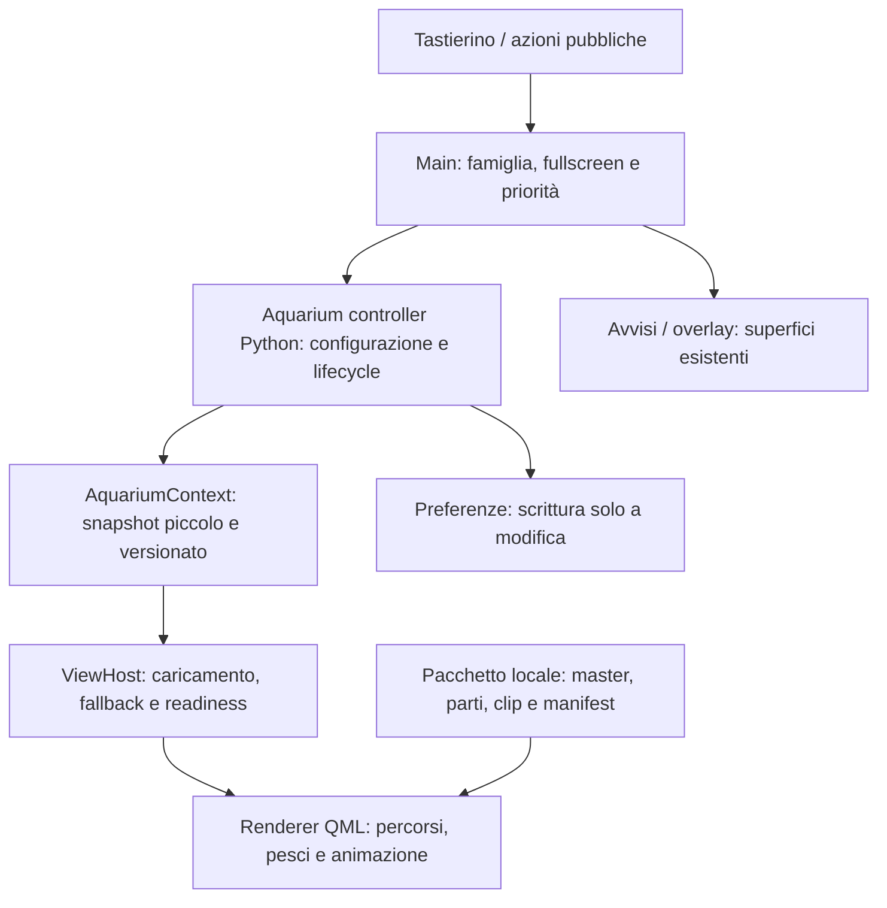

# SmartPC v0.10 — Acquario Calm · studio completo di integrazione

**Revisione 2 · 25 ottobre 2026 · Europe/Rome**

> Aggiornamento esecutivo, 26 ottobre: implementazione completata e rc.2/Apple1.6.5 installati. Questo documento conserva lo studio precedente; [chiusura, stato P0–P7 e limiti](v010-aquarium-completion-report.md).
**Stato dello studio alla redazione: ricerca e progettazione; nessun codice Acquario, asset di produzione, benchmark o intervento sulla Orange Pi.** Requisiti dell'utente e proposte tecniche sono distinti. [MasterPlan corrente](release-masterplan.md), [analisi preliminare](v010-aquarium-analysis.md), [ricerca online: 28 schede S1–S28](v010-aquarium-online-research.md).

Baseline **documentata corrente al 25 ottobre**: core **0.9.4-rc.3**, manifest 654 file, Theme API **2.12 / 68 superfici**, Apple Calm **1.6.4 attivo**. [Chiusura Auto](v094-game-functional-closure-report.md), [ottimizzazioni trasversali](v093-implementation-report.md), [barra/orario/dimming](v094-header-clock-report.md). Nessuna nuova lettura live della board. La baseline rc.13/2.10/Base del 13 ottobre e l'[audit originario](v010-aquarium-source-audit.json) restano storici; il [nuovo audit](v010-aquarium-source-audit-2026-10-25.json) identifica i sorgenti attuali. Sequenza Acquario v0.10 → Compagno v0.11 → Memoria/AI v0.12 → Stabilità v1.1.

**Aggiornamento esecutivo:** il [piano P0–P7](v010-aquarium-implementation-plan.md) fissa default, schema, file, macchina a stati, algoritmi e test. Prevale sulle alternative ancora discusse qui. La barra con HH:mm richiesta e consegnata il 22 ottobre resta sopra il canvas fullscreen; la precedente ipotesi di shell nascosta è superata. Reduced/Off statici, 7 Home dalla vista principale, nominale 2 specie/6 pesci. Ramo rig/sprite deciso con una prova equivalente, senza pretesa preventiva di 60 fps.

## 1. Esito dell'analisi

**Approccio raccomandato:** nuovo argomento Acquario con superficie pubblica `aquarium.main`, scena illustrata 2D locale a 960×640, camera fissa, fondo opaco e pochi pesci animati con un rig a parti. Confrontare un pesce riggato con sprite e, soltanto se necessario, deformazione via shader. Il movimento ordinario appartiene a QML/Qt Quick; Python governa configurazione, comandi, stato e persistenza. Non serve inizialmente un nuovo processo né un simulatore biologico.

**60 fps è un target sensato da esplorare, senza garanzia preventiva.** L'acquario elimina fisica/sensori/training del Gioco, ma aggiunge texture trasparenti e possibile overdraw. Nessuna equivalenza automatica fra “PowerVR attiva”, animazioni Qt e fotogrammi nuovi al pannello. La rc.13 del Gioco presenta a 30 Hz e non va copiata come clock dell'acquario.

Il rischio più importante nella produzione AI è ottenere parti/pose coerenti che si animino bene; nella shell è il vero fullscreen senza coprire avvisi o perdere uscite; nelle prestazioni è la regolarità del movimento con lavoro concorrente. Il prototipo utile deve risolvere questi tre punti prima di ampliare il catalogo.

## 2. Requisiti e proposte

| Livello | Contenuto |
| --- | --- |
| **Acquisito dall'utente** | Nuova v0.10, nuovo argomento Acquario semplice e tutto schermo; stile Calm del compagno; test capacità di generazione di modelli animati tramite ChatGPT e prestazioni della board; obiettivo 60 fps. |
| **Proposta di prodotto** | Un ambiente, camera fissa, 2 specie originali e 6 istanze (4 piccole + 2 medie), 3 livelli di profondità; pausa con 5, impostazioni minime nel Menu. Profilo nominale da approvare/congelare prima delle prove. |
| **Proposta tecnica** | Rig 2D a parti, curve continue con seed, clock visivo QML, asset condivisi/precaricati; nessuna AI necessaria durante il nuoto. |
| **Fuori dal primo perimetro** | Accudimento/progressione, economia, riproduzione, salute dei pesci, predazione, audio, touch obbligatorio, telecamera, 3D, salvaschermo automatico e AI runtime. Nuovi requisiti richiedono una scelta distinta. |

L'acquario è un argomento del carosello, non una sostituzione della Home. L'apertura avvia il movimento se la policy lo permette; non ha un comando Start di allenamento. Nessun avanzamento invisibile mentre si consulta Sport o dopo il reboot: la scena riparte localmente da una disposizione valida. Offline e assenza dell'Account non influiscono sul funzionamento.

## 3. Ispirazioni tradotte nel linguaggio Calm

| Riferimento | Principio da riprendere | Traduzione SmartPC |
| --- | --- | --- |
| Marine Aquarium (S1) | Scena ambientale, vita anche nei piccoli gesti. | Pesci con fasi diverse, coda/pinne/gill idle; fondale fisso con vuoti utili. |
| ABZÛ (S2) | Continuità e anticipazione del movimento. | Virata leggibile, curva continua; camera ferma e niente scatti di orientamento. |
| Endless Ocean (S3) | Osservare senza prestazione obbligatoria. | Esperienza contemplativa, nessun punteggio o pannello di bisogni. |
| Reynolds (S4–S5) | Separare steering e locomozione; regole locali per piccoli gruppi. | Percorsi/obiettivi semplici, pinne distinte dal moto; banco eventuale dopo MVP. |

Queste sono scelte di adattamento, non copie dei prodotti. Il [testo degli sviluppatori di ABZÛ](https://giantsquidstudios.com/Fluid-Motion-in-ABZU) tratta una locomozione 3D controllata; usiamo il principio di raccordo, senza ereditarne camera o fisica.

**Direzione visiva candidata:** illustrazione morbida, silhouette pulite, dettagli leggibili a 50–60 cm, fondo acqua desaturato, accenti limitati, niente neon o UI da videogioco. La materia dei pesci deve richiamare il [concept Calm del compagno](v010-companion-concepts/A-calm.png). Non basta usare il nome Apple Calm: il concept illustrato e i token della shell hanno ruoli diversi.

Nel [bundle Apple Calm](../../theme-projects/apple-calm/bundle/theme.json) il giorno ha canvas `#F3F4F6`, testo `#1D1D1F` e accento `#0066CC`; la variante notte usa canvas `#111216`. L'acqua può avere colori propri concordati, mentre Menu, focus, avvisi e recovery continuano a usare ruoli semantici del tema. Pesci in PNG non vengono ricolorati automaticamente dai token. Definire una palette d'ambiente giorno/notte o un raccordo validato, evitando un filtro fullscreen aggiunto senza prova.

**Composizione candidata:** vasca senza cornice occupante, fondale nell'ultimo 20–25% dell'altezza, due gruppi laterali di piante/rocce e zona centrale aperta. Pesci piccoli circa 70–100 px, medi 120–160 px; livelli lontano/medio/vicino con scala e contrasto stabili, senza blur runtime. Sono parametri di concept da confrontare sul pannello, non geometrie già approvate. Preparare una sola direzione Calm, con varianti più vuota/più ricca a parità di specie e inquadratura.

## 4. Audit dell'integrazione corrente

Audit iniziale del 13 ottobre, ricontrollato il 25 ottobre; i numeri di riga possono variare. [Snapshot corrente e differenze con il primo audit](v010-aquarium-source-audit-2026-10-25.json), senza accesso alla board.

| File / punto verificato | Situazione corrente | Conseguenza per Acquario |
| --- | --- | --- |
| [Main.qml](../Main.qml), `allFamilies`, `viewIndex`, `activeContentId` | 7 macroaree visibili, slot storici fino a 8; routing esplicito per famiglia. | Aggiungere `aquarium` e un solo `aquarium.main`; non rinumerare gli slot esistenti. Migrare/default del nuovo slot senza perdere preferenze. |
| [state.py](../state.py), `TOGGLEABLE_MODULES`, `visibleModules` | Visibilità persistita in `moduleVisible/<id>`; disponibilità dei servizi filtrata. | Inserire il modulo locale con default dichiarato, disponibile anche offline; nasconderlo arresta il lavoro animato. |
| [Main.qml](../Main.qml), `pageGeometry`, `shellGeometry` | Pagine ordinarie marginate, Gioco 912×552; la shell riserva header. | Policy fullscreen per la superficie acquisita, non modifica globale di tutti i viewport. |
| [PageHost.qml](../components/PageHost.qml) | Compensa `y - 90` perché vive nel content layer a y=90; usa `presentPage` a Ready. | Fullscreen possibile soltanto verificando coordinate assolute, clip, parent e trace. Evitare di sommare un secondo offset. |
| [ViewHost.qml](../components/ViewHost.qml) | Loader/staging, readiness, renderer compatibili in cache, lifecycle e ripristino focus. | Riutilizzare il percorso, distinguendo caricato/risorse pronte/primo frame; fermare renderer nascosti e candidati. |
| [ShellHost.qml](../components/ShellHost.qml), [Shell Apple](../../theme-projects/apple-calm/bundle/qml/Shell.qml) | Apple 1.6.4: header 56 px con HH:mm, shell compatta z=2 e dimming globale z=30. | Conservare shell/orario sopra il canvas e area sicura sotto la barra; nessuna soppressione del clock. |
| [SceneHost.qml](../components/SceneHost.qml), [ActorState.qml](../components/ActorState.qml) | Scena globale dipendente da `appearance.scene`; un attore semantico; gestione actor/canvas; builtin safe region 56×48. | Scene ambientale del tema distinta dall'argomento. Con Acquario attivo sospendere questa scena per evitare doppio attore/rendering. |
| [Main.qml](../Main.qml), `SceneHost.suspended` | Overlay, urgente, night e quietActive fermano la scena attuale. | Non riusare indiscriminatamente night/quiet: notte è palette, quiete è policy Avvisi, pausa Acquario è lifecycle. |
| [surfaces.json](../theme-api/surfaces.json), [contexts.json](../theme-api/contexts.json) | `scene.main` usa SceneContext e non dichiara azioni; contrato per un ActorSnapshot. | Nuovo AquariumContext, azioni allowlist e dati piccoli; non infilare sei pesci nell'identità del compagno. |
| [app.py](../app.py) / [theme_contexts.py](../theme_contexts.py) | Costruzione servizi e domini pubblici; shutdown esplicito. | Collegare un controller leggero, disponibilità/stato e chiusura, senza I/O nel render loop. |
| [GameVisual.qml](../presentations/GameVisual.qml) / [game_presentation.py](../game_presentation.py) | Clock 30 Hz e buffer 200/120 ms per campioni reali del Gioco. | Non riusare cadenza o ritardo; traiettorie generate localmente non hanno quella coda del worker. |
| [Rc.13](v09-pacing-optimization-report.md) | Misure callback/pose, non FPS ottici; snapshot statico distinto dalla scena. | Riutilizzare il principio di dati statici separati, non i numeri del Gioco come capacità dell'acquario. |

**Decisione consigliata:** ViewHost/PageHost con nuova superficie; SceneHost resta il servizio delle scene ambientali del tema. Estrarre eventualmente componenti visivi comuni soltanto quando due consumatori reali lo giustificano. Non allargare `scene.main` cambiando semantica e azioni dei temi esistenti.

## 5. Architettura proposta e proprietà dello stato

**Python possiede** visibilità, configurazione validata, pausa utente, motivi di sospensione, revisioni delle risorse e risultato dei comandi. **QML possiede** fase visuale, traiettorie e trasformazioni dei pesci della sessione visibile. **Shell possiede** navigazione, fullscreen, priorità/input e geometria degli avvisi. **Theme Engine possiede** scelta renderer, staging e recovery. Il renderer non modifica gli avvisi, non scrive preferenze e non gestisce endpoint.

Questo confine è coerente con Python per stato/I/O e QML per presentazione: i percorsi sono motion visuale, non uno stato biologico autorevole. Se si aggiungono bisogni o simulazione persistente, questa scelta va rivista. Una futura simulazione numerica costosa richiederebbe confronto di un worker dedicato; non crearlo per sei percorsi.

**Context candidato:** `configurationRevision`, `assetRevision`, `status` (loading/ready/error), `environmentId`, `species[]` limitata e validata, `instances[]` con id/species/seed/depth/initialPose, `playbackState`, `suspendReasons[]`, `motionPolicy`, `viewport`, `notificationOccupiedRegions`, `capabilities`. Reuse tipizzato di style/lifecycle/action result dal contratto pubblico. Non esporre il servizio Python come oggetto arbitrario ai temi. Nessuna mappa di frame/posizioni a 60 Hz attraverso l'adapter.

**Azioni candidate:** `aquarium.pause`, `aquarium.resume`, eventualmente `aquarium.configure` da Menu, più navigazione esistente. Pausa/ripresa idempotenti; preferire comandi espliciti al toggle per il broker. Le modifiche di densità/palette hanno parametri allowlist e limiti del profilo, non path o codice arbitrario. Risposta con esito reale e revision/request id; comandi fuori superficie/modalità o in presenza di urgente respinti. La diagnostica non diventa una capability sempre accessibile ai renderer.

## 6. Fullscreen, tastierino e avvisi

**Policy aggiornata al 25 ottobre:** canvas `(0,0,960,640)`, barra di sistema e HH:mm conservati sopra la scena secondo la richiesta consegnata in v0.9.4. Nuoto nella safeArea sotto l'header del tema; background esteso a tutto schermo. SceneHost ambientale sospeso, shell e badge/banner/urgente/recovery restano attivi con le precedenze esistenti; dimming unico z=30. Il caricamento non oscura titolo/ora né committa un renderer incompleto.

Non serve nel primo percorso una nuova capability per nascondere la shell. Riutilizzare pageGeometry/PageHost con coordinate corrette e `ShellContext.clock` della 2.12; verificare anche il clock fallback Base/Functional. Il [piano, §§2–6](v010-aquarium-implementation-plan.md) dettaglia payload dedicato, registro senza dataDomains, condizioni di mandatory/coerenza per SceneHost e la macchina a stati. Vecchi bundle ricevono il renderer fallback conservando la propria barra.

| Tasto | Scena | Menu/overlay | Urgente |
| --- | --- | --- | --- |
| **1** | Home, arresto del movimento. | Home secondo policy attuale. | Routing urgente attuale. |
| **2 / 8** | Nessun cambio con una sola vista; nessuna variazione nascosta della densità. | Selezione/scorrimento. | Routing urgente attuale. |
| **3** | Inbox, scena congelata. | Inbox secondo policy attuale. | Routing urgente attuale. |
| **4 / 6** | Argomento precedente/successivo; nessuna cattura da minigioco. | Righe/opzioni secondo contesto. | Routing urgente attuale. |
| **5** | Pausa / Riprendi con breve feedback, nessun overlay per fermare il nuoto. | Conferma del comando selezionato. | Dettagli/esito esistente, nessuna ripresa dei pesci. |
| **7** | Home dalla vista principale; negli overlay 7 risale secondo la shell. | Chiude/rientra con focus coerente. | Routing urgente attuale. |
| **9** | Menu con voci pertinenti e Comandi. | Menu attuale. | Routing urgente attuale. |

Auto-repeat di 5 ignorato; navigazione e broker passano dallo stesso controllo. Pausa da tastierino deve essere percepibile senza legenda permanente. Comandi mantiene le istruzioni; in movimento ridotto/off mostra una frase pertinente al tentativo di ripresa. Non persistiamo il routing come un ciclo Acquario→Acquario.

**Banner:** continua la scena se non sottrae contrasto/attenzione al messaggio; se l'area banner copre pesci, può congelare il visuale mentre è esposta. Congelare tutto è un primo fallback semplice. Nessuna coda o storico nuovo, nessuna lettura automatica, nessuna reazione “gol” nei pesci. **Urgente:** sospensione immediata e input alla superficie urgente; non aspettare fine clip, preload o salvataggio. **Recovery:** errore visibile e vie di uscita sempre funzionanti; non coprirlo con un fondale opaco.

## 7. Lifecycle, pausa e movimento ridotto

Separare desiderio utente e condizioni della shell: `requestedPlayback` e insieme `suspendReasons`. Il movimento effettivo vale solo quando requested=playing, risorse Ready, destinazione acquisita/visibile, policy normale e nessun motivo bloccante. Un bool unico perde la pausa dell'utente quando si chiude un Menu.

| Evento | Stato/azione proposta | Rientro |
| --- | --- | --- |
| Prima apertura | Loading → Ready; asset essenziali prima dell'avvio. | Avvio automatico se policy normal; niente lavoro prima della visibilità. |
| Pausa utente | Pose/fasi congelate, requested=paused. | 5 esplicito; Menu non annulla questa scelta. |
| Menu/Inbox/overlay | Motivo overlay; fermare clock, pinne, sprite, particelle e shader temporali. | Riprende se prima playing e nessun altro motivo; fase riallineata senza recuperare il tempo invisibile. |
| Urgente | Motivo urgent con precedenza assoluta. | Ritorno alla scena congelata e proposta prudente di 5 per riprendere. Non rianimare appena il banner urgente cambia id. |
| Uscita famiglia/modulo nascosto | Stop di tutto il visuale; conservazione in RAM limitata o unload secondo host. | Nuova sessione visuale valida; pausa utente conservata nella sessione se il controller resta vivo. |
| Tema/palette | Sospensione durante swap, nuova asset/theme epoch; niente due clock attivi. | Riprende quando Ready e modalità compatibile, invalidando callback vecchie. |
| Notte | Cambia ambiente/contrasto, non è di per sé pausa. | Stessa policy di playback. |
| Quiete Avvisi | Si conserva la policy notifiche. | Non diventa pausa dei pesci automaticamente. |
| Movimento ridotto | Decisione di piano iniziale: statico, niente clock o microgesti. Microgesti eventuali dopo qualifica separata. | Normal riparte senza catch-up; dettaglio visivo da concordare. |
| Movimento off | Frame statico, zero clock/particelle; 5 non forza normal. | Si modifica in Aspetto, senza cambiare implicitamente preferenza globale. |
| Display spento / processo non esposto | Sospensione quando il segnale è realmente disponibile. | Riprende soltanto se visibile e policy consentita; non presumere sospensione dal nero. |
| Reboot | Ripristina configurazione, non pose o tempo di assenza. | Navigazione di avvio corrente; movimento solo dopo apertura/Ready. |

Riprendere senza salti richiede un tempo di animazione attivo che escluda gli intervalli sospesi. Un frame lungo per stallo si tratta distinto da una pausa: niente raffica di tick o salto attraverso il bordo. Si può spezzare/limitare il passo di steering, ma il tempo visuale e la distorsione risultante devono essere dichiarati; non nascondere un frame perso riproducendo in slow-motion indefinito.

**Persistenza minima:** visibilità modulo e configurazione ambiente/densità/motion locale se prevista, con schema/default/validazione. Seed di benchmark e run id appartengono al report, non a una “memoria” dei pesci. Nessun SQLite dedicato necessario per la prima scena: valutare QSettings esistente. Pose, particelle e timer non si scrivono periodicamente. Configurazione corrotta recupera default valido; scrittura fallita non mostra “salvato” e conserva la scelta precedente persistita.

## 8. Produzione del pesce animabile tramite AI

La documentazione [OpenAI](https://developers.openai.com/api/docs/guides/image-generation) segnala limiti di identità e composizione anche nelle immagini generate/editate. Lo studio usa questa evidenza per richiedere controlli; non prova che una singola richiesta in chat restituisca parti allineate o un'animazione pronta. Valutare separatamente **illustrazione**, **preparazione degli asset**, **rig**, **motion** e **integrazione**.

| Fase | Materiale da produrre | Verifica |
| --- | --- | --- |
| **M0 · Master** | Una specie originale laterale, silhouette e colori stabili; riferimento Calm. | Riconoscibile alla taglia finale e distinta dal fondale; niente pinne spurie/testo/finto alpha. |
| **M1 · Parti** | Corpo, coda, pinna pettorale e dorsale/ventrale se necessarie; lato opposto o pose di virata. | Stesso canvas/coordinate, perni numerici, sovrapposizione dietro giunti, texture completa nelle zone rivelate. |
| **M2 · Rig** | Gerarchia, pivot, ampiezze, fasi e ordine dei livelli in manifest. | Nessun buco/seam al massimo gesto; corpo stabile, coda morbida, origine identica. |
| **M3 · Clip** | Nuoto lento/ordinario, virata sinistra/destra, quiete. | Loop chiuso anche nella velocità; nessun cambio di identità, occhi/pinna che spariscono o contorno doppio. |
| **M4 · Taglie** | Asset runtime alle taglie richieste; source originali separati. | Alpha ispezionato su chiaro/scuro/acqua, edge bleeding e jitter subpixel; nessun upscale eccessivo. |
| **M5 · Replica** | Seconda specie sul medesimo contratto. | Pipeline ripetibile, tempo di correzione e numero di tentativi registrati. |

**Catalogo minimo proposto:** nuoto continuo con due ritmi e fase individuale, quiete con pinna/respiro discreto, virata completa nei due sensi. Una semplice scala X negativa può invertire il pesce ma non dimostra una virata convincente: usare solo se il concept accetta il gesto, altrimenti clip/pose di raccordo. Le due specie non devono usare identici ritmo/angolo/contorno.

**Prompt preparatorio candidato, da usare quando si avviano gli asset:** “Pesce originale illustrato 2D nello stile Calm del riferimento allegato; vista laterale, anatomia e silhouette semplici, luce coerente. Personaggio intero isolato, alpha reale, nessun fondale/testo/ombra sul pavimento. Mantieni colori, occhio e forma del master nelle varianti. Parti con giunti coperti e zone nascoste complete.” Il prompt non sostituisce il manifest tecnico e la verifica del file. Per l'editing fissare reference master e una sola modifica per tentativo.

**Manifest candidato per specie:** id/versione/hash, dimensioni canvas, bounding box, parti e relative source, pivot/ordine, clip/durata/fps, bounding envelope e varianti ammesse. Sheet con frame rettangolari identici, origine stabile, conteggio e padding espliciti. Separare file originali e runtime. Generare pose indipendenti senza un master comune è il confronto debole da evitare; tagli e ridimensionamenti devono essere riproducibili.

**Valutazione produzione:** assegnare a identità, alpha/giunti, naturalità, loop e leggibilità una griglia 0–2 (difetto bloccante / correzione necessaria / pronto). Nessun difetto bloccante e almeno 8/10 è una soglia candidata da fissare prima della selezione; pubblicare anche rigetti, tentativi e minuti di correzione. Fotogrammi di una clip non sono campioni statistici indipendenti. Due specie validate danno una prima indicazione della pipeline, non provano generazione universale di qualsiasi compagno.

## 9. Confronto dei renderer e budget

| Candidato | Vantaggio atteso | Rischio / prova richiesta | Scelta iniziale |
| --- | --- | --- | --- |
| **Rig a parti QML** | Poche immagini condivise, controllo dei perni e gesti trasferibile al cane. | Giunti visibili, segmenti rigidi e costo di binding/nodi. | Primo prototipo: corpo+coda+pinna; ampliare solo per difetto concreto. |
| **AnimatedSprite** | Pose complesse disegnate/qualificate offline; un nodo visuale principale. | Memoria sheet, jitter fra frame, blending con contorni doppi. | A/B stessa taglia/durata, interpolazione on/off. |
| **Shader locale su mesh** | Curvatura continua senza separare troppe parti. | Distorsione del corpo/occhio, toolchain `.qsb`, compatibilità e costo shader. | Terzo confronto se rig/sprite non soddisfano qualità/costo. |
| **Spine runtime** | Tooling di rig/mesh avanzato. | Dipendenza, integrazione Qt, licenza/build ARM e recovery. | Principi utili (S6); non aggiungerlo al primo percorso. |
| **Video fullscreen** | Ambiente prerenderizzato. | Decoder, loop, alpha/interazione, autonomia limitata; test diverso. | Eventuale riferimento visivo, non misura dei singoli pesci/rig. |
| **Canvas fullscreen** | Disegno libero. | CPU e upload frequenti di texture (S15). | Evitare come base dell'esperimento. |

[Qt FrameAnimation](https://doc.qt.io/qt-6.8/qml-qtquick-frameanimation.html) è un candidato verificabile per moto imperativo sincronizzato all'animazione. Prima provare percorsi dichiarativi per un pesce, poi un unico FrameAnimation che aggiorni soltanto posizioni/angoli/fasi dei delegate esistenti. Non ricostruire liste, normalizzare JSON o creare/distruggere Item ogni frame. Il callback QML resta lavoro della GUI: non è GPU compute.

[Qt Animator](https://doc.qt.io/qt-6.8/qml-qtquick-animator.html) può muovere il scene graph senza aggiornare le proprietà QML durante il gesto. Usarlo per una pinna decorativa, non come sorgente della posizione letta dallo steering. Evitare due scrittori sulla stessa proprietà. [AnimatedSprite](https://doc.qt.io/qt-6.8/qml-qtquick-animatedsprite.html) è il percorso sprite; 12–24 pose/s della coda e rendering 60 fps sono ritmi distinti, entrambi da valutare. Nessun fps alto ottenuto aggiungendo una rotazione diagnostica estranea alla scena.

**Budget teorico:** 16,67 ms fra refresh a 60 Hz, con GUI/preparazione, sync/render e risorse in pipeline; non sommare percentili separati dei thread come un tempo frame. Fondo RGBA8 960×640 ≈2,34 MiB di pixel; una sheet 24×128×128 ≈1,5 MiB, una 24×256×256 ≈6 MiB. Due specie con 3 clip da 24 frame a 256² occupano teoricamente 36 MiB, prima di padding/mipmap/copie; sei istanze non richiedono sei copie di ogni sheet se condividono le risorse. Non è un consumo misurato né un limite imposto.

Le sheet devono rispettare limiti texture reali del backend e layout delle righe. Cache URL, risoluzione e upload vanno osservati. `sourceSize` non varia durante il nuoto ([Image](https://doc.qt.io/qt-6.8/qml-qtquick-image.html)); preload asincrono non garantisce upload GPU privo di picchi. Niente `layer.enabled` o shader fullscreen per ogni pesce. Fondo opaco, alpha ritagliato, z di profondità stabile e pochi gruppi: il [renderer Qt](https://doc.qt.io/qt-6.8/qtquick-visualcanvas-scenegraph-renderer.html) spiega perché sovrapposizioni traslucide incidono sul batching, ma il costo qui è da misurare.

Shader e particelle si aggiungono uno alla volta; pacchetti `.qsb` preparati e verificati per GLES della board ([ShaderEffect](https://doc.qt.io/qt-6.8/qml-qtquick-shadereffect.html)). NPU non ha un ruolo necessario in questa scena. Governor/clock e C++ diventano confronti soltanto se la profilazione trova un limite e la scelta conserva qualità/consumo/stabilità.

## 10. Movimento e varietà senza un simulatore costoso

**Primo algoritmo candidato:** percorsi curvi entro una regione valida, obiettivi a intervalli di secondi con RNG seedato, velocità in px/s e raggio minimo di virata. Usare curve cubiche con raccordi di tangente o steering smussato; velocità lungo la curva regolata, non semplice incremento del parametro u spacciato per velocità costante. Posizione e orientamento derivano dalla stessa tangente. Il corpo anticipa la curva, la coda segue con fase, ampiezza e ritmo legati moderatamente alla velocità.

La regione valida tiene conto dell'inviluppo delle pinne e dell'intera virata, non solo del centro. Containment prima del bordo, con margine: niente rimbalzo a 180° istantaneo. Un livello lontano passa dietro le piante; il livello vicino non cambia z ogni frame. Entrata/uscita sotto un'area coperta richiede una transizione chiara, non apparizione casuale al centro. Profondità è scelta scenica 2D, non acqua fisica 3D.

**Valori per il concept, da tarare:** piccoli 20–45 px/s, medi 15–30 px/s; virate 1–2,5 s; fase della coda distinta per istanza, variazione di ritmo limitata e lenta. Separare le unità del movimento dai frame. Una traversata della scena avrà così durata di decine di secondi: valutare se basta varietà senza agitazione. Nessuna validità biologica attribuita a questi numeri.

**Gruppo opzionale:** solo dopo il percorso individuale usare vicinato/separazione e al massimo un banco piccolo. Le regole di [Reynolds](https://www.red3d.com/cwr/boids/) motivano il modello, non le costanti. A 16 pesci il confronto diretto ha 240 coppie ordinate per tick; non è di per sé un problema né motivo per una griglia. Prima misurare; per cataloghi grandi studiare indice spaziale. Una frequenza di steering 10–20 Hz candidata può convivere con valutazione della traiettoria a ogni frame, mantenendo continuità; scegliere in A/B, non imporre 60 chiamate Python/s.

## 11. Contratto Theme API, fallback e fixture

Evoluzione **additiva**, senza assegnare ora una nuova versione API. Registrare `aquarium.main` e, se serve, menu dedicato `aquarium.menu` dopo decisione UX; AquariumContext tipizzato, dominio `aquarium` e azioni allowlist. Estendere metadata/reference/qmltypes/fixture tramite gli strumenti del progetto, non aggiornare solo il JSON dei surface ids. L'integrazione effettiva determinerà conteggio superfici e versione API.

**Fallback:** renderer builtin funzionale con stessi pesci/semantica o asset statico se l'animazione non è pronta; Base/Functional e Apple Calm verificati. Un fallback statico è disponibile ma non chiude il gate animazione 60 fps. Vecchi bundle ricevono fallback della nuova superficie, shell/orario conservati sopra il canvas e avvisi prioritari. Non far dipendere disponibilità del modulo da `appearance.scene.enabled`.

**Fixture minime:** loading, ready normal, user paused, overlay suspended, urgent, reduced, off, night, asset missing, invalid configuration, fallback/legacy theme, text scale 1/1,1. Preview/staging non iniziano clock o scritture; un tema candidato non crea un secondo acquario vivo. L'epoch renderer/config/asset invalida callback tardive e distrugge risorse fuori uso secondo il ViewHost.

`ready` deve dipendere da risorse essenziali reali; separare optional mancanti (proseguire senza bolle) e specie essenziale non caricabile (fallback errore). La prima immagine mostrata ha evidenza distinta dal solo Loader.Ready. Errori della superficie non devono mettere in recovery tutta la dashboard senza necessità; definire prima il confine fra asset opzionale, renderer guasto e bundle corrotto.

## 12. Benchmark riproducibile e criterio dei 60 fps

Conservare build/manifest, Qt/PySide, backend/render loop, risoluzione/refresh, tema/palette/motion, fonti attive, seed, asset/hash, numero/taglia/depth dei pesci, effetti, temperatura iniziale e configurazione governor realmente installata. Il report v0.9.3 ha selezionato performance sulla policy6/A76, nice GUI 0 e affinity libera: conservarli come baseline e rileggerli prima delle prove, senza nuovo tuning implicito. L'audit precedente identifica A733/PowerVR: verificare questi dati prima delle prove; nessuna conclusione da un vecchio studio T527/Mali. RSS/PSS, CPU per thread e temperatura sono diagnosi; qualità e regolarità sono criteri di prodotto.

| Gate | Procedura candidata | Risultato |
| --- | --- | --- |
| **A0 · Baseline/strumenti** | Confermare 960×640/60 Hz e backend; stessa build con scena vuota/statica; controllo overhead degli strumenti. | Setup ripetibile e separazione rendering/animazione; nessun FPS negativo attribuito a scena statica che non ridisegna. |
| **A1 · Renderer** | Un pesce a parità di master/taglia/traiettoria; rig/sprite, interpolazione sprite on/off; shader solo se necessario. 60 s warm-up, 120 s misura, 3 repliche. | Qualità, costi, loading e regime; selezione prima di aumentare il carico. |
| **A2 · Scala** | 1/4/8/16 pesci, 2 specie e stesso seed/percorsi. Poi bolle/piante/luce separati, stesso protocollo; ordine A/B alternato. | Carico nominale sostenibile e stress distinto dalla configurazione di prodotto. |
| **A3 · Dashboard** | Profilo nominale, tre temi/fallback, day/night normal; refresh e banner riproducibili poi uso reale, Menu/Inbox/uscite/urgente. | Priorità, pause e fluidità sotto lavoro pertinente; cache/modalità dei provider annotate. |
| **A4 · Durata** | Almeno 30 minuti nominali, cicli di rientro e confronto memoria dopo warm-up/alla fine; ripetere solo per nuovo difetto. | Stalli, regime termico e crescita; nessun certificato 24h ricavato da 30 minuti. |
| **A5 · Qualifica fisica/consegna** | Pannello reale, tastierino, manifest/backup/preferenze, servizio e reboot attribuibile alla release quando si passa alla distribuzione. | Fotogrammi fisici e ritorno corretto; installato distinto da live-qualified. |

**Metriche:** contare eventi e durata dell'intera finestra; frame interval p50/p95/p99/max, peggior finestra di 1 e 10 s, distribuzione degli intervalli, stalli ≥33,3/50/100 ms e ritardi di posa. Con vsync valido, stimare slot mancati da intervalli multipli del periodo effettivo, indicando arrotondamento/tolleranza e possibili errori del segnale. Non chiamarli frame fisici mancati senza osservazione del pannello. Separare costo GUI, render, upload e I/O. GPU busy solo con contatore qualificato; watt richiede misura propria.

**Gate operativo proposto**, da congelare prima di misurare: media callback ≥59/s, p95 ≤18,5 ms a refresh prossimo a 60 Hz, slot mancati stimati ≤1%, nessuno stallo >50 ms ripetuto in regime nominale; p99/max e peggiori finestre sempre pubblicati. Il 18,5 ms è tolleranza candidata per misura/jitter, non budget hardware nuovo. Il carico nominale deve passare ogni replica; non scegliere solo il seed migliore. Cambi tema/caricamenti e urgente misurati separatamente e comunque riportati.

Questo gate descrive **vicino a 60**. Per una dichiarazione **60 fps costanti nel perimetro provato**, richiedere assenza di slot mancati osservati e verifica di fotogrammi distinti sul pannello, con metodo/tolleranza dichiarati. Un loop di pose a 12 fps sopra un fondale ridisegnato 60 volte non basta a dimostrare nuoto a 60: verificare anche spostamento continuo del pesce. [QQuickWindow](https://doc.qt.io/qt-6.8/qquickwindow.html) distingue l'accodamento per presentazione; `grabWindow` e screenshot continuativi non vanno usati nella finestra di misura.

**Misura fisica candidata:** ripresa esterna a 120/240 fps con tempi d'esposizione compatibili e riferimento di movimento visibile, almeno sulle finestre più difficili; dichiarare aliasing/rolling shutter e confrontare con traccia software. Input misurato da pressione reale a risposta visibile, senza scambiarlo per FPS. Se mancano strumenti ottici, pubblicare soltanto esito software e lasciare il gate fisico aperto.

**Raccolta sicura:** segnali del render thread non fanno I/O/Python costoso o manipolazioni QML dirette; ponte con buffer/contatori e trasferimento sul thread corretto. Dataset limitato, flush fuori finestra, timestamp monotoni. Confronto raccolta on/off. Per timer PySide sulla piattaforma, conservare la regola già acquisita di callback senza ritorno bool; preferire QML per il clock visivo. Non aggiungere una rotazione diagnostica continua per forzare un contatore a 60.

**Se fallisce:** isolare clock, binding, alpha/nodi, upload e effetti; ridurre una variabile, mantenendo scena/master/policy comparabili. Pubblicare il limite e scegliere profilo migliore. Un fallback 30 fps resta un risultato distinto. Test con Gioco/training attivo invisibile è stress separato, non uso nominale autorizzato.

## 13. Verifiche funzionali e consegna futura

| Rischio | Test pertinente |
| --- | --- |
| Navigazione/fullscreen | Entry/exit in tre temi, screenshot 960×640 day/night, viewport/clip/z e titolo durante loading; 1/3/4/6/7/9 e broker coerenti. |
| Pausa/priorità | Repeat 5, Menu da user paused, urgente durante virata/caricamento, motion off/reduced, callback dopo distruzione. Nessuna riattivazione inattesa. |
| Lavoro nascosto | Uscita/nascondi modulo e renderer candidate: clock, sprite, particelle e uniform temporali fermi; non solo `visible=false`. |
| Asset/config | File mancante/alpha errato/manifest invalido, dimensioni/clip e limiti, optional contro essential; errore chiaro e uscita praticabile. |
| Temi pubblici | Contesto allowlist, azioni fuori superficie, fixture, kit e fallback vecchio bundle; staging senza side effect. |
| Stato/salvataggio | Default/migrazione non rinumera moduli, errore persistenza, reboot/offline; preferenze e archivi del Gioco invariati. |
| Performance | A0–A5, callback e pose/ottica separati, overhead misurato, memoria dopo rientri, temperature/stalli e niente log per frame. |

Test mirati ai rischi nuovi; i report v0.9 non si ripetono integralmente. Prima della distribuzione: preflight runtime/checkout/modifiche, backup, manifest/hash, installazione e rollback di codice+asset, servizio/GUI, nessun warning QML inatteso, preferenze/piloti/archivi conservati e reboot release-attributable se dichiarato. Non modificare governor o dipendenze per preparare questa analisi.

## 14. Lotti di lavoro e decisioni prima dell'implementazione

| Lotto | Consegna reviewabile | Criterio per avanzare |
| --- | --- | --- |
| **Q0 · Progetto** | Questo dossier, fonti, confini/fullscreen/lifecycle, concept da produrre. | Chiarire specie/ambiente e accettare il profilo nominale e policy. |
| **Q1 · Un pesce** | Master, parti/pivot, nuoto/virata/quiete e confronto rig/sprite. | Qualità sufficiente e benchmark A1; la seconda specie non precede la riuscita del primo modello. |
| **Q2 · Verticale integrato** | Famiglia/host fullscreen, controller/context, pausa, avvisi, fallback e fixture. | Un pesce dentro la dashboard con input/lifecycle corretti in PC/EGLFS. |
| **Q3 · Scena nominale** | Due specie/sei istanze proposte, sfondo e profondità; optional separati. | A2/A3 passano sul carico dichiarato; niente aumento automatico della densità. |
| **Q4 · Qualifica/consegna** | A4/A5, report AI e prestazioni, manifest/rollback/kit aggiornato. | Evidenza distinta di qualità, software, pannello e installazione; residui espliciti. |

**Default e ordine esecutivo aggiornati:** [piano P0–P7](v010-aquarium-implementation-plan.md). Prima contratto/lifecycle e verticale Main con placeholder dichiarato, poi master e confronto rig/sprite, due specie/sei pesci, scala e qualifica. Barra con HH:mm conservata; 5 pausa/ripresa, 7 Home dalla vista principale, rientro da Menu solo se prima playing e da urgente con ripresa esplicita, Reduced/Off statici. Restano da produrre asset e misure; le scelte tecniche necessarie a iniziare il codice sono specificate. Questa chat rimane ricerca/pianificazione, senza avvio dell'implementazione.

## 15. Cosa trasferire al compagno v0.11

Riutilizzabili se verificati: master/parti/clip e manifest, alpha/pivot, separazione asset e runtime, clock visuale, readiness/preload/fallback, pause/motion, benchmark e kit delle nuove superfici. Da qualificare di nuovo: articolazioni del cane, dimensioni ambientali/dedicate, accudimento/input, bisogni/progressione, transazioni/assenza, reazioni agli avvisi e memoria. Il fullscreen dell'acquario non certifica il cane nella regione compatta della dashboard; la riuscita di un pesce non certifica tutti i personaggi AI.
