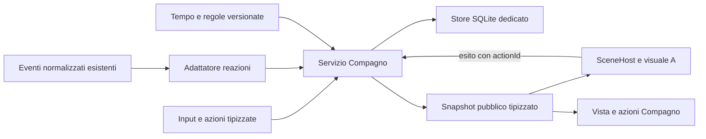

# SmartPC v0.11 — Compagno A · specifica funzionale e tecnica

> **Riallineamento roadmap · 13 ottobre 2026:** Compagno ora v0.11, memoria/scene AI v0.12; la nuova v0.10 è Acquario. Nomi dei file e asset conservati per mantenere i collegamenti. Baseline, fonti e proposte dell’11 ottobre restano storiche; per stato corrente e numerazione vale il [MasterPlan](release-masterplan.md), revisione 2.68. Nessuna nuova verifica sulla board.
**Revisione 2 · 11 ottobre 2026 · Europe/Rome**

**Stato: analisi.** Requisiti dell'utente acquisiti; comportamento e parametri seguenti sono proposte reviewabili. Nessun codice del Compagno implementato, nessuna installazione o misura di prestazioni del cane.

Riferimenti: [MasterPlan corrente](release-masterplan.md), revisione **2.56**, baseline documentata **0.9.0-rc.6 / Theme API 2.9 / 68 superfici / Apple Calm 1.6.2**; [analisi iniziale](v010-companion-analysis.md); [concept A](v010-companion-concepts/A-calm.png). Baseline letta nei file locali, senza nuovo controllo sulla board. Gli studi UX storici sono fonti di principi; la navigazione corrente del MasterPlan prevale sulle vecchie famiglie/versioni.

**Integrazione online:** [ricerca e registro delle 14 fonti principali](v010-companion-online-research.md). Le sigle S1–S14 collegano studi originali, pratiche di produzione e documentazione alle proposte qui sviluppate. Frequenze/durate/regole di SmartPC non diventano parametri validati per il solo fatto di avere un riferimento esterno.

## 1. Requisiti acquisiti e decisioni ancora aperte

**Confermato dall'utente:**

- Stile **A — Calm / illustrazione 2D**: cane illustrato, interfaccia scura e accenti coerenti con il tema approvato.
- Presenza nella dashboard e schermata propria per gioco/interazione.
- Bisogni e progressione, con **accudimento più attivo, bisogni frequenti e conseguenze temporanee recuperabili**.
- Reazioni agli avvisi; priorità degli urgenti conservata.
- Asset e animazioni prodotti tramite AI in questa chat; scelta dello stack orientata a CPU/GPU e obiettivo 60 FPS.

**Proposta di perimetro iniziale:** un cane, un ambiente, tre bisogni, cinque azioni, mini-gioco della palla, pochi traguardi, scene giorno/notte. Primo rilascio con aspetto stabile; crescita cucciolo/adulto, ulteriori giochi e storia AI restano estensioni da scegliere. Il cane non muore e non perde definitivamente capacità per mancata cura; il legame non diminuisce con l'assenza. Queste ultime regole sono proposte coerenti con conseguenze recuperabili, non una simulazione biologica.

Nome del cane, ritmi definitivi, orari, nomi/soglie dei traguardi e oggetti da sbloccare restano da decidere. Lo stile A è approvato; il personaggio master e i suoi asset di produzione devono ancora essere costruiti e approvati.

## 2. Schermate e presenza

**Famiglia Compagno**, proposta dopo Gioco nel carosello, con una vista principale iniziale. È una funzione completa di accudimento; non si aggiunge una quarta vista a Oggi né si rende il tasto Home un ingresso nel cane. L'ordine definitivo è da concordare.

Composizione candidata, in coordinate logiche 960×640:

| Regione | Geometria iniziale | Contenuto |
| --- | --- | --- |
| Barra | y=0, h=56 | Nome famiglia/vista e contesto della shell corrente. |
| Scena | x=24, y=72, w=576, h=448 | Cane, cuccia, ciotola/palla secondo l'azione; stato breve leggibile. |
| Cura | x=616, y=72, w=320, h=448 | Sazietà, Energia, Compagnia e progresso; tre bisogni con valori alti positivi. |
| Azioni | x=24, y=536, w=912, h=88 | Ingresso all'interazione e azioni; stato distinto fra consultazione e selezione. |

Le geometrie sono un punto di partenza, non coordinate già approvate sul pannello. In modalità Azioni proporre quattro scelte orizzontali come nel concept — Gioca, Carezza, Cibo, Riposo — con Richiama nel menu contestuale. L'utente sceglie solo dopo l'ingresso esplicito nell'interazione; durante la consultazione 4/6 continuano a cambiare famiglia. Nessuna legenda permanente nuova nelle viste ordinarie.

**Presenza ambientale:** una versione compatta dello stesso cane, inizialmente in Home e nelle viste che dichiarano spazio utile. Valutare footprint 96×96 o 128×128: entrambi richiedono nuove regioni rispetto all'attuale 56×48. Non comprimere automaticamente il cane finché diventa illeggibile. Se manca spazio, sospenderlo; la Home conserva ora/meteo/evento condizionale. Nelle viste del Gioco attivo proporre assenza del cane ambientale per rispettare attenzione e carico.

Un ambiente e una presenza attiva condividono identità/stato: il cane della Home non è un secondo animale. Asset completi e compatti devono mantenere la stessa silhouette. Le transizioni fra regioni devono essere sicure lungo il percorso; se un passaggio non è libero, usare un raccordo breve fra pose senza attraversare i dati.

## 3. Tastierino e modalità di interazione

| Modalità | Frecce | 5 | 7 |
| --- | --- | --- | --- |
| **Consultazione** | 4/6 famiglia; 2/8 viste, se disponibili. | Entra in Azioni. | Torna secondo la navigazione corrente. |
| **Azioni** | 4/6 scelgono una delle quattro azioni; 2/8 non cambiano vista. | Avvia l'azione selezionata. | Chiude Azioni conservando selezione. |
| **Cura in corso** | Non avviano nuove azioni né cambiano famiglia. | Nessuna ripetizione; eventuale risposta «in corso». | Interrompe la cura se ancora interrompibile. |
| **Palla — pronta** | 4/6 direzione; 2/8 distanza tra livelli disponibili. | Lancia. | Termina il mini-gioco e torna ad Azioni. |
| **Palla — recupero** | Nessuna modifica del lancio già iniziato. | Non lancia una seconda palla. | Interrompe il round. |

**1 Home, 3 Avvisi e 9 Menu** conservano significato e precedenza: durante una cura/round richiedono uscita e interrompono il visuale, senza continuare un gioco invisibile. Ritorno con vista/azione selezionata coerenti e senza ripresa implicita. Urgente immediato senza aspettare clip, conferma o salvataggio. Una transazione già conclusa resta conclusa.

La modalità Azioni appartiene alla vista Compagno e non è un overlay globale ordinario: oggi ogni overlay sospende SceneHost. Il routing dell'input deve essere esplicito e tipizzato; la presentazione non possiede direttamente il tastierino. Scartare auto-repeat e input appartenenti alla precedente modalità durante l'uscita, anche per le azioni broker. Nessuna pressione lunga obbligatoria.

**Focus reviewabile:** all'ingresso evidenziare l'azione selezionata e il titolo della modalità; durante l'esecuzione distinguere selezione, comando accettato e azione in corso. All'uscita ripristinare l'ultima scelta ancora valida; un avviso non sposta il focus sulla ciotola né avvia un'azione. Con 7 si risale Palla → Azioni → Consultazione senza conferme ordinarie o cicli chiudi/riapri. Conservare il linguaggio del focus della shell. Principio ispirato a [Google TV navigation](https://developer.android.com/training/tv/get-started/navigation), adattato al nostro tastierino, non al routing Android (S7).

## 4. Bisogni, umore e conseguenze

Tre quantità interne 0–100, con **100 positivo**. La voglia di compagnia è derivata da `100 − Compagnia`: non esporre due barre con significati opposti.

| Bisogno | Cosa lo cambia | Conseguenza temporanea candidata |
| --- | --- | --- |
| **Sazietà** | Diminuisce col tempo; Cibo la ripristina. | Cerca/guarda la ciotola, posa affamata e minore vivacità quando molto bassa. |
| **Energia** | Diminuisce da sveglio e giocando; Riposo recupera. | Sbadigli, movimenti più calmi, round brevi; propone riposo. |
| **Compagnia** | Diminuisce senza interazione; Carezza/Gioca la ripristinano. | Cerca attenzione, osserva l'utente della dashboard, saluto più affettuoso quando torna l'interazione. |

L'umore è derivato dai bisogni, dall'azione e dal contesto, senza una quarta barra indipendente: tranquillo, contento, affamato, stanco, cerca compagnia. La priorità funzionale resta chiara anche quando due bisogni sono bassi; la vista può mostrare una frase principale e lasciare leggibili tutti gli indicatori.

**Leggibilità della cura:** abbinare fascia, gesto e breve frase, ad esempio «Ha fame · puoi dargli da mangiare» oppure «È stanco · il riposo recupera energia». Non usare soltanto colore o tristezza generica. La scelta dell'azione espone effetto e disponibilità; esito, saturazione e assenza di premio sono distinguibili. Se due bisogni sono bassi il messaggio principale resta stabile fino al completamento/cambio significativo, mentre entrambi gli indicatori rimangono consultabili. La personalità non nasconde una necessità e il cane non si nutre autonomamente: l'accudimento attivo conserva la sua funzione.

**Parametri iniziali da simulare e tarare, non requisiti finali:**

| Parametro | Candidato iniziale |
| --- | --- |
| Sazietà da sveglio / a riposo | −10 / −5 punti per ora. |
| Energia da sveglio / a riposo | −4 / +24 punti per ora. |
| Compagnia da sveglio / a riposo | −8 / 0 punti per ora. |
| Cibo completato | +35 Sazietà, limitata a 100. |
| Carezza completata | +20 Compagnia, limitata a 100. |
| Round palla completato | −8 Energia, −1 Sazietà, +15 Compagnia. |
| Fasce bisogno | 60–100 soddisfatto; 30–59 ordinario; 0–29 richiede cura. Rientro dalla richiesta oltre 40 per evitare oscillazioni. |

Con questi candidati la sazietà può passare da 70 a 30 in circa quattro ore da sveglio: l'accudimento ha occasioni concrete durante la giornata. Decidere se il ritmo è adeguato dopo una simulazione; non imporre un timer per somministrare cibo a intervalli esatti.

Le azioni di cura restano raggiungibili anche con bisogni a zero. Con Energia bassa la prima proposta è un round breve e poi riposo, evitando un blocco senza uscita. Cibo già a 100 non dà ulteriore nutrimento o progressione; si può mostrare «È sazio». Carezze ulteriori possono avere una risposta breve senza premi ripetuti.

**Esempio calcolato dei parametri candidati**, con stato iniziale ipotetico e azioni completate. Calcolo aritmetico di pianificazione, non esecuzione del Compagno o prova sulla board:

| Ora | Situazione | Sazietà | Energia | Compagnia |
| --- | --- | --- | --- | --- |
| 08:00 | Stato iniziale | 70 | 80 | 70 |
| 11:00 | Prima della cura | 40 | 68 | 46 |
| 11:00 | Dopo cibo, carezza e un round | 74 | 60 | 81 |
| 15:00 | Prima della cura | 34 | 44 | 49 |
| 15:00 | Dopo cibo, carezza e un round | 68 | 36 | 84 |
| 18:00 | Energia bassa: suggerisce riposo | 38 | 24 | 60 |
| 19:00 | Dopo un'ora di riposo | 33 | 48 | 60 |

Il campione rende esplicito il compromesso: la cura ha un effetto, ma il gioco consuma energia e le necessità tornano. La giornata effettiva può includere più round, meno cure e riposo diverso; confrontare anche questi scenari prima di approvare i coefficienti.

## 5. Tempo, riposo e spegnimento

**Regola proposta:** i bisogni continuano durante il normale funzionamento anche quando il cane non è visibile. Un menu o urgente sospende la presentazione, non il tempo della cura. Nascondere la famiglia è distinto da disabilitare l'accudimento; la disabilitazione esplicita congela bisogni/progresso e al ritorno imposta un nuovo riferimento temporale.

Usare tempo monotono durante il processo e timestamp UTC persistiti per il recupero. Integrare la variazione per il tempo effettivamente trascorso, senza un aggiornamento per frame. Inizialmente un controllo al minuto, più controlli agli ingressi/azioni/cambi di fascia, è sufficiente come proposta; pubblicare uno snapshot solo quando cambia un dato presentato.

Riposo manuale e orari del cane sono distinti da palette notte, quiete Avvisi e Reduced/Off. Proposta di orario iniziale 23:00–07:00 Europe/Rome, modificabile. Un'interazione esplicita può svegliarlo; decidere un intervallo di attività prima del ritorno al riposo. L'energia recupera col tempo di riposo: premere Riposo non la riempie istantaneamente.

Al reboot, interrompere qualsiasi cura/gioco rimasto aperto, caricare lo stato e riprendere da una posa sicura. Applicare **al massimo otto ore di recupero offline**, con bisogni di Sazietà/Compagnia non abbassati sotto 15 dal solo recupero offline; nessuna perdita del legame. Sono limiti candidati. Integrare separatamente eventuali periodi di riposo nella finestra scelta; non moltiplicare un tasso unico per settimane di assenza. Cambio data/fuso, ora legale e orologio arretrato/futuro hanno casi di prova specifici.

## 6. Azioni e gioco

| Azione | Sequenza | Effetto e completamento |
| --- | --- | --- |
| **Richiama** | Attenzione → orientamento → breve avvicinamento sicuro. | Risposta immediata; primo rilascio senza premio al legame. |
| **Carezza** | Posa rilassata → gesto/risposta → ritorno. | Compagnia e premio eleggibile soltanto al completamento. |
| **Cibo** | Ciotola → mangia → posa sazia. | Sazietà al completamento; nessuna porzione per comandi rifiutati/interrotti. |
| **Riposo / Sveglia** | Si sistema / si alza con raccordo. | Cambio di modalità, recupero temporale; nessun riempimento istantaneo. |
| **Gioca** | Entra nella palla; sceglie lancio → cane recupera → ritorna. | Cura/progresso per round valido completato, con limite ai premi. |

**Palla, prima proposta:** attività breve controllabile, distinta da una clip che si ripete senza input. La persona sceglie direzione e distanza, poi lancia. Il cane segue un percorso previsto nello spazio della sua scena e restituisce la palla; il gioco è pronto per il lancio successivo. Con poco vigore proporre distanza ridotta. Non richiede training, una rete neurale o fisica generale.

Movimento e ciclo di passo devono essere sincronizzati: zampe a terra senza scorrimento apparente e velocità coerente con la clip. La palla può seguire una curva semplice; gli oggetti restano dentro l'area del gioco. Un round interrotto non diventa una vittoria né viene riprodotto al ritorno.

## 7. Progressione

Separare soddisfazione temporanea e **legame persistente**. Proposta: tre traguardi iniziali — Conoscenza, Fiducia, Intesa — con progressi comprensibili e sblocchi presenti, per esempio un nuovo saluto, una variante di gioco e un oggetto della scena. Nomi/soglie/sblocchi da scegliere dopo il catalogo degli asset: non mostrare un premio che non esiste.

Il legame cresce con cure e round completati. Richiama, tasti ripetuti, tempo nascosto e generiche reazioni agli avvisi non danno automaticamente esperienza. Proporre un limite per azione/finestra temporale e un tetto complessivo; evitare premi da ripetizione immediata senza imporre una streak quotidiana.

I progressi appartengono al servizio, non alla clip/skin. Una nuova posa, un altro tema o il riavvio non li azzerano. Il primo perimetro mantiene l'aspetto stabile; la crescita cucciolo/adulto richiede un catalogo di asset e regole separati.

**Progressione espressiva candidata:** Conoscenza abilita un saluto riconoscibile; Fiducia una risposta più rilassata alla carezza; Intesa una variante di restituzione della palla o un oggetto con interazione propria. Costruire gli sblocchi solo se il relativo asset supera la qualifica. La preferenza per un oggetto può essere un parametro esplicito del carattere; non presentarla come apprendimento AI. Continuità del rapporto (S1), scelta/padronanza del gioco (S2) e personalità visibile di Tamagotchi Uni (S3) ispirano questa proposta; non ne dimostrano l'efficacia su SmartPC. [Studio Bickmore/Picard](https://www.ccs.neu.edu/home/bickmore/publications/toCHI.pdf), [studio Ryan/Rigby/Przybylski](https://selfdeterminationtheory.org/wp-content/uploads/2020/10/2006_RyanRigbyPrzybylski_MandE.pdf), [Bandai](https://tamagotchi-official.com/us/series/uni/howtoplay/).

## 8. Avvisi e richieste del cane

**Ordine delle priorità:** recovery/urgente → focus e regioni protette → interazione esplicita → avviso ordinario qualificato → gesto ambientale.

Gli avvisi ordinari possono far orientare il cane verso il banner o produrre una risposta pertinente: attenzione per meteo/soglie, breve esultanza solo per un risultato sportivo qualificato. Durante una cura/round scartare la reazione oppure conservare al massimo una richiesta ancora recente; proporre TTL 15 secondi. Nessuna festa dopo molto tempo per un evento ormai passato.

Specificare il budget delle reazioni: candidato un gesto di attenzione di 0,8–1,5 secondi, poi ritorno alla posa coerente con il bisogno. Sono tempi da provare. Se dorme, l'avviso ordinario non lo sveglia; in Reduced/Off basta una posa pertinente. Categoria/priorità decidono la risposta: una notizia negativa non usa la clip allegra. Nessun suono aggiunto nel primo perimetro. La frequenza massima fra eventi distinti resta da tarare; deduplicare lo stesso evento non limita da solo una raffica di eventi diversi.

Gli urgenti nascondono/sospendono immediatamente il cane e interrompono l'azione in corso. Alla chiusura ritorno calmo; nessun replay della cura o del gioco. La lettura, consegna, cancellazione e durata dell'avviso restano del motore eventi: il Compagno non chiama `markSeen` o `markBannerPresented`.

Identificare la reazione per evento/revisione/tipo, con deduplica limitata e persistita dove necessaria. Refresh identico, cambio tema e reboot non riproducono la stessa risposta; una rettifica annulla la richiesta non ancora eseguita. Non consumare endpoint aggiuntivi per animare il cane e non inferire il ritorno dell'utente da presenza LAN.

**Richieste di cura:** segnale discreto nel cane e nella sua vista. Come proposta, ingresso opzionale in Avvisi, disattivo inizialmente: una sola richiesta aperta per bisogno, ritirata dopo la cura, con frequenza limitata. I bisogni non generano urgenti. Quiete notifiche e orari devono valere anche per eventuali richieste di cura.

## 9. Architettura e autorità dello stato

Una sola autorità possiede bisogni, tempo, progressione, azione e priorità. Proposta di moduli futuri, **non file già esistenti**: `companion_core` per transizioni pure, `companion_service` per Qt/scheduling, `companion_store` per dati, `companion_events` per reazioni; `DogVisual` per asset/clip/rig. Gli ID e i nomi sono illustrativi.

Separare tre dimensioni:

- **Stato di vita:** bisogni, legame, modalità sveglio/riposo e profilo di cura.
- **Azione:** nessuna oppure richiesta con ID, tipo, fase ed esito.
- **Presentazione:** ambientale, dedicata, sospesa o disabilitata, con motivo e generation del renderer.

La GPU compone texture/trasformazioni; Qt gestisce animazione e rendering. Il servizio aggiorna lo stato a bassa frequenza. Valutare C++ per rig/deformazioni/calcoli intensivi dopo misure; mantenere Python per servizi esistenti e come baseline del controller. Un thread di scrittura serializzato separa I/O dalla GUI; non un thread per bisogno né una nuova simulazione a 60 Hz. Qt offre scene graph e integrazione nativa; modalità/thread effettivi dipendono dal runtime e devono essere verificati. [Qt Scene Graph](https://doc.qt.io/qt-6.8/qtquick-visualcanvas-scenegraph.html).

**Proprietà del visuale:** riusare SceneHost come host persistente. La vista comunica geometria/regioni, non possiede la vita del cane. Progettare una modalità ambientale/dedicata con adattamento del footprint e un solo proprietario della sequenza attiva. Se il cambio composizione richiede un renderer candidato, autorizzare solo quello corrente a inviare completamenti; niente doppie animazioni/callback durante il cambio tema.

L'attuale footprint è statico nel descriptor e `scene.main` non ha azioni: è necessaria un'estensione additiva. Proposta `companion.main` con `CompanionContext`, azioni `companion.pet/feed/rest/wake/play/call` e richieste di lancio/cancellazione; `scene.main` riceve soltanto lo snapshot visuale pertinente. Nomi/numero delle superfici e minor API definitivi si decideranno nel contratto, senza assegnare ora una nuova versione.

Il renderer riceve stato e azioni consentite, non accesso ai provider/DB. Nuove proprietà vanno nei DTO sorgente, nei generatori, negli adapter e nelle fixture; aggiornare Base/Functional, compatibilità Apple Calm/fallback, qmltypes e kit. Le preferenze e il bundle Apple Calm importato non si riscrivono arbitrariamente.

Campi semantici candidati del contesto, da tipizzare nel contratto effettivo:

| Gruppo | Dati necessari |
| --- | --- |
| **Identità** | companionId stabile, nome se configurato, skinId/versione del master. |
| **Cura** | Tre bisogni, fasce, stato derivato e azioni eleggibili con motivo del rifiuto. |
| **Progressione** | Legame/traguardo, progresso nel traguardo e oggetti realmente disponibili. |
| **Azione** | actionId, tipo, fase, parametri limitati, completamento/errore e possibilità di interrompere. |
| **Visuale** | Posa/clip semantica, direzione, regione/safeArea, proprietario/generazione e motivo di sospensione. |
| **Persistenza** | Stato della scrittura e errore recuperabile; nessuna credenziale o handle del DB. |

DTO piccoli e aggiornamenti discreti: il tempo del frame e l'avanzamento grafico della clip restano nel visuale Qt, mentre il servizio conserva tempi/scadenze semantici e valida gli esiti.

### 9.1 Selezione leggera dei gesti autonomi

Proposta ispirata alla [Utility Theory di Graham](https://www.gameaipro.com/GameAIPro/GameAIPro_Chapter09_An_Introduction_to_Utility_Theory.pdf) (S4), limitata al catalogo del cane:

1. Applicare le priorità rigide e scartare gesti senza asset, spazio, compatibilità motion o modalità di vita adatta.
2. Valutare i candidati ambientali quando cambia il contesto, termina un gesto o scade la pausa; non a ogni frame.
3. Per il bisogno più rilevante favorire un gesto pertinente: ciotola/Sazietà, sbadiglio/Energia, sguardo/Compagnia. Durante il sonno usare solo pose compatibili.
4. Scegliere una variante tra candidati simili e leciti, con seed ripetibile nei test. Parametri candidati: gesto ambientale 1–3 s, pausa tra gesti evidenti 20–60 s, cooldown del medesimo gesto 90 s. Respiro discreto è separato; valori da tarare.
5. Conservare il gesto fino al suo termine ordinario; bisogno vicino a una soglia non cambia posa ripetutamente. Input/urgente prevaricano subito questa inerzia.

Esempio: Sazietà 25, Energia 27, Compagnia 70 non alterna ogni secondo ciotola/sbadiglio. Mostra una necessità principale e poi una pausa; il secondo bisogno resta visibile. Questo selettore suggerisce/comunica, non applica cibo, premi o comandi dell'utente. Non richiede reti neurali, NPU o training.

Intenzione, spazio e raccordo sono distinti: un gesto verso la cuccia è consentito solo se il percorso è sicuro nella composizione attuale (S5). L'adattatore visuale traduce l'intenzione in clip/parti ed esiti; la logica di cura non legge l'indice del frame per assegnare premi (S6).

### 9.2 Rendering e uso dei linguaggi

**Prima ipotesi:** QML/Qt Quick per composizione/trasformazioni/clip, Python per regole e persistenza a bassa frequenza; eventuale componente C++ per deformazione o lavoro misurato che supera il budget. L'ottimizzazione riguarda il percorso eseguito, non il nome del linguaggio. Nessun aggiornamento Python→QML a 60 Hz per tre bisogni.

Per trasformazioni decorative indipendenti valutare `RotationAnimator`, `ScaleAnimator`, `XAnimator`/`YAnimator`. Questi tipi aggiornano il scene graph e possono usare il thread di rendering, ma **la proprietà QML non segue ogni posizione intermedia**: non ricavarne collisioni/focus/percorso. Mantenere una traiettoria semantica separata e raccordare cancellazione/cambio regione alla posizione visuale effettiva; se il visuale non offre questo raccordo affidabile, scegliere la normale animazione di proprietà o un controller nativo. Non convertire automaticamente MotionController. [Qt Animator](https://doc.qt.io/qt-6.8/qml-qtquick-animator.html) (S13).

Verificare backend, loop effettivo e vsync sulla board (S12). Una coda GUI bloccata può lasciare un gesto decorativo in movimento e ritardare comunque input/urgente: quel risultato non supera il gate della dashboard. Evitare shader/blur dinamici e deformazioni complesse nella prima prova; preparare gli asset e misurare il collo di bottiglia prima di estendere il rig.

## 10. Protocollo delle azioni e salvataggio

Ogni richiesta include `requestId`, tipo, parametri limitati e generazione della modalità. Esiti distinti: accettata/in corso/completata/annullata/rifiutata/errore. «Accettata» non significa «Salvata».

Sequenza proposta:

1. Validare stato, parametri e risorse pronte; riservare una sola azione con ID e registrarne l'inizio prima dell'esecuzione con effetti.
2. Animare localmente; callback soltanto per fase/completamento/interruzione, mai per ciascun frame.
3. Accettare il completamento solo per azione/generazione ancora valide; calcolare i delta da applicare.
4. Scrivere insieme stato aggiornato, premio/sblocco e risultato dell'azione. Pubblicare lo stato confermato dopo l'esito della scrittura. Callback duplicata non applica di nuovo gli effetti.
5. Se l'urgente arriva durante una clip non completata, annullare gli effetti del round/cura. Se il completamento è già stato accettato e la transazione è in corso, lasciare terminare la scrittura; l'urgente resta immediato sul piano visuale.

**Esito mancante:** il servizio conserva una scadenza semantica dell'azione con margine, indipendente dal frame rate. Una clip bloccata, renderer rimosso o callback assente non lascia la modalità “in corso” per sempre: timeout → annullamento/errore senza premio, ritorno consultabile e comando di uscita sempre disponibile. Timeout non equivale a completamento riuscito. In particolare, fermare `AnimatedSprite` non produce automaticamente `finished`: l'interruzione va notificata esplicitamente (S13).

Store SQLite dedicato con schema/regole versionati e un solo writer. Tabelle candidate: identità/impostazioni, stato dei bisogni e tempo, traguardi/sblocchi, registro limitato delle azioni, deduplica limitata delle reazioni. Il registro serve a recupero/idempotenza, non costituisce la storia AI v0.12.

Il costo del commit resta fuori GUI; coda limitata e retry con esito esplicito in caso di occupazione/errore. Non scegliere `synchronous=OFF` per migliorare la fluidità. Schema e configurazione devono dichiarare le garanzie richieste: [Atomic Commit in SQLite](https://www.sqlite.org/atomiccommit.html) (S14) distingue atomicità e assunzioni sullo storage. Eventuali prove di perdita di alimentazione saranno una qualifica separata e autorizzata.

Transazione unica per gli effetti della cura e i relativi progressi; SQLite fornisce commit/rollback transazionali. Gestire anche fallimento/busy e il risultato effettivo del commit, senza confermare in anticipo. [SQLite Transactions](https://www.sqlite.org/lang_transaction.html).

Aggiornamenti temporali salvati periodicamente, proposta ogni cinque minuti e ai cambi di modalità; effetti di cura/sblocchi salvati al completamento. Per i delta temporali il timestamp salvato permette ricostruzione coerente. Non scrivere frame o ogni piccolo movimento sulla microSD. Definire il livello di durability richiesto e qualificarlo se si rivendica tenuta a power-cut; un commit applicativo non prova ogni comportamento del supporto.

Storage non scrivibile: la presenza può rimanere consultabile, ma bloccare le nuove azioni con effetti persistenti e spiegare l'esito. Stato corrotto/migrazione fallita: conservare il file e tentare solo recuperi validati; non creare silenziosamente un nuovo cane. Reset completo separato da impostazioni, con conferma e descrizione di ciò che viene cancellato.

## 11. Asset A e animazioni create in chat

La grafica A conserva palette/font/icone del tema effettivo. L'illustrazione del cane usa un riferimento master, viste canoniche e asset trasparenti coerenti. Generare/correggere parti e pose con imagegen; scrivere qui anche rig e animazioni Qt.

Catalogo iniziale: posa calma e sguardo, respiro, occhi, orecchie/coda, attenzione, passo, carezza, cibo, riposo/risveglio, recupero palla. Per gesti piccoli usare parti/trasformazioni; per cambi di silhouette usare pose/clip dedicate. Il passo richiede contatti credibili: la sola traslazione del cane non basta.

Metadati per asset/clip: ID semantico, versione/reference, dimensioni, pivot/appoggio, direzione, durata, loop, punto di raccordo, azioni compatibili, fallback statico e politica di interruzione. Conservare prompt e anteprime. Gli atlas/celle generati devono avere geometria verificata: nessun assunto di griglia perfetta.

Caricare prima le risorse della sequenza, osservando readiness ed errori. Per le immagini Qt offre `sourceSize` e caricamento asincrono; dimensionare le texture per l'uso reale e non variare continuamente la dimensione richiesta durante l'animazione. [Qt Image](https://doc.qt.io/qt-6.8/qml-qtquick-image.html).

Ridotto: gesti brevi e niente attraversamenti ampi. Off: pose statiche e riscontro testuale degli esiti; la cura mantiene significato. Cane nascosto/sospeso: fermare animazioni e timer visuali, conservando stato/tempo del servizio secondo le regole. La scena notte può restare visibile con il cane addormentato.

**Carattere iniziale proposto:** affettuoso e curioso, senza timidezza variabile casualmente o tristezza punitiva. Temperamento stabile distinto dall'umore momentaneo. Prima partitura di produzione, ispirata ai principi Disney (S9), con tempi nostri da verificare:

| Gesto | Preparazione → risposta → assestamento | Controllo visuale |
| --- | --- | --- |
| Richiamo | Orienta occhi/orecchie → testa e breve coda → osserva tranquillo. | Risposta leggibile anche in formato ambientale. |
| Carezza | Si dispone → rilassa occhi/corpo → mantiene posa appagata. | Non stirare il muso per simulare qualsiasi espressione. |
| Fame | Guarda ciotola → piccolo movimento del muso → attende. | Una richiesta breve, poi calma; niente loop insistente. |
| Palla | Guarda bersaglio → prepara passo/recupera → frena e restituisce. | Zampe, palla e ombra coerenti nella partenza/arrivo. |

**Compatibilità del rig:** respiro + blink compatibili con calma; sguardo/coda entro limiti delle pose; clip intere di cibo/passo/sonno escludono le parti che animano già. Un solo proprietario per canale (corpo, occhi, testa, coda), senza due sequenze che scrivono la stessa trasformazione. Progettare parti nascoste e margini di sovrapposizione per evitare buchi alle giunture; ordine dei livelli e pivot sono metadati, non supposizioni su un PNG. Spine ispira il principio di parti/mesh, senza introdurre quel runtime (S10).

**Clip preparate:** preferire durata basata sul tempo; `frameSync=true` cambierebbe il ritmo in caso di frame persi. La fusione di frame di `AnimatedSprite` può produrre contorni doppi: provarla contro `interpolate=false`; non usarla per sostituire pose mancanti. Rendering a 60 FPS e numero di pose originali sono due misure diverse. [Qt AnimatedSprite](https://doc.qt.io/qt-6.8/qml-qtquick-animatedsprite.html) (S13).

**Produzione AI in chat:** master → pose chiave coerenti → parti per piccoli gesti → clip per cambi di silhouette → metadati e validazione. Gli studi ToonCrafter (S11) mostrano che occlusioni/movimenti cartoon richiedono un trattamento specifico: non assumere che due immagini o un video generato diano automaticamente un loop pronto. Qui non si seleziona ToonCrafter né si presuppone che sia disponibile. Nessuna generazione durante l'uso della dashboard.

Qualificare bordi/alpha, identità di occhi/pelo/macchia, giunture alle rotazioni, appoggio, prima/ultima posa e occlusione cane/palla/ciotola. Atlas alle dimensioni utili, con margini contro contaminazione tra celle e limiti texture verificati sul dispositivo. Stima grezza RGBA8, non misura: 24 frame da 256×256 richiedono 6 MiB di soli pixel; da 512×512 richiedono 24 MiB, prima di padding/mipmap/copie. Il peso PNG compresso non rappresenta la memoria del renderer.

**Reduced/Off e gioco:** mantenere direzione/distanza, comando e risultato della palla attraverso pose discrete e testo. Il riposo recupera secondo il tempo reale previsto; le cure conservano protocollo e durata semantica, con indicazione leggibile del completamento. Off non significa completamento istantaneo né premio gratuito. Il riferimento [W3C SC 2.3.3](https://www.w3.org/WAI/WCAG22/Understanding/animation-from-interactions.html) (S8) ispira la separazione fra funzione e movimento; non è una dichiarazione di conformità nativa.

## 12. Qualifica e prossime decisioni

**Prima dimostrazione di produzione:** un personaggio master A, parti per respiro/sguardo/coda e un breve passo. Deve dimostrare identità, giunture pulite, appoggio e raccordi; serve un accordo successivo per avviare il prototipo, non è stato prodotto in questa analisi.

Poi qualificare quattro scenari funzionali: giornata attiva con cura/progresso; cura interrotta da urgente; palla con input/ripetizioni/uscita; reboot dopo azione interrotta e assenza. Prove aggiuntive mirate: doppio completamento, scrittura fallita, orologio/DST, evento rettificato, tema e motion.

La [matrice degli studi sul nostro prodotto](v010-companion-online-research.md#8-studi-da-fare-sul-nostro-prodotto) aggiunge: due/tre visite brevi, cura saltata e assenza di 24 h; confronto di gesti leggibili a 96/128 px; durata reale delle sessioni e richieste per giorno; due bisogni quasi uguali; raffica di eventi distinti; timeout/callback tardiva. I coefficienti iniziali devono rendere l'accudimento attivo recuperabile anche in questi scenari, non soltanto nella giornata ideale dell'esempio.

Durante l'animazione obiettivo 60 FPS e circa 16,67 ms per frame; verificare distribuzione degli intervalli e scatti, input e passaggi a caldo/freddo. I/O e preparazione non bloccano la GUI: principio supportato dalla [guida prestazioni Qt](https://doc.qt.io/qt-6.8/qtquick-performance.html). Misure software e risposta ottica restano distinte; CPU/RAM/GPU sono diagnostiche, non soglie arbitrarie. Verificare tutte le combinazioni realmente consentite con Gioco/avvisi, includendo eventuale sospensione del cane.

Report futuro con intervalli p50/p95/p99, quota di intervalli oltre 33,3 ms e blocco più lungo, separando avvio/caricamento e regime; tempi input→riscontro e urgente→sospensione. A 60 Hz 33,3 ms corrisponde a circa due intervalli di refresh: indicatore diagnostico, non soglia di rilascio già approvata. Il momento software di presentazione non dimostra quando il pixel è diventato visibile. Confrontare cane disattivo/attivo a parità di scena e carico; niente FPS obbligatori quando la scena è deliberatamente statica.

**Decisioni da concordare prima dell'implementazione:** ritmo effettivo dei bisogni; effetto delle assenze; orari e wake; mini-gioco della palla; traguardi/sblocchi; eventuali richieste di cura in Avvisi; collocazione della famiglia e footprint ambientale. Nome/master e aspetto stabile/crescita completano il perimetro grafico.

Questa revisione modifica soltanto documenti di analisi. Non modifica MasterPlan, contratti, runtime, preferenze o codice del Gioco presenti nel checkout.
