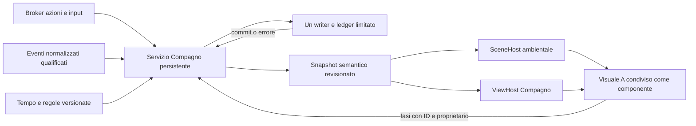

# Compagno v0.11 — revisione dell'analisi dopo le consegne Acquario e Apple Calm

**20 novembre 2026 · revisione 1 · sola analisi**

Questa revisione aggiorna [analisi](v010-companion-analysis.md), [specifica](v010-companion-functional-spec.md) e [ricerca](v010-companion-online-research.md). I nomi storici `v010-companion-*` restano validi; il rilascio del Compagno è **v0.11**, Memoria/AI **v0.12**. Nessun runtime del cane, asset di produzione, installazione o benchmark sulla board è stato creato qui.

## 1. Baseline e provenienza

- [MasterPlan](release-masterplan.md), revisione **3.42**: **0.10.4-rc.2 / Apple Calm 1.9.1**, documentate come installate il 20 novembre; pannello e tastierino fisici ancora da qualificare per questa consegna.
- [Tema corrente](../../theme-projects/apple-calm/README.md), manifest del bundle e `dashboard/version.py` concordano su queste versioni. Theme API **2.15 / 71 superfici**: riscontro nel contratto locale e nel [report di manutenzione](v0103-maintenance-delivery-2026-11-18.md). Nessuna superficie Compagno esistente viene presupposta.
- Ultimo ambiente target documentato: PC Python 3.12.13/Qt 6.8.2; ARM Python 3.13.5/Qt 6.8.2. L'interprete predefinito del PC non è automaticamente il banco target.
- I report di consegna e i loro manifest identificano i byte qualificati. Il checkout contiene anche ricerca estranea alla distribuzione: il solo `version.py` non certifica la sua distribuibilità. Prima del futuro prototipo selezionare una base verificata e registrare il delta.

Sono riscontri da file locali, **non una nuova osservazione del servizio o della Orange Pi**. Le prove passate sono attribuite alla rispettiva versione, non al futuro cane.

## 2. Risultato del controllo

| Priorità | Problema dell'analisi precedente | Correzione proposta |
| --- | --- | --- |
| P0 | Baseline di ottobre, con il solo avviso di rinumerazione. | Baseline attuale e provenienza esplicite; v0.11 e v0.12 coerenti nei documenti. |
| P0 | Layout fisso fino a y=624, prima dei banner inferiori adattivi. | Composizione nello spazio utile negoziato, anche a scala 110%; regioni sicure aggiornate prima della presentazione del banner. |
| P0 | Tre cure quotidiane incompatibili con i coefficienti di sazietà/compagnia. | Simulazione di sette giorni, alternativa numerica e limiti dichiarati; nessuna approvazione implicita. |
| P0 | Timeout descritto come cancellazione senza effetti anche mentre il commit può essere in corso. | Distinguere animazione, accettazione dell'effetto e transazione; verificare l'esito prima di ritentare. |
| P0 | “Stesso host persistente” esteso implicitamente alla schermata interattiva. | Stato persistente nel servizio; SceneHost ambientale e ViewHost dedicato condividono lo stesso visuale e un solo proprietario attivo. |
| P1 | Animator e C++ ancora trattati come possibilità generiche di accelerazione. | Partire dal percorso di proprietà Qt già qualificato; specializzare solo un collo di bottiglia misurato. |
| P1 | Catalogo di gesti presente, ma vantaggio della progressione e variabilità del gioco incompleti. | Contratto osservabile per sblocchi, durata delle attività e conseguenze delle scelte. |
| P1 | Tenuta continuativa e errori non ancora un lotto concreto. | Gate su GUI reale, code/helper/risorse, storage, callback tardive, clock e riaperture. |

Restano acquisiti **A — Calm illustrato 2D**, accudimento attivo con conseguenze recuperabili, presenza ambientale, pagina propria, gioco/progressione e reazioni agli avvisi. La revisione non cambia queste richieste né approva crescita, voce o conversazione libera.

## 3. Lezioni locali da usare davvero

### Layout, notte e notifiche

La [consegna Apple Calm 1.9.1](../../theme-projects/apple-calm/README.md) adatta l'altezza del banner al testo e aspetta che la pagina riservi spazio. `Main.qml::noticeSafeGeometry` e le metriche dei banner sono integrazioni esistenti da usare. Il pannello Azioni non può occupare sempre la fascia inferiore del vecchio concept.

La palette segue alba/tramonto; il riposo del cane conserva un proprio orario. Luminosità, quiete Avvisi, movimento e sonno sono ingressi distinti. Oggi `SceneHost` è sospeso anche per `night`, `quietActive` e Acquario selezionato: la futura policy del Compagno deve separare questi motivi senza cambiare arbitrariamente la policy degli altri renderer. L'Acquario mantiene la precedenza nella propria scena.

### Conferme e recupero

La [manutenzione 0.10.3](v0103-maintenance-delivery-2026-11-18.md) ha corretto azioni che risultavano concluse al solo accodamento: pending fino all'esito del worker, request ID, retry limitato e fallimenti visibili. Il Compagno deve adottare questa semantica già al primo prototipo funzionale. Un'animazione gradevole non prova che una carezza sia stata salvata.

### Grafica e risorse

Il [report grafico rc.4](v010-aquarium-graphics-fix-report.md) documenta capacità EGL e scanout effettivo: GUI pronta non garantiva pixel corretti. Conservare ponte/configurazione qualificati; il cane 2D non richiede di riaprire driver o cache shader.

Il [confronto ABBA del 30 ottobre](v0102-apple-calm-implementation-report.md#movimento-e-gpu) non ha motivato una conversione globale a Animator. Una trasformazione Qt di proprietà è la base; rig C++/mesh sono candidati circoscritti. Il rig 3D dei pesci dimostra una capacità del progetto, non la qualità di una camminata canina o una ragione per abbandonare A.

La manutenzione ha ridotto scritture invariate e chiuso un lettore inattivo. Applicare al cane aggiornamenti discreti, cache con proprietario, code limitate e nessun processo di sola decorazione residente senza utilità. Misurare GUI/worker reali, non soltanto il supervisore systemd.

## 4. Studio numerico della cura

Esecuzione riproducibile: [simulate-care.py](evidence/v011-companion-review-2026-11-20/simulate-care.py), [risultati JSON](evidence/v011-companion-review-2026-11-20/care-results.json). **12 combinazioni: tre profili per quattro scenari**, sette giorni a passi di un minuto. Sonno 23–07 Europe/Rome; iniziali Sazietà 70, Energia 80, Compagnia 70. Ogni visita completa istantaneamente un pasto, una carezza e un round della palla. Non è il controller reale: niente premi, durata delle azioni, rifiuti, errori o rendering. La settimana scelta non comprende cambio d'ora.

**Controllo indipendente del bilancio giornaliero:** ottobre consuma `16×10 + 8×5 = 200` punti Sazietà; tre pasti offrono al massimo `3×35 = 105`, prima del costo dei round e della saturazione a 100. Compagnia consuma `16×8 = 128`, contro al massimo 105 da tre carezze+round. L'accudimento attivo non basta a stabilizzare quel calendario.

| Caso su sette giorni | Minimo Sazietà | Ore da sveglio con Sazietà <30 | Minimo Energia | Minimo Compagnia |
| --- | ---: | ---: | ---: | ---: |
| Ottobre, visite 08/14/20 | 0 | 92,47 | 0 | 0 |
| Nuovo candidato, visite 08/14/20 | 51 | 0 | 14 | 62 |
| Nuovo candidato, salta la visita delle 14 al giorno 3 | 19 | 2,63 | 14 | 28 |
| Nuovo candidato, solo visite 08/20 | 0 | 64,45 | 20 | 0 |
| Nuovo candidato, visite 08/12/16/20 | 51 | 0 | 8 | 64 |

**Candidato da valutare:** Sazietà −6/h sveglio e −3/h riposo, pasto +45; Compagnia −6/h sveglio; Energia −3/h sveglio, +24/h riposo e −6 per round. Carezza +20 Compagnia e palla +15/−1 Sazietà conservati. Tre visite sono una proposta di calendario, non una preferenza attribuita all'utente.

Risultati utili: saltare una visita ha conseguenze recuperabili; due visite sono insufficienti con questa dose; più round richiedono più riposo. Il profilo intermedio che cambia soltanto sazietà/compagnia continua ad avere Energia minima zero: bilanciare una sola barra non basta. L'energia bassa del candidato completo compare anche nella prima giornata iniziata a 80; restano da studiare riposo diurno, round brevi e stato iniziale. Nessuna promessa che questi coefficienti siano definitivi o divertenti.

**Criterio da concordare:** cura ordinaria sostenibile con il calendario scelto; una visita saltata peggiora temporaneamente lo stato ma le cure successive lo recuperano; gioco ripetuto ha un costo comprensibile. Prima di congelare le regole aggiungere scenari “solo cibo/carezza”, riposo diurno, azioni interrotte e 24–72 h di assenza. Il numero di visite e i minuti reali restano decisioni di prodotto.

### Orologio e recupero offline

Una soglia offline non deve creare cibo: con valore precedente 10, il limite 15 non lo riporta gratuitamente a 15. Per bisogni che decadono usare `min(precedente, max(15, precedente − perdita))`; l'energia segue l'integrazione di riposo, non questa formula.

Proposta di finestra: ultime otto ore dell'intervallo non ancora contabilizzato, terminate al momento del recupero; integrare sveglia/sonno separatamente. Avanzare il riferimento al recupero concluso, così riaprire non ripete la stessa assenza. Durante il processo prevale il tempo monotono. UTC arretrato/futuro non plausibile → stato dell'orologio da verificare, nessuna retrocessione/premio inventato e nuovo riferimento solo dopo riconciliazione esplicita. Il valore “otto ore” resta da concordare; questa revisione precisa la semantica, non approva l'assenza simulata.

## 5. Architettura proposta dopo il controllo

Il diagramma indica riuso del componente, non due cani animati contemporaneamente. Un solo servizio possiede identità, bisogni, legame e azione; un solo renderer alla volta possiede movimento e ricevute. Durante tema candidato/retained exit può esistere una copia statica, priva di autorità sugli effetti. `scene.main` rimane ambientale e non interattivo; `companion.main` è il contratto dedicato da progettare. Non assegnare qui una futura minor API.

**Cadence separate:** integrazione tempo al minuto/ingresso/comando, selezione gesto su evento/scadenza, animazione Qt alla frequenza del display, scritture ai cambi significativi/checkpoint. Niente timer Python per fotogramma, nuovo processo per tre bisogni o NPU ornamentale. C++ resta disponibile per un rig che richiede lavoro frequente misurato.

### Azioni: cinque momenti diversi

1. **Richiesta e ammissione:** validare request ID, epoca del cane, revisione attesa, modalità, risorse e spazio; riservare una sola azione. Feedback “preparazione” immediato, esito di ammissione persistente asincrono.
2. **Esecuzione:** il controller visuale rende il gesto e invia poche fasi identificate. Durata minima semantica e ordine delle fasi sono del servizio; un renderer non può assegnare XP accorciando una clip.
3. **Effetto accettato:** prima di accodare il commit il servizio serializza la decisione fra completamento e cancellazione. Da qui l'azione entra in “salvataggio”; la coda cosmetica può finire o sparire senza cambiare l'effetto deciso.
4. **Transazione:** stato, delta, traguardo e risultato una sola volta nella stessa transazione. Pending non è completata. ID persistente e controllo revisione/epoca proteggono retry/replay; rifiutare richieste troppo vecchie anche dopo la potatura del ledger.
5. **Esito:** confermare solo l'esito reale. Commit già riuscito + risposta persa → leggere il risultato dello stesso ID. `busy` noto → retry limitato, senza ripetere animazione/premio; errore permanente → spiegazione e recupero. Esito ancora indeterminato → verificarlo nel writer prima di lanciare un'azione incompatibile.

**Urgente/uscita:** immediati sul visuale e sull'input. Prima dell'effetto accettato annullano la cura; dopo non cancellano retroattivamente una transazione conclusa/in corso. Timeout della sola animazione non può provare che una scrittura pendente non sia avvenuta. Risorse/QML assenti conservano stato e possibilità di uscita. Il completamento di un'azione non equivale al fatto che il cane sia stato otticamente visto dall'utente.

SQLite non fornisce da solo una garanzia di replay delle azioni di prodotto: occorrono ID e stato persistiti insieme. Proposta iniziale, da misurare sullo store dedicato: rollback journal `DELETE` + `synchronous=EXTRA`; se lettori/concorrenza richiedono WAL, valutarlo con `FULL`, checkpoint e copia coerente. Non cambiare i DB esistenti. Le garanzie dipendono anche da filesystem/flush/hardware. [Transazioni SQLite](https://www.sqlite.org/lang_transaction.html), [synchronous](https://www.sqlite.org/pragma.html#pragma_synchronous), ricontrollati il 20 novembre.

## 6. Esperienza e contenuti da finalizzare

| Oggetto | Proposta concreta | Condizione per chiuderlo |
| --- | --- | --- |
| Primo utilizzo | Nome facoltativo, breve spiegazione delle tre cure, un richiamo senza ricompensa. Il cane esiste prima di una connessione cloud. | Percorso breve col tastierino; disabilitare/riprendere non cancella identità o legame. |
| Azioni | Quattro scelte principali; indicazione di effetto, riposo e salvataggio. La vita del cane non dipende dalla pagina aperta. | Tutti i percorsi hanno uscita/focus coerente e non premiano tasti ripetuti. |
| Palla | Direzione cambia percorso, distanza cambia durata/consumo entro livelli dichiarati; niente fallimento casuale imposto alla persona. La dose del simulatore rappresenta un round standard. | Definire costi breve/standard e riposo; valutare se queste scelte risultano interessanti. |
| Legame | Tre traguardi con gesto/saluto/oggetto disponibili; soglie legate a cure varie e distribuite nel tempo. | Simulare giorni per sblocco, limiti e ripetizioni; niente numero XP definitivo senza quel confronto. |
| Dopo l'ultimo traguardo | Cura, variazioni dei gesti e gioco restano utilizzabili; niente promessa di contenuti infiniti. | Catalogo sufficiente e saluti riconoscibili dopo uso ripetuto. |
| Avvisi | Matrice categoria/stato/freschezza → gesto ammesso; orientamento solo verso un banner davvero presentato. | Non inventare conferme di gol/presenza; limite anche per raffiche di eventi distinti, oltre alla deduplica. |
| Movimento Off | Pose e testo mantengono scelta, durata semantica, cura e risultati; nessuna attesa di un frame che non arriverà. | Stessi effetti delle modalità animate, senza completamenti gratuiti. |

Non sono nuove approvazioni dell'utente. Aspetto stabile, assenza di morte/perdite irreversibili, finestra offline, orari e soglie restano proposte da concordare. Il profilo Cozy riguarda l'aspetto: non modifica nascosto la difficoltà della cura o richiede un nuovo tema per usare il cane in Apple Calm.

## 7. Produzione AI e qualità dell'animazione

Il campione minimo rimane **master A → respiro/sguardo/coda → passo breve → ritorno alla calma**. Il master deve funzionare sia nella scena dedicata sia nel footprint compatto, con proporzioni, appoggi, pivot e parti nascoste coerenti. Tutti gli asset e il codice d'animazione si producono tramite AI in questa chat quando sarà autorizzata la produzione.

Confronto mirato: parti Qt per piccoli gesti; parti + clip per passo/cibo/gioco; mesh nativa solo se elimina difetti che le prime due non risolvono bene. Gli asset del cane non sono modelli dei pesci adattati. Raccordi, occlusioni e contatti delle zampe sono gate separati dai frame software.

Caricare il set della sequenza, non tutto il catalogo all'avvio; conservare residenti fallback e gesti comuni. Cache limitata per dimensioni/numero di set, cancellazione dei caricamenti obsoleti, nessun caricamento crescente a ogni rientro. Quantificare pixel decodificati, copie durante cambio tema e upload. Non derivare i costi dal solo PNG.

Base grafica: `NumberAnimation`/Qt Quick; Animator solo per trasformazioni che non richiedono coordinate QML intermedie e con interruzione coerente. La [documentazione Animator](https://doc.qt.io/qt-6.8/qml-qtquick-animator.html) ricontrollata conferma quella distinzione. Il budget di circa 16,67 ms riguarda l'intera dashboard in movimento; la [guida Qt](https://doc.qt.io/qt-6.8/qtquick-performance.html) richiede lavoro non bloccante e profiling. Nessuna sostituzione globale di animazioni o driver proposta.

## 8. Lotti e gate per rendere il piano eseguibile

| Lotto | Risultato reviewabile | Prova necessaria |
| --- | --- | --- |
| C0 · Regole | Calendario di cura, riposo/assenza, dosi, conseguenze e progressione. | Settimana ordinaria, visita saltata, giornate diverse, rientro e capacità di recupero. Lo screening presente è parziale. |
| C1 · UX/contratti | Pagina, focus, spazio banner, campi/azioni e ownership. | Mock nelle due palette, 100/110%, banner piccolo/grande/urgente, Reduced/Off; compatibilità Base/Functional/Apple. |
| C2 · Campione asset | Un master e la sequenza minima, con metadata/pivot e raccordi. | Stessa identità a dimensioni reali, alpha pulito, piedi stabili; interruzione in ogni fase. |
| C3 · Fetta funzionale | Una cura completa con writer, risultato, ripresa e fallback. | Errore SQLite, ACK perso, retry, callback duplicata/tardiva, uscita prima/dopo effetto, reboot del processo e clock anomalo. |
| C4 · Catalogo | Tre bisogni, palla, sblocchi e matrice eventi. | Nessun premio doppio, input ripetuto, rientri/cambio tema e raffica di notifiche. |
| C5 · Qualifica | Pacchetto esatto, dati/rollback e misure sul target. | PC target/ARM/EGLFS, cold/warm, concorrenza consentita, HID e pannello; durata sullo stesso artefatto. |

C0/C1 sono analisi e progettazione. C2 avvia produzione di asset/animazioni, C3–C5 implementazione e qualifica: **non eseguiti da questa revisione**.

Proposta di gate prestazionale da fissare prima del prototipo: distinguere callback, cambi di posa, presentazioni software e latenza ottica; registrare p50/p95/p99, intervalli >33,3/>50 ms, pausa massima e input→riscontro/urgente→sospensione. Nessuna soglia p95 di 16,67 ms imposta ai callback come se fossero misure GPU. Confrontare cane spento/attivo a stesso artefatto, tema e carico. Nessuna richiesta di renderizzare continuamente una posa statica.

Uso continuo: campioni GUI validati tramite heartbeat PID/token/ascendenza; distinguere GUI/worker/cgroup. Rientri e cambi tema ripetuti, crescita di texture/FD/thread, scritture e code, helper inattivi, shutdown ordinato e errori storage. Pianificare 30 min mirati, poi 8–24 h di uso misto quando autorizzato; il gate finale deve dichiarare durata/artefatto realmente provati. Nessuna soglia arbitraria di CPU/RAM o certificazione del cane ereditata dai pesci.

## 9. Verifiche di questa revisione e residui

Eseguiti lettura mirata dei documenti/sorgenti pertinenti, ricontrollo online di quattro riferimenti tecnici Qt/SQLite, studio aritmetico delle 12 combinazioni e controlli strutturali dei documenti. `scripts/check-dashboard.py --list` identifica cinque casi rapidi disponibili; nessuno qualifica documenti di analisi o il Compagno assente. Non sono state lanciate suite runtime/GUI o prove sulla board.

Residui prioritari: scegliere calendario e assenza; completare il confronto con riposo/azioni parziali; fissare tempi/costi del gioco e soglie/sblocchi; definire la matrice degli eventi effettivi e l'integrazione delle geometrie; poi approvare master/campione di animazione. Il modello usato per scrivere il progetto non sostituisce alcuna di queste evidenze.
