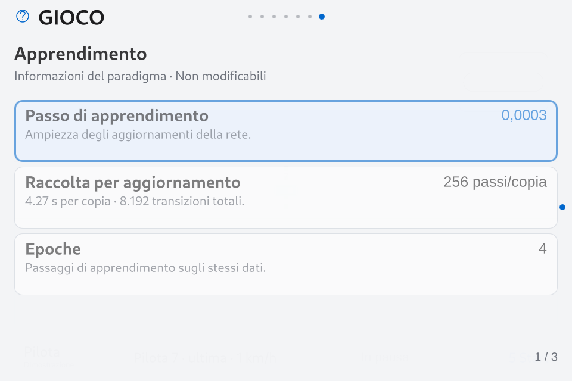

# Gioco · guida bilanciata e motore CPU · rc.15

**14 ottobre 2026 · Implementato e installato sulla Orange Pi 4 Pro · 0.9.0-rc.15 · manifest 595 file · API 2.11.**

Seguito autorizzato degli studi [incentivi e sottosterzo](game-reward-balance-study.md) e [GPU/NPU e parallelismo](game-gpu-npu-parallel-study.md). I sei paradigmi/preset personali restano fissi. Questa consegna modifica il protocollo di allenamento e il motore di esecuzione; non costituisce una certificazione della competenza dei piloti.

## 1. Obiettivo implementato

`balanced-driving-1`, curriculum `corner-control-1`, fisica float64 `f2-1`, ingressi `driving-memory-1` a 68 canali. [Contratto effettivo](../game_rewards.py), [episodi](../game_academy.py), [trainer](../game_academy_trainer.py).

| Componente | Regola effettiva |
| --- | --- |
| Progresso valido | 10 punti per lunghezza del giro; gli esercizi brevi usano 2 punti per distanza obiettivo. Il credito conserva frontiera, cancelli e protezioni contro i tagli. |
| Giro pulito | +3 a ogni giro completo pulito, anche in continuo. Un giro sporco non blocca quelli successivi. |
| Tempo | Costo da 0,5 a 2 punti per tempo di riferimento, con pressione progressiva dopo controlli affidabili. Il riferimento nominale deriva da lunghezza, aderenza e 9 m/s; non è un record. |
| Fuori pista | −0,5 all'ingresso, −2 per tempo di riferimento trascorso fuori. Nessun premio ai metri esterni o al rientro volontariamente ripetuto. |
| Ritiro/contatto | −3 al ritiro; il medesimo evento fatale non riceve anche il costo del contatto. Impatti recuperabili: costo proporzionato alla gravità. |
| Sottosterzo dannoso | Piccolo costo integrato, massimo 1 per tempo di riferimento. Richiede movimento, domanda anteriore eccessiva, deriva >0,14 rad e margine/direzione in peggioramento per almeno 0,25 s; escluso il fuori pista. |
| Esercizio/rientro | +2 al successo di un esercizio breve; +0,5 per il compito Rientro. Recuperare un'uscita ordinaria permette di riprendere progresso e giri puliti. |
| Sorpasso | +0,5 solo dopo incontro verificato e mantenuto; una ricompensa per avversario e fascia di giro, per impedire scambi artificiali ripetuti. |
| Stallo | −0,5 una volta, conservando la distinzione fra immobilità improduttiva e blocco nel traffico. |
| Regolarità | Solo PPO-Smooth: costo moderato dello scarto fra comando sterzo e attuatore, escluso quando il detector segnala perdita di controllo. |

Ogni reward di episodio riconcilia la somma dei termini nominati. Nella selezione Evo/NEAT, un ritiro anticipato riceve inoltre il costo temporale della parte inutilizzata della finestra, registrato separatamente in `selectionUnusedTime`: interrompere il tentativo non evita il costo del tempo. Questa correzione non viene aggiunta come ritorno terminale nascosto a PPO.

Nessun premio diretto per acceleratore, freno, centro pista o velocità massima; nessuna frenata automatica imposta agli agenti. Detector e coefficienti sono una prima taratura, non valori ottimi dimostrati su tutti i circuiti/auto.

## 2. Cambiamenti per metodo

| Pilota | Implementazione |
| --- | --- |
| Evo | Nuovi esercizi di ingresso curva e obiettivo normalizzato. Due discendenti esplorano bias di pedale più bassi nei pesi; restano candidati da valutare, senza cambiare il comando a runtime. |
| NEAT | Identici esercizi; esplorazione del bias solo su nuovi discendenti, elite conservati. Forward nativo sparso con stessa topologia, ordine di somma e attivazioni. |
| PPO | Actor, distribuzione gaussiana e optimizer personale conservati. GAE λ passa a 0,99 nel nuovo protocollo; gamma mantiene la scala temporale di 40 s, rollout 256/4,267 s per copia e clip/KL rimangono quelli dichiarati. Il critic viene rivalutato al cambio della scala dei ritorni. |
| PPO-Smooth | Come PPO, mantenendo separato il costo di regolarità; una correzione in perdita di controllo non viene scoraggiata dal costo. |
| Clone | Maestro esplicito solo per le etichette, rete autonoma alla guida. Replay numerico circolare da 2.048 esempi, batch 128 con quota di frenata quando disponibile, campionamento cronologico/ripresa deterministici. |
| Pure Pursuit | Riferimento geometrico congelato, nessun apprendimento. Qualifica e Gara mantengono il requisito del giro misurato. |

La nuova fase **Ingresso curva** segue Partenza; parte prima della curva con velocità diverse e distanza di 140 m. Non cambia il significato degli ingressi già appresi: il codice temporale riusa Controllo. Nel continuo vengono proposti anche ingressi curva, mantenendo il mondo continuo. La pressione sul passo cresce solo dopo affidabilità/retention; per PPO/Clone entra ai confini dei nuovi tentativi/finestre.

## 3. Migrazione e riproducibilità

Il primo **Start** migra una copia del checkpoint del percorso scelto. L'installazione non allena né migra i piloti originali.

- Conservati identità, preset fissi, pesi dell'actor/rete, topologie e stream RNG personali, passi e tempo già registrati, memoria, storico e versioni qualificate.
- Il checkpoint originale resta un artefatto immutabile; il nuovo conserva `sourceCheckpoint`, RewardSpec e provenienza nella sessione.
- Fitness con scale diverse, rollout pendenti e vecchi valori del critic non sono confrontabili: vengono invalidati. Il nuovo episodio comincia da un confine dichiarato; non riprende metà episodio con una reward diversa.
- La reinizializzazione del critic usa uno stream separato, non consuma la sequenza casuale dell'actor. Gli esempi Clone compatibili rimangono etichette valide.
- Pausa/ripresa conserva anche risultati fisici già preparati ma non ancora applicati, e i pacchetti dei processi persistenti. Le transizioni vengono applicate una volta, in ordine. JSON stretto: solo il campo fisico `finish` usa `null` per un arrivo non ancora avvenuto; altri valori non finiti non vengono ignorati.

Le qualifiche restano attribuite a una policy congelata e alla configurazione fisica. Il tempo di Qualifica resta distinto dalla reward. Trasferire conoscenza su altra pista non trasferisce automaticamente un tempo ufficiale.

## 4. Dove lavorano CPU, GPU, NPU e RAM

| Risorsa | Scelta |
| --- | --- |
| CPU | Fisica float64 raggruppata per mondi solitari compatibili; geometria/sensori nativi float64; NEAT sparso nativo; learner/Adam e coordinamento. |
| CPU aggiuntive | Quattro gruppi persistenti per Impara sorpasso con 32 copie su Ovale 1/Varano, sulla Orange Pi 4 Pro verificata. Parent: rete, update, ordinamento, preview e salvataggi; figli: ambienti e bot congelati. |
| GPU | Rendering Qt Quick/OpenGL. Il compute sintetico non ha mostrato un vantaggio rispetto alla CPU nativa sul core ad alta capacità; backend compute non selezionato. |
| NPU | Nessun nuovo carico attivato: non è stata dimostrata convenienza per queste reti piccole/topologie diverse e per pesi che cambiano frequentemente. |
| RAM | Buffer numerici riusati, cache batch LRU di 16 forme, replay Clone 2.048 esempi; copie private e processi disponibili senza un tetto RAM artificiale. |

Ricostruzione: eseguire `scripts/build-game-native.sh <directory-runtime>` sulla macchina di destinazione, poi rigenerare/verificare il manifest. Il compiler produce la libreria per la propria architettura; per la board occorre ARM64. Questa consegna contiene la libreria compilata e verificata sulla board, non quella x86 del PC.

Nessun cambio di driver/governor/affinità della Dashboard. Un thread BLAS per worker/processo. Libreria ARM precompilata `libsmartpc_game_native.so`; sorgente C incluso, fallback NumPy se non disponibile. Per traffico restano distinti i domini di collisione: i mondi non vengono fusi come se fossero una gara comune.

La policy automatica è deliberatamente limitata a board/configurazioni misurate. Due processi sono stati confrontati ma non selezionati. Sulle altre piste/carichi resta il percorso singolo; nessuna deduzione per 64/128 copie. I gruppi sono on-demand e vengono chiusi con la sessione.

## 5. Misure isolate sulla scheda

[Raggruppamento: 30 casi](evidence/v09-balanced-runtime-2026-10-14/batch-matrix.json); [traffico: 15 casi iniziali](evidence/v09-balanced-runtime-2026-10-14/traffic-matrix.json) e [20 conferme](evidence/v09-balanced-runtime-2026-10-14/traffic-confirmation.json); [baseline corretta: 4 casi](evidence/v09-balanced-runtime-2026-10-14/baseline-confirmation.json). Sei secondi per caso dopo startup, processi indipendenti, copie dei piloti reali; nessun GameStore originale. Inclusi trainer/update, esclusi GUI/preview. Gli attivi e i picchi per tick sono nel JSON.

| Metodo | Solo Ovale, transizioni/s | Solo Varano, transizioni/s | Traffico Ovale 1→4 gruppi | Traffico Varano 1→4 gruppi |
| --- | ---: | ---: | ---: | ---: |
| Evo | 2.544 | 870 | 213→267 (+25%) | 188→258 (+37%) |
| NEAT | 2.216 | 943 | 217→277 (+28%) | 187→252 (+35%) |
| PPO | 1.428 | 937 | 220→267 (+21%) | 185→254 (+38%) |
| PPO-Smooth | 1.261 | 779 | 219→267 (+22%) | 183→251 (+37%) |
| Clone | 938 | 768 | 190→229 (+21%) | 166→224 (+35%) |

Il solo raggruppato supera tutti i casi a 2/4 gruppi sullo stesso circuito/metodo: frammentare il batch introduce IPC e matrici più piccole. Il confronto senza kernel/batch nel trainer nuovo conferma Evo/NEAT circa 302/312 transizioni/s sull'Ovale e 279/276 su Varano. I 40 casi preliminari conservati in `execution-matrix-before-batch.json` precedono una correzione del caching: sono diagnostici storici, non la baseline definitiva.

**Capacità reale:** 32×60 richiede 1.920 transizioni/s sostenute. Evo/NEAT superano quella soglia aggregata nel campione Ovale, ma gli attivi diminuiscono durante i tentativi: non è prova che tutte le 32 auto siano sempre a 1×. PPO, Clone, Varano e traffico rimangono sotto. La vista Pilota indipendente e la cadenza di presentazione a 30 Hz sono misure diverse. Nessun FPS ottico o risparmio in watt è ricavato da queste prove.

## 6. Reward e controlli funzionali

[25 prove congelate](evidence/v09-balanced-runtime-2026-10-14/frozen-balanced-rewards.json), cinque seed accoppiati per comportamento, Ovale/continuo; nessun update. Ritorni mediani: fermo −0,593; sterzo geometrico+tutto gas −1,956 (cinque ritiri); riferimento prudente 13,866; riferimento 18,729; riferimento rapido 27,792. Giri puliti: 0/0/5/5/10. Il riferimento rapido rimane premiato maggiormente, senza premio diretto al freno.

[20 ingressi curva](evidence/v09-balanced-runtime-2026-10-14/reference-bend.json): cinque seed per quattro piste, tutti risolti dal riferimento con rilascio/frenata dove utile. Dimostrano risolvibilità dell'esercizio, non apprendimento automatico di Evo/PPO.

[12 gate mirati](../check_game_balance.py): migrazione senza perdita di pesi/genomi/RNG; sensori su bordi/esterno e quattro piste; forward NEAT esatto; giri continui premiati una volta; feedback prima del ritiro senza alterare azioni; esercizi con velocità/etichette diverse; esplorazione nei pesi; fisica raggruppata identica per snapshot/reward/sensori; pausa nel mezzo del batch; ring Clone dopo wrap; processi seriali/persistenti equivalenti per cinque metodi sia con sia senza raggruppamento; selezione limitata ai carichi misurati.

Superati [86 controlli PC](evidence/v09-balanced-runtime-2026-10-14/pc-regression-final.txt) e [12 gate ARM](evidence/v09-balanced-runtime-2026-10-14/board/arm-balance.txt), inclusi Accademia, modalità, memoria, record, circuiti, ottimizzazione e pacing. Corrette due aspettative obsolete dei test che permettevano Gara senza un tempo di Qualifica e un confronto basato sul numero di chiamate `tick` anziché sulle transizioni: la regola di produzione non è stata allentata.

## 7. UI, qualifica nativa e consegna

Le impostazioni mostrano il protocollo del percorso salvato e il motore effettivo; prima della migrazione indicano **Al prossimo Start**. GAE viene letto dal checkpoint del pilota scelto, non dal draft del menu. Nel dossier: gas/rilascio/freno come distribuzione dei campioni, secondi di perdita di controllo rilevata e pressione sul passo. Non sono misure di competenza o percentuali di energia.

PC: tre temi, pause/ripresa, Qualifica→Gara con due riferimenti realmente qualificati, layout Apple a scala testo 1,1 e parametri PPO λ0,99 verificati. Clock software circa 30 Hz, riferimento Pilota circa 1×; massimo dell'intero walkthrough comprende caricamenti e va separato dagli intervalli del movimento.

**Consegna verificata:** [ricevuta finale](evidence/v09-balanced-runtime-2026-10-14/final-receipt.json), [manifest ARM](evidence/v09-balanced-runtime-2026-10-14/release-manifest.json), [stato della board](evidence/v09-balanced-runtime-2026-10-14/board/installed.json).

- Sei piloti e **1.989 artefatti**, tutte le tabelle/dati originali del gioco e preferenze conservati; nessun training/reset implicito durante l'installazione. Il numero attuale è acquisito in questa consegna, non dedotto dalla precedente rc.14.
- Hash di tutti i 595 file conformi; servizio `active/running`, `NRestarts=0`, GUI pronta senza pending, Base attivo. Stesso boot, nessun reboot OS. Rollback `/opt/smartpc/dashboard-rc14-before-balance`; backup `/var/backups/smartpc-before-balance-20261014-105816`.
- EGLFS 960×640: Base/Evo 32 tentativi, Functional/NEAT maturo, Apple/modalità e Qualifica reale→Gara 2, Apple/impostazioni e dossier. Nessun warning QML. Pausa Base 22,8 ms nel campione.
- [NEAT maturo, prima prova](evidence/v09-balanced-runtime-2026-10-14/board/mature-neat-first.json): 20 s, 1,00107×, clock 30 Hz, p95 45,40 ms, p99 **67,52 ms**, massimo 83,85 ms. Funzionalità superate; p99 oltre il limite predisposto di 66,67 ms. Installazione fermata prima dello switch.
- [Ripetizione mirata](evidence/v09-balanced-runtime-2026-10-14/board/mature-neat-repeat.json), stesso carico e durata: 0,99998×, clock 30 Hz, p95 45,83 ms, p99 **63,11 ms**, massimo 89,20 ms. Soglie predisposte superate nel secondo campione. Entrambe le misure sono conservate: il risultato non dimostra un limite universale o l'assenza di scatti su uso lungo.
- [Apple/modalità e Qualifica→Gara](evidence/v09-balanced-runtime-2026-10-14/board/apple-final.json): clock 30 Hz, preview circa 1,00070×. Intervalli durante movimento p95 36,01/p99 36,17/massimo 55,98 ms; i soli 33 intervalli in movimento limitano la rappresentatività. Le pause/staticità di una rete non ancora competente generano lunghi intervalli nel conteggio generale dei frame: non sono automaticamente un blocco del clock.
- [Base/Evo](evidence/v09-balanced-runtime-2026-10-14/board/base-evo-32.json) verifica tentativi/selezione/salvataggio. Il suo conteggio frame comprende anche fasi statiche e navigazione del walkthrough; non viene usato come gate dei 30 fps continui.
- [Impostazioni Apple](evidence/v09-balanced-runtime-2026-10-14/board/apple-settings.json) e [dossier](evidence/v09-balanced-runtime-2026-10-14/board/apple-dossier.json): percorso selezionato, λ0,99 reale dopo Start, descrizioni a scala testo 1,1, storia e reset selettivi su dati privati.

Il primo avvio del verificatore UI era privo di un renderer del corpus diagnostico, escluso correttamente dalla distribuzione runtime. Aggiunto al solo progetto privato; [errore iniziale](evidence/v09-balanced-runtime-2026-10-14/board/qualification-install-first.log) conservato. Entrambi gli stop di qualifica hanno ripristinato il servizio originale. I renderer diagnostici non sono stati aggiunti al runtime installato.

Screenshot EGLFS e `frameSwapped` sono evidenza di rendering software sul dispositivo, non misura ottica del pannello o del keypad.

## 8. Seguito scientifico distinto dall'implementazione

- Confronto a budget uguali e cinque seed per metodo, scenari riservati, varianza/critic/tempo pulito e retention Ovale→Varano→Ovale. Coefficienti e λ sono una prima versione da misurare su apprendimento prolungato.
- Traffico con contatti/ritiri per km/incontro, regole sportive e sorpassi realmente utili; non certificato dal miglioramento di throughput.
- Per-auto 1× sostenuto con tutti i 32 attivi, carichi maturi/ampliati, misure ottiche/input e uso lungo.
- GPU compute/NPU solo con un carico che dimostri precisione e beneficio; eventuali ibrido/SAC restano release successive.

Questi sono esperimenti di efficacia e capacità estesa, non parti di codice dichiarate mancanti in rc.15. I piloti apprendono solo dopo Start; questa installazione non li trasforma automaticamente in piloti competenti o qualificati.

## 9. Riscontro di apprendimento dopo la consegna

[Analisi Evo in produzione, 14 ottobre](game-evo-learning-stall-analysis.md): le verifiche funzionali della rc.15 non attestavano convergenza. Il checkpoint reale dopo 31 nuovi aggiornamenti mostra 800 tentativi di curva senza arrivo e predominanza del freno. Un confronto congelato non favorisce la popolazione nuova. Il seguito proposto corregge curriculum/elite/ripasso e valuta l'eventuale reset su copie; nessuna nuova modifica runtime o reset effettuati da questa analisi.

**Seguito attuato:** la [rc.16](v09-evo-progressive-report.md) implementa il percorso Evo progressivo e documenta screening, cinque seed, risultati e limiti. Conservati i pesi originali; nessun reset generale. La fotografia e i gate rc.15 sopra restano storici.
