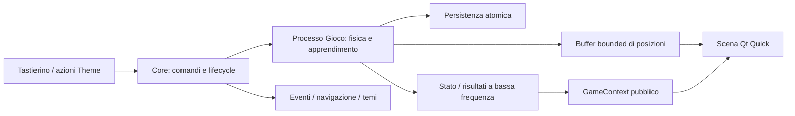

# v0.9 · Gioco / Auto che impara — studio di fattibilità, GUI e UX

## Stato implementazione · 11 ottobre 2026

**Aggiornamento rc.3:** [impostazioni comprensibili e miglioramento del tempo](game-settings-speed-study.md) implementati e installati dopo autorizzazione: menu senza legenda, descrizioni secondarie/valore distinti, Controllo/Passo, campione verificato e Progressi dei tempi. [Report e gate ancora aperti](v09-game-settings-pace-report.md). Geometrie/tavole successive nel testo conservano lo studio storico.

La candidata corrente è 0.9.0-rc.3; la [consegna rc.2](v09-game-implementation-report.md) conserva le prove precedenti. Il testo seguente conserva lo studio precedente; i candidati numeric9/30 sono sostituiti da race-32-v1, rete 32→16→2 e fisica f1-2. NPU verificata nella rc.2 con una politica appresa, CPU scelta dopo misure; PPO/NEAT e guida nel traffico restano da qualificare.

10 ottobre 2026 · revisione GUI/UX 4 · layout/tavole r2 · S0, approfondimento progettuale · SmartPC / DeskPulse · 960×640.

**Stato: analisi e concept, senza implementazione o installazione del gioco.** Le immagini sono tavole disegnate offline con dati inventati e dichiarati dimostrativi. Non provano apprendimento, prestazioni Qt, uso della NPU o leggibilità sul pannello fisico. L'inventario e le prove NPU del [primo studio](npu-ai-games-study.md) sono le evidenze hardware disponibili; qui non sono stati ripetuti benchmark o interventi sulla scheda.

**Direzione aggiornata con l'utente:** display **3,5″ orizzontale, 960×640, rapporto 3:2**. Pista quasi a tutto schermo, senza titolo locale "Auto che impara" e senza pannello laterale. Header del sistema, arena **912×496** e fascia informativa **912×48**; stato, generazione e auto osservata sono compatti. Pista e veicoli condividono la stessa scala fisica. Durante Impara/Gara/Prova/Campione le frecce controllano la scena: **4/6 auto precedente/successiva**, **2/8 visualizzazione precedente/successiva**. **5 Pausa** arresta il calcolo e, dopo conferma, restituisce le frecce alla navigazione ordinaria. Questa revisione sostituisce la precedente proposta pista/pannello 624+272 e le frecce sempre dedicate alla navigazione.

Il primo algoritmo resta su sensori numerici e apprendimento CPU in un processo dedicato; NPU da confrontare sulla politica fissa. La famiglia propone ora **Pista / Classifica / Progressi**; Classifica e Progressi si raggiungono dopo la pausa. Piloti persistenti, profili individuali e F1 2D standard sono definiti nello [studio piloti e simulazione](game-drivers-simulation-study.md). Le tavole r2 non rappresentano ancora Gara e la nuova Classifica.

**Approfondimento algoritmi, 10 ottobre:** lo [studio Evoluzione / PPO / NEAT](game-learning-algorithms-study.md) completa S0 con ricerca tecnica e aggiorna la semantica dei futuri backend: auto indipendenti, politica condivisa PPO, contatori/passaggi/checkpoint specifici, selezione del metodo a sessione ferma e confronto NPU del campione. Questa è un'estensione dell'analisi, non una nuova qualifica delle tavole r2; quelle mostrano la baseline evolutiva.

## 1. Scopo e risultato dello studio

Questo documento rende disegnabile il modulo prima di scriverne il runtime: requisiti, punti di integrazione, alternative di layout, stati, messaggi, comandi, provenienza dei dati, movimento, risorse e criteri di accettazione. Le scelte marcate **proposte** sono specifiche candidate da verificare nelle fasi S1–S5 del [MasterPlan](release-masterplan.md); nessun PASS del futuro prodotto è implicito.

| Domanda | Risposta attuale | Prova ancora necessaria |
| --- | --- | --- |
| Possiamo costruire un ovale 2D a camera fissa? | Soluzione progettuale compatibile con Qt Quick e la risoluzione disponibile. | Geometria, collisioni e disegno nativo S1/S4. |
| L'auto può imparare localmente? | Piccola rete ed evoluzione hanno un costo teorico contenuto. | Miglioramento riproducibile e giri validi S1, sostenibilità S2. |
| La NPU è funzionante? | Due modelli di esempio eseguiti nel primo studio. | Conversione e confronto della nostra politica S3. |
| Possiamo addestrare sulla NPU? | Non dimostrato dal runtime consultato. | SDK e aggiornamento pesi; non requisito v0.9. |
| Avremo 60 FPS durante il training? | Obiettivo plausibile con scena statica e poche auto. | Profilazione sulla board sotto carico, inclusi provider e avvisi. |
| Possiamo dedicare risorse dopo Start? | Sì come politica del nuovo worker, con budget e stop espliciti. | Non implica sospensione automatica dei provider esistenti. |
| La GUI sarà coerente? | Geometria, token e tastierino ricavati dal sistema corrente. | Fallback dei temi, testi ingranditi, EGLFS e lettura fisica. |

## 2. Che esperienza vogliamo offrire

L'utente apre Gioco, vede subito la pista e capisce che il calcolo è fermo. Con Start osserva tentativi, errori e miglioramento. Può fermarsi in qualunque momento e ritrovare il campione salvato. Deve comprendere tre cose senza aprire dettagli: **cosa sta facendo il sistema, quanto bene sta guidando, quale tasto lo ferma**.

La vista permette osservazione e selezione dei tentativi: non si chiede all'utente di pilotare. Le collisioni sono parte dell'esperimento, non errori dell'applicazione. Il comportamento interessante è visibile nella traiettoria; numeri e grafici servono a interpretarlo. Evitare premi fittizi, percentuali di "AI completata", livelli arbitrari e promesse del tipo "impara in due minuti".

Distinguere i modi nel titolo di stato:

- **Impara:** si valutano tentativi e si modificano i pesi tra generazioni nella baseline Evoluzione/NEAT; PPO alterna raccolta e aggiornamenti della politica condivisa. Durante gli episodi il sottotitolo può dire "Prova i tentativi"; alla selezione "Prepara la prossima generazione".
- **Gara:** più piloti già addestrati nello stesso mondo, ciascuno con la propria rete congelata; posizione/giro reali, risultati a fine gara.
- **Prova:** valuta snapshot congelati dei piloti su scenari comuni; nessun apprendimento, risultati pubblicati secondo il regolamento della Classifica.
- **Campione:** guida il modello migliore salvato, con pesi fissi. Può eseguire nuovi episodi, ma non sta imparando.
- **Replay:** futura riproduzione di posizioni registrate. Esclusa dall'MVP; non usare questo nome per l'inferenza di un campione.
- **Pausa:** movimento e simulazione fermati e confermati dal worker; eventuale salvataggio ha un esito separato.

## 3. Riscontri nel sistema attuale

| Punto letto | Conseguenza per il progetto |
| --- | --- |
| [Main.qml](../Main.qml), `activateKeyImpl`, `navigateFamily`, `navigateView` | Comandi globali e frecce di navigazione sono la baseline. La nuova route Gioco deve intercettare le quattro frecce durante Simulazione, preservando urgenze e overlay; richiede un contratto esplicito. |
| [Shell Apple Calm](../../theme-projects/apple-calm/bundle/qml/Shell.qml) | Header 56 px, margini 24 px, titolo di famiglia, indicatori di famiglia/vista e area stato già esistenti. Riutilizzare la shell. |
| [TopicDashboard Apple Calm](../../theme-projects/apple-calm/bundle/qml/TopicDashboard.qml) e [studio landscape](v086-landscape-graphic-study.md) | Baseline con titolo locale a y≈70 e contenuto da y=120. Gioco propone una variante di geometria dichiarata: nessun titolo locale, arena da y=72 e fascia 48 px; conserva margini, raggi e token. |
| [Manifest Apple Calm](../../theme-projects/apple-calm/bundle/theme.json) | Font Cantarell e numeri Liberation Sans; palette giorno/notte e textScale del tema. Non introdurre un'estetica arcade separata. |
| [app.py](../app.py) | Molti servizi nascono all'avvio. Il futuro worker Gioco deve caricare simulatore e dipendenze pesanti dopo Start. |
| [network.py](../network.py), `setVisible` | La visibilità non sospende il polling Rete. Non assegnare automaticamente tutte le risorse al gioco ignorando la freschezza. |
| [theme_api.py](../theme_api.py), [theme_contexts.py](../theme_contexts.py), [registro presentazioni](../presentations/registry.json) | Nuove superfici, contesti e azioni richiedono contratti pubblici e fallback. Il percorso ad alta frequenza delle auto va separato dai riepiloghi del broker. |
| [studio movimento](theme-engine-motion-spec.md) | Normal / Reduced / Off richiedono un comportamento esplicito anche per questa vista. Le proposte storiche vanno confrontate con il runtime corrente. |

Il riferimento visivo osservato è una [cattura EGLFS Apple Calm già disponibile](evidence/v087-sport-live-fix-2026-10-10/board-proof/eglfs-apple/f1-qualifying-finished.png). Dimostra il sistema precedente, non la nuova vista. La baseline usata nello studio è core 0.8.7-rc.3 / Theme API 2.7 / Apple Calm 1.6.2; una futura integrazione dovrà verificare nuovamente le versioni effettive.

## 4. Architettura dell'informazione

Famiglia proposta `game` / Gioco, attivabile da Moduli e dopo Rete nella sequenza corrente. Tre viste: **Pista**, **Classifica** e **Progressi**, senza pagina introduttiva obbligatoria. Pista non ha un titolo locale: Gioco nella shell e il nome del circuito nei dettagli sono sufficienti.

| Destinazione | Contenuto | Accesso |
| --- | --- | --- |
| Pista | Arena grande, fascia compatta, auto osservata. | Default; 5 Start / Pausa / Riprendi. |
| Classifica | Gare concluse e categoria separata Prova standard, configurazione e risultati da modelli congelati; nessuna valutazione automatica aprendo la vista. | 2/8 da fermo; 5 apre consultazione/dettagli pilota. |
| Progressi | Grafico e risultati della sessione ferma, per pilota. | 2/8 soltanto in controllo Navigazione. 5 apre dettagli. |
| Menu Gioco | Modalità, velocità, salvataggi, nuova sessione e dettagli tecnici. | 9; la sessione attiva viene sospesa. |

In **Navigazione** 2/8 scorrono Pista / Classifica / Progressi, 4/6 cambiano famiglia. In **Simulazione** quei quattro tasti hanno esclusivamente funzioni locali; non aprono altre pagine. La shell mostra il contesto di controllo corrente e non suggerisce una navigazione che in quel momento è bloccata.

Nessun campione al primo accesso: stato Pronto, 5 Start. Un modulo non disponibile o un checkpoint incompatibile ha una spiegazione distinta; non trasformare dati assenti in zero. Il carico pesante nasce solo dopo Start.

## 5. Composizione nativa: la pista occupa lo schermo

### Layout scelto nella revisione 2

| Elemento | Rettangolo nativo, px | Regola |
| --- | --- | --- |
| Shell | 0, 0, 960, 56 | Riutilizza famiglia, palette, font e area stato. |
| Margine sopra arena | y=56–72 | 16 px; nessuna riga "Auto che impara". |
| Arena | x=24, y=72, w=912, h=496 | Una sola superficie, radius 24; niente sidebar o titoli interni permanenti. |
| Area utile pista | x=44, y=92, w=872, h=456 | Padding 20; unica trasformazione uniforme del mondo. |
| Fascia compatta | x=24, y=576, w=912, h=48 | Stato/generazione, auto, richiamo dei comandi e 5. |
| Margine inferiore | y=624–640 | 16 px; nessuna seconda legenda o footer 1–9. |

L'arena occupa **73,6% dell'intero display** e **91,2% delle due superfici arena+fascia**. Rispetto alla prima card pista 624×504, l'area della superficie cresce del **43,8%**. L'ovale dimostrativo passa da 568×252 a **864×432**: area del suo rettangolo **2,61 volte maggiore**. Questi sono confronti geometrici delle tavole; non una misura del tempo di rendering.

L'ovale viene centrato con margini uniformi, non deformato per riempire il contenitore. La card non contiene più "Ovale", "Pista fissa · vista dall'alto", legenda, conteggio tentativi e numeri grandi. Nome pista, campione, popolazione, giri e storico stanno in Menu/Progressi. Un solo richiamo compatto alle frecce è giustificato dal loro cambio di funzione.

La fascia in attività può essere: **Impara · G12 | Auto #1 | 4/6 Auto · 2/8 Vista | Tutte | 5 Pausa**. È una specifica candidata verificata nelle tavole, con font 22–24. In pausa: **Pausa | 2/8 Viste · 4/6 Moduli | 9 Menu | 5 Riprendi**. Il tasto 5 resta nello stesso punto.

### Circuiti più articolati

La stessa arena accetta una geometria chiusa diversa dall'ovale, attraverso bounding box, trasformazione uniforme e checkpoint della pista. Il concept "Circuito futuro" dimostra l'ingombro di più curve e rettilinei a pari dimensione del veicolo. Non è una pista generata, un ambiente implementato o una geometria già validata per collisioni.

Una fascia fissa fuori dall'arena evita di cercare spazio libero nell'infield di ogni circuito. Un eventuale HUD sovrapposto richiederebbe zone libere verificate e un fallback: non è la soluzione scelta in questa revisione. Il pannello laterale del primo studio rimane nelle evidenze storiche, ma non guida più l'implementazione.

### Preview e display fisico

Ogni tavola nuova è esattamente **960×640**. La preview conserva il rettangolo 3:2 anche in una conversazione stretta: si scala come immagine di un dispositivo, non diventa una pagina verticale. I tasti interattivi di prova stanno sotto il dispositivo e non consumano pixel dell'arena. La diagonale di 3,5″ è nominale: lettura e dimensioni attive del pannello si verificano sulla board.

## 6. Informazioni: soltanto quelle utili mentre guida

Durante attività: **modalità/stato, generazione se Impara, identificativo dell'auto, visualizzazione corrente e 5 Pausa**. Non mostrare una tabella di rete neurale o due KPI grandi. In Campione, "Pesi fissi" sostituisce la generazione. Il record non cambia perché si seleziona un'altra auto.

Un cambio auto aggiorna evidenziazione e identificativo; un cambio visualizzazione aggiorna Tutte / Solo auto / Sensori. Le altre statistiche sono consultabili da fermo. Il raggiungimento di un giro non genera una finestra sopra la pista: resta registrato in Progressi e può avere un breve messaggio non invasivo nel posto dello stato.

| Dato di dettaglio | Definizione | Regola |
| --- | --- | --- |
| Generazione | Ciclo reale di valutazione/selezione. | Incremento a selezione confermata; nessun incremento preparato dal renderer. |
| Avanzamento | Checkpoint ordinati del primo giro, 0–100%. | Mai "AI completata"; in Progressi/dettagli dell'auto. |
| Giro migliore | Tempo simulato di giro valido, per pista/configurazione. | "—" prima del primo giro, mai 0,0 s. |
| Giri validi | Completamenti con finestra dichiarata. | Distinguere sessione, episodio e storico. |
| Popolazione / visibili | Es. 32 simulati, 4 disegnati. | Nel dettaglio, indipendenti dal numero di auto osservate. |
| Campione | Individuo completato e persistito, versione ambiente. | Distinguere candidato corrente, record e modello realmente salvato. |

Record sul giro e migliore fitness possono appartenere a individui diversi; associare sempre l'identità. Quando manca lo stream, congelare le posizioni e mostrare "Sessione interrotta" nella fascia. L'orologio non continua a simulare attività. Errori lunghi usano un pannello temporaneo con sessione ferma; il layout normale non conserva spazio vuoto per messaggi eventuali.

## 7. Proporzioni realistiche e geometria unica

**Unità del mondo in metri; pixel soltanto nel renderer.** Proposta iniziale, non dati di un modello commerciale: veicolo lungo **4,4 m**, largo **1,8 m**, passo **2,65 m**; pista larga **10 m**. L'auto ha rapporto lunghezza/larghezza **2,44:1**, la corsia è larga **5,56 auto**. Si può in seguito scegliere un veicolo diverso, cambiando insieme sprite, collisioni e parametri fisici.

Per l'ovale delle tavole: bounding box esterna **144×72 m**, raggio esterno 36 m, raggio della linea centrale 31 m, due rettilinei da 72 m. Scala **6 px/m**: pista esterna 864×432 px, corsia 60 px, auto **26,4×10,8 px**. Uno stesso fattore scala x/y, carrozzeria, ruote, collisioni, sensori e checkpoint. Niente auto ingrandite solo graficamente o ovale stirato separatamente sugli assi.

Trasformazione: `s = min(Wutile / Wmondo, Hutile / Hmondo)`; centratura del bounding box; `pixel = origine + s × metri`. Margini includono ingombro della corsia, corpo dell'auto e marcatori. Un tema può cambiare palette, contorni, infield e materiali; non ridimensionare l'auto indipendentemente dalla pista.

La diagonale nominale 3,5″ e il rapporto 3:2 danno un'area teorica circa **74,0×49,3 mm**. In questa ipotesi l'auto è lunga circa **2,0 mm** sul pannello: geometria proporzionata, riconoscibilità da verificare fisicamente. Per renderla trovabile usare **alone di selezione e numero esterni alla carrozzeria**, senza cambiare dimensione apparente del veicolo. L'alone è un marcatore, non area di collisione.

1. **Scena statica:** bordi definiti, superficie neutra, traguardo a scacchi; nessuna camera che insegue.
2. **Auto realistiche dall'alto:** sagoma proporzionata, ruote e parte anteriore distinguibile; lo stesso orientamento usato dalla fisica.
3. **Auto selezionata:** accento, numero e alone; altre auto neutre. Identità stabile nell'episodio.
4. **Collisione:** corpo orientato verificato dal simulatore, non un punto senza dimensione. Disegno e contatti condividono coordinate. Raggi misurati da punti definiti sul veicolo.
5. **Tentativi Impara:** copie indipendenti tra loro, sovrapponibili nel disegno; ciascuna può contenere bot/piloti congelati del curriculum di traffico. In **Gara** le auto sono concorrenti nello stesso mondo, con percezione degli avversari e contatti secondo regole qualificate; non confondere le due semantiche.
6. **Sensori:** cinque raggi della sola auto selezionata; in questa visualizzazione le altre auto si possono nascondere per chiarezza. Nessuna pioggia di linee per tutta la popolazione.
7. **Reset episodio:** nessuna interpolazione da arrivo a partenza; azzerare il buffer delle trasformazioni, preservare camera e geometria.
8. **Circuiti futuri:** stesso veicolo e larghezza strada, più curve all'interno dell'area disponibile. Verificare auto da almeno 24 px di lunghezza come soglia candidata, da qualificare fisicamente: con 4,4 m richiede s≥5,45 px/m. Con area 872×456 corrisponde a un bounding box al massimo circa 159,9×83,6 m. Non superare il limite riducendo a pochi pixel il veicolo senza dichiararlo.

Il generatore futuro deve rispettare larghezza, raggi percorribili, distanza tra rami, continuità, assenza di intersezioni indesiderate e ordine checkpoint. Una pista più complessa può avere più curve senza diventare più grande. Se non passa il fit/validazione, rigenerare o indicare indisponibilità; zoom e camera mobile sono una decisione successiva.

**Simulazione, requisito aggiornato:** il modello cinematico F0 resta una baseline S1; il prodotto propone una dinamica F1 2D contenuta per la vettura standard, con trazione/frenata, velocità laterale e limiti di aderenza. Prima asfalto asciutto; cataloghi separati preparano gomme, fondi/condizioni e vetture future. Drift avanzato, sospensioni, aquaplaning e contatti fra avversari restano successive fattibilità. Lo [studio simulativo](game-drivers-simulation-study.md) definisce stato, gate e scelta F0/F1: proporzioni geometriche non certificano realismo fisico.

La rete 7→16→2 resta il riferimento F0. La F1 candidata usa numeric9 (cinque distanze e stato dinamico locale) e rete 9→16→2, da qualificare; versioni incompatibili non condividono automaticamente pesi/record. Il renderer non determina il comportamento o la fitness. Selezionare un'auto e cambiare visualizzazione non cambia sensori, difficoltà o pesi.

## 8. Percorsi utente aggiornati

### Primo accesso e Start

1. Apri Gioco → pista grande, Pronto e 5 Start; nessun lavoro pesante.
2. Il nome della famiglia rimane nella shell; nessun titolo locale o spiegazione sopra il circuito.
3. 5 → Avvio e controllo **Simulazione**: le frecce non possono uscire dalla famiglia mentre si prepara il worker.
4. Conferma + primo snapshot → Impara o Campione, 5 Pausa; appare il richiamo `4/6 Auto · 2/8 Vista`.
5. I dati sono reali; nessuna percentuale di apprendimento inventata.

### Mentre guida

1. 4/6 scelgono il precedente/successivo individuo disponibile della generazione. Ordine stabile; nessun cambio pagina.
2. 2/8 scorrono i modi **Tutte → Solo auto → Sensori**, nei due versi.
3. La pista resta interamente visibile e la camera ferma. Se cambiano i sensori mostrati non cambiano quelli che riceve la rete.
4. Il frame evidenzia l'auto confermata dal canale render; una richiesta di un'auto ancora non disponibile non produce un'identità falsa.
5. 5 è il percorso normale per fermare il calcolo e ritornare alla navigazione.

### Pausa e ritorno ai comandi del sistema

1. 5 Pausa → Pausa in corso; frecce temporaneamente ignorate, senza coda.
2. Il worker interrompe nuovi passi a un confine sicuro e conferma lo stato consistente.
3. Solo dopo ack → Pausa e controllo **Navigazione**; la fascia cambia in `2/8 Viste · 4/6 Moduli`.
4. Ora 2/8 aprono Progressi, 4/6 cambiano famiglia, 9 apre Menu; 5 Riprendi richiede un nuovo avvio esplicito.
5. Save fallito non equivale a worker ancora attivo: pausa e persistenza hanno esiti distinti. Timeout pausa → Sessione interrotta, recupero del worker, poi navigazione.

1 Home e 7 Indietro restano uscite globali che chiedono pausa; 3 Inbox e 9 Menu sospendono il lavoro prima/durante l'overlay. L'utente ha specificato il blocco delle quattro frecce: queste eccezioni conservano il percorso globale del sistema e non riprendono automaticamente. L'urgenza può sempre interrompere e acquisire l'input.

### Guardare un campione e nuova sessione

Da fermo Menu → Guarda campione, se compatibile; 5 Start esegue la rete salvata con pesi fissi. Anche in Campione le frecce sono locali e 5 Pausa restituisce Navigazione. Cambiare modalità richiede pausa e un nuovo Start.

Nuova sessione conferma l'eventuale abbandono del lavoro non salvato, con focus iniziale Annulla. Campione persistito preservato; cancellazione di tutti i file distinta. Nessun reset sulla pressione prolungata di 5, Home o Indietro.

## 9. Macchina a stati e verità operativa

| Stato | Messaggio / azione primaria | Evento di uscita |
| --- | --- | --- |
| Pronto, senza salvataggio | "Premi Start per iniziare" / 5 Start | Start accettato → Avvio. |
| Pronto, checkpoint disponibile | "Sessione salvata disponibile" / 5 Riprendi | Caricamento validato; modalità salvata dichiarata. |
| Avvio | "Avvio"; frecce trattenute | Primo snapshot + conferma → modalità scelta; timeout → Errore con controllo restituito. |
| Impara | Generazione e risultato / 5 Pausa | Pausa, uscita, overlay, urgenza, fault o limite termico. |
| Campione attivo | "Modello salvato · pesi fissi" / 5 Pausa | Stesse interruzioni, nessuna modifica dei pesi. |
| Pausa in corso | "Pausa in corso"; frecce ignorate | Ack del worker → Pausa/Navigazione; timeout → Interrotta e recupero controllato. |
| Pausa | Motivo breve / 5 Riprendi | Start esplicito, cambio modo o chiusura. |
| Salvataggio | "Salvo il campione" / azione momentaneamente disabilitata | Esito persistenza; navigazione globale sempre disponibile. |
| Errore salvataggio | "Sessione in pausa · salvataggio non riuscito" / 5 Riprova | Nuova scrittura riuscita oppure uscita; conservare il precedente file valido. |
| Interrotta / worker guasto | "Sessione interrotta" + istruzione / 5 Riprova | Nuovo worker e sessione/epoch; scartare messaggi del precedente. |
| Limite di carico | "In pausa per temperatura/carico" / 5 Riprova quando consentito | Condizione rientrata + azione utente. Nessuna ripartenza automatica. |
| Salvataggio incompatibile | "Campione di una versione precedente" / 5 Nuova sessione | Nuova sessione; file precedente preservato per eventuale migrazione. |

Ricevere un comando non significa averlo eseguito. Ogni comando ha richiesta, accettazione/rifiuto ed esito operativo. Separare `runState`, `controlMode`, `mode`, `pauseReason`, `saveState`, `workerState`: un unico enum non deve nascondere una pausa riuscita con salvataggio fallito.

Durante Avvio e Pausa in corso ignorare ripetizioni di 5; niente coda di toggle. Su interruzione, fermare prima la produzione di nuovi passi; attendere solo operazioni brevi limitate. Un processo che non risponde viene terminato e il checkpoint recuperabile resta quello già confermato. Il valore candidato di 250 ms per pausa si misura sul lavoro fermo; non sul solo cambio dell'etichetta.

## 10. Tastierino: due contesti espliciti

| Tasto | Navigazione, sessione ferma | Simulazione, Impara / Gara / Prova / Campione | Overlay |
| --- | --- | --- | --- |
| 2 / 8 | Vista precedente / successiva. | Visualizzazione precedente / successiva: Tutte, Solo auto, Sensori. | Riga precedente / successiva. |
| 4 / 6 | Famiglia precedente / successiva. | Auto precedente / successiva, ordine stabile. | Regole dell'overlay corrente. |
| 5 | Pista: Start/Riprendi. Progressi: dettagli. | Richiede Pausa; nessun toggle accodato. | Conferma. |
| 1 | Home. | Uscita globale con pausa. | Home secondo il core. |
| 7 | Indietro. | Uscita globale con pausa. | Annulla/chiudi. |
| 3 | Inbox. | Richiesta di pausa + Inbox. | Router globale. |
| 9 | Menu. | Richiesta di pausa + Menu. | Menu attuale. |

`controlMode = navigation | simulation` è esplicito e derivato dal lifecycle core, non dalla presenza visiva dell'auto, dal frame corrente o dal tema. Start accettato acquisisce il controllo; Pausa confermata lo restituisce. Avvio/Pausa in corso sono stati di transizione che trattengono le frecce senza eseguire nuove selezioni o navigazioni.

**Precedenza del router candidata:** urgente → operazione tema/overlay → Gioco attivo/transitorio → navigazione ordinaria. La route Gioco consuma 2/8/4/6/5 quando pertinente; non lascia passare la stessa pressione alla navigazione. Anche `navigation.family.step` / `navigation.view.step` dal broker devono rispettare il blocco, con rifiuto qualificato o richiesta di pausa esplicita. Azioni non urgenti non possono aggirarlo attraverso un secondo ingresso.

Selezione auto e modo visivo sono operazioni di presentazione; non alterano episodi, policy, mutazioni o velocità. Se la selezionata termina, conservarne la posa finale fino al termine generazione oppure al cambio utente; indicare lo stato nei dettagli. Alla nuova generazione mantenere l'indice se valido, altrimenti il primo disponibile, con aggiornamento atomico di ID/posizione. Campione singolo: 4/6 senza altra auto non navigano e non producono un errore.

Quando si seleziona un individuo non attualmente disegnato, il worker ne pubblica la posa nel budget del canale, sostituendo uno slot secondario. Nessuna richiesta di 32 snapshot per rendere possibile la selezione. Identificativo della generazione e ID individuo evitano di selezionare un'auto del processo precedente.

**Protezione dalle pressioni ripetute:** nessun buffer di frecce attraversa il cambio Simulazione→Navigazione. Una freccia mantenuta non deve trasformarsi in una raffica di cambio modulo dopo 5. Verificare eventi repeat/rilascio nel layer input; dove oggi esiste solo `keyPressed`, l'estensione del contratto input è un lavoro esplicito. Non promettere guida manuale continua con segnali discreti.

Focus dell'azione 5 stabile; selezione auto attraverso le frecce non sposta il focus della shell. Richiamo breve della mappa nella fascia; indicatori di famiglia/vista inattivi durante Simulazione, riattivati dopo pausa. Lo sblocco non dipende dal solo cambio di etichetta sul pulsante.

## 11. Menu: poche scelte comprensibili

L'opzione Gioco vive nel Menu attuale, senza inventare un secondo sistema di overlay. Raggruppare le righe; scorrimento e indicatori rimangono quelli del sistema.

| Riga | Regola proposta |
| --- | --- |
| Metodo: Evoluzione / PPO / NEAT | Estensione proposta: scelta a sessione ferma, backend disponibile solo dopo qualifica; nuovo metodo apre sessione/checkpoint separati. |
| Modalità: Impara / Gara / Prova / Guarda campione | Da fermo: pilota/profilo per Impara; partecipanti/snapshot e regole/griglia per Gara. Start solo con almeno due piloti compatibili. Prova standard separata; modello assente/incompatibile con motivo. |
| Salva e termina | Da sessione attiva chiede pausa, poi scrive checkpoint; "Salvato" solo a conferma di persistenza. |
| Velocità: Osserva / Veloce | Default Osserva = tempo simulato vicino al reale. Veloce disponibile dopo qualifica S2, fattore effettivo indicato. |
| Visualizzazione: Tutte / Solo auto / Sensori | Stessa scelta comandata da 2/8 durante Simulazione; displayMode persistente, sensori della sola selezionata. |
| Nuova sessione | Conferma se abbandona lavoro non salvato; preserva campione precedente. |
| Dettagli | Motore reale CPU/NPU, popolazione, passi/s, frame software, temperatura e ultima scrittura; nessun indicatore NPU inventato. |

Numero di tentativi, coefficienti della fitness, mutazioni e architettura della rete rimangono nel profilo sperimentale, non nella schermata principale. Se servono a uno studio avanzato, esporli in una pagina tecnica successiva con profili validati; evitare parametri liberi che possano bloccare il kiosk.

## 12. Progressi e valutazione dell'apprendimento

La pagina Progressi consulta una sessione ferma. Quanto segue descrive la baseline Evoluzione/NEAT. Per PPO usare passi/aggiornamenti reali; per il confronto fra metodi usare valutazioni su scenari comuni e asse passi totali oppure tempo attivo, come nello [studio algoritmi](game-learning-algorithms-study.md). Non equiparare generazioni e aggiornamenti. Un solo grafico principale **miglior avanzamento valido per generazione** prima del primo giro, con assi espliciti Generazione / Avanzamento %. A completamento può selezionare il tempo dei giri, separato dal primo grafico: non unire percentuali e secondi su una linea.

Mostrare osservazioni per generazione e, se utile, il record cumulativo con etichette distinte. Il record non può scendere per definizione; non spacciarlo per miglioramento continuo della popolazione. Giri validi, tempo al primo giro e confronto con baseline casuale restano nel riepilogo/dettaglio. Un intervallo mancante nel log è un buco, non una linea interpolata presentata come prova.

Conservare finestre bounded: proposta ultime 100 generazioni a schermo, aggregazione esplicita per storico lungo e archiviazione limitata. Prima dei dati il grafico è sostituito da "I progressi compariranno dopo i primi tentativi". La data/versione dell'ambiente accompagna lo storico; record di circuiti o configurazioni diversi non vengono confrontati come identici.

Il primo ovale può favorire strategie quasi ripetitive. Il criterio tecnico include partenze variate, semi di valutazione separati e un ovale con dimensioni diverse. Fitness più alta e un giro sul training non provano generalizzazione. Obiettivi candidati: miglioramento in quattro semi su cinque rispetto alla baseline casuale, poi giro entro cinque minuti in quattro prove sulla pista facile. Rivedere le soglie dopo S1 senza nascondere gli esiti negativi.

## 13. Tipografia, colore e densità

Riutilizzare i token, non copiare una palette hardcoded nel futuro renderer. Le tavole Apple Calm usano i valori effettivi del tema per mostrare la continuità; Base e Functional potranno rappresentare gli stessi dati con i propri stili.

| Ruolo | Giorno Apple Calm | Notte Apple Calm |
| --- | --- | --- |
| Sfondo | #F3F4F6 | #111216 |
| Superficie | #FFFFFF | #202228 |
| Testo | #1D1D1F | #F5F5F7 |
| Secondario | #5D626C | #ADB2BD |
| Accento | #0066CC | #79B8FF |
| Focus | #E7F0FF | #293B54 |
| Avviso / errore | #8A5200 / #AD2525 | #EEC06B / #FF9696 |

Titolo di famiglia 32 px; nessun titolo locale su Pista. Fascia con stato e dati 22–24 px, numeri compatti; i grandi valori sono riservati a Progressi/dettagli. Numeri allineati e a larghezza tabulare quando cambiano. La corsia usa una superficie neutra; marcatore/numero identificano l'auto insieme al colore. Non usare rosso per un semplice tentativo fallito.

Con `textScale=1.1` eliminare prima il nome del modo visivo o abbreviare la generazione; fascia sempre 48 px e geometria 3:2. Errori lunghi in un pannello temporaneo, con calcolo fermo e testo completo. Vietato troncare "salvataggio non riuscito" lasciando solo "salvataggio". Anche la preview mantiene il rettangolo del dispositivo; i comandi di prova esterni non appartengono ai suoi 960×640 pixel.

Colori, contorni e stato testuale devono rendere il messaggio riconoscibile anche senza distinguere le tinte. I rapporti di contrasto sono controllati sulle tavole, usando W3C come riferimento qualitativo; questa analisi non certifica WCAG per una GUI nativa. [Uso del colore, W3C](https://www.w3.org/WAI/WCAG22/Understanding/use-of-color), [contrasto del testo, W3C](https://www.w3.org/WAI/WCAG22/Understanding/contrast-minimum).

## 14. Movimento, Quiet e tema

| Preferenza | Comportamento proposto |
| --- | --- |
| Normal | Movimento delle auto interpolato; transizioni brevi secondo il tema; nessuna camera mobile. |
| Reduced | Stessa informazione di guida, senza scie, zoom, bounce, lampeggi e transizioni decorative; campione singolo come scelta iniziale consigliata. |
| Off | Nessun movimento continuo: pista statica, statistiche a frequenza ridotta, snapshot soltanto su richiesta nei dettagli. Apprendimento può continuare dopo Start, stato "Impara · movimento disattivato". |
| Quiet/notte | Palette notturna e volume coerenti con sistema; non avvia o ferma automaticamente training. Nessun suono del motore previsto nell'MVP. |

Off è una decisione proposta da accettare e testare nell'integrazione: non introdurre silenziosamente un'eccezione alle preferenze perché "è un gioco". Reduced preserva il movimento funzionale dell'auto; se l'utente vuole evitarlo del tutto ha Off. [Animazione e interazione, W3C](https://www.w3.org/WAI/WCAG21/Understanding/animation-from-interactions).

Cambio tema a caldo: richiesta di pausa prima della transazione; il contenuto si ricrea nello stato fermo, buffer trasformazioni azzerato e worker senza passi nuovi. A fine cambio non si riprende automaticamente. Presentazioni senza supporto Gioco usano un fallback core compatibile; il cambio del tema non deve perdere un campione o duplicare un processo.

## 15. Avvisi, overlay e priorità

- **Urgente:** il sistema di eventi conserva priorità e comandi attuali; gioco chiede pausa immediatamente, l'overlay non aspetta il disco. Alla chiusura resta Pausa con motivo "Avviso urgente".
- **Inbox e Menu:** calcolo sospeso mentre l'utente consulta; al ritorno Riprendi. Una finestra modale non nasconde un'attività pesante ancora attiva.
- **Banner non urgente:** usare le zone e il contratto di disponibilità esistenti. Proposta per Gioco: annunciare disponibilità solo quando un banner può essere ospitato senza coprire auto primaria, stato o tasto 5; altrimenti l'evento conserva il percorso Inbox/indicatori previsto dal core. Nessun nuovo filtro che sopprima urgenze.
- **Home/altre viste:** richiesta di pausa idempotente in un unico lifecycle, non collegata separatamente a ogni tasto. La stessa regola copre azioni broker, disattivazione modulo e riapertura della shell.
- **Perdita dello stream:** pista ferma con dicitura ultimi dati; non estrapolare indefinitamente un'auto oltre l'ultimo campione reale.

La scelta del banner piccolo/grande va verificata con l'implementazione attuale del broker e con lo studio notifiche in corso: il modulo dichiara le proprie zone, non riscrive ranking o acknowledge degli eventi.

## 16. Architettura tecnica proposta

Processo dedicato per isolare GIL/carico Python, poter terminare un worker guasto e misurare CPU/RAM proprie. Qt e QObjects rimangono nel processo GUI. Protocollo IPC bounded con ultime posizioni sostitutive: se QML è in ritardo, scartare snapshot intermedi, non accumulare secondi di guida nella coda. Piccolo numero di slot/auto preallocati e trasformazioni aggiornate; non distruggere e ricreare tutti i delegati a ogni frame.

Il renderer mantiene pista statica e aggiorna posizione/rotazione. Preferire geometria/asset statici scene graph; evitare Canvas che ridisegna tutta la superficie continuamente. Le raccomandazioni Qt su lavoro asincrono e profilazione motivano questa scelta, ma il suo costo sulla nostra board resta da misurare. [Prestazioni Qt Quick 6.8](https://doc.qt.io/qt-6.8/qtquick-performance.html), [Canvas](https://doc.qt.io/qt-6.8/qml-qtquick-canvas.html).

### Frequenze e integrità

| Canale | Ipotesi iniziale | Regola |
| --- | --- | --- |
| Fisica | Passo fisso 1/60 s simulato. | Non dipende dal frame grafico; in Veloce più passi per secondo reale. |
| Politica | Ogni passo fisico. | Eventuale decimazione è un esperimento misurato sulla guida. |
| Posizioni IPC | 20–30 Hz iniziali. | Sequence, tempo simulato, sessionId, episodeId, trackRevision. |
| Rendering | Obiettivo 60 FPS. | Interpolazione tra snapshot coerenti, niente smoothing attraverso reset/collisioni. |
| Statistiche | Fino a 2 Hz / evento generazione. | Revisioni coerenti, nessuna copia dei pesi verso QML. |
| Storico | Generazione completata. | Persistenza/aggregazione fuori dal thread UI. |

Interpolazione fra due snapshot confermati introduce un ritardo grafico limitato, candidato di un intervallo IPC. Segnalare e misurare quel ritardo. Interpolare angoli con distanza minima; nessuna posizione sintetica usata per fitness o collisioni. Su vecchio snapshot congelare; scegliere il timeout con S2/S4 (ipotesi iniziale 250 ms reali), distinguendo rallentamento, pausa e fault. Non disegnare un'auto come ancora attiva dopo un episodio terminato.

Per i backend aggiuntivi, ritmo statistiche/storico include fine valutazione e aggiornamento PPO oltre alla generazione. Il renderer non interpola attraverso un autoreset: identità ambiente ed episodio distinguono i tentativi PPO. La fase “Aggiorna rete” può tenere ferme le pose e conserva la cattura delle frecce.

### Contratti candidati, da registrare

Superfici `game.track`, `game.progress`, `game.details`; famiglia `game`. La nuova arena senza titolo deve dichiarare la propria geometria e le zone banner, non spostare indiscriminatamente gli altri moduli. Azioni whitelisted `game.start`, `game.pause`, `game.mode.select`, `game.save`, `game.session.new`, `game.sensors.set`, `game.car.select`, `game.display.select`. I nomi sono proposte, non API già esistenti. Requisiti del broker: validazione schema/permessi/superficie, ticket, limiti, esito; il tema non invia comandi shell né carica modelli arbitrari.

`GameContext` contiene disponibilità, mode/runState/controlMode/saveState, displayMode, selectedCarId, motivo pausa/errore leggibile, sessione/versione pista, generazione, avanzamento, giro, data campione, motore reale e capability. Stato unavailable/stale/error esplicito; dato assente distinto da zero. Il canale render contiene solo coordinate/rotazioni/identità bounded, non tutto il contesto a 60 Hz. Coordinate in metri e matrice uniforme applicata dal renderer preservano proporzioni; textScale non modifica dimensioni fisiche o scala delle auto. Tema e fascia conoscono arena e input capture.

`sessionId` e un epoch del worker separano processi riavviati; sequence scarta messaggi fuori ordine, trackRevision scarta geometrie vecchie. Checkpoint include versione schema, versione ambiente/fitness, seed, generazione, pesi, metadati record e, per ripresa evolutiva fedele, popolazione e stato RNG. Salvare soltanto il campione consente nuovi tentativi da quel modello, ma non una ripresa identica della generazione interrotta: l'etichetta deve dichiararlo.

L'estensione multi-algoritmo aggiunge capability/motori separati, passi e aggiornamenti reali, `policyVersion` e selezione del metodo; `generation` è opzionale e la selezione PPO identifica ambiente/episodio. I checkpoint qui descritti sono evolutivi: per NEAT servono specie/innovazioni, per PPO valutatore/ottimizzatore e confine di rollout. Tutti i dettagli e le proposte di pausa sono nello [nuovo studio](game-learning-algorithms-study.md), senza registrazione di API in questa analisi.

## 17. Risorse e condizioni di sostenibilità

Le prove precedenti hanno trovato circa 5,27 GiB RAM disponibili e inferenza NPU funzionante; sono campioni del 10 ottobre, non risorse prenotate. Rete 7→16→2: per 32 auto × 60 decisioni/s, circa 276.480 MAC/s teorici per i soli pesi. Collisioni, sensori, copie, Python, IPC e draw possono costare più della rete.

| Budget candidato | Come verificarlo |
| --- | --- |
| Popolazione 16 / 32 / 64 iniziale, estensioni 128 / 256 | Tempi generazione, passi/s e tempo al primo giro, stessa fisica e semi. PPO confronta copie ambiente, non popolazione di politiche; profili ampliati nello [studio algoritmi](game-learning-algorithms-study.md). |
| Auto visibili 1 / 4 / 8 | Frame pacing e leggibilità con sovrapposizioni reali. Popolazione non cambia per il solo numero visibile. |
| Tutta la RAM disponibile, senza tetto fisso | Indicazione aggiornata dell'utente: rilevare disponibilità dopo Start e durante la sessione, picco worker/GUI, allocazioni utili e rilascio alla chiusura; niente swap indotta dal gioco. |
| Risposta software ai comandi p95 ≤150 ms | Tempo input→stato di richiesta presentato; separato dall'arresto reale. |
| Pausa calcolo ≤250 ms | Ack dopo nessun nuovo passo; provare durante sensori/selezione/scrittura e su fault. |
| Obiettivo 60 FPS | Distribuzione frame interval, p95/p99, frame lenti, input; prova con carico e termica stabilizzati. |
| Checkpoint periodico | Ipotesi massimo uno ogni 30–60 s reali e su uscita/record rilevante, scritture bounded. Misurare I/O su SD; non salvare ogni frame/giro. |

Nessun pinning CPU/governor o limitazione dei provider prima di S2. Profilare con dashboard completa; ridurre prima snapshot, decorazioni/auto secondarie e frequenza del grafico. Se il simulatore resta lento, ridurre popolazione/velocità e dichiarare il profilo; non alterare arbitrariamente il passo fisico per mostrare 60 FPS.

Misurare CPU per processo, tempi sensori/collisioni/rete/selezione, IPC, RSS, swap, temperatura, passi/s reali e simulati. Per NPU: carico iniziale, costo completo decisione inclusi trasferimenti e parità numerica/azioni; la YOLO installata non serve a guidare l'auto. Un motore CPU valido permette la prima release; la NPU può essere utile per modelli futuri più grandi se il confronto lo conferma.

La soglia termica non viene inventata da questa analisi: deriva dai trip point reali e dalla qualifica hardware. Un controller futuro applica hysteresis e limiti validati. Prima riduce il carico dove verificato; se non basta mette in pausa con motivo. Nessun loop automatico Start/Stop che oscilla o riprende mentre l'utente è altrove.

## 18. Salvataggi, offline e reboot

L'MVP funziona senza rete; i dati del gioco sono locali. Persistenza sotto la directory dati SmartPC con schema/manifest propri, file temporaneo nello stesso filesystem, flush e sostituzione atomica; conservare un precedente checkpoint valido e gestire l'esito del sync secondo la qualifica. "Salvato" richiede successo reale, non solo lavoro accodato.

Crash o spegnimento recuperano l'ultimo checkpoint validato; non si promette conservazione degli ultimi secondi. Alla ripartenza la dashboard carica metadati leggeri e mostra sessione disponibile, nessun training automatico. Campione corrotto: scartare il file invalido dal caricamento, spiegare il limite e offrire precedente valido o nuova sessione, senza cancellare in silenzio i file utili alla diagnosi.

Checkpoint e record associano track/config/fitnessVersion. Se incompatibili, evitare di confrontare un record della vecchia pista con quella nuova. Migrazione è un lavoro esplicito. Log bounded e rotazione; niente fotogrammi continui o dataset su SD nell'MVP.

## 19. Perimetro v0.9 e sviluppi successivi

| v0.9 iniziale | Dopo qualifica dell'ovale |
| --- | --- |
| Ovale asfalto asciutto, camera ferma, vettura/gomme standard e dinamica F1 candidata. | Cataloghi di circuiti, vetture, gomme/fondi/condizioni; generatore dopo validazione. |
| Piloti persistenti, Impara/Gara/Prova/Campione, Pausa, Classifica e Progressi; Gara condivisa 2 piloti, 4 come obiettivo candidato. | Replay registrato, campionati, scia/urti con danni dopo studio. |
| Profilo automatico misurato, dettagli essenziali. | Editor pista/iperparametri e modo manuale se richiesti. |
| Evoluzione fissa, training CPU; esperimento prioritario campione NPU S3. | PPO poi NEAT con gate propri; politica visiva/CNN e confronto CarRacing-v3. |
| Contesti/azioni Theme e fallback. | Asset/scenografie aggiuntive che rispettino il budget. |

CarRacing-v3 resta un riferimento: osservazione RGB 96×96, tre controlli continui e tracciati generati. Non è l'ambiente già scelto per la prima implementazione: il nostro ovale numerico riduce pipeline e rende diagnostica/collisioni più controllabili. [Documentazione Gymnasium](https://gymnasium.farama.org/environments/box2d/car_racing/).

La sequenza del MasterPlan rimane v0.9 Gioco → v0.10 Compagno → v0.11 Memoria/scene AI → v1.0 stabilità integrata. Questa analisi approfondisce S0 e prepara S1/S4, senza anticipare automaticamente nuove release.

## 20. Verifiche e criteri di accettazione

| Gate | Prova necessaria | Stato oggi |
| --- | --- | --- |
| G1 · Ambiente | Collisioni swept/checkpoint, determinismo e F1 standard: trazione, frenata, aderenza, bassa velocità e convergenza del passo. | Da eseguire S1. |
| G2 · Apprendimento | Piloti con stati/pesi propri, cinque semi, baseline, partenza variata e ovale di valutazione; risultati e tempo al primo giro. | Da eseguire S1/S2. |
| G3 · Layout | 960×640 3:2, arena 912×496, fascia 48 px, day/night e scale 1/1.1; fit uniforme anche del circuito complesso, nessun titolo locale su Pista. | Tavole concept verificate offline; QML da qualificare. |
| G4 · Comandi | Cattura frecce attive, 4/6 auto e 2/8 visualizzazione, 5/ack sblocco, repeat/rilascio e broker; overlay/urgente/tema, nessuna ripresa implicita. | Da eseguire S4/S5. |
| G5 · Verità dello stato | Ack tardivo, worker bloccato/terminato, messaggi vecchi, nessun "Pausa" o "Salvato" falso. | Da eseguire S4. |
| G6 · Prestazioni | Matrice popolazione/auto visibili, dashboard completa, 30 min, termica e frame pacing. | Da eseguire S2/S4/S5. |
| G7 · Persistenza | Save lento/fallito, file troncato, reboot e versione incompatibile; campione precedente valido. | Da eseguire S1/S4/S5. |
| G8 · NPU | Conversione, vettori reference, decisioni/guida equivalenti e costo completo. | Due esempi eseguiti; politica di guida non provata. |
| G9 · Temi | Base/Functional/Apple, fallback, hot switch fermo, SDK pubblico aggiornato e lint/runtime. | Da eseguire S4. |
| G10 · Pannello fisico | Auto 26,4×10,8 px e proporzioni fisiche, alone/numero, fascia compatta, contrasto e tastierino a distanza d'uso. | Da eseguire S5; PNG non bastano. |
| G11 · Installazione | Manifest/hash/backup/rollback, preferenze, zero warning inattesi, servizio stabile e reboot. | Nessuna installazione in questo studio. |
| G12 · Piloti/classifica | ID persistenti, selezione di un solo learner, policy congelate/versioni, regole comuni, batch interrotto, pareggi e risultati assenti/precedenti. | Da eseguire S1/S4/S5. |
| G13 · Gara | Sensori/curriculum traffico, mondo comune e azioni sincronizzate, contatti/ritiri, griglia/giri/arrivi, stop di tutti, risultati e interruzioni persistenti; modelli distinti CPU/NPU. | Da eseguire S1/S2/S3/S4/S5. |

Un test di frame software non certifica GPU o latenza ottica. Un layout leggibile sul PC non certifica la lettura a 50–60 cm sul pannello da 3,5″. Le soglie di apprendimento e risorse sono ipotesi da qualificare; risultati insufficienti richiedono una revisione dell'ambiente/carico prima della candidata.

## 21. Tavole della revisione 2 e verifica

Nuove tavole **960×640**, tutte orizzontali 3:2; font e palette Apple Calm, dati dimostrativi:

- [Pronto](evidence/v09-game-ux-study-2026-10-10-r2/pronto.png), [Impara](evidence/v09-game-ux-study-2026-10-10-r2/impara.png), [Pausa / Navigazione](evidence/v09-game-ux-study-2026-10-10-r2/pausa.png).
- [Auto #2 selezionata](evidence/v09-game-ux-study-2026-10-10-r2/auto-2.png), [Solo auto](evidence/v09-game-ux-study-2026-10-10-r2/solo-auto.png), [Sensori](evidence/v09-game-ux-study-2026-10-10-r2/sensori.png).
- [Campione](evidence/v09-game-ux-study-2026-10-10-r2/campione.png), [Errore](evidence/v09-game-ux-study-2026-10-10-r2/errore.png), [Progressi](evidence/v09-game-ux-study-2026-10-10-r2/progressi.png).
- [Menu](evidence/v09-game-ux-study-2026-10-10-r2/menu.png), [Urgente](evidence/v09-game-ux-study-2026-10-10-r2/urgente.png), [Notte](evidence/v09-game-ux-study-2026-10-10-r2/notte.png), [Testo 1.1](evidence/v09-game-ux-study-2026-10-10-r2/testo-110.png).
- [Circuito futuro, stesso veicolo e scala](evidence/v09-game-ux-study-2026-10-10-r2/circuito-futuro.png).

[Renderer offline r2](evidence/v09-game-ux-study-2026-10-10-r2/render_study.py) e [verifiche r2](evidence/v09-game-ux-study-2026-10-10-r2/validation.json). Il renderer usa il helper grafico della prima revisione per font/icone; non importa servizi o avvia il gioco. Le [tavole della prima proposta](evidence/v09-game-ux-study-2026-10-10/overview.png) restano uno storico superato dalla direzione concordata.

La preview permette Start/Pausa, selezione dell'auto e cambio visualizzazione con tasti di prova **esterni al display**. Le posizioni sono fixture statiche: nessuna fisica, apprendimento, misura NPU o promessa di 60 FPS. I numeri fisici definiscono un modello candidato, non il collaudo del pannello.

## 22. Ordine di lavoro raccomandato

1. **S1:** prototipo headless PC, ovale/F1 e collisioni prima della rete, poi un pilota in apprendimento/semi e checkpoint; Gara 2/4 con avversari, curriculum traffico e arrivi prima dell'integrazione GUI. Prima decisione: il compito produce miglioramento visibile entro tempi utili?
2. **S2:** misura isolata sulla board e scelta del profilo 16/32/64; poi convivenza con dashboard. Seconda decisione: quale carico conserva input, avvisi e fluidità?
3. **S3:** politica fissa CPU/NPU e conversione. Terza decisione: vantaggio reale o prima release CPU?
4. **S4:** arena della revisione 2, route Simulazione/Navigazione, lifecycle unico, contesti Theme/fallback; Gara, Classifica/Progressi e copie di errore con dati reali. Validare stato, movimento e persistenza prima di decorazioni.
5. **S5:** candidata installata con evidenze native, test fisico, reboot e sessione lunga. Solo dopo questi gate si può dichiarare il modulo consegnato.

**Conclusione progettuale:** l'ovale 2D numerico è il primo esperimento più controllabile per questa dashboard. La GUI è disegnabile con il linguaggio attuale e un carico grafico semplice; convergenza, 60 FPS e vantaggio NPU restano risultati sperimentali da acquisire. Il prossimo passo concreto è S1, non l'aggiunta di un contatore animato alla shell.

Il confronto di studio S1b può aggiungere PPO/NEAT sul PC prima della vista; la loro disponibilità sul prodotto segue misure di risorse, pause, checkpoint e guida, senza bloccare automaticamente la prima v0.9. Nessuna promessa di modello NPU dinamico durante training.

## 23. Decisioni aggiunte dopo la revisione dell'utente

| Requisito concordato | Decisione di studio | Gate |
| --- | --- | --- |
| Rispetto del display 3,5″ orizzontale | Tavole 960×640, 3:2; preview dello stesso rettangolo, nessun reflow mobile interno. | G3/G10. |
| Più pista, meno scritte | Tolto titolo locale, sidebar e legenda; arena 912×496, fascia 48 px. | G3. |
| Preparazione a circuiti complessi | Bounding box/world units/scala uniforme; esempio futuro, generatore validato successivo. | G1/G3. |
| Proporzioni realistiche | Carrozzeria 4,4×1,8 m, passo 2,65 m, strada 10 m; ingombro collisioni coerente. | G1/G10. |
| Frecce bloccate per la navigazione durante attività | Input capture nel core e nel broker; 4/6 selezione auto, 2/8 visualizzazione. | G4/G5. |
| Fermare con 5 per ritornare ai comandi | Sblocco solo a pausa confermata; repeat/input vecchi non attraversano la transizione. | G4/G5. |

**Impatto sull'engine:** oggi la geometria standard prevede titolo locale e contenuto da y=120; il nuovo host deve esporre una variante di layout per `game.track` con area y=72, senza modificare tutte le superfici. La shell conserva header 56 e preferenze ma riceve lo stato input capture per sospendere indicatori/azioni di navigazione. Asset e temi non decidono quando sbloccare i tasti: lo fa il core dal worker.

**Impatto sui dati:** selezione/mode visivo sono stati UI a bassa frequenza. La rete e l'ambiente restano identici passando da Tutte a Solo auto o Sensori. Il budget di massimo otto veicoli renderizzati non cresce perché si osserva un candidato prima nascosto. Nessuna ricompilazione NPU, modifica del seed o riavvio della generazione per una scelta visiva.

**Impatto sul collaudo:** aggiungere casi Start+freccia ravvicinati, 5+freccia durante ack lento, freccia mantenuta allo sblocco, rifiuto di navigation.step via broker, selezionata morta/ID vecchio, campione singolo, generazione nuova, perdita worker e urgenza. Il test deve osservare destinazione attiva e passi reali, non il solo colore di un indicatore.

**Valutazione:** la maggiore superficie non richiede più auto o più snapshot; con pista statica il lavoro mobile rimane limitato. La memoria/costo di geometria e materiali di un circuito articolato va misurata, ma ampliare il viewport non obbliga ad ampliare il modello neurale. Proporzioni, collisioni, leggibilità e input capture sono i nuovi gate concreti di questa revisione.

## 24. Piloti, Classifica e cataloghi — estensione di prodotto

Lo [studio dedicato](game-drivers-simulation-study.md) amplia il perimetro della prima v0.9: piloti persistenti, F1 standard contenuta, Gara simultanea e Classifica entrano nei requisiti. Si allena il solo pilota scelto dall'utente, lo si salva, poi se ne seleziona un altro oppure si schierano modelli congelati in Gara; nessuna rotazione automatica della rosa. La rosa candidata iniziale è quattro piloti; ogni pilota allena una propria politica e possiede tentativi interni, distinti dal personaggio. Profili diversi non implicano stili già dimostrati.

Classifica offre Gare (arrivi/ritiri delle sessioni concluse) e Prova standard, senza mescolare i due ordinamenti. Gara: griglia/regole definite prima di Start, posizione per giri/avanzamento validi e risultato per arrivo; interruzione utente/worker non è un vincitore. Prova standard con vettura/fondo uguali, cinque scenari comuni candidati e politiche congelate. Ordinamento proposto per prove concluse e tempi validi, dati assenti distinti da zero; nessuna competizione basata sulla fitness privata del pilota. Dettagli e record seguono snapshot/configurazioni versionati. La lista propone quattro righe grandi e consultazione attraverso il pannello del sistema; il layout sarà verificato in S4.

Controlli attivi invariati: 4/6 seleziona auto/tentativo, con pilota proprietario dichiarato; 2/8 visualizzazione; 5 pausa confermata prima della navigazione. In Gara/Prova la stessa cattura protegge la sessione. Gara mantiene arena/fascia approvate: giro/posizione, nome osservato e 5 Pausa; dettagli di griglia/reti fuori dalla pista. Tutte mostra inizialmente 2/4 concorrenti; Solo/Sensori cambia solo il disegno. 5 e urgenti fermano l'intero mondo, inclusi avversari e timer. Aprire Classifica non avvia lavoro pesante. Le superfici candidate includono `game.leaderboard` e `game.driver.details`, con contratti additivi e fallback.

Futuri circuiti, materiali, condizioni e vetture sono cataloghi di dati separati dal renderer/pilota. La prima F1 può richiedere numeric9 e nuovi campioni NPU: le tavole r2 e i conteggi numeric7 rimangono storico/baseline, non prove aggiornate della simulazione. G1/G2/G7/G8/G12 e il nuovo G13 devono essere verificati prima della consegna.
