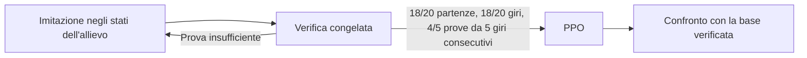

# Gioco · piloti, diagnostica e ricette di apprendimento · rc.18

**15 ottobre 2026 · rc.18 installata · 606 file · Theme API 2.11.**

Attuazione dello [studio su piloti e varianti](game-pilot-fixes-variants-analysis.md). [Ricevuta](evidence/v09-pilot-improvement-2026-10-15/board/final-receipt.json), [evidenze](evidence/v09-pilot-improvement-2026-10-15/). Le capacità software, la competenza delle reti e la selezione scientifica dei preset hanno stati distinti.

## 1. Correzioni e diagnostica

- Il World registra la causa del ritiro: bordo esterno, impatto grave fra vetture, controllo di plausibilità geometrica o causa sconosciuta. Il codice storico `contact` resta leggibile, ma i nuovi episodi hanno `terminationCause`; lo storico privo del dato non viene riclassificato.
- Cause e contatori attraversano snapshot, pause/riprese, batch e processi di raccolta. Le dinamiche e i premi dei piloti standard non vengono cambiati da questa diagnostica.
- Dossier e preview distinguono fuori pista e collisione; i ritiri storici senza causa rimangono espliciti. Il dossier mostra anche comandi con sterzo oltre il 90%, riferiti alla popolazione e al nuovo periodo di osservazione.
- Evo/NEAT conservano i risultati dei singoli scenari del **medesimo candidato selezionato**. Non si combinano il massimo di un candidato e il massimo di un altro come se una sola rete avesse superato entrambi i casi.
- I primi due secondi del tentativo hanno contatori di sterzo per analizzare le partenze a ventaglio. Non viene imposto uno sterzo corretto alla rete.

## 2. Parametri effettivi e maestro

`effective-training-1` è salvato nella sessione/checkpoint e consultabile nel dossier: seed, metodo/variante, numero di candidati o copie, sensori, reward, topologia/inizializzazione NEAT, γ/λ, LR, rollout, epoche, batch, clip e KL PPO, versione della ricetta e maestro. Uno storico che non contiene il descrittore resta **non ancora registrato** fino a Start.

Il preset generico e l'Accademia non vengono confusi: γ dell'Accademia PPO corrisponde a 40 s; i valori di minibatch/KL mostrati provengono dal percorso. Per NEAT sono visibili sigma e risposta iniziale effettivi; non si attribuisce la voce `hidden` della rete densa alla topologia NEAT.

Il costo Smooth è descritto correttamente come scarto fra comando e sterzo fisico, non come varianza dei tempi sul giro. Pursuit mostra **esecuzione**, senza presentare i passi come apprendimento.

Le etichette Clone registrano `teacher-labels-1`, controller e pressione sul passo. Quando cambia l'obiettivo di velocità del maestro, il replay viene rinnovato conservando rete e storia: non si mescolano esempi con obiettivi differenti senza dichiararlo. Al primo Start un replay precedente privo di questa provenienza viene rinnovato; **non è un reset dei pesi del pilota**. Il maestro mantiene la propria informazione geometrica e non corregge mai i comandi eseguiti dalla rete.

## 3. Nuovo metodo Clone → PPO

`clone_ppo` / `clone-ppo-1` è un metodo esplicito, non un PPO puro con un maestro nascosto.

Durante l'imitazione guida l'actor dell'allievo. Le etichette aggiornano la rete; non entrano nel rollout PPO. Il passaggio conserva esattamente i pesi dell'actor e crea nuovi critic, ottimizzatori e rollout. La dispersione iniziale delle azioni PPO è 0,1: preset iniziale dichiarato, non un ottimo universale dimostrato.

Fase, esempi, RNG, contatori e verifica interrotta sono persistenti. Le prove di continuità richiedono una **serie consecutiva** di cinque giri puliti, non cinque tornate pulite sparse. La verifica non conta come passi di apprendimento. Il passaggio è raggiungibile anche iniziando in Infinito o Sorpasso; non dipende esclusivamente dal curriculum Impara.

Il modello imitativo verificato resta nel checkpoint. Qualifica lo usa come base stabile finché non esiste un migliore verificato successivo; il candidato esplorativo PPO non lo sostituisce solo perché è più recente. La nuova fase/hash non eredita certificati cronometrati. Anche il riuso personale su un'altra pista conserva la fase e i pesi compatibili, senza copiare qualifiche di altre configurazioni.

## 4. Varianti disponibili, originali conservati

Le sei identità originali rimangono invariate. **Non sono stati creati nuovi piloti nella rosa di produzione e non è stato avviato un loro allenamento.**

Percorso: **Impostazioni Gioco → Gestione piloti → Crea**. Il nuovo metodo Clone→PPO è fra i metodi principali; **Varianti e stili** contiene le ricette sperimentali. La scelta crea una nuova identità con parametri fissi; metodo, variante e versione della ricetta sono persistenti. Le chiavi dei percorsi distinguono anche variante e versione, mantenendo invariati gli hash dei vecchi profili che non le contenevano.

| Ricetta | Differenza implementata | Stato della competenza |
| --- | --- | --- |
| NEAT-64 | 64 genomi, altri parametri della baseline | Variante sperimentale; non sostituisce NEAT standard |
| NEAT-Risposta | `response_init_mean=0,4` invece di 1 | Parametro della libreria applicato ai nodi creati, inclusi quelli aggiunti in seguito; non soltanto agli output iniziali |
| Evo-32N | 32 neuroni interni invece di 16 | Capacità maggiore, vantaggio da misurare |
| PPO-Prudente | LR 0,0001 | Aggiornamenti più piccoli; nessun miglioramento universale presunto |
| Regolare | Clone→PPO, tempo meno aggressivo, premio giro 4, rischio sottosterzo 1,5; costo sterzo 0,03 introdotto con la pressione sul passo | Selezione affidabile poi dispersione dei tempi, quindi tempo mediano; stile da qualificare |
| Attaccante | Clone→PPO, curriculum con traffico esistente e premio sorpasso pulito 0,75 | Restano i controlli contro contatti/uscite e sorpassi ripetuti artificialmente |
| Polivalente | Clone→PPO, casi su altre piste aggiunti dagli archi, alternando il contesto con gli stadi | Esercizi multi-pista implementati; competenza completa e retention su ogni pista restano da misurare |

La risposta NEAT è una taratura della creazione dei nodi secondo la configurazione della libreria: questa precisazione aggiorna la proposta iniziale limitata ai due output. Le policy conservano il valore dei propri geni; la modifica non reinterpreta il NEAT personale esistente. Parità Python/nativa verificata.

L'ovale, le altre piste e la vettura standard mantengono la stessa fisica. Polivalente non randomizza ancora gomme, grip o potenza: quei contesti richiedono prima la verifica di osservabilità prevista dallo studio. Le varianti non sono automaticamente abilitate a gareggiare: serve la loro Qualifica.

## 5. Verifiche e consegna

- PC: 33 controlli su integrità, bilanciamento e progressione; suite ulteriore da 66 controlli con una differenza di metadati Clone individuata e corretta. Il controllo di compatibilità interessato è passato nella riparazione mirata. Gli 11 nuovi controlli finali coprono inoltre varianti, cause fisiche dei ritiri, parità NEAT, ripresa/phase switch e gradienti actor/critic/dispersione PPO tramite differenze finite.
- La compatibilità Clone senza il nuovo descrittore conserva il formato precedente: nessun campo `teacherSpec: null` aggiunto ai vecchi checkpoint. Le etichette nuove hanno invece il descrittore esplicito.
- ARM: **30 controlli**, poi 10 mirati sull'archivio stabile e 11 finali sul passaggio dell'ibrido nelle modalità continue (gruppi sovrapposti, non sommati come test tutti distinti). Gli aggiornamenti finali hanno gate dedicati e manifest aggiornato.
- Main/Worker reale Apple Calm sul PC, 960×640 e scala 1,1: creazione, parametri fissi, 32/64 tentativi NEAT, salvataggio e dossier, Clone→PPO con una sola vettura nella dimostrazione; zero warning QML.
- EGLFS sulla scheda: Base, Functional e Apple Calm per ricette/parametri/32–64 tentativi/ibrido; regressione impostazioni Apple e Qualifica neurale con il candidato Evo congelato già usato nella rc.17. Sono prove su dati privati, non nuove qualifiche dei piloti originali.
- Una prova della fase imitativa di Clone→PPO su 10.000 transizioni conserva **esattamente** actor e stati fisici del Clone puro sullo stesso seed; il rollout PPO rimane vuoto: [parità](evidence/v09-pilot-improvement-2026-10-15/hybrid-imitation-parity.json). Non è un esame del giro completo.
- La prova fisica del protocollo ibrido con il riferimento **geometrico dichiarato** supera 20/20 partenze, 20/20 giri e 5/5 serie da cinque giri, in 101.946 passi di verifica. È un test del gate, **non una rete neurale addestrata né una prova della convergenza di Clone→PPO**: [risultato](evidence/v09-pilot-improvement-2026-10-15/hybrid-gate-reference.json).

Il primo tentativo EGLFS si è fermato per i permessi della nuova directory delle prove. Il servizio precedente è stato riavviato senza sostituire il runtime; dopo la correzione del test, tutti i walkthrough sono passati. Un'invocazione locale ha inoltre nominato un test inesistente: non conta come gate; il controllo reale sui percorsi e i nuovi test sono stati eseguiti correttamente.

[Ricevuta finale](evidence/v09-pilot-improvement-2026-10-15/board/final-receipt.json): **606 hash conformi, sei piloti e 3.056 artefatti conservati**, tutte le tabelle di produzione e preferenze preservate nel confronto di consegna, Base attivo, GUI pronta, servizio attivo e `NRestarts=0`. Nessun reboot OS. Backup e rollback sono nella ricevuta. Gli ultimi ritocchi specifici del Worker si applicano al suo prossimo Start senza riavviare la GUI.

I [log PC](evidence/v09-pilot-improvement-2026-10-15/pc-test-logs/) e il [confronto sorgenti/runtime](evidence/v09-pilot-improvement-2026-10-15/source-runtime-provenance.json) sono conservati: nessuna divergenza nei 605 file comuni; la sola libreria nativa ARM è specifica della scheda. Il manifest archiviato coincide con l’hash della ricevuta finale.

Nel campione della Qualifica EGLFS: clock **29,67 Hz**, frame p95 **37,13 ms**, p99 **46,00 ms**, massimo **74,29 ms**; giro lanciato 20,205 s. Sono tempi Qt del carico provato, non FPS ottici né garanzia di 30 fissi con 64 reti mature.

CPU per simulazione, policy e aggiornamenti; GPU per Qt Quick. Non è stato selezionato un nuovo carico NPU. Le risorse disponibili non vengono sostituite con un tetto RAM artificiale.

## 6. Confronti di apprendimento: lettura corretta

[Runner privato](evidence/v09-pilot-improvement-2026-10-15/compare_methods.py), baseline rc.17 e codice candidato congelati in directory separate. Cinque seed previsti per metodo; milestone a 1 milione di transizioni e seguito a 3 milioni secondo la regola di avanzamento registrata nei risultati. Le verifiche non aumentano il contatore dei dati di training; il loro costo è distinto. I tempi di processi PC concorrenti non sono prestazioni della scheda.

**Dato già acquisito sul confronto completo Evo/NEAT, cinque seed:**

| Metodo | Giri riusciti a 1 milione | Giri riusciti a 3 milioni |
| --- | ---: | ---: |
| Evo da zero | 0/20 | 4/20 |
| NEAT da zero, preset standard | 0/20 | 20/20 |

Ogni colonna usa quattro scenari congelati per ciascuna delle cinque reti, non venti run di training indipendenti. Lo stesso NEAT standard passa quindi da zero giri riusciti nel primo budget a tutti i giri di questa batteria nel secondo. È una prova utile di fattibilità e della necessità di distinguere tempo di apprendimento e ventaglio esplorativo. Non certifica trasferimento, traffico o ogni futuro seed.

[Riepilogo della campagna](evidence/v09-pilot-improvement-2026-10-15/learning-summary.json): **23 run con almeno una milestone completa, 40 milestone e 57 milioni di transizioni nei checkpoint durevoli**. Le milestone successive dello stesso run non sono sommate due volte. Le parti interrotte dopo l'ultimo checkpoint non sono stimate. [Chiusura delle estensioni opzionali](evidence/v09-pilot-improvement-2026-10-15/study-stop.json): la campagna iniziale da 65 run è stata fermata dopo la verifica funzionale; restano [23 checkpoint privati validi](evidence/v09-pilot-improvement-2026-10-15/checkpoint-inventory.json), riprendibili senza coinvolgere la rosa personale. Nessun processo della produzione è stato fermato per chiudere questi esperimenti.

A 1 milione i gruppi nuovi completi sono NEAT-64 (0/20) e NEAT-Risposta (7/20); il NEAT standard è 0/20 a quel budget ma 20/20 a 3 milioni. Le estensioni a 3 milioni dei nuovi preset riguardano solo alcuni seed selezionati dalla regola di avanzamento: non sono confrontabili come se tutti e cinque fossero stati estesi. Non viene cambiato il default NEAT personale.

**Campagna restante:** gli esiti parziali PPO/Smooth e delle varianti non vengono promossi a una graduatoria definitiva. Il registro dei risultati distingue budget effettivo, seed, scenari e costo delle verifiche. Una taratura nuova resta sperimentale finché manca la batteria adeguata. Nessun default personale viene sostituito sulla sola impressione visiva o su una singola rete riuscita.

## 7. Stato G0–G6 e gate aperti

| Fase | Stato software | Cosa resta da qualificare |
| --- | --- | --- |
| G0 | Diagnostica, cause, configurazione e scenari installati | Uso prolungato e ulteriori casi reali di errore |
| G1 | Runner e prove estese su copie; primi gruppi completi nel §6 | Copertura e confronti statistici degli altri metodi; la perdita di un tentativo non è automaticamente un bug |
| G2 | Varianti pure creabili e parametri distinti | Beneficio prima di qualsiasi promozione a preset consigliato |
| G3 | Clone→PPO installato, gate fisico/persistenza/gradienti/Worker verificati | Affidabilità delle reti apprese, miglioramento rispetto al maestro e costo per seed |
| G4 | Regolare/Attaccante e infrastruttura di training disponibili | Giri ripetibili e sorpassi puliti con bot differenti e poi piloti addestrati |
| G5 | Esercizi su più piste predisposti e attivi nella variante | Giri completi, test su pista nuova, retention estesa; nuovi fondi/vetture non qualificati |
| G6 | Condizionale, non selezionato | SAC e decisioni a 20 Hz richiedono un esperimento separato e un vantaggio; nessun backend fittizio nel menu |

Nessun reset generale è necessario sulla base delle prove raccolte. I piloti personali possono continuare a imparare e devono qualificare i propri snapshot. Le identità nuove mantengono metodo/variante fissi; il solo fatto di creare Regolare o Attaccante non gli attribuisce abilità già apprese.
