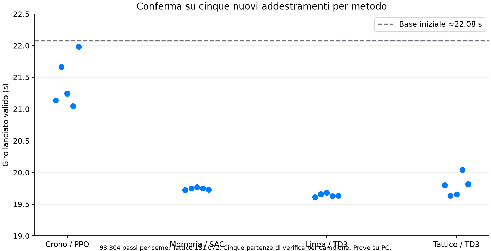

# Gioco rc.27 — imparare a migliorare il tempo valido

**21 ottobre 2026 · Europe/Rome.** Attuazione dello [studio sulle ricompense](game-racing-reward-objective-study.md). [Evidenze, sorgenti degli esperimenti e risultati per seme](evidence/v09-race-objective-implementation-2026-10-21/README.md).

**0.9.0-rc.27 installata e verificata sulla board**, manifest di 640 file. I modelli allenati nelle prove private non sono stati importati nei piloti di produzione.

**Aggiornamento successivo alla consegna:** [audit del menu e piano per tutti i piloti](game-pilots-completion-study.md). Riprodotta una regressione: il validatore non riconosce i nuovi campi dei profili rc.27. Il walkthrough usava la selezione diretta dei piloti e non copriva la conferma dal menu di una bozza modificata. I test riportati conservano il loro perimetro; questo difetto è successivamente risolto dalla [rc.28](v09-pilot-menu-fix-report.md), con prove del menu e della ripresa di tutti i learner. Lo studio originale non aveva installato una correzione.

## 1. Cosa cambia

Il premio conserva progresso valido, costo del tempo, fuori pista, contatti, ritiri e regole sportive. Il proxy di sottosterzo rimane una misura diagnostica ma **non applica più una penalità autonoma**: nelle sonde penalizzava un passaggio più veloce e pulito più del beneficio temporale. Un test fisico riproduce ora l'ordinamento corretto e conserva la penalizzazione dei fallimenti, compreso il gas forzato con aderenza ridotta. Non c'è un bonus permanente all'acceleratore.

La ricompensa è `direct-driving-3`, la ricetta di apprendimento `direct-driving-4`. Il protocollo del checkpoint rimane `direct-driving-3`: sono identificatori distinti, non tre versioni del medesimo campo. Le ricette vecchie continuano a essere interpretate secondo il loro obiettivo originale.

La scuola richiede due riuscite per ciascuna delle quattro competenze. Dopo il completamento, il passo prevale e rimane un ripasso ogni 16 episodi. Le soglie delle lezioni sono ancora prove di fondamenti: non certificano una staccata ottimale. Il riferimento offline eseguibile raggiunge circa **19,638 s** lanciati contro circa **22,081 s** della base, con cinque partenze nominali pulite e cinque con grip ridotto. È la migliore fra 27 alternative finite, non il limite globale della fisica; non sostituisce la rete in pista e non cambia gli asset iniziali installati.

## 2. I quattro metodi

| Pilota | Intervento selezionato |
| --- | --- |
| Crono / PPO | Esplorazione longitudinale lieve, coerente per episodio; distribuzione e probabilità condizionate corrette, ripresa esatta. |
| Memoria / SAC | Replay e doppio critic; breve preparazione dei critic, ancoraggio temporaneo del solo sterzo. Il pedale rimane libero. |
| Linea / TD3 | Stesse protezioni di sterzo, actor deterministico e doppio critic; esplorazione durante la raccolta. |
| Tattico / TD3 | Ricerca iniziale del passo, poi curriculum misto con sorpassi, difesa e griglie; controlli aggiuntivi del traffico. |

Gli esperti della rete hanno aggiornamenti e momenti Adam separati: le esperienze in solo aggiornano l'esperto in solo, quelle con rivali aggiornano esperto traffico e selettore. Questo evita che un gradiente piccolo modifichi comunque l'altro esperto tramite la normalizzazione o i momenti di Adam. Il selettore neurale resta allenabile; la separazione dei gradienti non costituisce una prova di conservazione del comportamento, perciò rimangono obbligatorie le verifiche fisiche.

L'ancoraggio SAC/TD3 agisce sullo sterzo per 32.768 decisioni e decade; non obbliga un pedale o una velocità durante l'inferenza. Tutti ripartono dal migliore dopo una regressione o due verifiche senza guadagno. Le esperienze compatibili vengono conservate. Fisica a 60 Hz, decisioni a 10 Hz, attuatore interamente neurale; CPU per questi learner, GPU per il rendering, nessun nuovo percorso NPU.

## 3. Risultati del confronto

Ogni confronto usa budget fisici fissati: **98.304 passi raccolti**, **131.072 per Tattico**. Le verifiche congelate vengono contabilizzate separatamente. Sono stati confrontati baseline rc.26, sola modifica del premio, curriculum/routing, ancoraggio e alternative di esplorazione. La selezione precede una conferma su cinque semi nuovi 41–45 per metodo. La sola rimozione della penalità non risolveva tutti gli stalli.

| Metodo | Passi per seme | Iniziale → campione | Semi con guadagno ≥3% | Serie pulite finali |
| --- | ---: | ---: | ---: | ---: |
| Crono / PPO | 98,304 | 22.081 → **21.245 s** | 3/5 | 25/25 |
| Memoria / SAC | 98,304 | 22.081 → **19.750 s** | 5/5 | 25/25 |
| Linea / TD3 | 98,304 | 22.081 → **19.630 s** | 5/5 | 25/25 |
| Tattico / TD3 | 131,072 | 22.078 → **19.798 s** | 5/5 | 25/25 |

PPO esteso: nuova ricetta **20,516 s**, baseline rc.26 **21,080 s** come mediane fra cinque semi. Nuova ricetta migliore nella coppia in **4/5** semi, peggiore nel seme 42 (21,370 contro 20,962 s). Il criterio del 3% rispetto alla propria base è raggiunto in 5/5 semi nuovi; non è un vantaggio del 3% sulla vecchia ricetta in 5/5 casi.

Il numero nella tabella è la mediana fra cinque addestramenti del tempo lanciato misurato su cinque partenze separate per ciascun campione. Ogni verifica percorre tre giri: il primo da fermo è escluso dal tempo lanciato. I semi di valutazione non sono addestramenti indipendenti; la base supervisionata iniziale è comune. Cinque basi preparate indipendentemente rimangono da confrontare.

Crono al budget iniziale supera il 3% in 3/5 semi nuovi, sotto il criterio proposto di 4/5. È stato perciò eseguito un confronto aggiuntivo **a 196.608 passi per entrambe le varianti PPO**, sugli stessi cinque semi, senza ritoccare la ricetta dai risultati parziali. Le righe estese non vanno confrontate con le altre come se avessero lo stesso budget. I file riportano ogni seme, compresi i casi meno favorevoli.

Il tempo reale degli esperimenti comprende carichi concorrenti diversi; non dimostra una nuova accelerazione in secondi sul dispositivo. Preparazione iniziale, raccolta/update, verifiche e valutazione finale sono distinti dove misurati; i primi esperimenti non hanno il contatore CPU, segnalato assente. La convergenza in ore sulla scheda resta da qualificare.

### Varianti respinte e correzioni trovate durante le prove

- Le prime partenze distribuite chiudevano erroneamente come fallito un circuito completo iniziato lontano dal traguardo. Corretto il contratto dei segmenti: distanza e cancelli ordinati, senza trasformare il giro iniziale parziale in un PB valido. Le campagne influenzate sono conservate e respinte.
- Partenze distribuite e ritorni multi-step non sono le impostazioni scelte. Il percorso multi-step ha test di terminale, truncation e ripresa, ma manca una campagna valida che ne dimostri il vantaggio. Anche l'orizzonte GAE maggiore non viene attivato.
- Le prove reali hanno mostrato che il contatore storico faceva saltare a Tattico la preparazione al passo dopo il reset dei critic. Il curriculum della nuova ricetta conta ora le decisioni dalla propria epoca; i totali storici restano invariati. Le prove precedenti della sua copia sono archiviate separatamente.
- Riparati un accesso al campione assente nel salvataggio di modalità legacy e due fixture: certificato dello snapshot gara distinto e uscita pista calcolata dalla larghezza reale di 12 m. La vecchia fixture del fuori pista falliva anche sulla rc.26, perché 4,6 m erano ancora dentro la carreggiata.

## 4. Migliore sul giro e versione gara

Ogni identità conserva due snapshot interni quando necessario, senza creare altri personaggi nel menu:

1. **Migliore sul giro:** promozione dopo tre serie pulite di tre giri, mediana dei due lanciati per serie. Guadagno richiesto maggiore di 50 ms e dello 0,15% rispetto al precedente.
2. **Pronto per la gara:** deve superare anche le prove pertinenti del traffico e due griglie congelate da cinque auto/tre giri. Tutti devono arrivare, senza incremento di contatti o limiti rispetto alla versione gara precedente.

Le verifiche di gara costose vengono programmate ogni quattro confronti, oppure prima per un guadagno superiore al 3%. Una verifica rinviata rimane esplicitamente **da verificare**. Un personale in solo può avanzare mentre la gara usa la precedente versione stabile. Qualifica, tempo in griglia e policy che correrà appartengono allo stesso snapshot.

La GUI distingue PB lanciato, fase, ultimo esito e stato gara; il dossier mostra i passi della nuova ricetta separati dai totali. “Tre serie, due lanciati ciascuna” sostituisce conteggi di prove e secondi ambigui. Conservati tema Apple Calm, scala 960×640, comandi e frequenza di pubblicazione delle scene.

Banca indipendente sui campioni delle quattro copie reali, con cinque semi mai usati prima: **40/40 serie pulite**, valutando separatamente migliore in solo e policy gara. Cinque griglie miste con Maestro e i quattro learner producono **25/25 arrivi**; contatti per griglia [1, 1, 2, 1, 0], limiti [1, 0, 0, 0, 6]. Arrivo non significa gara senza incidenti. Gli snapshot Tattico selezionati restano identici dopo la correzione dell'epoca: la banca è applicabile agli stessi pesi.

### Limite rilevante della gara

Nella banca indipendente le reti riconoscono rivali fino a 150 m e il selettore iniziale favorisce spesso l'esperto prudente del traffico. I giri in gara possono quindi restare molto più lenti dei PB in solo. **Un guadagno in qualifica non dimostra da solo sorpassi più efficaci o un passo di gara equivalente.** Le prove riportano selezione degli esperti, arrivi, contatti e limiti; non nascondono gli incidenti nella mediana dei soli tempi riusciti.

Un premio relativo nuovo, una selezione più locale del comportamento e una banca più ampia di rivali/stili richiedono un seguito controllato. Non sono stati attivati coefficienti tattici speculativi per far sembrare completato quel lavoro.

## 5. Continuità dei piloti

I quattro checkpoint reali sono stati esportati in sola lettura e provati su copie private. Identità, numeri, passi/tempo complessivi, storico e tutti gli artefatti originali vengono conservati. Non vengono importati i campioni migliori dei benchmark.

La migrazione mantiene esattamente l'esperto in solo del candidato corrente e consolida esperto traffico e selettore dal **campione stabile dello stesso pilota**. Nelle copie Crono/Memoria/Linea i candidati correnti aumentavano i contatti rispetto al loro campione: conservare indiscriminatamente ogni loro peso non conservava la competenza di gara. Entrambi gli originali rimangono disponibili nell'archivio e nel backup.

I momenti Adam del solo sono preservati, quelli del traffico/selettore ripartono. Critic e replay iniziano una nuova epoca perché i vecchi dati non consentono un ricalcolo completo delle ricompense; ricetta, verifiche e provenienza precedenti vengono archiviati. RNG e ripresa esatta sono verificati. Le qualifiche riferite a policy e fisica effettivamente invariate rimangono valide.

| Copia del pilota reale | Tempo iniziale → migliore finale | Passi raccolti nella prova |
| --- | ---: | ---: |
| Crono | 22.081 → 21.456 s | 98,304 |
| Memoria | 22.081 → 19.631 s | 98,304 |
| Linea | 22.081 → 19.669 s | 98,304 |
| Tattico | 22.078 → 22.078 s | 131,072 |

**La copia reale di Tattico non migliora in questo budget**, anche dopo la correzione del contatore di fase. La versione valida rimane conservata: i cinque nuovi addestramenti riusciti non dimostrano che ogni vecchio checkpoint riparta altrettanto bene. Questo caso resta prioritario nel seguito, insieme alla competizione nel traffico.

## 6. Verifica e consegna

Le prove finali PC passano **101 casi** (91 sul nucleo/ricompense/fisica/tempi/sorpassi e 10 sulle modalità). Il riferimento autograd Torch è incluso. Tre oggetti Qt non raccolti al teardown producono un ResourceWarning; non è un warning QML né una dimostrazione di assenza di leak.

Sulla board passano **39 casi ARM più tre verifiche mirate** del delta finale dell'epoca (una nuova e due ripetute). Main/Worker reali su EGLFS nei tre temi a 960×640/textScale 1,1, senza warning QML, quattro learner e cinque auto sempre presenti. Apple completa Qualifica dalla GUI e Gara da tre giri con cinque arrivi. Il walkthrough precede il solo delta finale del contatore di curriculum: il supplemento ARM copre quel delta e la migrazione; GUI, inferenza, fisica e premio sono identici. La parità dei nuovi avvii sul sorgente finale è verificata per quattro metodi, learner/world esatti su 4.000 tick e confini del curriculum. Non è una replica integrale di ogni campagna.

Il primo tentativo di consegna viene fermato **prima dello scambio** da un controllo troppo ampio sull'indice `driving_contexts`. Il confronto mostra quattro riferimenti aggiornati e otto eventi attesi (migrazione + checkpoint), con originali intatti; corretto il controllo semantico, il tentativo è conservato nelle evidenze.

**Installata rc.27: 640 hash conformi, Dashboard attiva, heartbeat GUI fresco con il PID corrente e NRestarts=0.** Apple Calm 1.6.3 e preferenze conservati; cinque identità, totali, storico e artefatti originali integri. Backup completo esterno di 99 file e rollback del runtime precedente. I quattro piloti avviano una nuova epoca dei critic/replay, mantenendo la propria esperienza secondo la migrazione descritta; nessun allenamento lanciato automaticamente. Solo riavvio del servizio, boot ID invariato.

[Ricevuta finale](evidence/v09-race-objective-implementation-2026-10-21/board/final-receipt.json) · [manifest ARM](evidence/v09-race-objective-implementation-2026-10-21/board/installed-manifest.json) · [delta sorgenti](evidence/v09-race-objective-implementation-2026-10-21/source-delta.json). Il MasterPlan è aggiornato alla revisione 3.04. Le misure frameSwapped restano campioni software, non una qualifica degli FPS ottici.

## 7. Stato del piano R0–R7 e seguito

| Passo | Stato acquisito e limite |
| --- | --- |
| R0 | Ordinamento premio e fallimenti coperti da prove fisiche; gate di settore/limiti preservati. Non è una dimostrazione contro ogni possibile abuso. |
| R1 | Riferimento fisico eseguito nominale/grip ridotto; ricerca finita, nessun ottimo globale dichiarato. |
| R2 | Ablation e confronti con cinque semi; conferma separata e budget PPO esteso. |
| R3 | Scuola con completamento, ripasso, routing Adam e ancoraggio selezionati; qualità ottimale delle competenze aperta. |
| R4 | Audit numerico/autograd, probabilità, bootstrap e ripresa; multi-step/GAE alternativo provati ma non selezionati. |
| R5 | Snapshot giro/gara, certificati e visibilità integrati; premio relativo nuovo e superiorità tattica generale aperti. |
| R6 | Più gruppi da cinque semi, checkpoint reali, banca finale separata e prove ARM. Preparazioni indipendenti, altri circuiti/fondi/auto e uso prolungato aperti. |
| R7 | Migrazione versionata, backup e ricevuta della consegna; nessun reset totale dei piloti. |

Prossimo lavoro prioritario: passo e competizione nel traffico misurati separatamente, senza compromettere il guadagno in solo; poi generalizzazione. Questa consegna non certifica guida al limite, miglioramento a ogni giro o 30 FPS ottici fissi. Acquario v0.10, Compagno v0.11, Memoria/AI v0.12 e Stabilità v1.1 mantengono l'ordine approvato.
