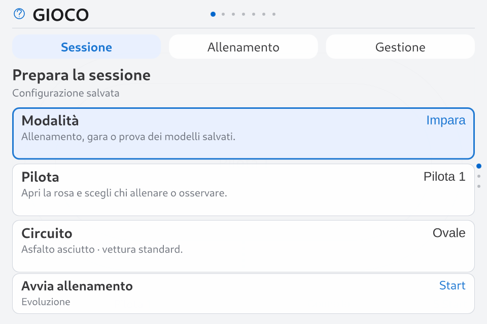

# Gioco — impostazioni, percorsi e Circuito Tecnico

11 ottobre 2026 · **0.9.0-rc.7 implementata, consegna in verifica** · Theme API 2.10 / 68 superfici / Apple Calm 1.6.2.

Implementazione autorizzata dopo lo [studio GUI/UX e circuiti](game-settings-circuits-ux-study.md). Le immagini di questo report provengono dal runtime; le quattro tavole dello studio restano concept storici. [Evidenze, script e ricevute](evidence/v09-settings-circuits-2026-10-11/).

## 1. Risultato per l'utente

- **Sessione:** modalità, pilota o schieramento, circuito e giri; Start rimane separato dalle regolazioni.
- **Allenamento:** metodo, guida solitaria/avversario fisso e parametri avanzati, divisi in Rete, Apprendimento e Riproducibilità. Ogni valore ha una spiegazione breve e le unità pertinenti; NEAT mostra topologia variabile, PPO distingue copie ambiente da auto visibile.
- **Gestione:** nuovo pilota, dossier, reset del percorso attivo e trasferimento dei pesi da un altro circuito. Il reset nomina pilota e pista e conserva lo storico.
- **Ovale e Circuito Tecnico:** pista asfaltata asciutta, vettura standard, percorsi di apprendimento e classifiche distinti. La pista tecnica aggiunge curve nei due sensi e una S larga.

Le modifiche sono una bozza. 2/8 sceglie la riga, 4/6 la sezione; 5 apre un valore, 4/6 lo regola e 5 lo conferma in bozza. Applica/Start conferma la sessione; 7 annulla il valore o torna al livello precedente, e offre di scartare la bozza quando necessario. Nessuna legenda permanente nel menu; Comandi descrive il livello attuale. Selezione per ID e ritorni coerenti anche dopo Nuovo pilota o cambi di metodo.

Durante la simulazione le frecce restano acquisite per auto/visualizzazione. 5 richiede pausa e salvataggio prima del ritorno alla navigazione. Aprire le viste, riavviare il servizio o avviare la board non avvia un allenamento.

## 2. Geometria e simulazione

`technical-1`, revisione 1, è contenuto immutabile nel catalogo: 384 segmenti, lunghezza della polilinea **272,052 m**, carreggiata **10 m**, auto **4,4×1,8 m**. La stima curva del concept era 272,065 m: il runtime misura il contenuto realmente usato. Scala uniforme e bordi identici tra disegno, raggi, contatti e cancelli; nessuna pista approssimata indipendentemente in QML. Il vecchio ovale conserva il kernel analitico e la serializzazione della configurazione.

`TrackRuntime` valida segmenti degeneri, incroci, tangenze e annidamento dei bordi. La proiezione usa continuità topologica e un indice spaziale; il progresso viene limitato al movimento plausibile. I quattro cancelli richiedono attraversamento, ordine e direzione. Raggi con selezione spaziale confrontati con tutte le intersezioni su 1.280 raggi casuali: stesso risultato entro 10⁻¹² m. Contatti con bordi mediante sagoma e inviluppo tra pose; la rotazione rimane discretizzata nei sottopassi adattivi, non è una prova analitica del movimento rotatorio continuo.

Qt Quick Shapes prepara i bordi statici; la cache dei percorsi QML viene aggiornata solo al cambio circuito/revisione/dimensioni, senza riformattarli nelle notifiche delle auto; le auto mantengono il renderer esistente e le proporzioni metriche. È presente la linea di partenza. Il controller diagnostico completa il circuito; questa prova riguarda la geometria, non l'apprendimento.

La griglia tecnica usa posizioni sfalsate ogni 4 m, alternate sui due lati. La griglia affiancata precedente aveva prodotto contatti iniziali e quattro ritiri nelle prove: [caso conservato](evidence/v09-settings-circuits-2026-10-11/pc/race-four-physics.json), [confronto griglie](evidence/v09-settings-circuits-2026-10-11/pc/race-grid-study.json). Regole tecniche `race-3` e griglia `staggered-4m-v1` congelate a Start; l'ovale conserva `race-2` e la sua griglia. Nessun controller sostituisce le reti dei piloti.

## 3. Piloti e conservazione dei percorsi

Archivio SQLite versione 2, migrazione additiva e rifiuto di versioni future sconosciute prima della migrazione. La tabella originale dei piloti resta l'ovale; percorsi per circuito e archivi per configurazione strutturale conservano checkpoint, modelli, curriculum e contatori. Tornare allo stesso metodo/rete/popolazione/seme/scenario riprende il percorso precedente. Parametri non strutturali aggiornano il percorso corrente.

Cambiare pista non cancella l'ovale. Il dossier distingue tempo/passi del percorso attivo e totale storico, etichetta circuito e provenienza degli eventi, conserva i parametri delle sessioni e i risultati dei modelli precedenti. Il reset agisce sul solo percorso selezionato, preservando identità, altri circuiti e configurazioni archiviate.

Il trasferimento copia soltanto pesi densi compatibili, su un percorso vuoto con stesso metodo e dimensione della rete. RNG, optimizer, curriculum, contatori e checkpoint sono propri del nuovo percorso. Evoluzione inizializza anche parte della popolazione; PPO inizializza l'attore. La topologia NEAT richiede uno studio specifico: il trasferimento incompatibile viene rifiutato con un motivo esplicito.

Sul circuito tecnico la **Gara richiede la prova del modello salvato per l'esatto ambito del circuito**, con almeno 9/10 completamenti. Verifica di ambito e hash anche nel worker. Prova/Guida modello consentono l'esame dei modelli ancora da qualificare. L'eleggibilità storica dell'ovale è preservata. Trasferire pesi non attribuisce il badge Verificato sulla pista nuova.

## 4. PPO e ricompensa

Corretto il difetto del bonus di passo: ora usa il tempo dell'episodio della singola copia; un reset parziale non eredita il tempo degli episodi precedenti. Snapshot/ripresa conservano i tempi e rifiutano dati non finiti o incompatibili.

PPO distingue termine fisico e limite di durata. Il timeout mantiene il bootstrap del valore successivo, ma interrompe la propagazione GAE verso l'episodio resettato. La ricompensa passa a `control-pace-2`; migrazione del vecchio checkpoint conserva attore, RNG, campione e storico, scarta rollout/aggiornamento pendenti e ricrea critico/optimizer. I checkpoint originali restano artefatti immutabili. Test dedicati verificano episodi equivalenti, reset parziali, terminali e timeout.

Evoluzione/NEAT/PPO sono reti locali create dai piloti; fisica, training e inferenza di questa candidata girano sulla CPU. La scelta NPU precedente rimane documentata: nessuna nuova accelerazione NPU è dichiarata.

## 5. Verifica dell'apprendimento

Cinque semi per gruppo, Evoluzione 32 candidati e rete densa da 16 neuroni. Gruppo da zero contro inizializzazione dai campioni ovali corrispondenti. Promozioni su dieci scenari abbinati, verifica finale su dieci partenze indipendenti per seme e nuova prova dell'ovale.

Il confronto principale usa **6.400.000 passi per ciascuna esecuzione**: unità dichiarata popolazione × chiamate a `World.step`, comprese le posizioni ritirate. Il tempo reale è registrato; le esecuzioni sono concorrenti, quindi non rappresenta una misura isolata della velocità di calcolo. Il confronto esplorativo a 60 generazioni è conservato separatamente e ha budget di passi diversi: non viene usato per affermare un vantaggio a parità di budget.

**Risultato principale:** inizializzazione dall'ovale **50/50** completamenti finali sulla pista tecnica, da zero **39/50**; cinque contro quattro semi con un campione promosso. [Riepilogo e risultati individuali](evidence/v09-settings-circuits-2026-10-11/learning-comparison.json).

| Seme | Da zero: validi / mediana | Trasferimento: validi / mediana | Prima qualifica: passi da zero / trasferimento |
| --- | --- | --- | --- |
| 1 | 0/10 · — | 10/10 · 21,22 s | non raggiunta / 1.172.032 |
| 2 | 10/10 · 25,54 s | 10/10 · 22,62 s | 2.419.200 / 1.267.200 |
| 3 | 10/10 · 25,86 s | 10/10 · 24,27 s | 4.723.200 / 609.536 |
| 4 | 9/10 · 32,92 s | 10/10 · 25,45 s | 4.147.200 / 5.803.360 |
| 5 | 10/10 · 23,10 s | 10/10 · 33,47 s | 2.419.200 / 6.161.120 |

Il trasferimento anticipa la prima qualifica in tre coppie, la ritarda in due e rende più lento il tempo finale del seme 5. Non è quindi un vantaggio uniforme. Riutilizzare i **nuovi** pesi tecnici sull'ovale dà 30/50 completamenti nel gruppo trasferito: due reti perdono tutti i dieci giri. Le copie originali dell'ovale rimangono intatte; non si richiede a una sola rete di conservare capacità universali. Il gruppo da zero dà 39/50 sull'ovale; anche questo non sostituisce la sua qualifica per circuito.

 I file [matched](evidence/v09-settings-circuits-2026-10-11/matched/) conservano politiche, parametri, promozioni, tempi e risultati individuali. Nessun bot nelle azioni dei learner. Il confronto è limitato ad asfalto asciutto/vettura standard e perturbazioni di partenza; non prova generalizzazione a gomme, meteo o circuiti futuri.

I cinque campioni ovali congelati, rieseguiti con il nuovo codice senza training, conservano **49/50 completamenti**: [ritenzione ovale](evidence/v09-settings-circuits-2026-10-11/pc/oval-retention.json). I loro archivi originali non sono modificati dagli esperimenti.

## 6. GUI, gare, carico e installazione

PC: kernel/persistenza/curriculum e contratto API; walkthrough dei tre temi, giorno/notte, testo 1/1,1, bozza senza scritture, focus, percorsi, reset, PPO con una sola auto visibile e NEAT. Schema/circuito/hash qualificano la rosa tecnica; vecchio contratto 2.9 compatibile con il nuovo 2.10. Kit aggiornato, sempre 68 superfici. Verifiche e log [PC](evidence/v09-settings-circuits-2026-10-11/pc/).

Board: tre temi su EGLFS/KMS **960×640**, scala testo 1,1, nessun warning QML; pause iniziali circa **117–121 ms**. Gara a due di tre giri e griglia a quattro verificate; [prove native](evidence/v09-settings-circuits-2026-10-11/board-native/qualification.json). Sessione PPO di **30 minuti completata**, 1.705.280 passi salvati, una sola auto visibile, nessun warning QML, pausa in **174 ms**, worker fino a **71,9 MiB**, massimo GUI **218,6 MiB**, temperatura più alta letta **64,48 °C**. [Riepilogo](evidence/v09-settings-circuits-2026-10-11/board-native/soak-summary.json). Timing `frameSwapped`: 66.632 frame, intervallo mediano 18,68 ms, p95 64,73 ms, massimo 419,85 ms: la fluidità non è ancora qualificata a 60 FPS. Le ultime modifiche a rosa/griglia e cache dei tracciati sono verificate separatamente nella prova nativa finale; il soak riguarda il training PPO standard e non tutte le combinazioni. Il collegamento SSH si è chiuso prima della scrittura del riepilogo del runner: rapporti individuali passati recuperati dalla scheda e servizio ripristinato, con provenienza esplicita nel riepilogo esteso.

Benchmark diagnostico concorrente alla prova GUI: un passo completo con osservazioni, controller e fisica ha mediana 1,90 ms per 32 copie sull'ovale, 2,64/3,69/17,24 ms per 1/4/32 copie sulla pista tecnica. Il controller non è il learner e il carico include un'altra attività: sono misure di costo dichiarate, non FPS. Il renderer PPO mostra una singola guida mentre il worker allena le copie. Popolazioni e reti più grandi restano da qualificare; avere RAM disponibile non garantisce maggiore velocità.

**Installazione e reboot: in verifica.** Il pacchetto, backup/rollback e ricevuta saranno registrati solo dopo installazione, preservazione degli archivi e GUI pronta. La verifica preliminare su una copia dell'archivio reale conserva quattro piloti e 349 artefatti, con tutte le colonne e gli hash invariati.

## 7. Residui e prossimi passi

Implementati A impostazioni, B geometria/ambiti e C circuito tecnico. La qualifica di prodotto resta parziale: robustezza su cinque semi e nuovi scenari, competenza PPO/NEAT, guida nel traffico, profili ampliati, lettura del pannello e keypad fisico. Un giro di un campione o del bot non chiude questi gate; timing `frameSwapped` non dimostra 60 FPS ottici.

Altri circuiti, vetture, gomme e fondi useranno cataloghi/ambiti versionati; non sono contenuti già selezionabili. Generatore, sterrato, bagnato avanzato e campionati restano sviluppi successivi. Compagno v0.10 e Memoria v0.11 conservano la sequenza del MasterPlan.
